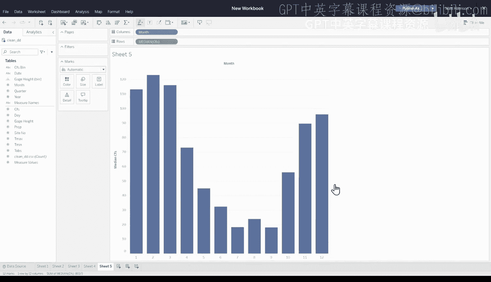

# 数据可视化：04：使用Tableau创建条形图 📊

在本节课程中，我们将学习如何使用Tableau软件创建一个条形图。我们将以“每月立方英尺/秒的中位数”数据为例，演示从数据导入到图表生成的全过程。

---

## 创建新工作表

首先，我们需要在Tableau中创建一个新的工作表来放置我们的图表。

---

## 设置图表轴

接下来，我们将配置图表的横轴与纵轴。

以下是具体操作步骤：

1.  将“月份”字段拖拽到“列”功能区。
2.  右键点击该字段，在弹出的菜单中选择“离散”，将其设置为分类数据而非连续数据。
3.  将“立方英尺/秒”字段拖拽到“行”功能区。

此时，图表默认对数值进行求和。

---

## 调整数值聚合方式

默认的求和方式不符合我们的需求，我们需要将其改为计算中位数。

操作方法是：点击“行”功能区上的数值字段，在下拉菜单的“度量”选项中选择“中位数”。

完成此步骤后，一个清晰的月度数据中位数条形图就生成了。

---

## 总结

本节课我们一起学习了在Tableau中创建条形图的基本流程。我们首先创建了新工作表，然后通过拖拽字段设置了图表的横纵轴，最后将数值的聚合方式从“求和”调整为“中位数”，从而得到了目标图表。