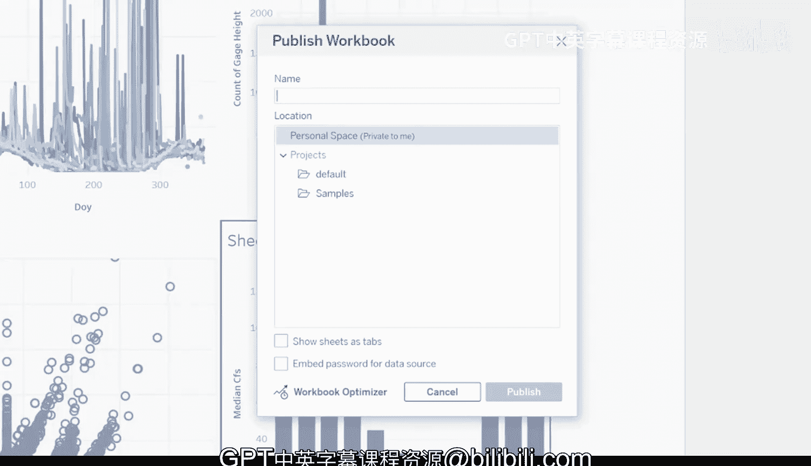

# 杜克大学《应用Python数据工程（3课全）｜Applied Python Data Engineering》中英字幕 p152 53_04_07_在Tableau中创建图表仪表板.zh_en -BV1nz421i7KP_p152-

In this example， we're going to show how to take the plots that we've made in Tableau and throw them into a dashboard At the bottom here。

 we've got a dashboard button。Click on that dashboard and then we're going to take our sheets and we're going to drag them over here。

Alternatively， you can right click on these and say add to dashboard。

We can go in here and change these titles if we want to。Yeah。

And clean these up if we want to at this point， all we have to do is come up here and say publish in the upper right and we can share this with our colleagues。

