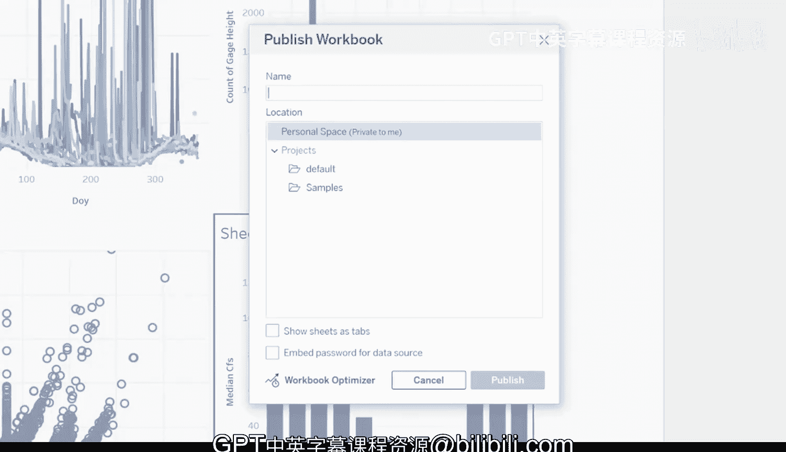

# 应用Python数据工程：3.4.7：在Tableau中创建图表仪表板 📊

在本节课程中，我们将学习如何将Tableau中创建好的图表整合到一个统一的仪表板中，并完成发布与分享。

上一节我们介绍了如何在Tableau中制作独立的图表。本节中我们来看看如何将这些图表组合成一个功能完整的仪表板。

---

在Tableau工作区的底部，可以找到一个名为“仪表板”的按钮。点击此按钮，即可进入仪表板创建界面。

以下是创建仪表板的核心步骤：

1.  **添加工作表**：将左侧“工作表”区域中已创建好的图表直接拖拽至右侧的仪表板画布上。或者，也可以右键点击工作表名称，然后选择“添加到仪表板”。
2.  **调整布局**：在仪表板画布上，可以自由调整各图表组件的位置和大小，以优化布局。
3.  **编辑标题**：如果需要，可以点击图表标题进行编辑，使其含义更清晰。
4.  **整体优化**：在此阶段，可以对仪表板进行最后的清理和美化，确保其简洁直观。

---

完成仪表板的设计与调整后，最后一步是进行发布。

只需点击界面右上角的“发布”按钮，即可将制作好的仪表板分享给你的同事或团队成员。

---

本节课中我们一起学习了Tableau仪表板的创建流程：从添加图表组件、调整布局，到最终发布分享。掌握这些步骤，你就能将多个数据分析视图整合成一个有力的沟通工具。