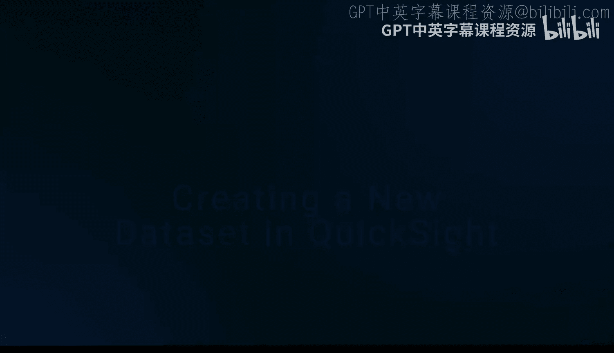
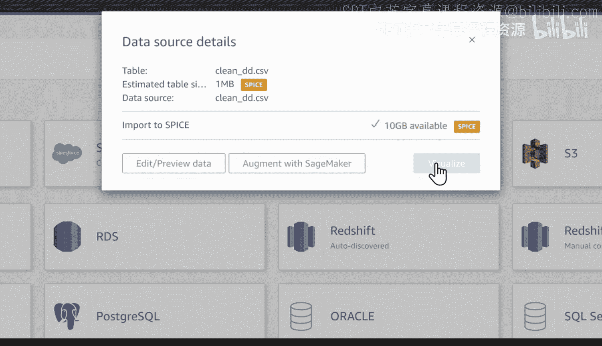
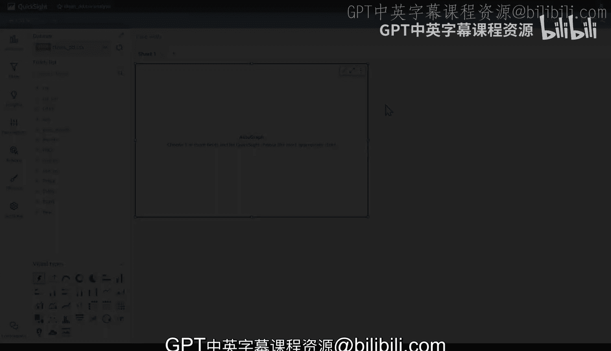

# 杜克大学《应用Python数据工程（3课全）｜Applied Python Data Engineering》中英字幕 p155 56_04_03_在QuickSight中创建新数据集.zh_en -BV1nz421i7KP_p155-

Once you've logged into AWS， you can enable Quicks at that point you can go to your home folder what we're going to do here is we're going to click on a new data set here。

 so come over here to data and we're going to say new data set。

We're going to upload our data set in this case， it is a file。And it looks like it's okay。

 Let's click on。Visualize here。

Okay， and it looks like it has sucked in our datum。

