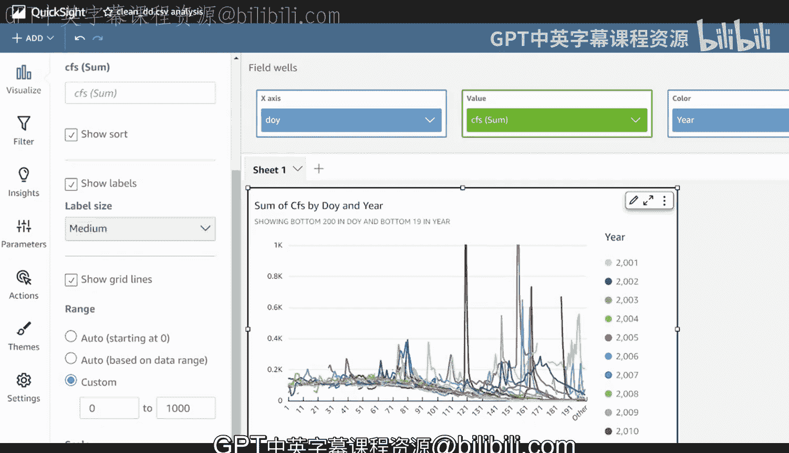

# 杜克大学《应用Python数据工程（3课全）｜Applied Python Data Engineering》中英字幕 p156 57_04_04_使用QuickSight创建折线图.zh_en -BV1nz421i7KP_p156-

In this session， we're going to look at making a line plot in Quicksight。

 We're going to use the dirty devil data to plot cubic feet per second per year。Okay。

 so right now there's this little autograph here。 I'm just going to delete this。

 What I want to do is come up here to add， and I'm going to say add a visual。

 the visual type that I want is a line chart。 So this this one right here。

 once you've clicked on that， you can see that we have an X axis a value and a color。

 So on the X axis， we want the day of the year。 I're going to drag that over there。Into the value。

 we want the cubic feet per second。And in the color， we want year。Okay， this is looking okay。

 However， if you look at the X axis。It is not great。

 So the order of the X axis is a little messed up。 Let's click over here on D O Y and let's say sort by D O Y。

 Let's see if that fixes it。There we go。 That's looking a little bit better。 However。

 we can still see that it looks like we've got outliers。 So that's blowing out our scale。

 So we're going to click on the pencil。 We're going to click on Y access。And down here。

 you can see that there's a range。 we'll click on custom range。I'm going click on0。

 and we'll click on。1000 here。Okay， there is our summary of cubic feet per second for each day for each year。

