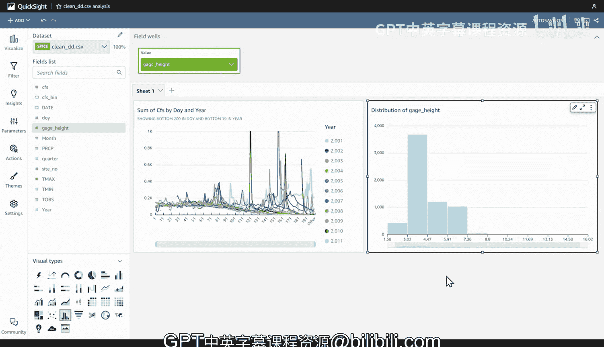

# 杜克大学《应用Python数据工程（3课全）｜Applied Python Data Engineering》中英字幕 p157 58_04_05_使用QuickSight创建直方图.zh_en -BV1nz421i7KP_p157-

In this section， we're going to show how to make a histogram using Amazon Quicksite。

 We've got our sheet right here。 Let's come up here to add and say add visual。

 And the visual that we want is a histogram。We just need to select our value that we want in it。

 that's gauge height。And there's our summary of the gauge height。

