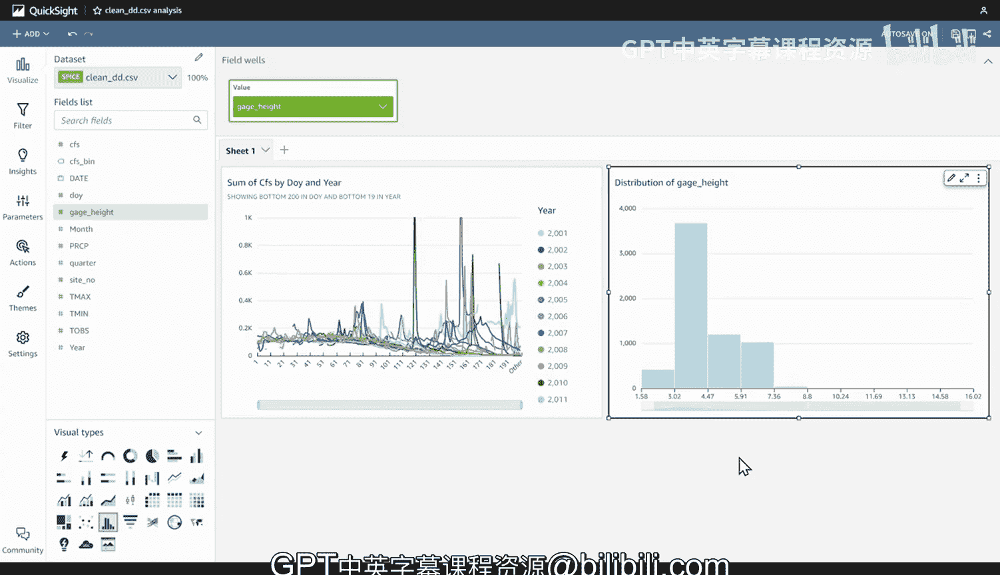

# 数据可视化：第4章：使用QuickSight创建直方图 📊

在本节中，我们将学习如何使用Amazon QuickSight服务来创建一个直方图。直方图是一种用于展示数据分布情况的图表，特别适合观察连续变量的频率分布。

上一节我们介绍了QuickSight的基本界面，本节中我们来看看如何具体创建一个直方图可视化。

## 创建直方图步骤

以下是创建直方图的具体操作步骤。

1.  首先，我们已打开目标工作表。在界面顶部找到并点击“添加”按钮，然后选择“添加视觉对象”选项。
2.  在弹出的视觉对象类型中，我们需要选择“直方图”。
3.  接下来，只需选择我们希望在直方图中分析的数值字段，这里我们选择“测量高度”。
4.  完成选择后，系统会自动生成并展示“测量高度”字段的数据分布摘要，即直方图。

本节课中我们一起学习了在Amazon QuickSight中创建直方图的完整流程。从添加视觉对象到选择图表类型，再到指定分析字段，最终我们成功生成了展示“测量高度”分布的直方图。掌握这一技能有助于你快速洞察数据的分布特征。