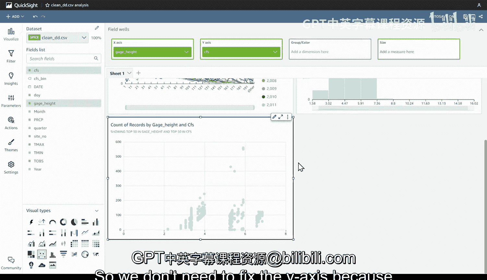

# 杜克大学《应用Python数据工程（3课全）｜Applied Python Data Engineering》中英字幕 p158 59_04_06_使用QuickSight创建散点图.zh_en -BV1nz421i7KP_p158-

In this example， we're going to make a scatter plot using Amazon Quicksite。

 The scatter plot that we want to do is the cubic feet per second versus the gauge height。

 come up here to add， say add visual。The visual is a scatter plot into the X axis。

 We're going to drag gauge height。Into the Y axis， we're going to drag cubic feet per second。

Okay there we go， you can see that this is already filtering this a little bit。

 it says it's only showing the top 50 in cubic feet per second and gauge height。

 so we don't need to fix the Y axis because this is already doing some filtering。

