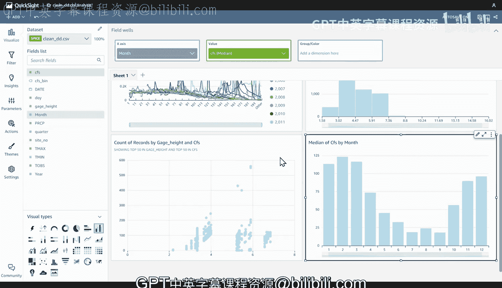

# 杜克大学《应用Python数据工程（3课全）｜Applied Python Data Engineering》中英字幕 p159 60_04_07_使用QuickSight创建条形图.zh_en -BV1nz421i7KP_p159-

In this example， I'm going to show how to make a bar plot in Amazon Quicksite。

Click on add if we're going to add a visual。The visual that we want to add is a bar plot。

Along the X axis， we want month because we want to summarize the median cubic feet per second per month。

 so when you see per generally you want that along the X axis。Let's put month down there。 Okay。

 the value is going to be cubic feet per second。That's looking relatively good。

 Let's come up here and click on this and say aggregate。And we want to say， median。

Also note that the order there， this is in descending order by the values。

 so click over here on month and we'll say month to sort by month。

