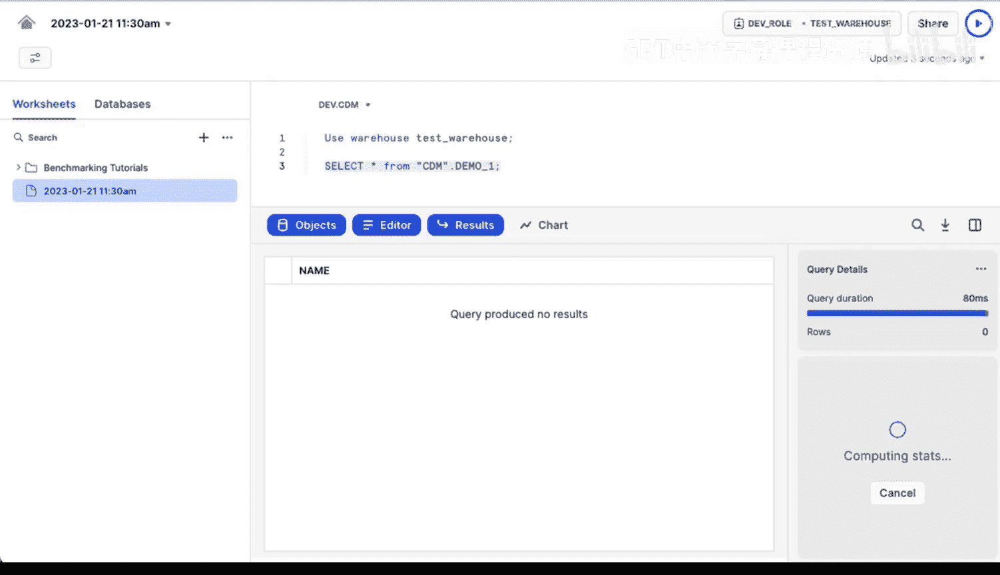

# 杜克大学《应用Python数据工程（3课全）｜Applied Python Data Engineering》中英字幕 p16 16_02_05_Snowflake仓库.zh_en -BV1nz421i7KP_p16-

Now， when we go back to our worksheets， here we've created a new notebook。

To run any sequel in a notebook， you need to be associated with the warehouse that will run this。Now。

 if we click here， we could normally set that， but we noticed that R Devil doesn't have access to any warehouses。

So similar to what we did with the database and schema privileges。

 we need to give this role privileges to run a warehouse。Under the admin section。We find warehouses。

These are the two warehouses we have。We click on the warehouse。We can see the warehouse activity。

Details。At last， the privileges。So let's grant our devil privileges to use this warehouse。Now。

 the privilege to modify warehouses。It may commonly be restricted because it's creating larger warehouses that become very expensive if their resources aren't properly used。

So now if we go back to our deferral。Go to our worksheet。And we look under warehouses。

 we can see that that test warehouse is now available。

And we can select the warehouse in this interface。And we will use that warehouse for any。

Snowflakes SQel we run in this workbook。We could also。

Use SQL to set the warehouse at the beginning of the notebook so they won't have to select it in the interface。

Also known as at the top of the notebook， we can select the database we wish to run queries against。

This case， we'll run them against the sample data。Oh， you know it， we'll run them against the div。

And use the CDM schema。This means。ThatIn our queries。

 we don't need to specify the database or schema we can explicitly。Specify the database and schema。

 especially if you want to run queries across databases。This is a convenience。For remote usage。

So now this。Roll。Now this role privileges to use the test warehouse to run SQL statements in the dev。

Daabase and CDM schema。So we can run a。Select there's no data in this table so we expect。

The queo returnedturned。Zero results。

But the access is granted。

