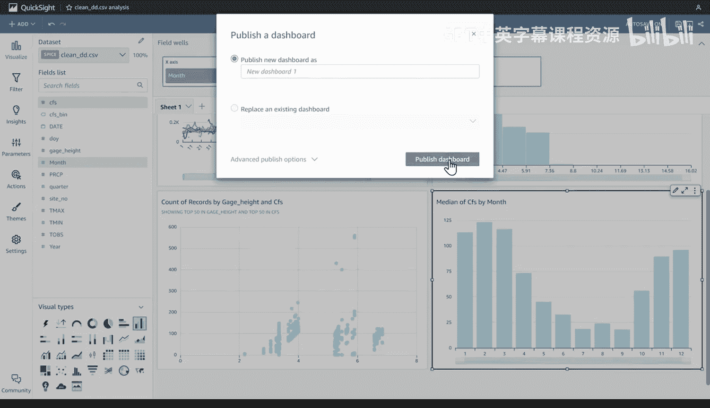

# 杜克大学《应用Python数据工程（3课全）｜Applied Python Data Engineering》中英字幕 p160 61_04_08_通过QuickSight共享图表.zh_en -BV1nz421i7KP_p160-

In this example， I'm going to show how to share your dashboard with others using Amazon Quicksite。

Once you've created what you want to share， you can come up here in the upper right hand corner and click share。

 you just click publish your dashboard， you can give it a name。

 and then you can click publish your dashboard。

One of the nice things about these business tools like Tableau and Amazon is that you can easily share these results with others。

