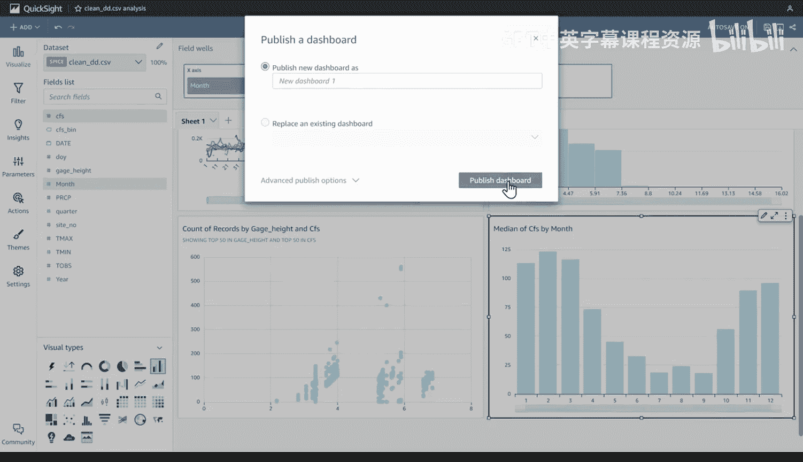

# 应用Python数据工程：3：通过QuickSight共享图表 📊

在本节课中，我们将学习如何使用Amazon QuickSight将创建的数据仪表板分享给其他人。这是一个将数据分析结果便捷地传达给团队或利益相关者的关键步骤。

上一节我们介绍了如何在QuickSight中创建和定制图表，本节中我们来看看如何将这些成果发布并共享。

## 发布仪表板

当你完成了想要分享的仪表板设计后，可以按照以下步骤进行发布。

以下是发布仪表板的具体操作步骤：

1.  在仪表板界面的右上角，找到并点击“分享”按钮。
2.  在弹出的选项中，点击“发布仪表板”。
3.  系统会提示你为此次发布版本命名，输入一个描述性的名称。
4.  最后，点击“发布仪表板”按钮以完成发布。

## 共享的优势

像Tableau和Amazon QuickSight这类商业智能工具的一大优点，就是能够轻松地将分析结果与他人共享。

这简化了协作流程，确保了所有相关人员都能基于同一份准确、可视化的数据进行决策。

本节课中我们一起学习了如何通过Amazon QuickSight发布和共享数据仪表板。你掌握了从找到分享按钮到完成发布的完整流程，并了解了这种共享方式在团队协作中的重要性。