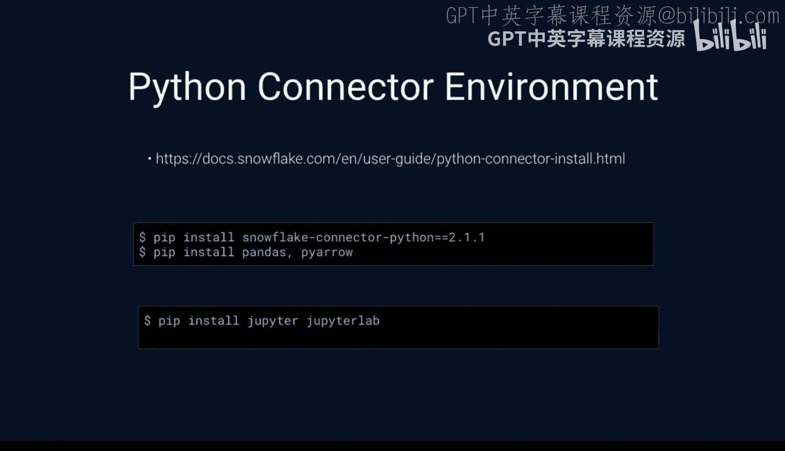
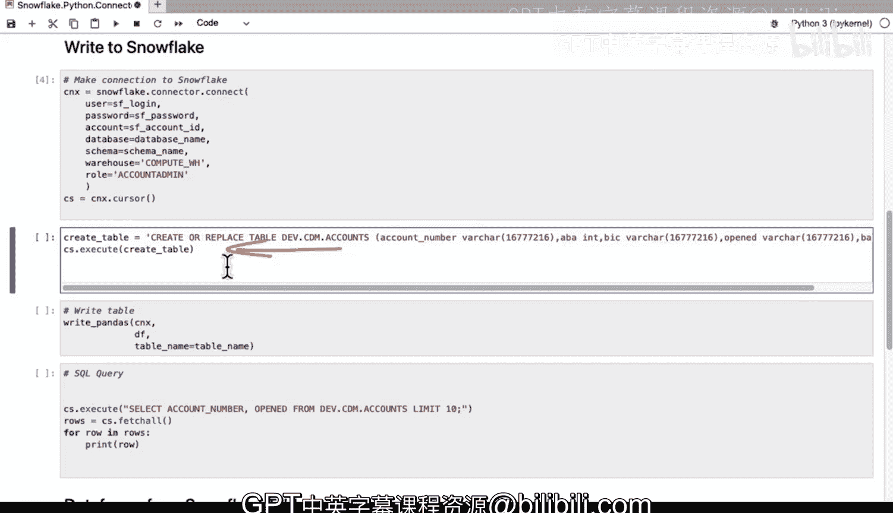

# 杜克大学《应用Python数据工程（3课全）｜Applied Python Data Engineering》中英字幕 p17 17_02_01_写入Snowflake.zh_en -BV1nz421i7KP_p17-

The Python connector is a Python package。Which you can use to run snowflake sequel。

With data frames that work with Snowflake's equal。You can use it to pull and push or manipulate data and stuff like。

话。To set up the connector environment。You should check the snowflake documentation on setting up for your particular version of Python and environment。

In my case。I just needed to piip install the snowflake connector version 2。11。

I also used panndadas and Pi arrow。In my case， because I wanted to work in a Jupiter notebook。

 I also installed Jupiter and Jupiter Lab。

Here I have a Jupiter notebook。Where I've set up some example code。

 You can run this code outside of a notebook book in a normal Python file or in an interactive Python shell。

First。Here I import the necessary packages。I'm importing O S， which is。

The operating system module that comes with Python。A snowfullyake connector。

And also from the snowflake connector， panda's tools， the right pandas method。In addition。

I'm importing panda's aliaest as PD， as is the convention。Now here I'm setting up some。

Varis that have like snowflake， password and login。

 as well as the database that we're going to be using and the schema and a table I'm going to be interacting with。

First。Let's read some data from a CSV file using pannda's Read CSV and then take a look at it。

So we can see。We have a table of accounts that has account numbers and some other values included a balance at a time it was opened。

So in order to interact with snowflake。First， we need to make a connection。

 We use the snowflake connector to connect。Here we're passing in。

The variables we set up that have the values we're going to use。

 we're also specifying the role and the warehouse we're going to use。Once we make this connection。

 we also make a cursor to run Snowflake SQL。Now， to create a table in snowflake。

We're going to run the SequL command。Where we create a new table named Dev accountss。

And we specify the columns and column types。Here we use the cursor to execute the SQL code。

