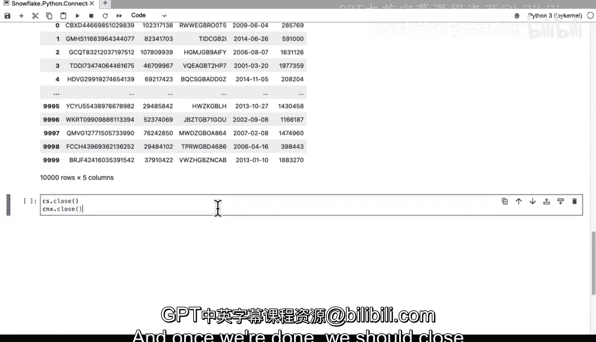

# 杜克大学《应用Python数据工程（3课全）｜Applied Python Data Engineering》中英字幕 p18 18_02_02_从Snowflake读取.zh_en -BV1nz421i7KP_p18-

Now， once we have a table existing in Sflake。We can write data to it， using the right pandas command。

So here we have the right pandaace command。We have our connection。

 we have the data frame that we loaded from the CSB file and the name of the table we want to load to。

So。Now， we've floated it into snowflake。If we take a look in this Snowfo console。In our dev database。

CDM schema。We can see now we have a table named accountss。

Table has the columns we specified in our individual SQs statement。We can preview the data。

And see that we've loaded it with data， this is the data that originated in our CSV file。Now。

We were to use the cursor to execute。A sequel statement which created the table。

 We could execute any other snowflake sequel statement using this cursor。 So here。Were。

Writing a SQL statement which selects the account number and the opened columns from the accounts table that we just created we're limited to 10。

We then fetch all of the results。And then print each one。And there's the output。

 so you can interact with tables in a snowflake this way。

 writing SQL statements and then executing them with the cursor， or as we saw before。

 using the right pandas method to directly bring in data from a panda's data frame。

Now another thing we can do is run a SQL statement that will select the data from a table in snowflake。

And then。With our cursor， we can use the Fe pandas all method。

 which will actually return a data frame。So here we've returned a data frame based on the data that's in snowflake。

And once we're done， we should close both our cursor and our connection。

