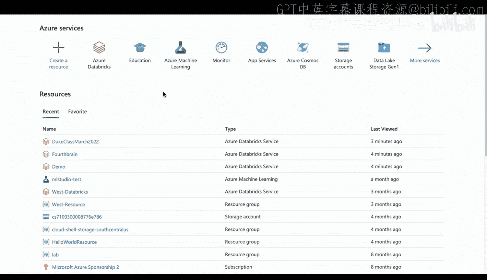

# 杜克大学《应用Python数据工程（3课全）｜Applied Python Data Engineering》中英字幕 p19 19_03_02_访问Databricks.zh_en -BV1nz421i7KP_p19-

And if you see here， I'm in my Azure account here and notice that there is this Databricks integration and this Databricks integration allows you to very quickly create resources and from here you can actually go through and build out whatever it is you need to do without needing to have a separate Databricks installation。

 So this is the main integration that we care about and that's all you need to be successful in this course。

