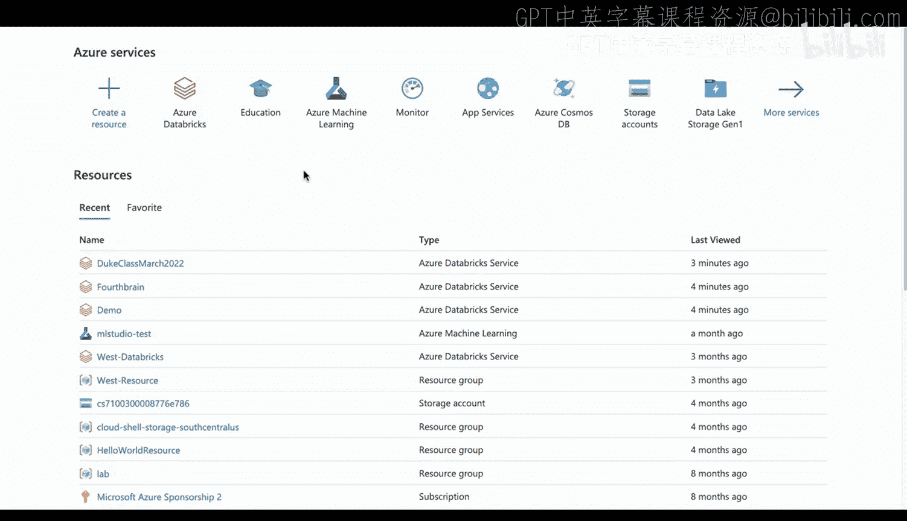

# 数据工程基础：19：访问Databricks

在本节课中，我们将学习如何在Azure环境中访问和使用Databricks服务。你将了解如何通过Azure门户的集成功能快速创建和管理Databricks资源，而无需进行独立的安装。

---

上一节我们介绍了数据工程平台的基本概念，本节中我们来看看如何在Azure中访问Databricks。

如果你在这里查看，我正位于我的Azure账户中。请注意，这里有一个Databricks集成选项。这个Databricks集成功能允许你非常快速地创建资源。从这里，你可以直接进行所需的所有构建和配置工作，而无需单独安装Databricks。

这是我们本课程中需要关注的主要集成方式。掌握这个方法就足以让你在本课程中取得成功。

---

本节课中我们一起学习了通过Azure门户访问Databricks服务的方法。我们了解到，利用Azure内置的Databricks集成，可以便捷地创建和管理相关资源，这简化了环境搭建的流程，是进行后续数据工程实践的关键一步。