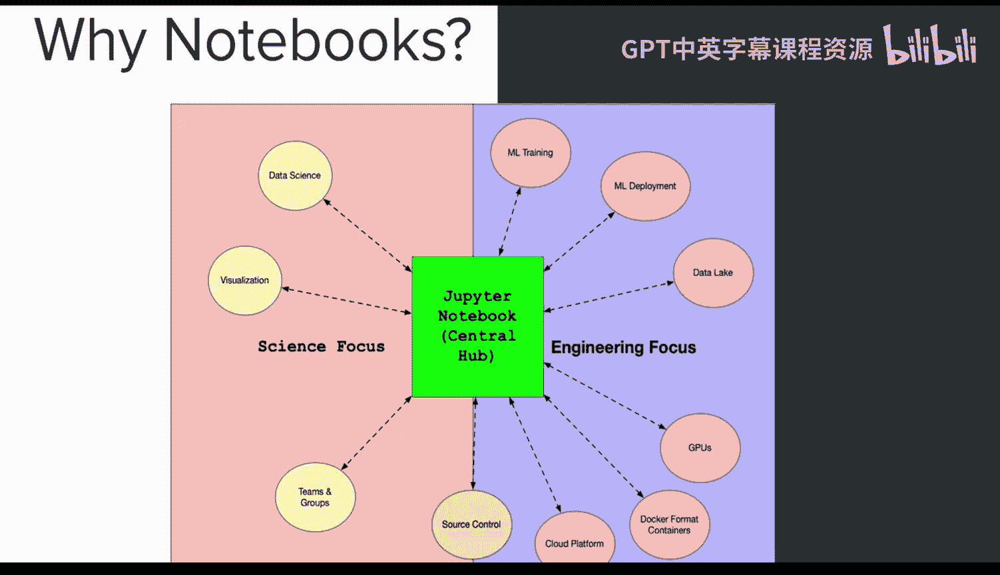
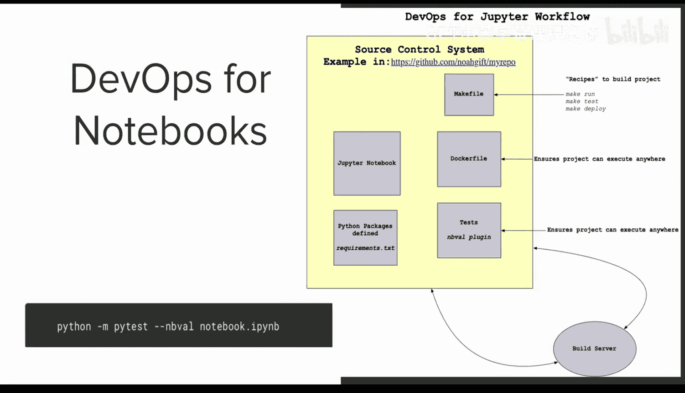
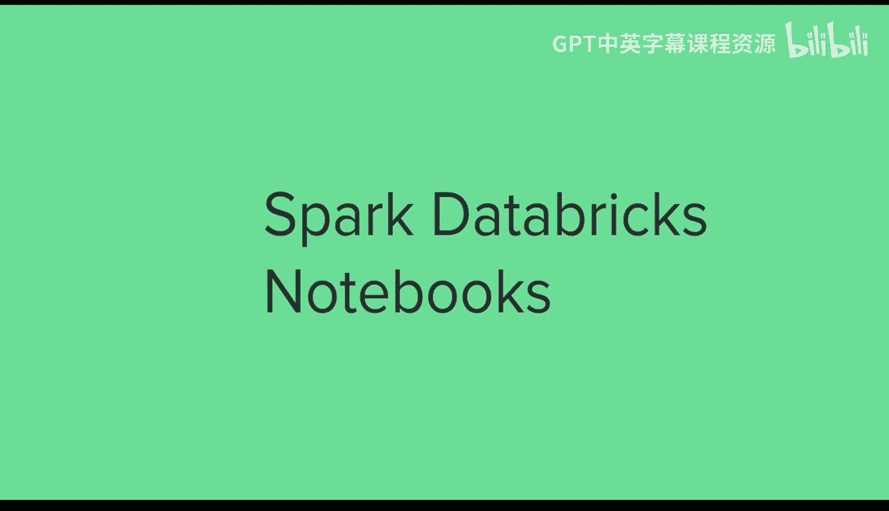
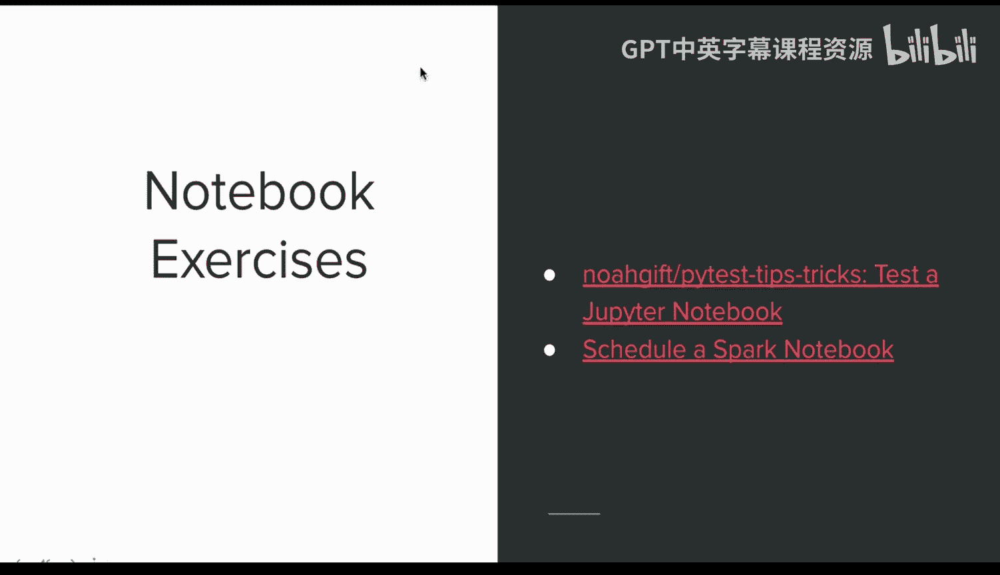
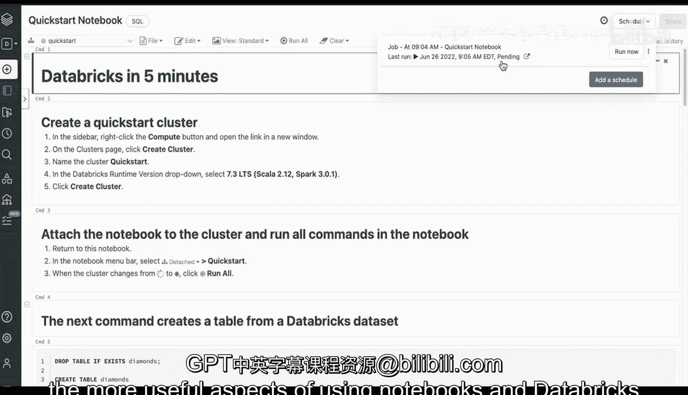

# 杜克大学《应用Python数据工程（3课全）｜Applied Python Data Engineering》中英字幕 p20 20_03_03_在Databricks中使用Spark笔记本.zh_en -BV1nz421i7KP_p20-

To start with notebooks themselves， we need to dive into what they're used for and how they play a role。

First， if we see that the notebooks in a sciencebased program do things with data science。

 they also help you work with visualizations， for example， doing a scatterpl。

 and they also are a great tool for doing teams and groups， for example。

 research project amongst the PhDs in an organization along with the students that they're supervising。

But there's also this engineering focus to notebooks。 and this could mean machine learning training。

 machine learning deployment， dealing with a data lake， for example。

 a big data system dealing with GPUus， dealing with Docker format containers， also a cloud platform。

 So really， there's a cross sectional approach to notebooks。

Another thing to consider is this concept of DevOs4 notebooks and in this particular scenario you could have a make file where it would go through and test things。

 deploy code， for example， maybe a machine learning model to production as part of a microservice there could be a Docker file its associated with your Jupyter notebook workflow and that would assure that you're able to reproduce exactly what's inside of your project and finally there are maybe the package requirements in a requirements Txt and then some tests。

 and you can actually test notebooks as well， by using the P test in BVal pluginin。

Let's dive now into the specifics of Spark Databricks notebooks。

If you dive into Spark Databricks notebooks， a few things that you can do include you can create a modify notebooks。

 you can schedule jobs， so this is helpful if you are going to let's say。

 create a weekly report and you would need to collect all the data and generate， let's say。

 a bar plot。You can also develop code against these notebooks。

So if we dive into creating and modify notebooks， a couple things to remember are that you can manage notebooks using the UI。

 you can also manage it using the Kalan interface and also you can invoke the Workspace API。

 so a bunch of different methods。Typically， what I would do is create one from scratch。

 or I would import it， or I would export it， or I would attach it to a cluster。 Really。

 these are common actions for notebooks。If you want to schedule it quite straightforward。

 you can right click on the corner and see this option， Quick Start notebook。

 schedule a job against a cluster， again， maybe a weekly report for your organization。

And once you've scheduled the job， it'll repeatedly go through and even send you an email if there is a start。

 success or failure alert。Now when you're developing with notebooks。

 a few things to remember are that these notebooks are really made for developing and running cells。

 you can mix and match different languages， you can use Python， you can use R Scala SQL。

 and you can manipulate these cells， and also include documentation in the markdown。Now。

 including notebook exercises is always a good way to finish off this tutorial。

 so I'm going to go ahead and take a look at scheduling a Spark notebook in order to do that。

 I will go ahead and go to my interface here and let's go ahead and make sure that we have a compute cluster running。

You can see I have a couple different clusters， I have a single node cluster and also have a cluster with 12 course。

 and if I go over to my workspace here， I could go through and look at this quick start notebook that I used earlier and make sure that it's attached to a cluster。

If I want to associate this quick start notebook with a scheduled job， I would just go over here。

 select schedule and go ahead and call this a scheduled job。 And this could happen。

 let's say every day at 9 o'clock。 And I would go through here。 and I would say。

 just send me a message if there's a problem running this job。 Let's go ahead and create that。

There we go。 Now， this quick start job will run at 9 o'clock every single day。

 and I could actually run it now as well。 That's always a good idea if you're going to create a scheduled job as first run it once。

 and we can go through here。 Now it's going to go through and double check the logic of our job。

 So the scheduling job is alone。 One of the more useful aspects of using notebooks and databricks。

