# 杜克大学《应用Python数据工程（3课全）｜Applied Python Data Engineering》中英字幕 p21 21_03_04_在Databricks中使用数据.zh_en -BV1nz421i7KP_p21-

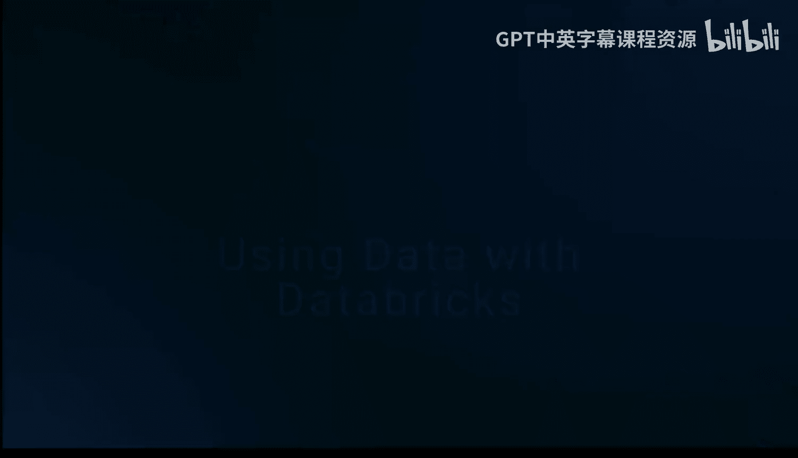

Let's dive into using data in Databrick Spark。

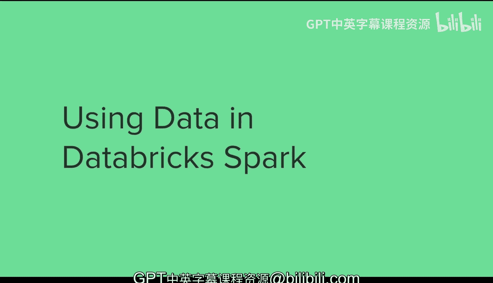

To get started with data in Databricks Spark first you need to get to a directory and in this location here you can see that I've got my data that I'm uploading to the DBFS or Databricks file system。

 it's a CSV file。Once I've uploaded that file， I am able to actually operate on it using a notebook or even a command line tool。

Next here， you can see that when it's finished uploading， it will give you an access location。

 and you can see from Piispark， Padas， R Scala， any of those languages。

 an example of how to pull in that data frame。When I pull that data frame into a notebook here。

 you can see I've been able to load it， and then if I do a display。

 I can get the output directly inside of my Spk notebook。

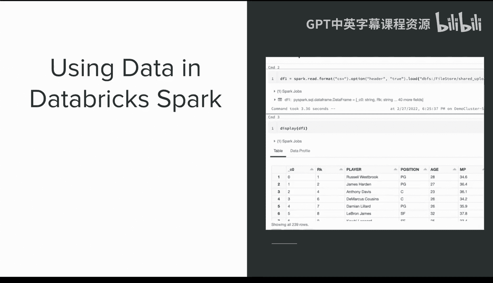

Let's talk a little bit about databricks， data sets themselves。

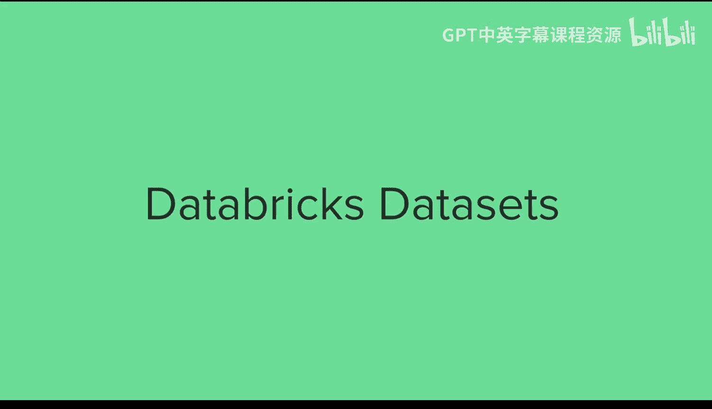

One of the ways that you can actually use data science is to not have to upload data at all。

 but access the path from the Databricks data set onto your notebook and you can see here there's a great way to test out different workflows and also display these internal datas and you can even look at the size as well and when you query this inside of your notebook。

 it's as simple as adding this concept of display DbutTils。fsLS。

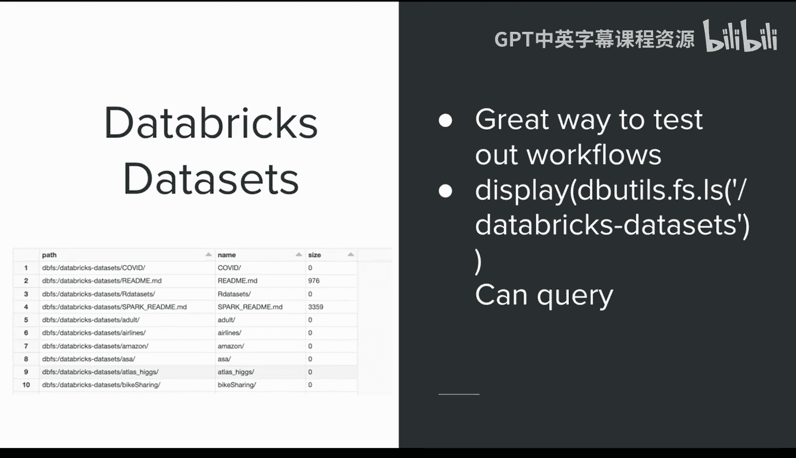

Now， let's talk about Azure Open data sets。 This is a very unique offering as well。

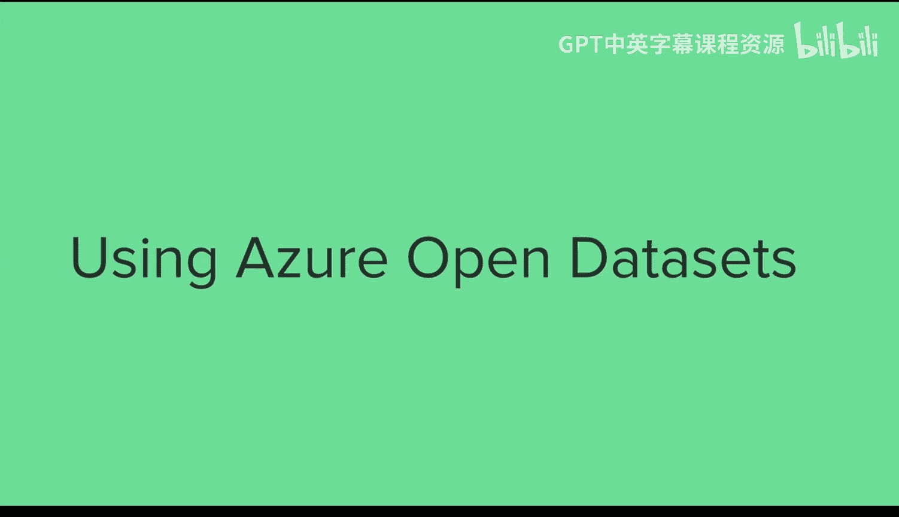

It's very powerful that comes with the Azure Databricks integration。In order to do this。

 all you need to do is install Azure ML hyphen open datas， and once you've done this。

 you can apply that library to all of your notebooks once it's been installed。

 you can actually impart in this case， we can import the NOAA is whether data limit let's say a date range from 2019 to march and then just play that result。

 So this is a very， very powerful way to get new data sets and play with them with just a few lines of code。

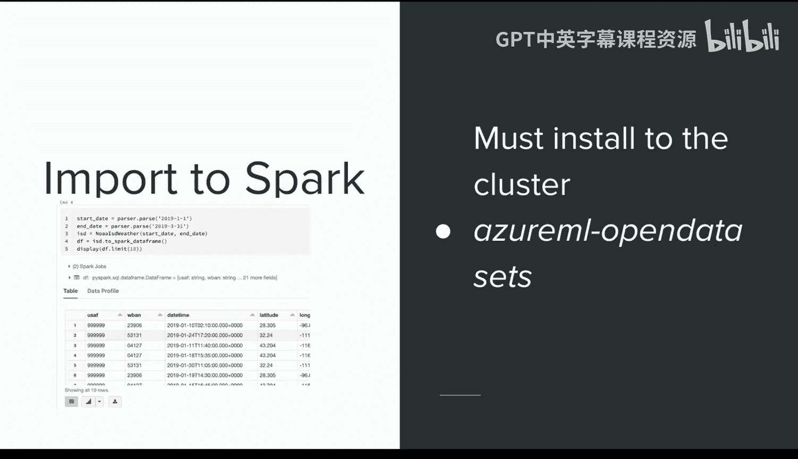

Now， what about the Databricks file system itself， How do you actually dive deeper into it， Well。

 one of the easy ways， as I mentioned before， is to just use this display operation。

 And here we say Dbutils。 fs do Ls。 and we go to the Databricks data sets。

 And this is a very informative way to see what's going on。

 you can also think about there's a object storage using a directory and file semantic。

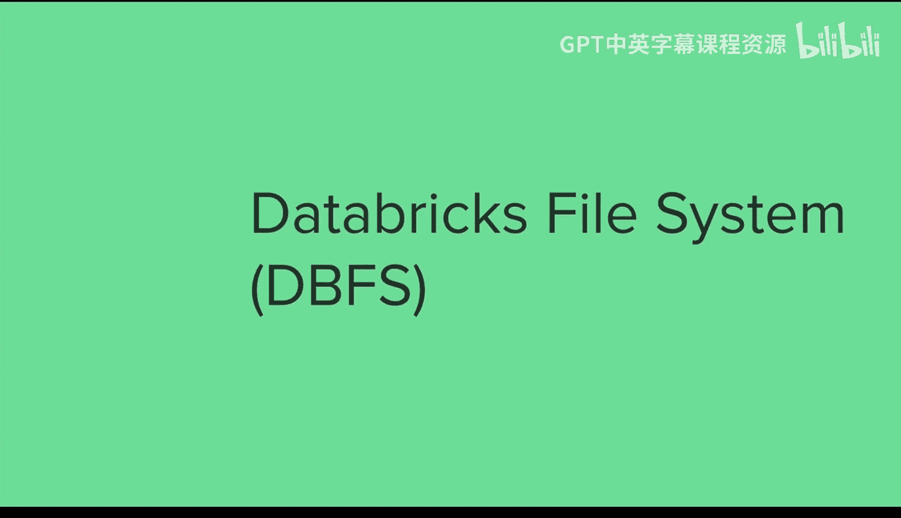

And this saves your data to an object storage location。

The other thing that's really powerful is this concept of browsing and uploading data directly。

 as I mentioned earlier， and it's important to point out that you have to enable this in your admin settings。

Now if we're using the Databricks file system here。

 here's a good example of how you can actually interact with it， you can do an fsls。

 you can use dbutils。fsls， you can do ls by itself with a colon s you can use the Dbfs Ls and this would be a local file system so really it's a combination of whether you're using something locally or you're using the cluster itself and the big takeaway here is the cluster has the ability to do distributed disko。

Now here's a good example of using the DBFS command here and it shows where it's actually located。

If you want to read from the root location， here's an example with the percentage FS。

 if you want to add the ability to talk to DBFS。You can actually go through here and add in that path as well。

Now in terms of data sources， a few things to be aware of are that the default data sources are Avro binary。

 CSV， hive table image， Jason， Elzo， compressionpress， MLflowlow experimentiment， parquet， XML。

 zip files， so there's a ton of default data sets， and data sources。

 but there's also additional data sources， including things like Azure or MongoDB。Or in fact。

 Redis or Snowflake。 So there's deep integration with third party data sources as well。

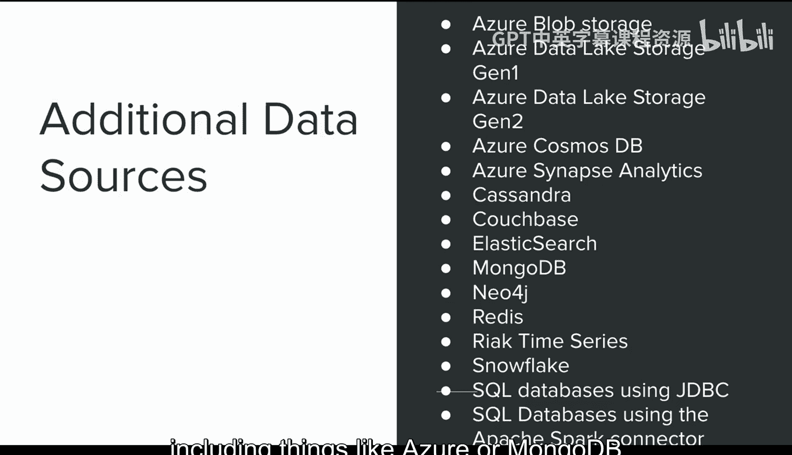

Now， in terms of Databricks ETL， one thing to point out is that it has the ability to do logs。

 files and media， move that into storage， prep it with Azure Databricks Sp。

 and then serve out a model。 So this is really the concept of an ETL pipeline with Databricks extract。

 transform and load， and you can do it quite simply with the Azure integration。

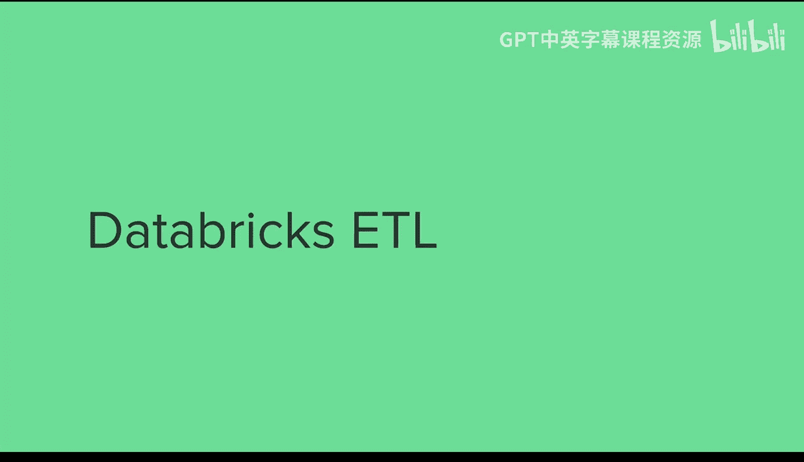

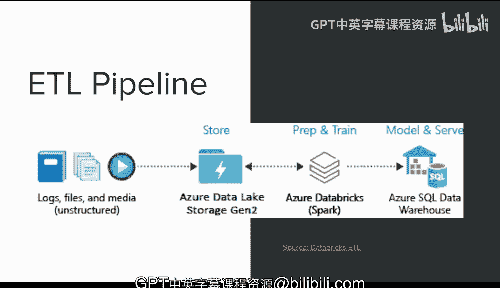