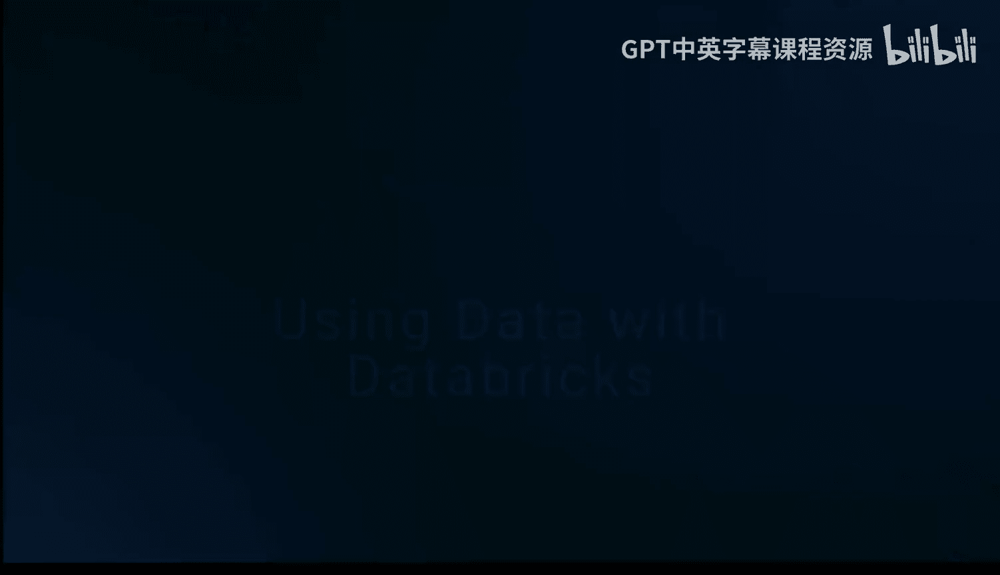
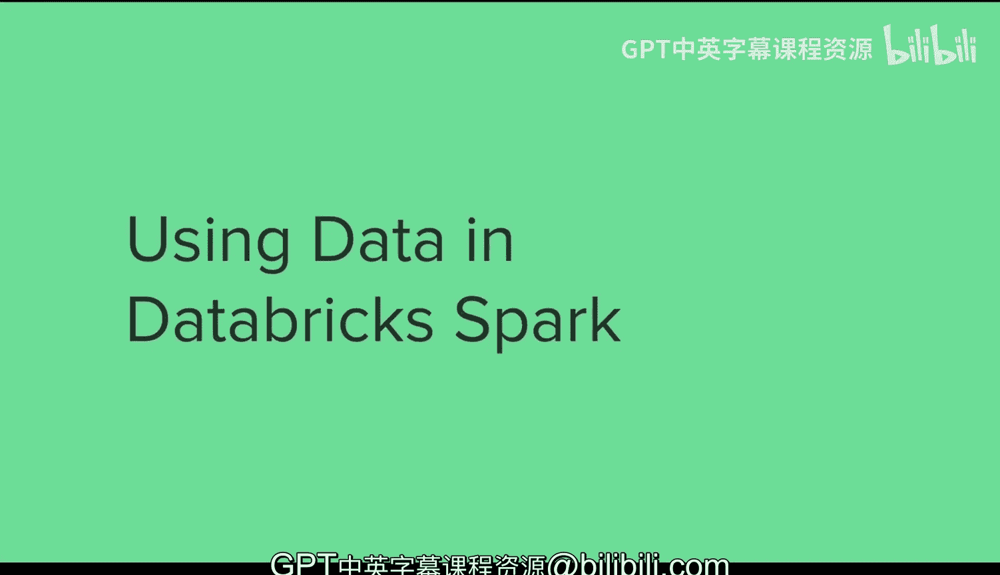
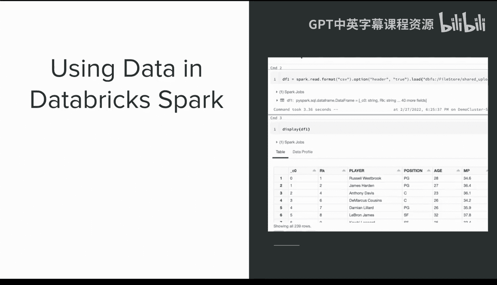
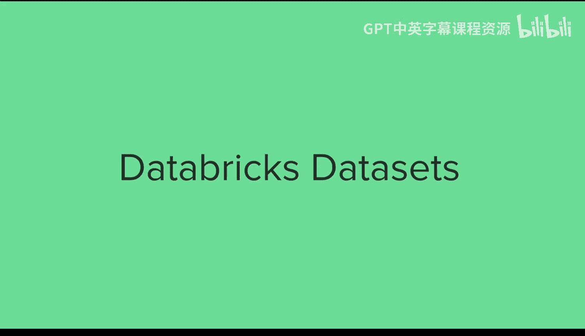
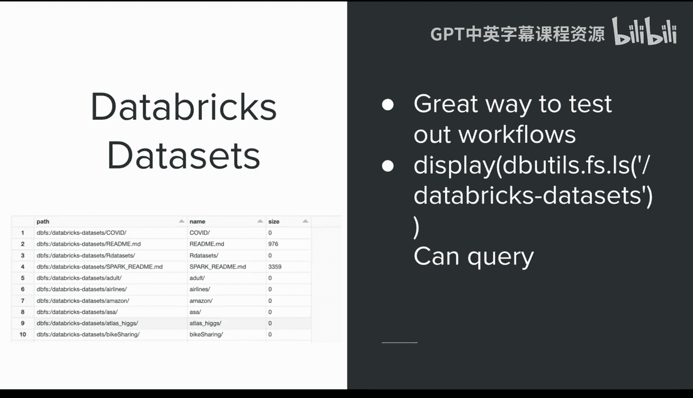
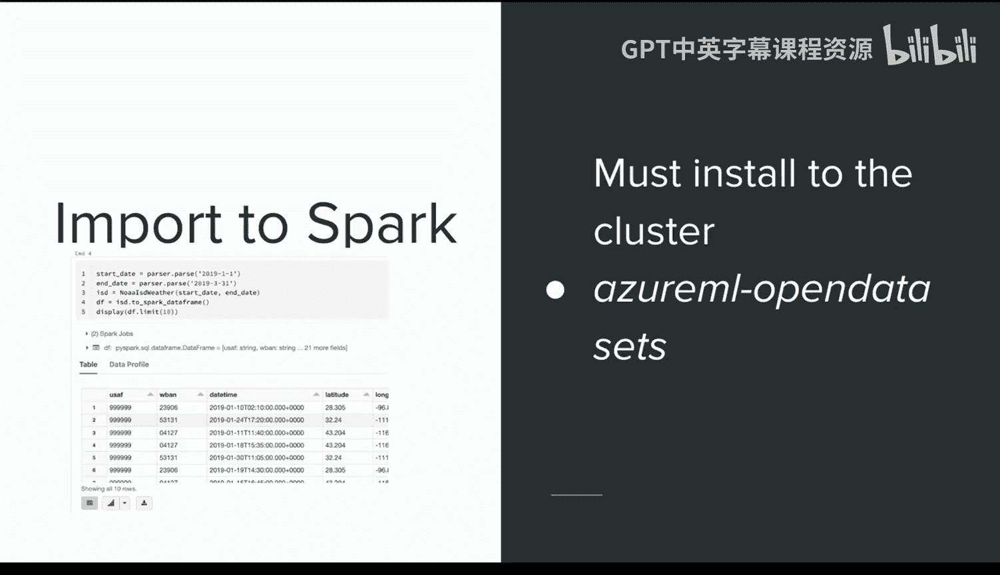
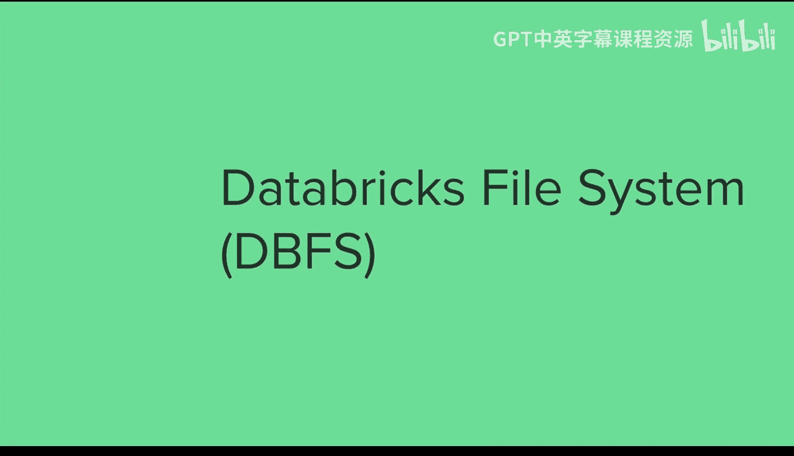
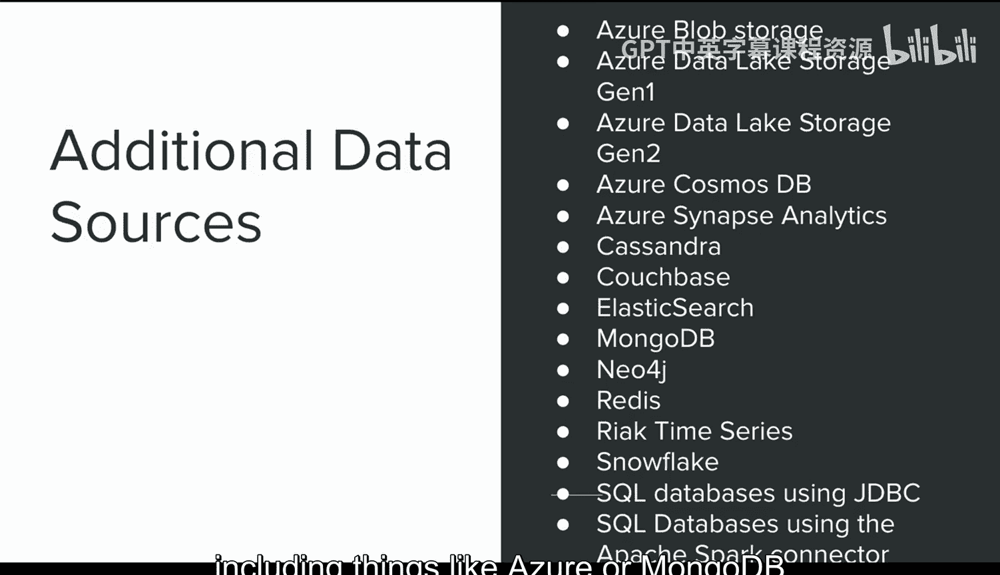
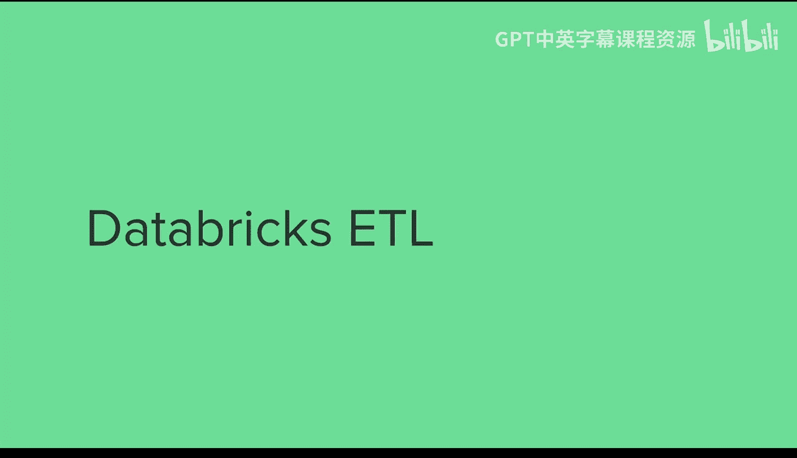
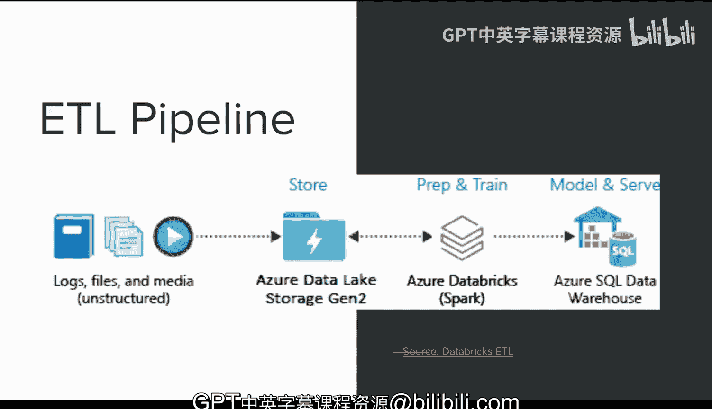

# 应用Python数据工程：3：在Databricks中使用数据

## 概述
在本节课中，我们将学习如何在Databricks Spark环境中使用数据。我们将涵盖从上传数据到文件系统、访问内置数据集、集成Azure开放数据集，到探索Databricks文件系统（DBFS）以及了解其支持的数据源和ETL流程。

## 开始使用数据
要开始在Databricks Spark中使用数据，首先需要进入一个目录。在这个位置，你可以看到我已经将数据上传到了DBFS（Databricks文件系统），这是一个CSV文件。上传完成后，我就可以使用笔记本（Notebook）甚至命令行工具来操作它。

接下来，当文件上传完成时，系统会提供一个访问路径。你可以看到，从PySpark、Pandas、R、Scala等任何语言中，都有示例代码展示如何将该数据加载为数据框（DataFrame）。

当我在笔记本中加载这个数据框后，可以看到数据已成功载入。如果我执行`display`操作，就能直接在Spark笔记本中看到输出结果。

## 关于Databricks数据集
上一节我们介绍了如何上传和使用自己的数据，本节中我们来看看Databricks自身提供的数据集。

使用数据科学的一种方式是根本无需上传数据，而是直接从Databricks数据集的路径访问到你的笔记本中。这是一个测试不同工作流和展示这些内部数据的绝佳方式。你甚至可以查看数据的大小。在笔记本中查询这些数据非常简单，只需使用`display(dbutils.fs.ls(...))`这个概念。

## Azure开放数据集
现在，让我们谈谈Azure开放数据集。这也是一个非常独特的服务。

它是Azure Databricks集成中非常强大的一部分。要使用它，你只需要安装`azureml-opendatasets`库。安装完成后，你可以将该库应用到所有笔记本中。安装后，你就可以导入数据了。例如，我们可以导入NOAA天气数据，设定一个日期范围（比如从2019年到3月），然后直接使用结果。这是一种非常强大的方式，只需几行代码就能获取新数据集并进行操作。

## Databricks文件系统（DBFS）
那么，Databricks文件系统本身呢？如何更深入地探索它？正如之前提到的，一个简单的方法就是使用`display`操作。

这里我们使用`dbutils.fs.ls`命令，并指向Databricks数据集目录。这是一种信息量很大的方式来查看当前情况。你也可以将其理解为使用目录和文件语义的对象存储。

它将你的数据保存到一个对象存储位置。另一个非常强大的功能是直接浏览和上传数据的概念，正如我早先提到的。需要指出的是，你必须在管理员设置中启用此功能。

如果我们在这里使用Databricks文件系统，以下是一个如何与其交互的好例子：你可以使用`%fs ls`、`dbutils.fs.ls`、带`:s`的`ls`命令本身，或者`dbfs ls`（这将是本地文件系统）。实际上，这取决于你是在本地使用还是在集群本身上使用。这里的关键要点是，集群有能力进行分布式磁盘操作。

这里有一个使用DBFS命令的好例子，它显示了数据实际存储的位置。如果你想从根位置读取数据，这里有一个使用`%fs`的例子。如果你想增加与DBFS通信的能力，你也可以在这里添加路径。

## 数据源
关于数据源，需要注意以下几点：默认支持的数据源包括Avro、二进制文件、CSV、Hive表、图像、JSON、LibSVM、压缩文件、MLflow实验、Parquet、XML、ZIP文件等。因此，有大量的默认数据集和数据源。

此外，还有额外的数据源，包括Azure、MongoDB、Redis或Snowflake等。这意味着与第三方数据源也有深度集成。

## Databricks ETL流程
在Databricks ETL方面，需要指出的一点是，它能够处理日志文件和媒体，将其移动到存储中，使用Azure Databricks Spark进行预处理，然后输出一个模型。这实际上就是Databricks的ETL（提取、转换、加载）管道概念。通过Azure集成，你可以相当简单地完成这个过程。

## 总结
本节课中，我们一起学习了在Databricks环境中使用数据的多种方式。我们从上传文件到DBFS开始，学习了如何加载和显示数据。接着，我们探索了直接使用Databricks内置数据集和强大的Azure开放数据集的方法。然后，我们深入了解了Databricks文件系统（DBFS）的操作命令和其作为对象存储的本质。我们还列举了Databricks支持的各种默认和第三方数据源。最后，我们简要了解了Databricks如何作为ETL管道，从数据提取、转换到加载和建模的完整流程。掌握这些方法，将帮助你在Databricks平台上高效地进行数据工程任务。