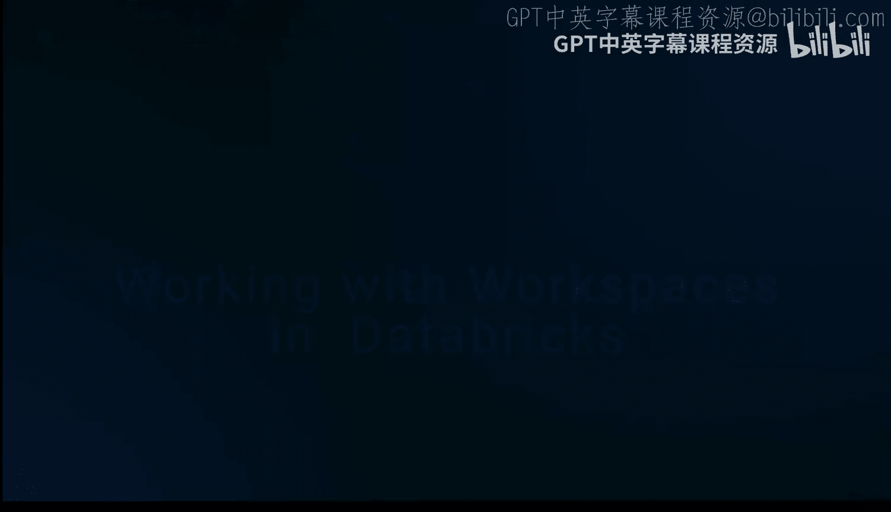
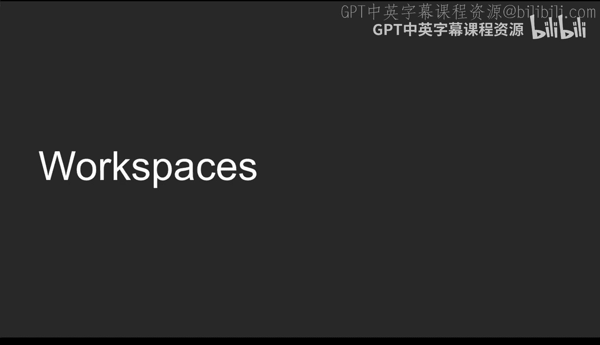
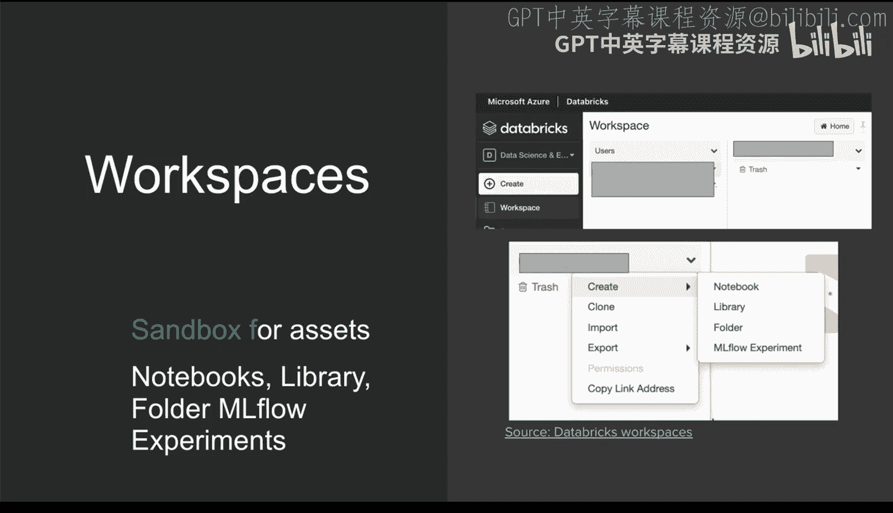
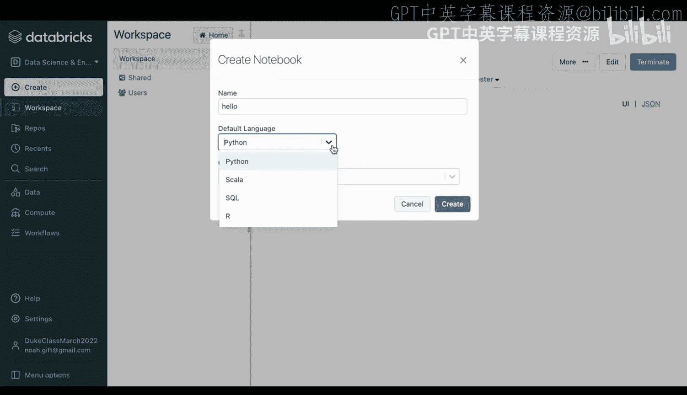
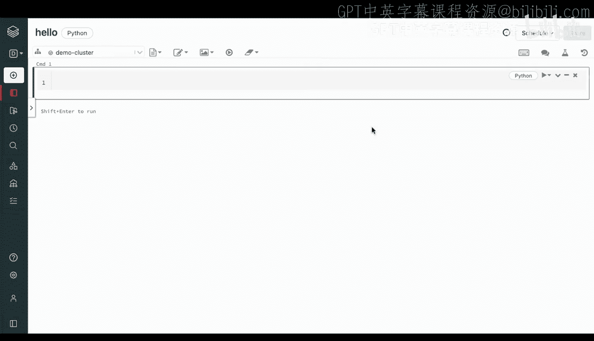
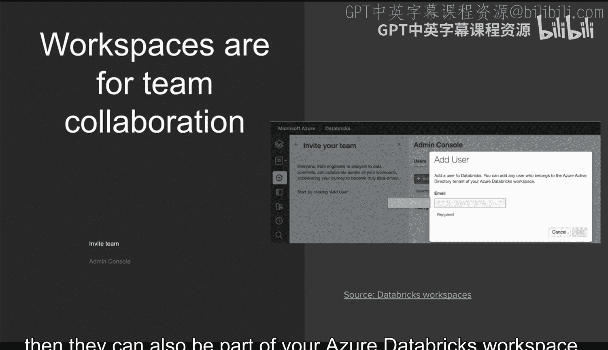
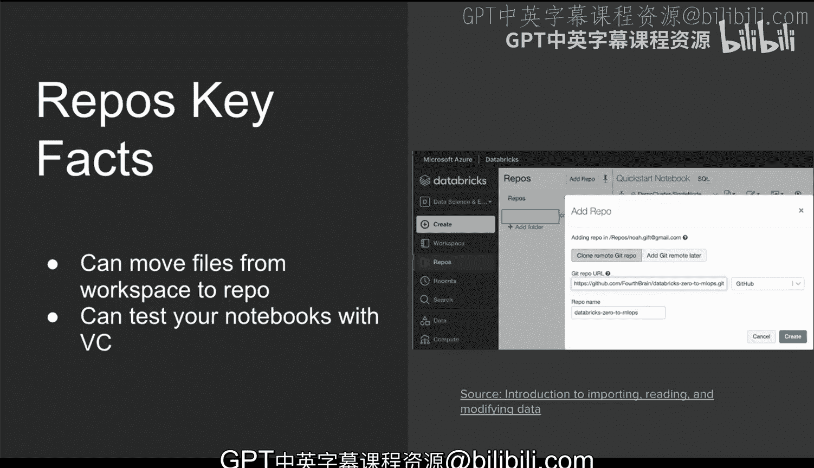

# 杜克大学《应用Python数据工程（3课全）｜Applied Python Data Engineering》中英字幕 p22 22_03_05_在Databricks中管理工作空间.zh_en -BV1nz421i7KP_p22-

Let's dive into workspaces for the Databricks platform。

 This is a location where you can do a lot of different things that will help you work with other users and also organize your project。

 So to start with when we take a look at a workspace one of the things to be aware of is that it is up in this left hand corner here that you would go ahead and create new users and those new users would then be able to work inside of your workspace。

 you can also do other things too， you can treat it like a sandbox for assets including notebook。

 library emailflow experiments and you can see here this is an example of how I could go ahead and create a new notebook。

 create a new library folder， whatever it is I need to do。 and also I can import other notebooks。

 for example， the documentation from Databricks。 Now let's go ahead and take a look at this。

 So if I go over to。

My Azure account and I dive into， let's say compute here and then go over to the workspace。

 This is where I could go in and I just have to right click and I could right click and create a new notebook。

 new library， new folder， whatever is I need to do。 Now let's go ahead and create a notebook。

 Let's go ahead and call this hello。 and I would want to select at this point， default language。

 whatever it is I'm doing， let's just use Python。 Once I've gone ahead and created that notebook。

 Then it's going to be inside of my workspace。 and I can share it with other users。

The other idea about workspaces is their for team collaboration and with a big data project。

 this is critical right and one of the things that you want to do in a teambased environment is have many different people let's say the data science team。

 the data engineers all work together the machine learning engineers and notice here that once you've got a workspace。

 then you can start doing things like working with a cluster ingesting data inviting people to your team。

 So really it's the start of a collaborative workflow。Now， again。

 if you want to invite someone to your team， you just right click， add them to your team。

 and then they can also be part of your Azure Databricks workspace。

Now repos are another exciting component because you can keep your code under version control and what's great about this is that you can actually go through and do continuous integration。

 whatever it is you need to do to your project to maintain industry standard software engineering practices and it works beyond with just let's say GitHub。

 it works with bitt bucketet cloud， GitLb， Azure Devops。

 AWS code commits so really it has tight integration with all those platforms and you can see here it's pretty straightforward to go ahead and add a repo and hook into that Git remote and then once you've got that inside of there。

 you can actually move things from the Repo back and forth into your workspace。

A few key facts about reos is you can move files from the workspace to the repo。

 this is a best practice here where you could treat the workspace as a sandbox。

 move it over to the repo， then check it in once it's in now your notebooks are able to be under version control。

 so there's a lot of amazing things that you can do with reoss。

