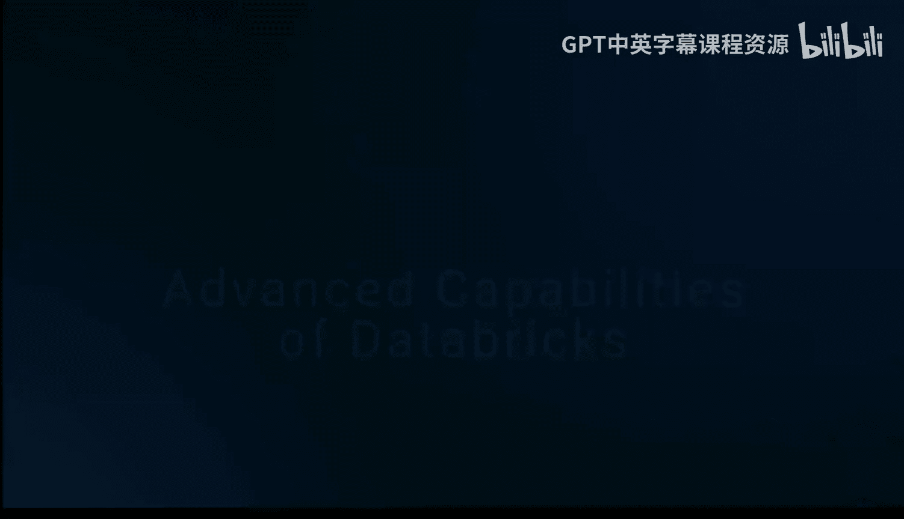
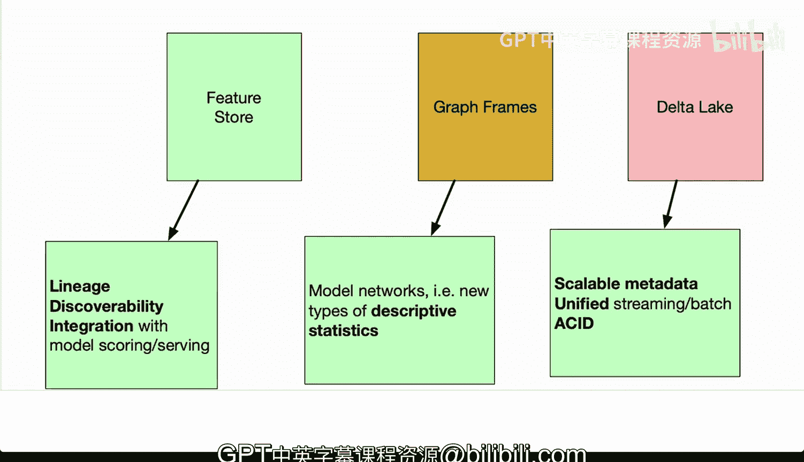

# 杜克大学《应用Python数据工程（3课全）｜Applied Python Data Engineering》中英字幕 p23 23_03_06_Databricks高级功能.zh_en -BV1nz421i7KP_p23-

Let's take a look at a few of the advanced features of the Databricks platform。

 One of them may is the feature store。 Why would you use a feature store。 Well。

 this is where you would curate and actually keep track of the complicated process of rich features that you would use for your machine learning model and it enables you to do things like have lineage so you can figure out where it came from。

 you can discover these features maybe different teams can work on the same features and you can integrate this with the model scoring and serving so you know really once you've put this thing into production what that feature was actually doing and how impactful it was。

There's another feature called graph frames and graph frames is another way to do modeling in machine learning and one of the things to think about with graphs is it's a different kind of a model and there are different types of descriptive statistics。

 for example， centrality， So what are all the different clusters of people who are they actually combining around。

 you see this a lot with networks like social networks are their influencers that are you know really people are interacting with and can you train models around those network based relationships。

There's also data lakes， data lakes provide a scalable metadata。

 a unified streaming and batch interface， and it's also acid。

And so that means that you can actually make these transactions and you know that those transactions are going to take place in a way that makes them repeatable and scalable。

And in addition， Delta Lake is now open sourced， so there are some very exciting and advanced features that you get by using the Databricks platform。

 including feature store， graphph frames and Delta Lake。

