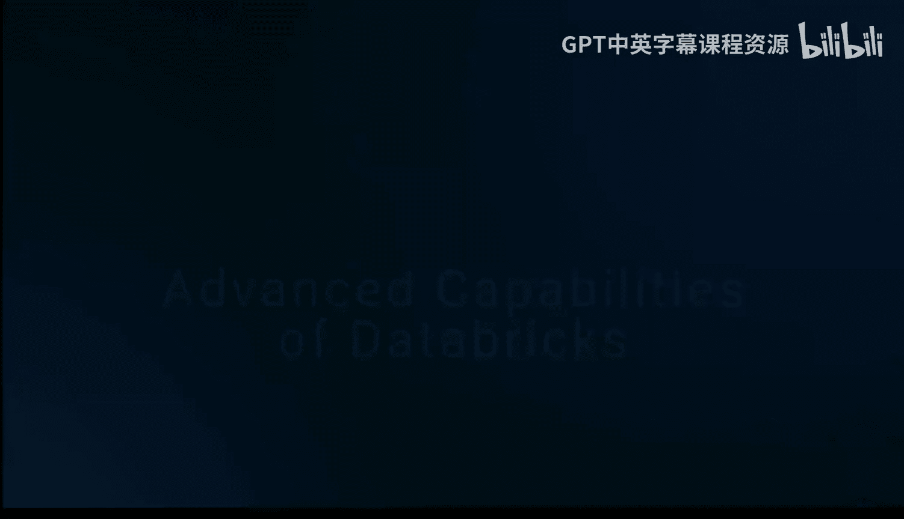
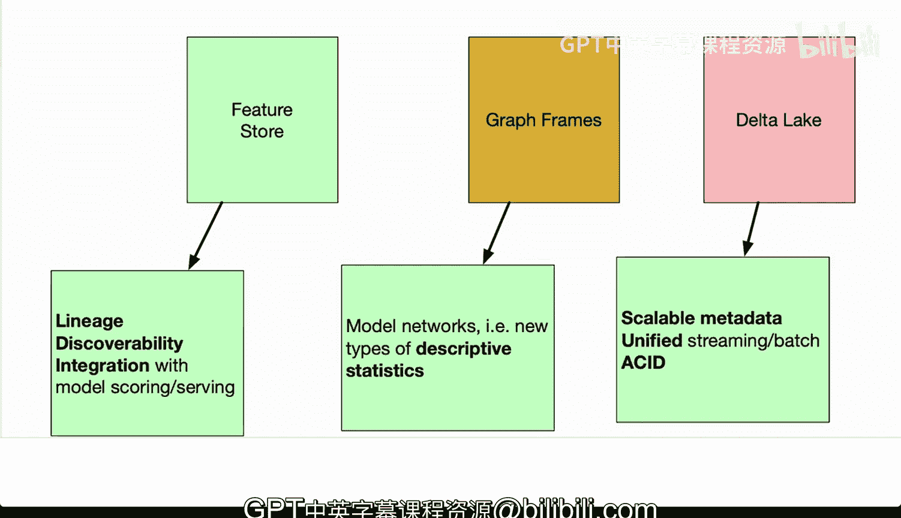

# 应用Python数据工程：3.3：Databricks高级功能

在本节课中，我们将探讨Databricks平台的几个高级功能。这些功能旨在帮助数据工程师和科学家更高效地管理数据、构建特征和进行机器学习建模。

---

## 特征存储

上一节我们介绍了Databricks的基础功能，本节中我们来看看特征存储。特征存储用于管理和追踪用于机器学习模型的复杂特征工程过程。它支持特征溯源，帮助用户了解特征的来源，并促进不同团队对相同特征的协作开发。此外，特征存储还能与模型评分和服务集成，确保在生产环境中清晰掌握每个特征的实际作用和影响力。

## 图框架

除了特征存储，Databricks还提供了图框架功能。图框架是机器学习的另一种建模方式。图模型与传统表格模型不同，它使用不同的描述性统计方法。

以下是图分析中常见的几种统计概念：

*   **中心性**：用于识别网络中最重要的节点。
*   **社群发现**：用于找出网络中紧密连接的群体或集群。
*   **影响力分析**：在社交网络等场景中，识别那些拥有大量互动和连接的影响者。

基于这些网络关系，可以训练专门的预测模型。

## Delta Lake

另一个核心高级功能是Delta Lake。Delta Lake提供了一个可扩展的元数据层，并统一了流处理和批处理的接口。同时，它支持ACID事务。

**ACID** 是原子性、一致性、隔离性、持久性的缩写，这意味着在Delta Lake上执行的事务是可重复且可扩展的。

此外，Delta Lake现已开源，这为社区开发和采用带来了更多可能性。

---

## 总结

本节课中我们一起学习了Databricks平台的三个关键高级功能：**特征存储**用于管理机器学习特征的生命周期；**图框架**为基于关系的建模提供了强大工具；**Delta Lake**则通过ACID事务和统一的处理接口，构建了可靠的数据湖基础。这些功能共同增强了Databricks在复杂数据工程与机器学习工作流中的能力。