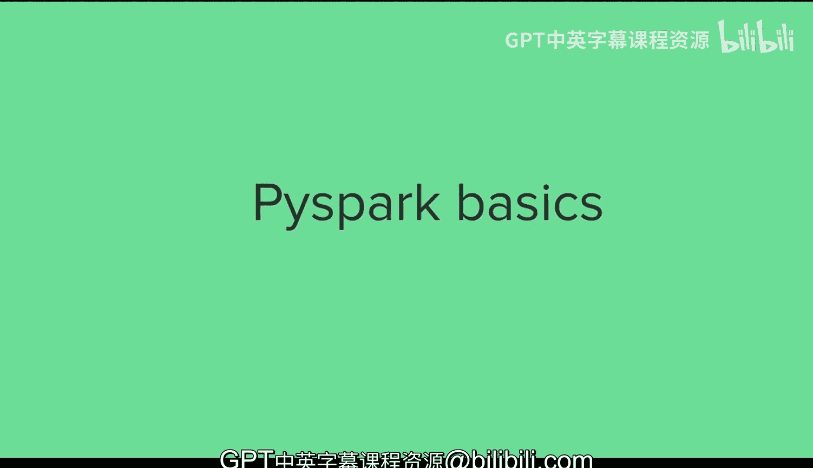
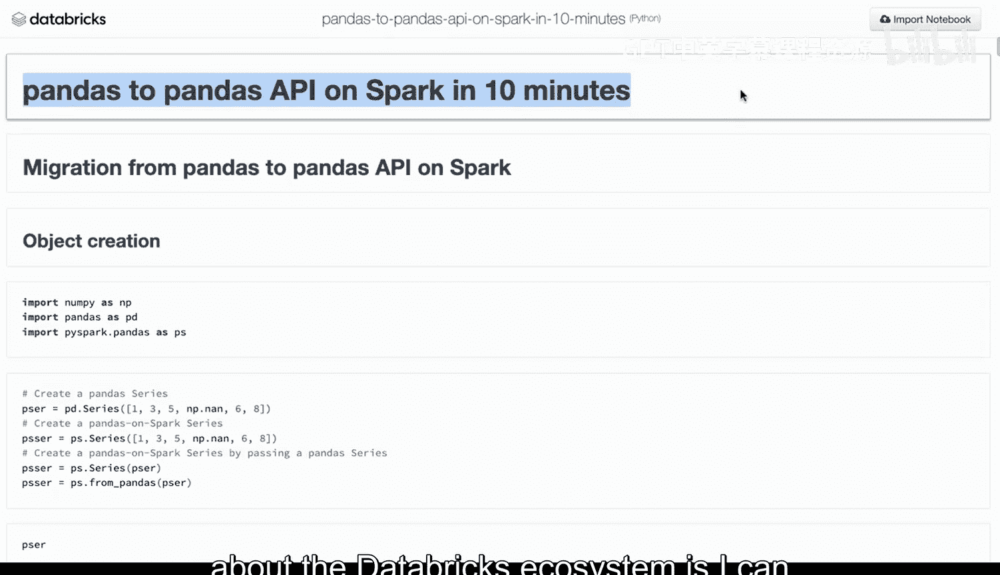
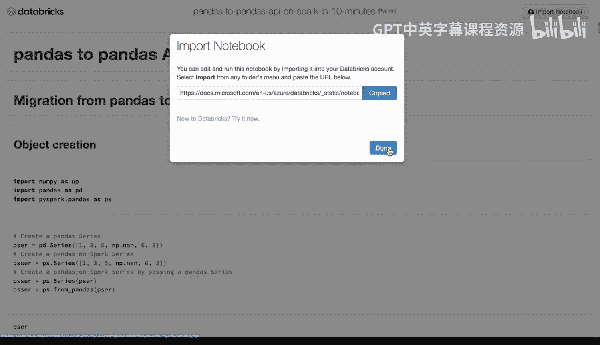
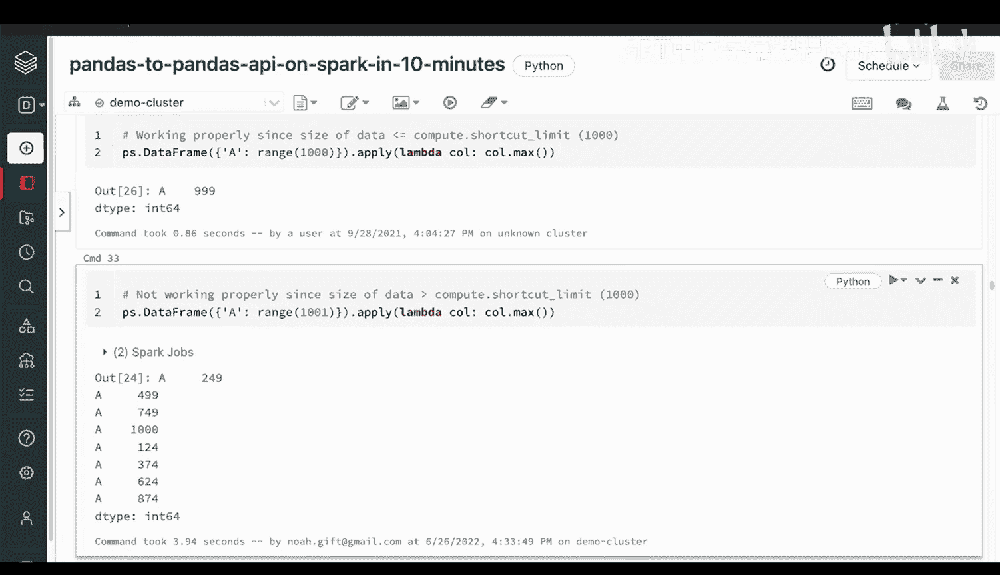

# 杜克大学《应用Python数据工程（3课全）｜Applied Python Data Engineering》中英字幕 p24 24_03_02_Databricks上的PySpark简介.zh_en -BV1nz421i7KP_p24-

Let's dive into Pi Spk basics。

To start off with there are some key concepts that are important。

 data frames are a columnar structure a lot like a CSV file or an Excel spreadsheet。

 and you can interact with these data frames using the regular pandaas API or this koalass interface which has a interface that is able to talk to the spark language and work with data frames at scale。

 So if you see in this example here， we have a data lake， which is object storage。

 we have the DBFS or the cluster that is able to go through here and merge everything together。

 and then we get this big data operation it could be an ad function where we take an input。

 we do that calculation， apply it to all the rows on the data frame and then do our maybe visualization。

Now， when we look at a Pispark data frame here， here's a good example， I could say from Pispark。

 sQL import， then I go through here and I create the department so I would go in and create a row and then when I have the row。

 I could go in and create the employee so this could be the first name， last name。

 email and this is right from the documentation from Azure Databricks and it shows you how it works in a very similar way to regular programming except for this is working on big data。

Now if I needed to join a data frame fairly straightforward to do。

 I would do a union in this case I would do Df1。un and then display that union data frame if I wanted to build a user defineded function or UDF pretty straightforward as well。

 I would build a function， have an input， return something but then register that function so that I could apply it to the data frame and that's really where the power comes in is taking these functions and applying them at scale。

Now， the Pipark Padas API is quite interesting because it solves a problem that panda has。

 which is it doesn't scale to big data。 One of the limitations of the regular pandas API is that it works on。

 let's say， data sets that are more in the academic range。 but when you have a real world scenario。

 you need to have bigger data platforms to interact with in this case。

 as long as you're running databricks from runtime 10。

0 or above you can actually go through and say import Pipark。 pandas asps。

 and what's great about this is you can use it in a very similar way to what you're already familiar with with pandas。

Now here's a few key facts， one of the key facts here is if you go in and you import Pipark。

 pandassps， you can actually convert this into a data frame and then do this operation and it looks very。

 very similar except for behind the scenes it's distributing the data。

 so it's scaling to the data that you have。Let's go ahead and look at this in action to really get a feel for what this would look like。

 So if I go ahead and I select this documentation here， this is a great document to take a look at。

 This is the official guide from Databricks and Microsoft。

 how it shows you you can do a pandas to pandas API on Spark now。😊。

What's really cool about the Databricks ecosystem is I can go to import notebook。

 and I can copy this URL， and then later just go to the menu and import it and bring it into my system。

 So it's very easy to import notebooks。 Now， fortunately， I've already got this imported。

 and we can take a look at this。😊。

So let's go ahead and take a look at how this would work first up here。

 we would say import nuy as in P， import pandas as PD， import Pipar Padas as PS。

 you can see all of the basic operations that you would do in a data science project are there with the exception that we're going to compare regular pandas P with Pis Spk pandas。

 which is PS。 Now if I want to go through here and create a panda series， look。

 it looks very clean and looks identical to the Pis Sp version。

If I go ahead and run this by doing shift return， you can see that they both are able to operate in a similar way。

If I type in PSER here， this will go through here and show me the output of that last command that I ran。

And if I go ahead and I look at the sort index， you can see I can also sort the data as a spark job。

 If I want to create a data frame in pandas。 In this case， it would be Pf create a pandas data frame。

 I could also create a pandas on Sp data frame you can see here identical workflows。

 there really is no difference between the two except for one is working on big data if I type in PDFf here。

 we can see the output of that particular data frame which we saw earlier Now if I want to go ahead and I look at the Pi Sp data frame and sort it we can also do that operation as well。

Now， if I want to view the data， I can do the head operation。

 so if you're familiar with the pandas interface， you know that dot head is a great way to look at a couple rows。

 we can look at describe here， and this will give us the descriptive statistics。 again。

 imagine this is a huge data， it's identical to what you do with a small dataset set because of the Pipar wrapper here for pandas。

Again， I could sort by value I could transpose right if I could basically take something and change the instead of it being horizontal。

 it's vertical， and then I could also go through here and calculate the max rows as well。

 So we see that when I'm using the interface here that it's only going to get up to 1000 operations。

 but I could change it again because have access to this big data system and actually make it more powerful we can select columns as well。

 so in this case I would select column a I can select two columns by using the double selection syntax here。

 and I also can select by using dot LOc， which is something that we do a lot in pandas and I can slice as well and take off different sections。

 So really similar operations here between pandas and Pipar with the big difference being that we can run this at scale。

 which is really nice Now one of the classic things that I like to do with pandas is to write。

some kind of a function and apply it to the data frame really that's the power of this data engineering type workflow。

 In this case I apply that function onto the data frame and in this particular scenario I can build a bespoke function right I can use Lada and I can actually apply that Lada function across the entire data frame。

Here's a good example here。 where I would do a square same thing。

 I can apply the square to that Sp data frame using the pandas interface。

 So there's a lot of really powerful ways that we can use Pipark that's very familiar to the regular programmer that is used to using pandas except where it scales to big data。

