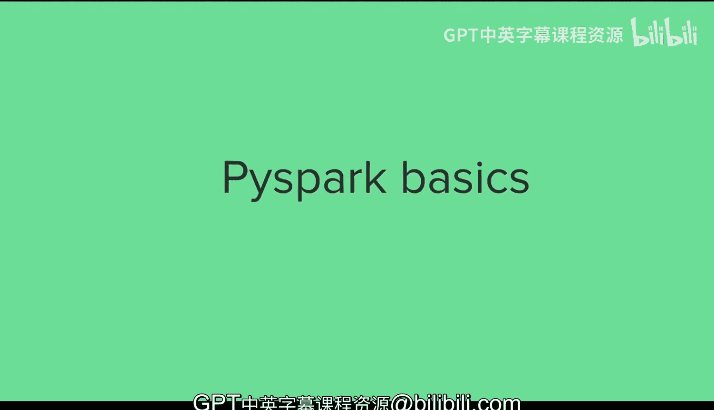
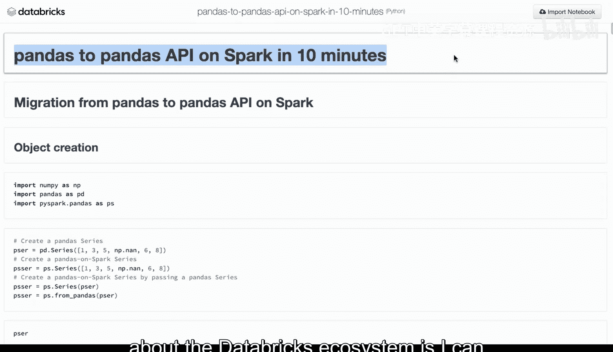
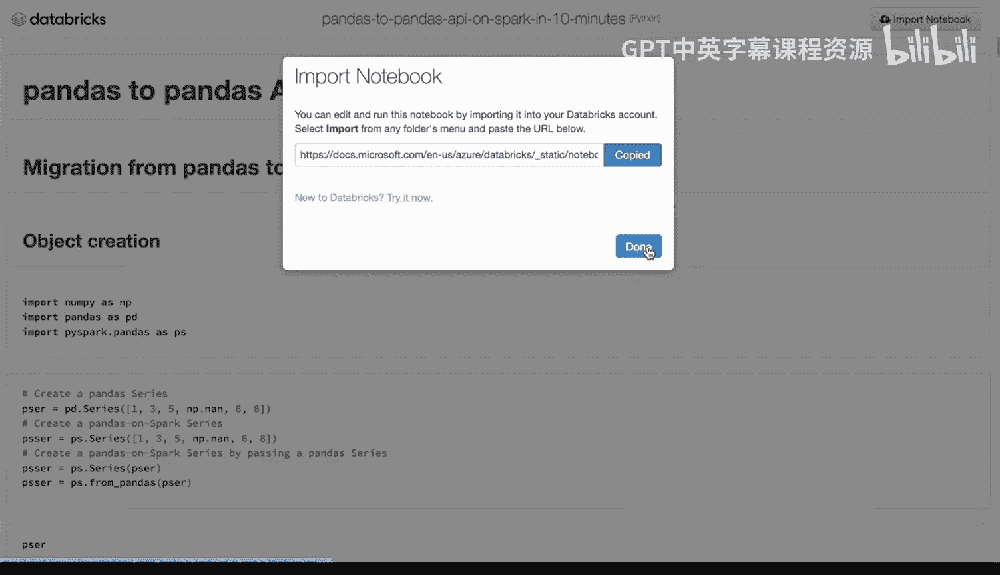
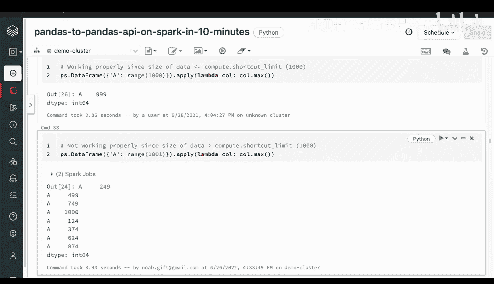

# 应用Python数据工程：3：Databricks上的PySpark简介 🚀




在本节课中，我们将要学习PySpark的基础知识，特别是如何在Databricks平台上使用它来处理大规模数据。我们将了解DataFrame的核心概念，并探索如何通过熟悉的Pandas API来操作PySpark，从而实现代码的平滑迁移和高效的大数据处理。

## 核心概念：DataFrame与API

DataFrame是一种列式数据结构，类似于CSV文件或Excel电子表格。您可以通过常规的Pandas API或Koalas接口与这些DataFrame进行交互。Koalas接口能够与Spark语言通信，并大规模地处理DataFrame。

以下是一个关键的工作流程示例：数据湖（对象存储）中的数据通过DBFS或集群被合并处理，随后进行大规模的数据操作。这可以是一个应用函数，我们接收输入，执行计算，将计算应用到DataFrame的所有行，最后可能进行可视化。

## PySpark DataFrame 操作示例

上一节我们介绍了DataFrame的基本概念，本节中我们来看看具体的代码操作。

以下代码展示了如何创建PySpark DataFrame并进行基本操作：

```python
from pyspark.sql import Row

# 创建部门行
department = Row("id", "name")
# 创建员工行
employee = Row("first_name", "last_name", "email", "department_id")
```

这段代码直接源自Azure Databricks的文档，其工作方式与常规编程非常相似，区别在于它能够处理大数据。

### 数据合并与用户定义函数

以下是两个关键操作的介绍。

**合并DataFrame**：
合并两个DataFrame非常简单。可以使用`union`方法。

```python
union_df = df1.union(df2)
display(union_df)
```

**创建用户定义函数**：
构建UDF也很直接。首先定义一个函数，然后将其注册以便应用到DataFrame上。这正是其强大之处——能够大规模地应用这些函数。

```python
from pyspark.sql.functions import udf
from pyspark.sql.types import IntegerType

def square(x):
    return x * x

square_udf = udf(square, IntegerType())
# 随后可将 square_udf 应用于DataFrame列
```

## PySpark Pandas API：解决扩展性问题

常规Pandas API的一个局限是难以扩展至大数据场景。它更适用于学术规模的数据集。在现实场景中，您需要能与更大数据平台交互的工具。

PySpark Pandas API解决了这个问题。只要在Databricks Runtime 10.0或更高版本上运行，您就可以使用它。


```python
import pyspark.pandas as ps
```

它的优势在于，其使用方式与您熟悉的Pandas非常相似，但幕后却在分布式处理数据，从而能够随数据规模扩展。





### 实践对比：Pandas vs PySpark Pandas

让我们通过实际操作来感受两者的区别。以下代码对比了常规Pandas和PySpark Pandas的使用。

首先导入必要的库并创建序列：

```python
import numpy as np
import pandas as pd
import pyspark.pandas as ps

# 创建Pandas Series
p_series = pd.Series([1, 2, 3, 4, 5])
# 创建PySpark Pandas Series
ps_series = ps.Series([1, 2, 3, 4, 5])
```

运行后，两者操作方式相似。使用`ps_series`可以查看输出。

**创建与排序DataFrame**：

```python
# 创建Pandas DataFrame
pdf = pd.DataFrame({'a': [1, 2, 3], 'b': [4, 5, 6]})
# 创建PySpark Pandas DataFrame
psdf = ps.DataFrame({'a': [1, 2, 3], 'b': [4, 5, 6]})

# 排序
pdf_sorted = pdf.sort_values(by='a')
psdf_sorted = psdf.sort_values(by='a')
```

两者工作流几乎完全相同，唯一的本质区别是后者能处理大数据。

**查看数据与统计**：
您可以使用熟悉的Pandas方法，如`.head()`查看前几行，或`.describe()`获取描述性统计信息。

```python
# 查看前几行
print(psdf.head())
# 获取描述性统计
print(psdf.describe())
```

即使面对海量数据，由于PySpark Pandas的封装，操作方式与处理小数据集一致。

**数据选择与切片**：
选择列、使用`loc`进行标签索引或切片等操作也与Pandas类似。

```python
# 选择单列
col_a = psdf['a']
# 选择多列
cols_ab = psdf[['a', 'b']]
# 使用loc切片
slice_data = psdf.loc[0:2, 'a']
```

## 应用自定义函数

在数据工程工作流中，一个经典且强大的操作是编写函数并将其应用到DataFrame上。

您可以直接应用函数，也可以使用Lambda表达式。

```python
# 定义一个平方函数
def square(x):
    return x ** 2

# 将函数应用到DataFrame的列上
psdf['a_squared'] = psdf['a'].apply(square)

# 使用Lambda表达式
psdf['b_squared'] = psdf['b'].apply(lambda x: x ** 2)
```

这为熟悉Pandas的程序员提供了强大且熟悉的方式来利用PySpark处理大数据。

## 总结



本节课中我们一起学习了PySpark在Databricks上的核心应用。我们理解了DataFrame作为列式数据结构的基础，探索了通过PySpark Pandas API如何用类似Pandas的语法处理大规模数据，并实践了数据操作、合并、自定义函数应用等关键技能。关键在于，PySpark使得为小数据编写的Pandas代码能够无缝扩展到大数据环境中，极大地提升了数据工程的处理能力和效率。