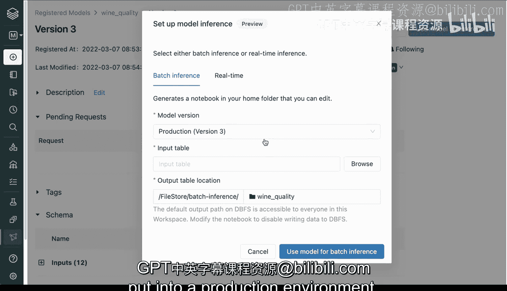

# 杜克大学《应用Python数据工程（3课全）｜Applied Python Data Engineering》中英字幕 p25 25_03_03_探索Databricks Azure功能.zh_en -BV1nz421i7KP_p25-

Take a look here at this integration of the Databricks platform alongside the Azure cloud computing platform。

 and notice here that at the very beginning， you can toggle between two modes。

 and this is a really important consideration to be aware of that data science and engineering mode is really for doing notebooks。

 it's optimized for that kind of workflow。 And if you select this workflow。

 all of the settings here from the reos to the search to the data that the compute。

 they're really designed for you to be able to spin up machines and work on things that are not necessarily a machine learning related。

 So GPUs don't necessarily come with the default set of machines that you would spin up from a cluster。

If you toggle over to the machine learning mode， things shift a little bit and notice here they kind of guide you to the other types of things you can do。

 including Autom， you can also do training and also take a look at things like a feature store So there's a couple different modes to be aware of Now if you want to go ahead and explore some of these features here let's go ahead and take a look So first you have this concept of create you can create a notebook。

 you can create a table， a cluster， a job， a repo Autom experiment， an experiment or model。

 So this is really a good place to start depending on what it is you want to do the workspace as we've discussed before is where you would actually keep your notebooks。

 the repo is where you would go through and integrate with Github and then if you want to scroll down here to the data section here this is where if you wanted to actually upload things to your DBFS you could go ahead and do that here you also can query exist。

Tables that have been integrated， for example。This diamonds table here。

 I can actually take a look at it and look at the schema， look at the sample data。

 do some kind of operation to it。 Now， notice it does need to have a cluster associated with it so that it can do these operations。

 So all。Data operations here need to have a cluster associated so that it can actually go through and query the data and do descriptive statistics。

 Now， if you did want to do a compute instance， there's a couple things to point out here one is if I go to compute and I go ahead and I say create cluster one gotcha here to be aware of that does catch people by surprise is when you go to the databricks runtime version something to be aware of is there standard mode and there's ML mode。

 if you do standard， some of the machine learning libraries are not loaded And if you go through and you try to do an example notebook。

 they won't work， if you go to the ML mode， notice that there's actually a slightly different iteration of the software。

And so in many cases， you'd want to pick the latest version of ML。

 potentially non GP to start with to control cost and then go through here and set up your cluster。

Finally， a few other things to be aware of would be you can go to the Workflows tab， Expments tab。

 feature store tab， or even models here and take a look at the different models that are already loaded。

When you go into and look at the models here， you can also drill down， look at what's happening。

See if it's actually been put into a production environment。And even use a model for inference。

