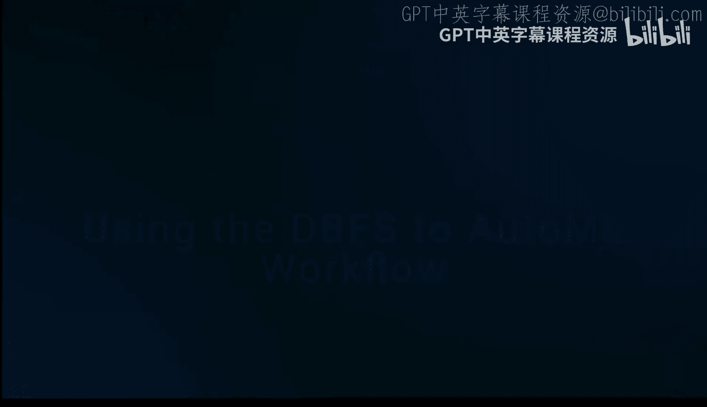
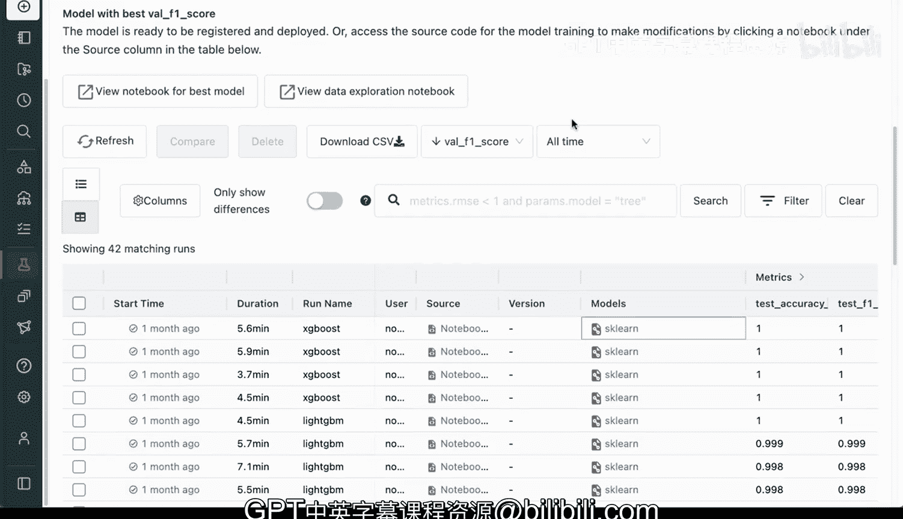

# 杜克大学《应用Python数据工程（3课全）｜Applied Python Data Engineering》中英字幕 p26 26_03_05_使用DBFS到AutoML工作流.zh_en -BV1nz421i7KP_p26-

Let's take a look at how we can go from data itself stored in the DBFS。

And actually take that data and go to Autol and really create a high levell in in experience。

 So as long as something is inside of the Databricks file system。

 and in this case we have two tables here， we have the diamonds table and the people table。

 we can actually do things with it and in particular。

 if I go to the diamonds table here and let's go and take a look at this One of the nice things about the data exploration tool here is that it'll give you the schema。

 it'll show you a little bit of a sample for the data。

 So you can actually take a look at the features that you would want to use potentially in an autol experiment。

 So now that I know that there are some features here like carrot cut color。

 you know things like that， that could be one thing I do Likewise。

 if I go to the people right here and and I go into this database you can see that there's a bunch of columns here that I can use。

 including the ID of the people in the database， the first name， the middle name， last name gender。

So what I could do here is actually take this information and use it to predict a gender based on the data that I've got in my system。

 So how would I do this， Well， first all we have to do is go over to experiments here and I've got this open in a tab and I can configure an Autom experiment。

 And in particular， one of the things that I can do is go select a cluster I've got set up in this case。

 you can see it's got 12 cores available， it's running DBr 11。

0 So it's running a newer version of the M framework and then I would want to select what problem I'm going to solve in this case。

 because I'm going to predict the gender I'm going to predict a classification based problem Now it's going to need to be told where the data lives and if I go through here I can actually select the different data set that I want in this case I'm going to go ahead and select the people database here。

And now that I've got that， it shows me the entire schema it's able to automatically handle it right and it's even able to do imputation as well。

 And now all I need to do is select the prediction target。

 So I need to tell it what I wanted to predict and I can go down here and select gender and then notice it'll create an experiment for us So let's go ahead and start this autom experiments。

Great now as this thing is running and we go through here and we get this thing training。

 all I need to do is go ahead and wait for it to finish and then it'll come up with a bunch of data here that shows us all of the runs Since I've already done this previously。

 if I go back over to this experiment， you can see all of the different tracking runs that have occurred and in particular if we go down here。

 one of the things that we can take a look at is that this has been run about a month ago。

 and you can see each of the different experiments。

 how long they took what was the model that was used the user that did it also the source notebook and finally the model that was actually used and this was a psychic learn model Now if I want to go ahead and select this。

 I could actually select this model and push it directly into production。

 This is where the model tracking system comes into play。Likewise。

 one of the really incredible things about Databricks is that notice it creates us。

A view notebook for best model and a view data exploration for best model。

 And so what's great about this is I can actually go through and look at the modeling code that would show me how to deploy the model or I can look at the exploratory data analysis code。

 So even if you are later going to go through and do all of this stuff yourself this workflow of either uploading some data to the DBFS or taking a bit of data that's already on the DBFS and then going through and creating an Autom experiment is really a very straightforward way to kind of get started with what it is you're going to do on your Databricks workflow project and later then deploy that into production as kind of a first pass。

😊。

