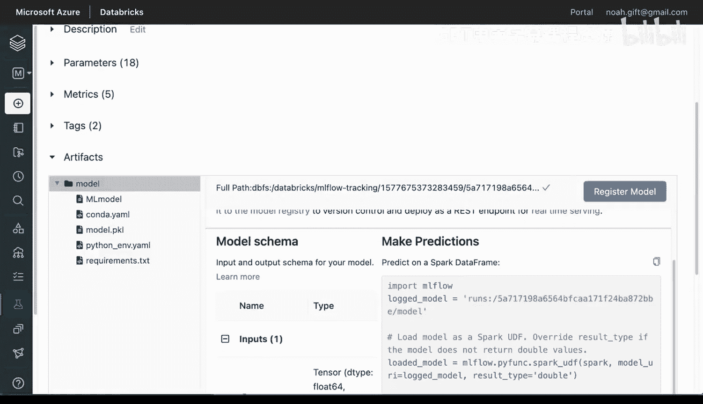
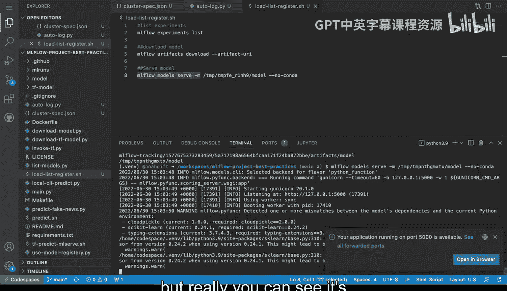

# 杜克大学《应用Python数据工程（3课全）｜Applied Python Data Engineering》中英字幕 p27 27_03_06_加载、注册和部署机器学习模型.zh_en -BV1nz421i7KP_p27-

Mages of using databricks is this concept of logging， loading， registering。

 and then deploying your M L model。 Let's go ahead and take a look at a few examples here。

To start with there are these API commands in this case。

 you can see I'm loading a model locally with Python。 I could also load it from a spark data frame。

 but if I go into the user interface here， I also can interact with these examples。

 So let's go ahead and take a look at one of these examples here。

 I've got a quick start guide And if I go through here and I look at the model here。

And I'm able to actually go to this model。 You can notice that I have the artifacts all registered。

 I have the ability to make predictions that are shown to me， and then also I have this path。

 and this path is really powerful because it allows me to interact with it remotely。

 So let's go ahead and take a look at this so。

If I go into the workflow for load list， register and Ser。

 the first thing that I'd want to take a look at is potentially all of the experiments that are on my platform。

Here we go。 M L flow experiments list。 You can see there's a whole list of experiments。

 and I could actually go to that experiment inside of the Databricks interface and find the 1 I care about and then go ahead and look for the model U I in this case。

 because I already have that model U I。I don't have to actually go ahead and do that。 Instead。

 I can just go back to my example here and copy this。 And if I go back to here。

 what I can actually do is download that model。 So let's go ahead and do that。 Let's。

 let's go ahead and say。First here， here is my path to where the model lives inside of Databricks。

 and then I go through here and I say，Look， I want to download this。

And I'm able to actually take that entire package。 Finally， to serve it。 It's pretty straightforward。

 All I need to do is do this and say M L flow model， Ser dash M。😊，Take that path right here。And then。

 say。No Conda。 And this should serve out the model I just downloaded from inside of Databricks。

 And then if I wanted to make an API call， I could use curl， I could also use Python， but really。

 you can see it's a very straightforward process to interact with this remote Databrick server。

