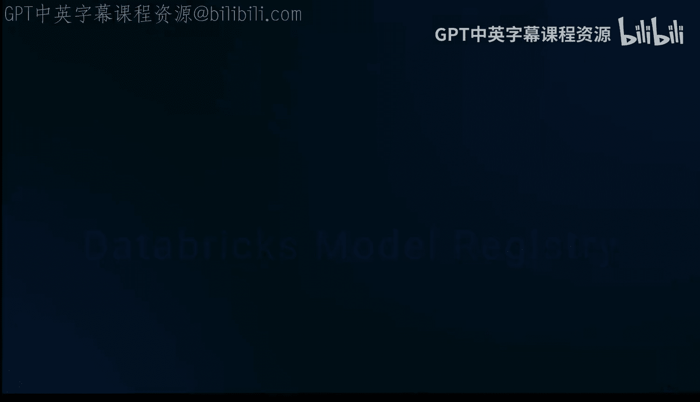
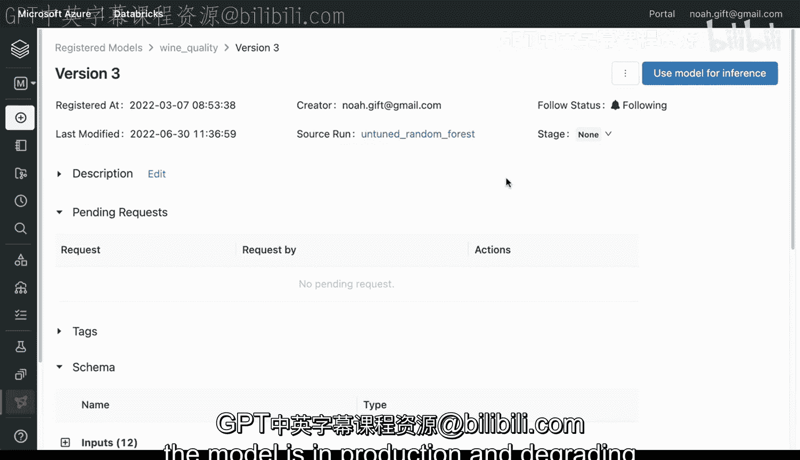

# 杜克大学《应用Python数据工程（3课全）｜Applied Python Data Engineering》中英字幕 p28 28_03_08_Databricks模型注册表.zh_en -BV1nz421i7KP_p28-

Let's take a look here at Microsoft Azure Databricks integration。

 I'm inside of the machine learning interface here， right in this particular tab。

 And what I want to look at next is the model registry itself。

 You can see some of the artifacts in this recent pane。 And this is one way to get to it。

 but I can also scroll down here。 and go to models you can see that's the model icon。

 once I'm in models， I have access to every model that I've registered inside of the Databricks platform。

 Now let's go ahead and take a look at first， this model here that has four versions。

 and notice here that there are no staging or production aspects set up yet。

If I go into this particular model， the elastic wine model。

 you can see here that if I select serving， it hasn't yet been enabled for serving。

 but I can click a version。 And one of the fun things about this particular version here is I can look at the source run。

😊，And I can go ahead and select that source run， And it shows me exactly what I need to do to run this particular example。

 And this is actually a great way to show how this deep integration allows me to have very reproducible models that I can version and select and do whatever I need to do with。

 including do a one liner here where I'm able to actually select a particular Giub repo and rerun this model。

 Now， if I go back to the。😊，Example here， and I get into my elastic wine model and go back even further。

 We can also take a look at a nether example here。 And one of those examples would be this wine quality example and notice if I select version 3。

 One of the things that it shows me is it shows me the source run like how this model was created and also gives me the ability to transition stages。

 And this is important for the operation side of things is that I could request that I want to potentially bring this model back to a nonproduction phase that would be one thing I could do。

I could also go back and I could request it to go to an archive stage， whatever it is I needed to do。

 this is a stagebased progression so that my organization could work with the data science team and the operations team to make sure that I'm really keeping track of what version of the model is in production and degrading some and pushing others into production。

