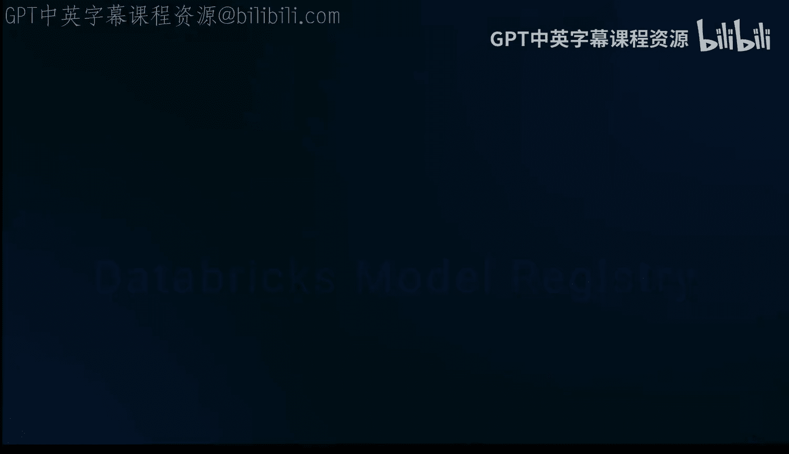
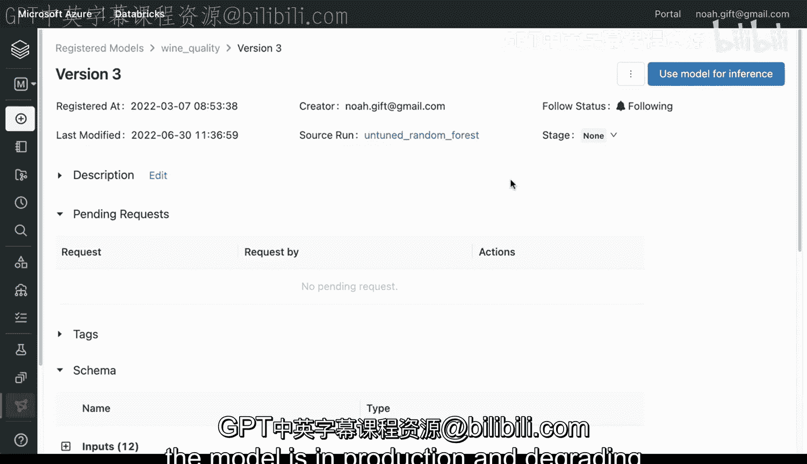

# 应用Python数据工程：3：Databricks模型注册表

在本节课中，我们将学习Microsoft Azure Databricks平台中的模型注册表功能。我们将了解如何访问已注册的模型、查看模型版本、追溯模型来源，以及管理模型的生命周期阶段。

## 访问模型注册表

上一节我们介绍了Databricks的机器学习界面。本节中，我们来看看如何访问模型注册表。

在机器学习界面中，可以通过多种方式进入模型注册表。一种方式是通过右侧最近活动面板中的工件链接进入。另一种方式是向下滚动，点击“模型”图标。进入“模型”页面后，即可访问在Databricks平台中注册的所有模型。

## 查看模型与版本

以下是查看模型及其版本信息的步骤。

*   在模型列表中，可以看到每个模型及其版本数量。例如，一个模型可能显示有4个版本。
*   初始状态下，模型可能尚未设置“暂存”或“生产”等阶段标签。
*   点击进入一个具体模型，例如“elastic wine model”。
*   在模型详情页，选择“服务”标签页，可以看到该模型尚未启用服务功能。
*   点击一个具体的版本号，可以查看该版本的详细信息。

## 追溯模型来源与复现

一个关键功能是能够追溯模型的来源。这确保了模型的可复现性。

在模型版本详情页，可以找到“源运行”的链接。点击该链接，会跳转到创建此模型版本时对应的运行记录。该记录详细展示了运行此模型所需的所有步骤和代码。这种深度集成使得模型可以被版本化、选择，并方便地进行各种操作。

例如，通过一个简单的命令行，就可以选择特定的Git仓库并重新运行此模型。

## 管理模型生命周期阶段

模型注册表的核心价值在于管理模型从开发到部署的生命周期。我们通过另一个例子来具体说明。

回到模型列表，查看另一个模型，例如“wine quality example”。选择其版本3，页面会显示该版本的源运行信息，同时提供“转换阶段”的功能。

这对于运维工作至关重要。例如，可以请求将某个模型从生产环境移回非生产阶段。也可以请求将模型归档。

这是一种基于阶段的生命周期管理流程。它使得组织能够协调数据科学团队和运维团队的工作，确保准确追踪生产环境中使用的是哪个模型版本，并管理模型的降级或上线流程。

## 总结

本节课中我们一起学习了Databricks模型注册表的核心操作。我们了解了如何访问和查看已注册的模型及其版本，如何通过“源运行”功能追溯和复现模型，以及如何使用阶段转换功能来管理模型的生命周期，从而在团队协作中确保模型部署的清晰与可控。