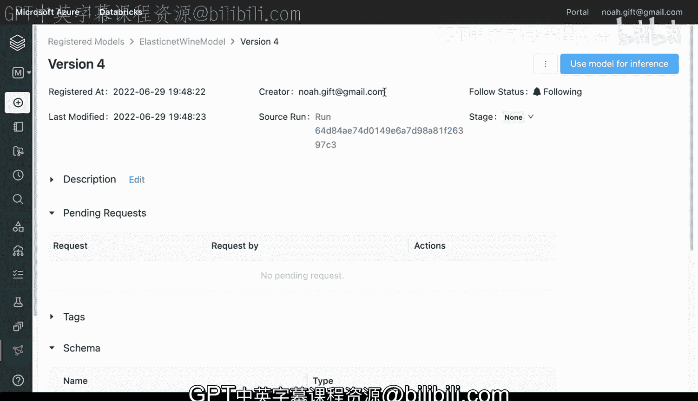

# 杜克大学《应用Python数据工程（3课全）｜Applied Python Data Engineering》中英字幕 p29 29_03_09_Databricks上的模型服务.zh_en -BV1nz421i7KP_p29-

Now that we have a little bit more of an understanding around the model registry。

 let's dive into how to serve out a model。 So again。

 you can see the models that show up in recent actions。

 We can also go right to the model section here。 And if I want to select a particular model and deploy it。

 I could actually go through here。Here we go， elasticastic wine model。

 And I could say use this model for inference。 So if I go ahead and select it。

 Now it's up to me to decide do I want to do a batchbased inference。 So， for example。

 score something once maybe every night， so I can do some kind of credit risk application or I can also do a real time。

 And when I do a real time， it'll enable a model serving behind a rest API。

 Let's go ahead and look at that real quick and see how this would actually pan out。

 So once you've got this in a pending state here， eventually it'll spin up a machine。

 it'll show you what particular model is running， and then it'll show you different events associated with it。

 So， for example， when the endpoint was updated when the cluster launched and you can also take a look at the kind of cluster you have and even configure it。

 right， So you could go through here and pick potentially a GPUbased inference type。

 if that's the kind of model that you have。The other thing that's really useful about this model serving interface here is how you can toggle back and forth and select different versions。

 So in this case， I would be selecting all of these different versions， and then finally。

 I could even invoke these by using things like the curl command， for example。

 and it shows me exactly how to invoke it I could use a Python command again。

 it shows me exactly how to invoke it。 So really it's a point and click interface in order to serve out an online model likewise。

😊，If I want to go back here and I want to select， for example， this model， use model for inference。

 if I select batch inference， I also can pick out an input table where again。

 I would do a one time operation and then go ahead and use that for a batch based operation。

 So it is pretty straightforward to do model serving inside of Databricks and you can also obviously run it locally as well。

