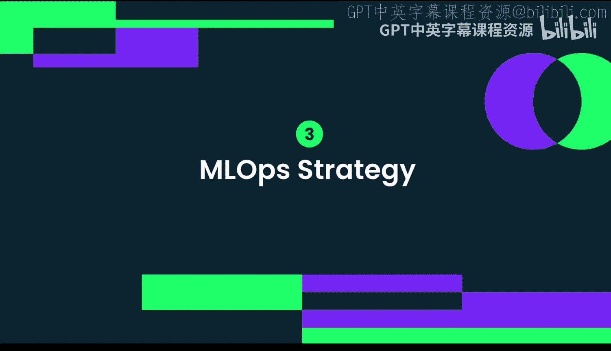
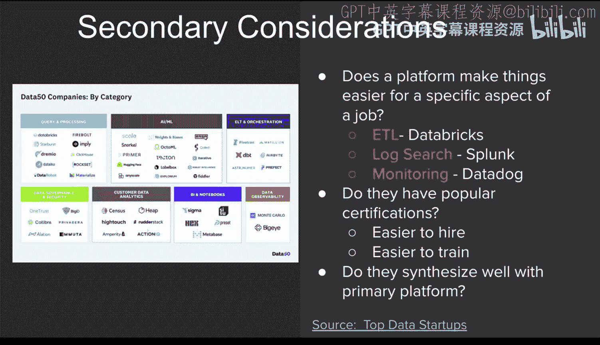
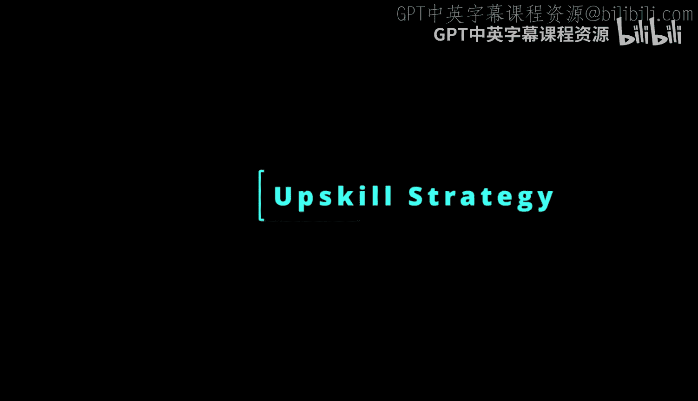
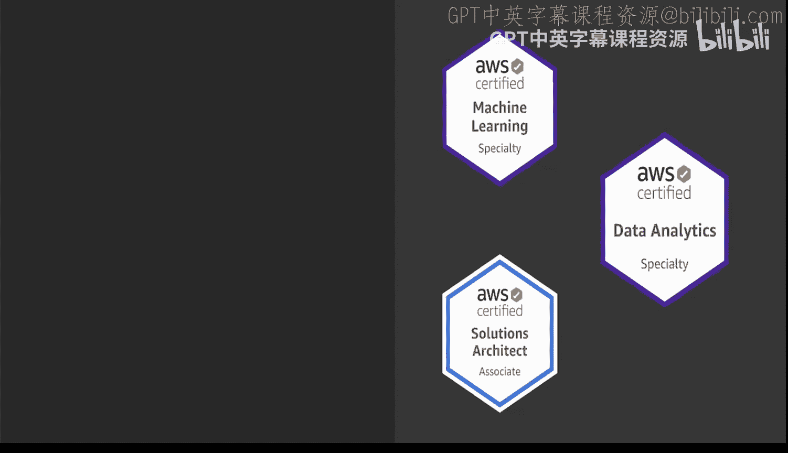
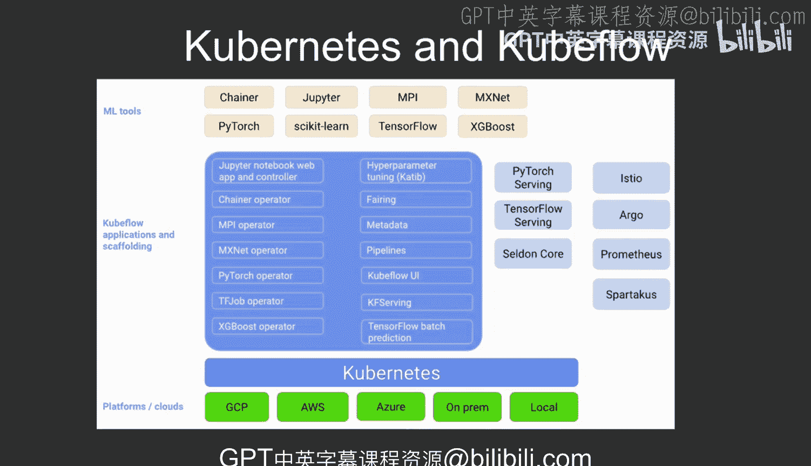

# 杜克大学《应用Python数据工程（3课全）｜Applied Python Data Engineering》中英字幕 p30 30_03_01_什么是MLOps.zh_en -BV1nz421i7KP_p30-

Let's dive into why MOs。 This is a great way to get started with understanding the use cases for MOs。

 to start with one of the things to consider is the motivation。 Why do we need MOs。

 And what is it really briefly， It's a way of operationalizing models and putting them into production to make them useful。

 Another thing to consider is the Covid-19 crisis and how it revealed the need for things like MOs。

 We need solutions quickly。Also some of the motivation is how to get started with MLOs。

 many academics or new people in data science have an inability to get these models into production。

 and that's one of the reasons for MLOs and also there are major MLOs platforms out there and it's important to know which of these platforms are helpful in operationalizing your models。

To start with， let's take a look at where things are headed。

 and this is really revealing is that the Wall Street Journal reported on October 16。

2020 that there were 775。Thousand0 jobs in cloud in 2020 up from 400，000 in 2019。

 and if you looked at LinkedIn， you can see that in fact， the data engineers are on the rise。

 machine learning engineer is on the rise but cloud itself is really struggling and in terms of getting enough people to to apply for these jobs。

 but data science is on the decline Now it doesn't mean that data science is and an important job。

 it means that these other jobs are becoming part of the infrastructure to do data science。

 Now if we take a look at what DevOs in MLOs really is， if you don't have DevOs。

 you can't possibly do MLOs and it's a hierarchy of needs and so when you look at something like the DevOs ecosystem of automating software engineering tasks。

 automating the deployment of infrastructure building continuous integration。

 continuous delivery that's a mandatory。Once you have that。

 you can build on top of it so you can build date automation systems that are able to leverage the Devps platform。

 You then next can go to platform automation and use these platform tools to then get to the point where you can do operationalization。

 And this is really the concept is this building on more and more sophisticated forms of automation。

Now one of the ways to consider the concept of continuous delivery with MLOs is this idea of using multiple branches and deploying the code to a main branch and a stadium branch and a production branch。

 and each of these has infrastructure as code inside。

 so essentially the environment is just a piece of code and it can automatically deploy and it uses this concept of Kaiszen。

 which is automatic improvement of your software system and by using Kaiszen you're able to really leverage a lot of the infrastructure around statistical processes for improving things that came out of the post-worl War II automobile industry and that's really the concept of Kazen and Japanese which is the concept of continuous improvement。

Now， data operations， one way to think about it is that it's like a water hookup。

 If you don't have water to your house， you can't have advanced tools like a dishwasher or a washing machine or a spa right you have to have the basic hookup。

 So the same thing goes with data。 you need to have some kind of sophisticated system to collect data this could be the data collection jobs that run at midnight。

 you also need to refer to things like a feature store where you would have maybe refined aspects of your data which be stored in there。

 And also you need to use tools like potentially serverless data engineering tools where you don't have to do a lot of the heavy lifting behind the scenes。

 it's managed for you and also big data processing tools like Spark is a great example and databricks and then with model versioning。

 This is the net aspect of data where you're able to keep these different models in potentially a data lake so that you're able to actually go back in time and reevaluate something you did。

 This is data operations。Now platform automation is really the next level up here and this is a good example of a sageMake project architecture and in the data science workflow we have the ingestion of data。

 we have exploratory data analysis， we have modeling we have a conclusion and if you look at this whole architecture really this is not something you want to do on your own because it's a giant distributed system instead you want to use a platform and with a platform it gives you the ability to spin up training systems that can automatically scale up and down。

 it gives you the ability to version that model and train it inside of the object storage system or the data lake。

 and finally when it's ready to deploy， you can set up these inference endpoints that can elastically scale up and down and also toggle between different model versions you really don't want to do this。

 you want to use a platform to orchestrate this kind of automation。

Now the feedback loop behind MLOps here is this concept of create and retrain。

 do continuous delivery， audit for the pipeline and also observe things like the data drift。

 so really it's a feedback loop here that you're constantly evaluating that train model to make sure it hits your business requirements and that the accuracy is still holding up when new data comes into your system。

Another concept that's really critical with MLOs is this concept of build once but deploy mini or create once and deploy mini。

 why would you want to build a thing the same kind of model multiple times really you want a system that can leverage the exact same model so it can be deployed to different components like a mobile app。

 a web app， a commandin tool。There's another thing that I think is very interesting。

 which I call the rule of 25。 and the concept is there is no silver bullet。

 and I think there is a lot of debate in the academic world about the concept of data centric or model centric But I would say that's actually the wrong argument。

 the answer is you need all of those things。 Unfortunately， there isn't this perfect solution。

 you need to have automation， which is devops， you need to have data automation， which is data ops。

 you need to have model automation， which is the concept of MLops。

 and you also need to have the business side down so that you understand the problem in a way that is framed correctly and that your model is actually reaching the business needs and you're even understanding。

How to actually implement a problem correctly。 So， for example。

 if you go to a radiologist and he said we're going to automate your job。

 they may tell you that even if they wanted to automate their job。

 there's certain aspects that are legal requirements that need a human in the loop。

 And so this is really the rule of 25 is that you don't think that there's a silver bullet that all of a sudden we've discovered there's some new you know binary switch to toggle。

 And then all of a sudden， Mops is easy。 Really， it isn't easy。

 It's a comprehensive approach where you equally take into consideration of these four quadrants。

Now let's dive into some of the use cases for MLOs。

 I think a classic use case would be autonomous vehicles and we see this really forming where on one hand there's a lot of progress but also there could be a business framing problem where maybe some of these automobilemobil companies need to actually focus on a new road versus trying to optimize for something that maybe will never work exactly the way they expect and so this is a very interesting ethical use case as well I machine learning production from zero。

 I think this is a classic use case here you're an academic。

 you want to get your model into production how do you do it applieded computer vision is another great example of an MLOps use case where we see this actually all over the place。

 you know license plate reading would be a good example and then real- world reliability is needed versus the concept of a research department。

So now that we understand a little bit about what MLOs is， let's dive into the MLOP strategy。

So the first thing to be aware of is again there is no silver bullet。

 it's important to pick the right technology partners like for example。

 using the AWS SageMake platform or using Kubernetes or using some other key solution that fits in a complementary way with what you're already doing。

Another thing to consider is this concept of a primary， a secondary investment。

 and so in terms of a primary， this would be things like low cost， is it popular。

 is it easy to hire people does it have really comprehensive holdings and can you build an abstraction on top of it。

 a secondary platform could be maybe it solves one problem really well。

 like Databricks does spark really well， Splunk does analytics really well。

 snowflake does big data really well， and then once you have those components。

 the next thing to consider is this concept of an investment。

 are you doing an R&D focus right are you actually diving into technologies like deep learning。

 Kubernetes， edge-based computing， are you using pretrained models。

 these are all really important considerations。In terms of the primary consideration。

 one way to take a look at this would be to look at the data right if we're doing data science。

 we should look at data ourselves and in terms of the cloud。

 really the top two players are AWS and Azure， 33% 21% and the enterprise support is also a key consideration also the industry standard certifications。

 the ability to hire the ability to upskill your staff。

 these are all really important considerations when you're choosing a primary platform。

Now in terms of secondary considerations， a few things to consider would be。

 does a platform make things easier for a specific aspect of a job， ETL， potentially Databricks。

 log search， potentially splunk， monitoring Datadog。

 know do they have easy and popular certifications because this would make it a lot easier to hire and do they synthesize really well with your primary platform are。

 for example， firstpart integrations into those systems？

Another thing to consider with hiring an upki strategy is。

 you are you leveraging the learning platforms themselves and are you encouraging people in your organization to do things like a practice self awareness。

 so you would know what you do know what you don't know a good way to do this would be to have yearly and quarterly learning goals。

Paying people to learn， you know， subscribing to learning platforms like O'reilly or LinkedIn learning。

These are all great examples of kind of building that structure in your organization。

A few key certifications for MLOs that I would consider would be the AWS machine learning certification would be a good example。

 The AWS data analyticslytic specialty the solutions architect for others。

 snowflake would be an interesting one to be certified in Data breaks would be an interesting one to be certified in and the Google Cloud would be an interesting one to be certified。

 So there are some really good industry standard certifications that are kind of in the area of MLOs。

Now what about future trends for MLOs， Well， a couple of them that I think are pretty interesting。

 One would be NFs ops， So are you doing NFs based deployment so you have let's say Github and you would develop inside of GitHub and you would work with。

 let's say Cloud9， the elastic file system would be the source of truth and you could actually integrate with build systems and automatically deploy code subsecon because they all have this centralized source of truth。

 I think we're seeing more and more of these kind of file system based approaches to doing machine learning operations and this is really a heavy component of NFs ops。

Now Kubernetes and Kubflowlow， this would be another one to heavily consider things like ML tools。

 Cubflowlow platforms that are integrated with it。 So again。

 whatever it is that you're thinking is a key technology here。

 these are some of the trends that are emerging with MLOs。

