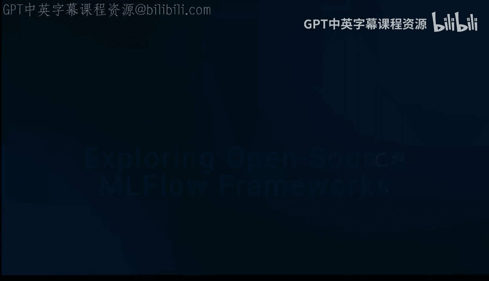
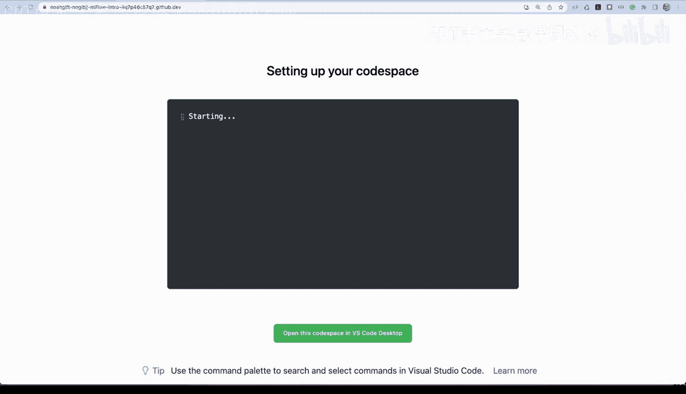
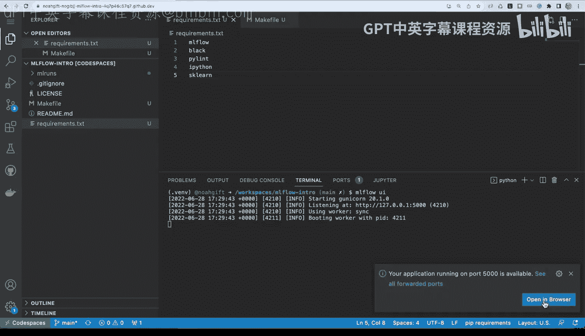
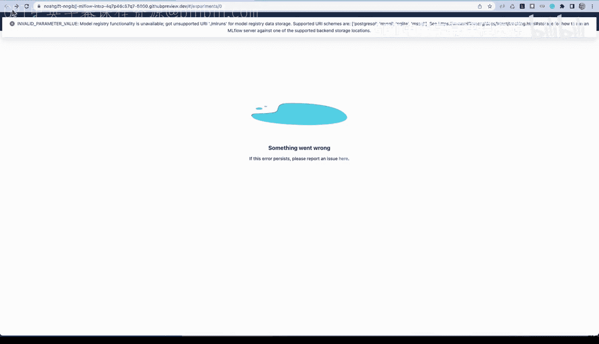
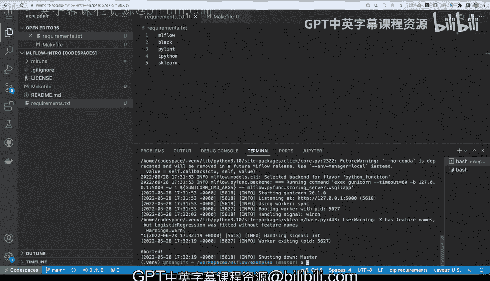

# 杜克大学《应用Python数据工程（3课全）｜Applied Python Data Engineering》中英字幕 p31 31_03_03_探索开源MLflow框架.zh_en -BV1nz421i7KP_p31-

Let's take a look at ML flow an open source model tracking and model versiongeing system that comes with databricks。

 but also is able to be used by itself。 It has a lot of exciting features。 And to start off with。

 let's just walk through the quick start guide here before I go in and show you how to use it。

 First step， we have Pip install ML flow。 This is how you get started。

 And then if we scroll down here。 you can see that。😊，When you want to go to the tracking API here。

 as long as you've gone through and done a Git clone of the MLflow repo。

 you can CDd into the examples subdirecty and then actually go through all of these examples and in this case。

 for example， the MLflow tracking API you could log metrics and artifacts so for example。

 if you wanted to go in and measure the last time it trained and maybe some hyperparameters you used。

 this is where you would actually go through here and put that if you want to take a look at the user interface to let's say look at different model runs and different model versions you would just type in MLflow UI。

And then if you want to go through and test out some of the projects。

 here's one of the things you can do， you can actually just go through here like this and point it to a subdirecty。

Or what is also pretty cool is that you can actually point it to an actual Github URL。

 So I think this is actually quite nice。 One thing to be aware of here is that you may want to decide to use noconda if you don't want to use theda package management system and then for serving out models if you want to train it here we go。

 you just go here and train and if you want to run it。

 it'll you'll take that ID that is generated and then actually serve it out and take a look at it and then if you want to invoke the endpoint there you go。

 you can go ahead and invoke that endpoint。 So really a pretty comprehensive set of features here。

 So let's go ahead and go through this example on our own here and take a look at it。

 So I'm going to go into a repo called Mflow that I've set up inside of Github and in fact。

 what I'm going to do is I'm going to use Github code spaces which is a great environment for experimenting with code because it hooks direct。

intoto my environment， and I can actually really walk through this tutorial。

And just essentially kick the tires on the different things that we would want to do inside of this project。

 So let's go ahead and let this thing launch。 Here we go。 Notice I'm in a virtual environment。

 and I've got some requirements installed here。 I installed Mflow。

 a formatting tool Linting a interactive interpreter and psyt learn。

 those are some of the things that I care about And now if I want to go ahead and take a look at Mlflow Ui。

 How would I do this， Well let's go ahead and just type in Mlflow Ui And what's great about the Github codespaces environment here is that what's what's really cool is that it will allow me to preview this environment in a browser。

 There we go。 and we can see my tracking system is is able to be run and I can also go ahead and take a look at models in this case。

 there are no models that are currently running But this is a nice feature that we have available。

 Now， what if I did want to go in。😊。

And take a look at some of the other things that you can do， well， if we go into ML flow here。

This subdirectory。 And I go into examples。Here we go。

 You can see that there's a bunch of different examples here。

 So what I'm going to do is I'm going to first run the second learn example that they have in the tutorial。

 and because I'm not a huge con to person。I'm going to say no Conda。There we go。

And now that I've run this command here， we can see that it's actually able to execute。 And in fact。

 we have the root mean squared error。 and and I've been able to actually get this thing to the project to run。

 now we could as well invoke a full git repo， which is again pretty pretty interesting。

 if we go through here and I do again， I'll add the noconda at the end here。

 not bad that you can actually go through here and invoke it。 And we see again。

 you just pointed to a Github repo， which is， which is really cool。

 So the other thing I'm going to do is I'm going to。😊，Train my model。

 And right here I go Python p I it learn。 and this has the the stuff inside of there that allows it to interface with ML flow。

 And I'm going to take this I and I'm going to use it when I serve out the model。

 So how do I do this。 Well， will the syntax is as follows。

 It will be ML flow model and you need to put in this I inside of your run。

 Let's go ahead and do this like this。Perfect。And we can say again。No condo。Perfect。

And now that it's been able to be invoked， what I can do is open up another terminal here。

 Let's go ahead and open up one more terminal， and I can actually grab。

A curl command that will invoke that endpoint。 There we go。

 We see that the model is actually served out a result。 In fact。

 we could see this being served out here。 So really a pretty comprehensive solution here for playing around with models。

 model versiongeoning and also the fact that you can point it to Github repos。

