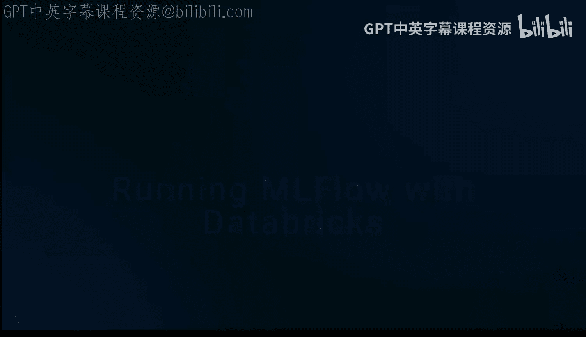
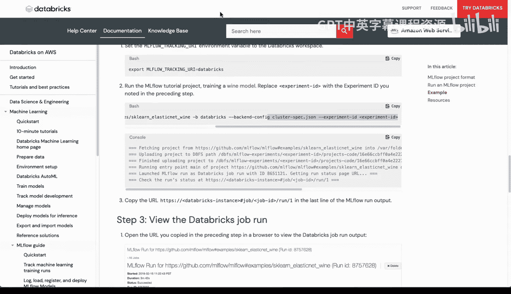
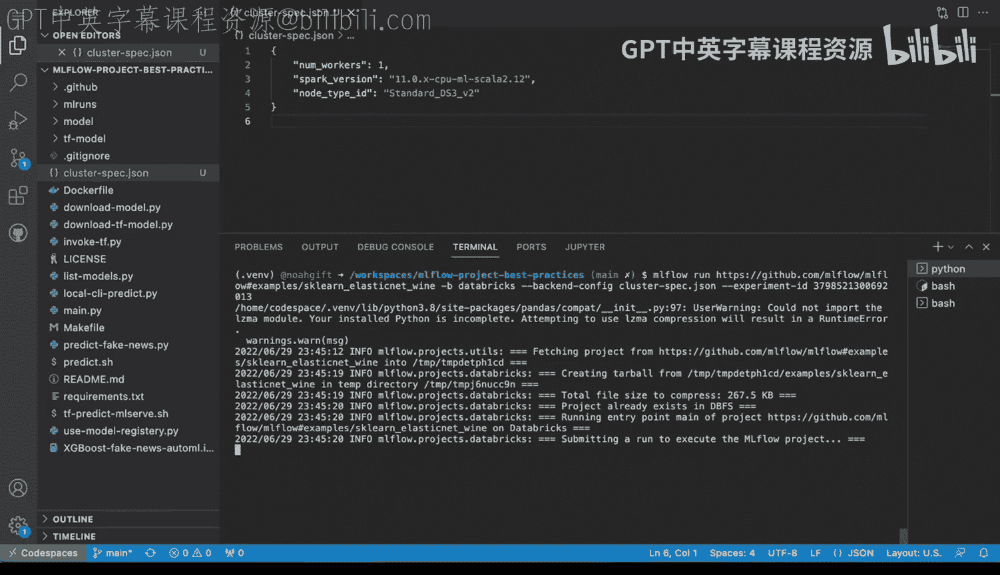
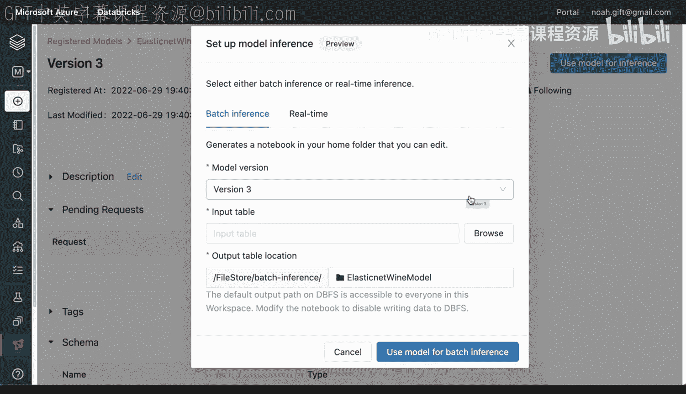
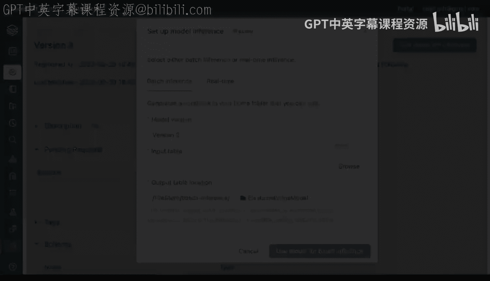

# 杜克大学《应用Python数据工程（3课全）｜Applied Python Data Engineering》中英字幕 p32 32_03_04_在Databricks中运行MLflow.zh_en -BV1nz421i7KP_p32-

Let's take a look at how you can do remote experiment tracking and training inside of the Databricks platform。

 But from another location。 So here's a good example。 Let's say I have this Databricks environment。

 I've got it all set up。 I set up a off token。 I take that off token。

 and I set up the Databrick CI so that I can use the Mlflow ecosystem inside of another environment。

 In this case， I happen to use Github codespaces， but it could be AWs GCP。

 my local data center could be my laptop。 I then invoke another repo to get a project so that I can train it。

 What happens next is that this experiment， gets tracked inside of the Databricks platform。

 I also use a remote cluster itself to do the work。

 So this is really a sophisticated environment where the Databricks ecosystem is doing all the heavy lifting。

 but then I can still interact remotely to it。 I think this is one of the workflows that many people would。

😊，So let's go ahead and dive into how this works to start with let's go ahead and take a look at the Databricks documentation here and check out how run MLflow projects on Databricks really works。

 First up inside we have an ML flow project。 We know this is a format for packaging data science code in a reusable way。

 If you look at the project format here。 it's going to be a local directory or Git repo。

 we're going to do the Git repo and you can treat this as an MLflow project。

 the project name is the name of directory， you've got a Conda file here。

 you have some kind of a Python file。 So you see here this is essentially the config that we need。

Now， in order to run this， all you need to do is actually run this command。 Now。

 there are a couple things here that are important to pay attention to。

 So one of them is that you are going to need to know the Ui of the location where your Databricks cluster is running。

 you can go to the admin console to find that。 the other thing you'll need to do is you'll need to actually have some kind of a cluster config to point to it。

 Now， fortunately， that's pretty straightforward in this particular location。

 they're going to select 7。3， they're going to say one worker and here's the node type。

 it can be any you know configuration that you choose。

 you're going to want to pick a version of spark that is going to work for your project， though。

 Another thing to be aware of is in order to run this example。

 you need an environment to have Pip install M flow in。

 you also want to go ahead and set up the Databricks Ci。

 let's go ahead and take a look at that real quick。 If I click on it。

The main thing to be aware of is that in your repo。

 you'll want to touch a file called dot Databricks config right here in your home directory。

 put in the workspace URL。 So again， this is your Databricks URL and then also the token that you created in the admin interface you can go through here and look at the documentation to figure this out on your own。

 but that's really all you need to do and then once you've done that。

 you can go ahead and create an experiment inside of the UI。

 So if we go ahead and head over to this environment here。

 we can see where experiments are created right here and notice I went through and I created an experiment。

Inside of this interface。 So you can go ahead and。Click on it again， here。

And say create blank experiment and go ahead and create the ID。 Once you go through and do this。

 we'll say a new remote experiment。 What it'll do is it'll give me this I right here that allows me to actually pass that into my other project。

 Now， since I've already run a remote experiment， I'm going to stick with this one。

And now all I need to do is continue to follow。The documentation here that shows us how to go。 Now。

 I need to make sure I've exported the MLflow tracking URL。

 And then here's the magic right here is that I can pass emailflow an example project and then I just need to pass in the cluster config and the experiment I。

 which is going to be the experiment I that I set up earlier。 So let's now go to Github。

 you see here， I've got this setup。 I created a sample config here。

 So a cluster hyphen spec Jason inside I've selected the node type that I want。

 I've also selected the spark version I want because this is the latest version at the time I'm building this demo and then in order to run it pretty straightforward。

 I just go through here， and I say let's go ahead and open this back up again。

All I need to do is go ahead and say MLflow Run， HtTPS GitHub， put in the name of this project。

 Pass in Databricks。Go ahead and say the backend config， which would be the cluster spec Jason。

 and then pass in the experiment ID， which is what I created earlier inside of the Databricks UI。

I go ahead and I run this。 It goes in， it pulls down the project and then allows me to do a remote training run here and use this use this Databricks cluster to do it。

 notice it even tells me everything I'm doing。 It says project already exists running the entry point submitting a run to execute the project launching it and then now I can go here and I can actually take a look at that particular run。

 So it's actually orchestrating all of the things that I need to go back to reproduce the project。

 Now if I go back to here we can go ahead and take a look at this。

 and we see that the latest run is right here and look I can see the actual version here。

And in fact， I've got all of the information about the project itself。

 and also if I want to go through here and take a look at the model。

 I can look at the metrics and even take this model that was created here and then use this model for inference。

 So really a very straightforward way to interact remotely with a Databricks cluster all it requires is this off token and a little bit of configuration on your machine。

