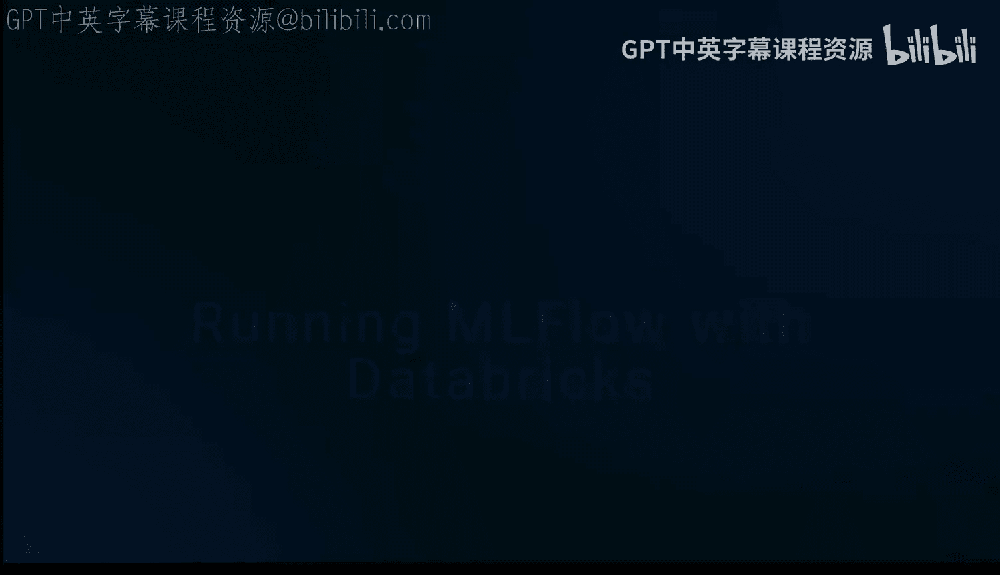
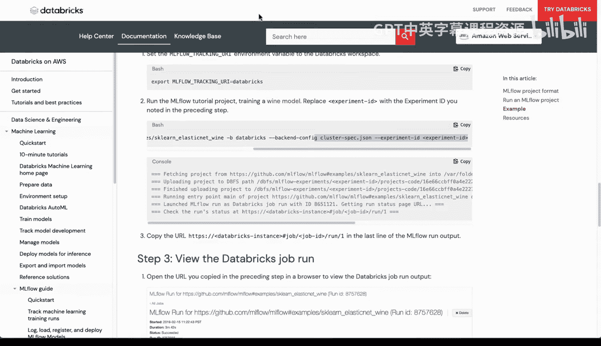
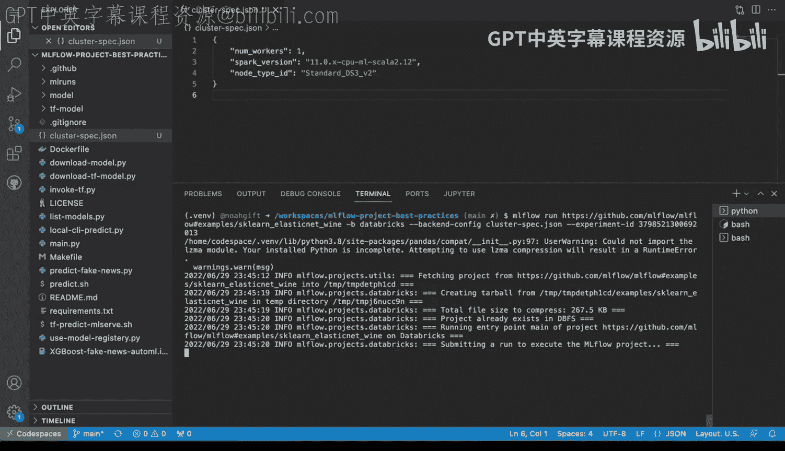
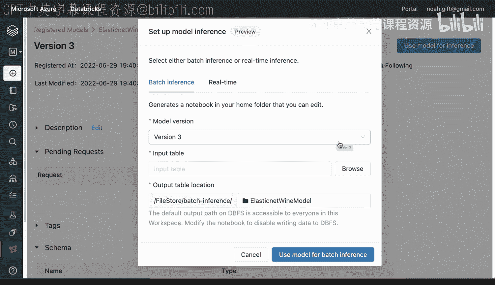
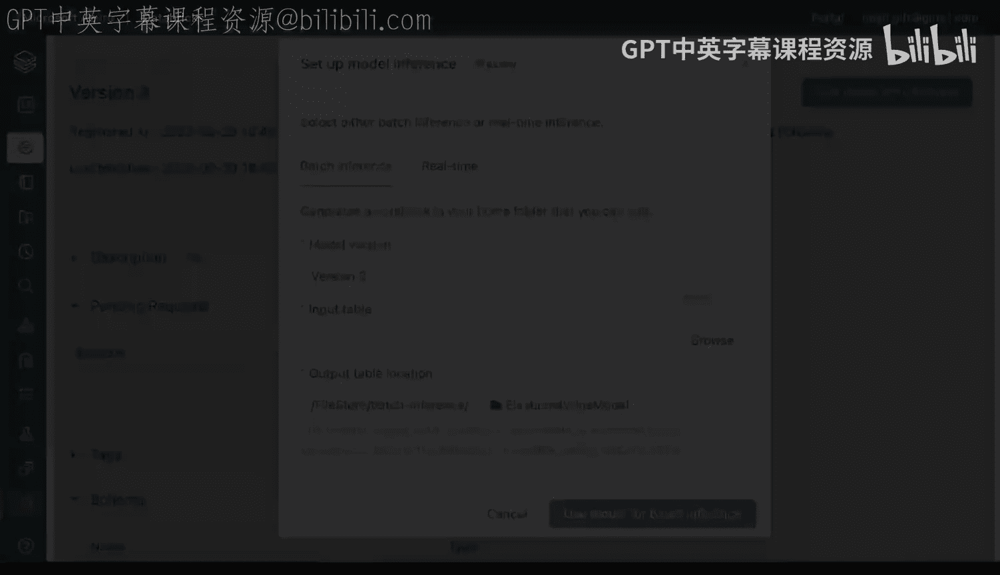

# 应用Python数据工程：3.4：在Databricks中运行MLflow 🚀



在本节课中，我们将学习如何在Databricks平台中进行远程实验跟踪和模型训练。我们将了解如何从本地环境或云端（如GitHub Codespaces）连接到Databricks集群，并利用其强大的计算资源来执行MLflow项目。

---

## 远程工作流概述

上一节我们介绍了MLflow的基本概念，本节中我们来看看如何将其与Databricks结合，实现远程管理。

假设我们已有一个配置好的Databricks环境。通过设置一个访问令牌（off token）并配置Databricks CLI，我们可以在另一个环境（如GitHub Codespaces、AWS、GCP、本地数据中心甚至个人笔记本电脑）中使用MLflow生态系统。随后，我们调用一个项目仓库进行训练。这个实验的所有过程都会被跟踪并记录在Databricks平台中，同时训练工作由远程集群执行。这是一个非常高效的协作模式，Databricks生态系统负责繁重的计算任务，而用户可以进行远程交互。

## 运行MLflow项目的机制

接下来，我们深入探讨其工作原理。首先，让我们查看Databricks官方文档，了解如何在Databricks上运行MLflow项目。

一个MLflow项目是一种以可复用方式打包数据科学代码的格式。以下是其基本结构：

*   **项目格式**：可以是一个本地目录或Git仓库。
*   **项目名称**：即目录名称。
*   **配置文件**：通常包含一个`Conda`环境文件和一个Python入口文件。

这构成了我们所需的基本配置。

## 执行前的关键配置

为了运行项目，你需要执行一个特定的命令。在此之前，有几个关键点需要注意：

以下是运行前必须完成的配置步骤：

1.  **获取Databricks集群URL**：你需要知道Databricks集群运行位置的UI地址，这可以在管理员控制台中找到。
2.  **准备集群配置**：你需要一个指向该集群的配置文件。配置过程很直接，例如选择Spark版本（如7.3）、工作节点数量（如1个）和节点类型。请根据你的项目需求选择合适的Spark版本。
3.  **安装MLflow**：确保你的本地环境已通过`pip install mlflow`安装了MLflow。
4.  **设置Databricks CLI**：这是实现远程连接的核心。

## 配置Databricks CLI

让我们快速了解一下如何设置Databricks CLI。

主要步骤是在你的代码仓库或本地目录中，于**主目录**下创建一个名为`.databrickscfg`的文件。文件中需要填入你的Databricks工作区URL和你在管理员界面创建的访问令牌。你可以参考文档完成此步骤，但这基本上是全部所需配置。

## 在Databricks UI中创建实验

完成CLI配置后，我们可以在Databricks UI中创建一个实验。

进入Databricks环境，找到创建实验的界面。点击“创建空白实验”，系统会生成一个**实验ID**。这个ID至关重要，它将用于在远程命令中指定实验位置。在本例中，我们将使用一个已创建的实验ID。

## 执行远程训练运行

现在，我们继续按照文档指示操作。首先，确保已导出MLflow的跟踪URL环境变量。

关键命令如下：我们可以通过`mlflow run`命令运行一个示例项目，同时传入集群配置文件（`cluster-spec.json`）和上一步获取的**实验ID**。

让我们转到GitHub查看示例。这里有一个准备好的配置`cluster-spec.json`，其中指定了我所需的节点类型和构建此演示时的最新Spark版本。



执行过程非常简单直接。只需运行以下格式的命令：

```bash
mlflow run https://github.com/.../project-name --backend databricks --backend-config cluster-spec.json --experiment-id <你的实验ID>
```

运行此命令后，它会拉取项目，并利用指定的Databricks集群执行远程训练任务。命令行会显示进度，例如“项目已存在”、“运行入口点”、“提交运行以执行项目”、“启动中”等。

## 查看与使用结果

执行完成后，我们可以回到Databricks UI查看这次特定的运行记录。在实验界面，可以看到最新的运行记录，包括代码版本、参数、指标等所有项目信息。



此外，我们还可以查看训练生成的模型、评估指标，并可以直接将此模型用于推理预测。这为实现端到端的机器学习流程提供了极大便利。

---

## 总结





本节课中我们一起学习了如何远程与Databricks集群交互以运行MLflow项目。整个过程只需要一个访问令牌（off token）和在本地进行少量配置。这为数据科学家和工程师提供了灵活性，可以在自己熟悉的环境中开发，同时利用云端Databricks的强大计算能力进行模型训练和实验管理。