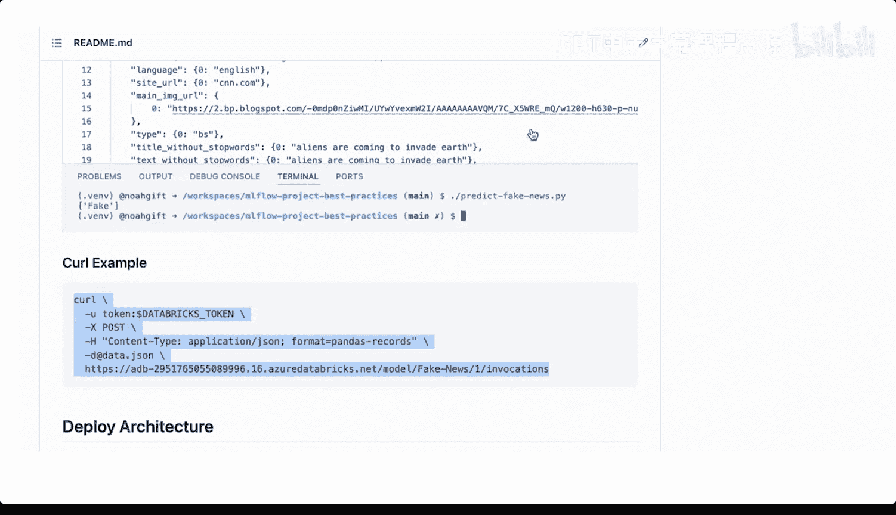
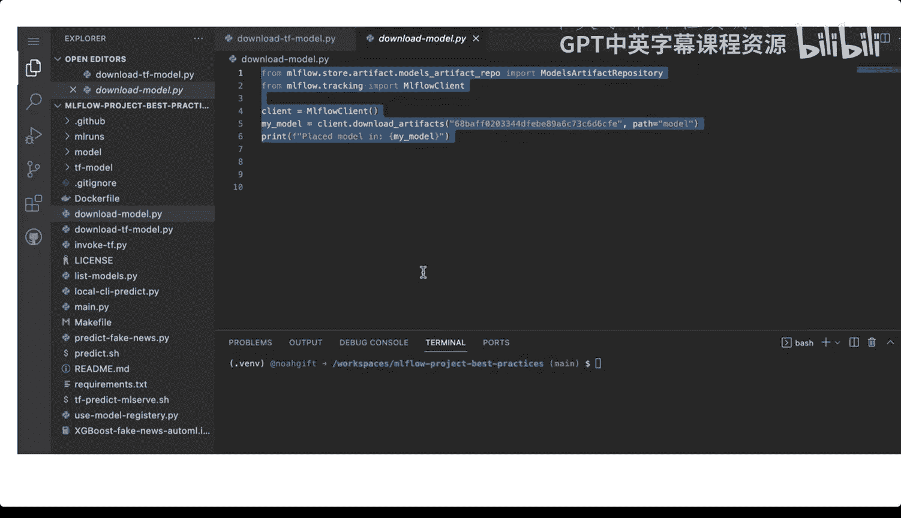
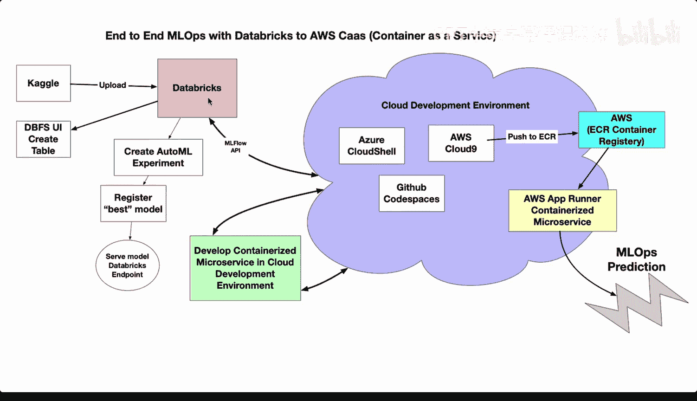

# 杜克大学《应用Python数据工程（3课全）｜Applied Python Data Engineering》中英字幕 p33 33_03_06_端到端Databricks MLflow.zh_en -BV1nz421i7KP_p33-

Let's take a look at it in L 3，2，1。Let's take a look at an end to end ML Lops model workflow with databricks and how you can take databricks and MLlflow and convert it to another platform。

 if you'd like。 So here's a good example， I have caggle here where I could go in and pick pretty much any project that does a classification and I could upload that into databricks。

 Once I've uploaded the data set into databricks， I could use the DBFS and the UI to create a table。

 Once I've done that， I could create an Autom experiment。 Once that Automle experiment is completed。

 I would register that best model and then put that into a databs endpoint if if I chose to serve it out via databricks。

 I don't have to necessarily do that， but I can do that。😊，I also could call。

The MLflowlow API from any cloud environment， from Azure， from Gitthub codespaces， from AWS Cloud 9。

And I could develop a microservice based approach and push that into some other environment。 In fact。

 AWS， the ER container registry could be one option。

 I could then from there auto deploy to AWS app runner and do a prediction。

 So I'm not just limited to databricks on whatever platform I'm running。

Once it's gone through and I've registered the models because of the ML flow API。

 I can pretty much do anything I want。 So let's go ahead and dig into this a little bit more here。

So if I go to X G boostos and this was from an Autom experiment I did earlier。 take a look at this。

 We've gone through here and we have a model which has all of these assets inside。

 We have the actual model。 We have a Conda do Yaml。 We have an input example。

 So this shows us how to actually invoke it。 If I wanted to invoke it locally。

 I've got the model dot pickle。I've also got the requirements。 Txt。

 and I've got these other things in here as well。I also have the full path to where this lives on disk and notice one of the neat things about this is that it gives me the schema。

 So essentially what I need to do to invoke it in the future and then also if I wanted to predict it on a spark data frame it shows me the exact run I and also the commands to load it up and then do a prediction and then it also shows me a way to do this on a pandas data frame as well。

 So this is really handy because I could go right into this platform and invoke it Now I can do more than that though。

 because I also can register this model， let's say in this example here， we'll just call this people。

And once I registered it， then I could actually go through and call this and version it from another platform。

 Now， let's go ahead and take a look at a project that I've got up here on Github here and notice here that I created some code around predicting fake news。

 I went through， created a payload that has some fake data like aliens are coming to invade Earth。

 And I went through， and I post that into my predict fake news and I was able to actually predict that that was fake。

 So this is a full in end workflow by just wrapping up some of those things that I showed earlier。

 Now， if I wanted to curl the production endpoint itself。 all I would need is a databs token。

 which is right here。 and I could also do a predict command that would go through and predict to that endpoint for the model that is actually registered。

 Now， if I want to pull this into a Github codespaces environment， here's a good example。

I could go in here， set it up， start to interact， let's say even download that artifact and then do some of the stuff I did earlier in this course where I went through and I used MLflow to do a prediction。

 so you can see here that in a nutshell if we go back to this diagram that it enables a huge amount of possibilities beyond just doing things with databricks and you can actually interface in any cloud environment。

