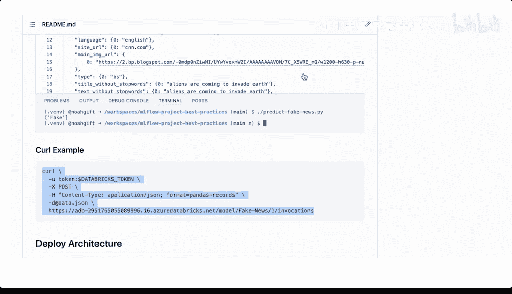
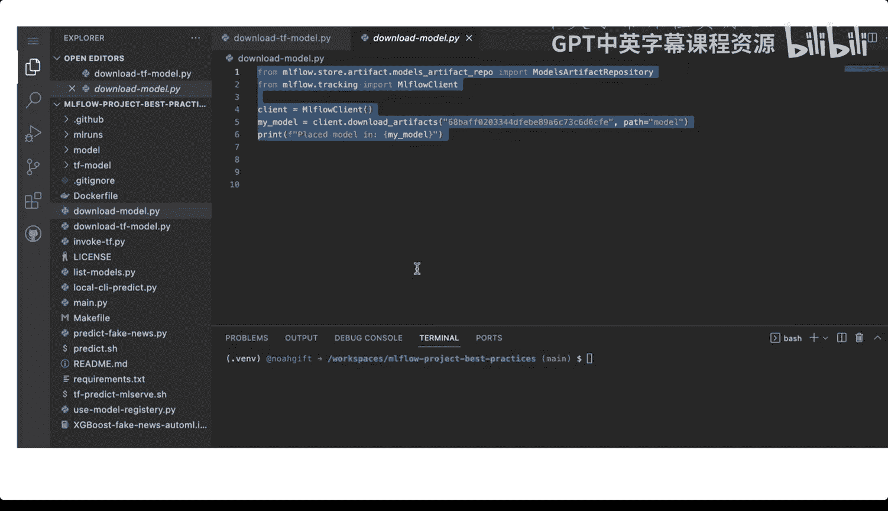
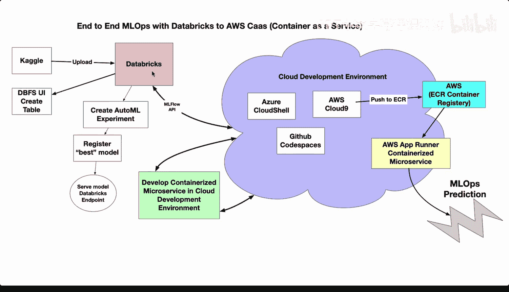

# 应用Python数据工程：3.3.6：端到端Databricks MLflow工作流 🚀


在本节课中，我们将学习如何构建一个端到端的MLOps模型工作流，它结合了Databricks和MLflow。我们将看到，即使模型最初在Databricks平台上开发和注册，你也可以利用MLflow的API，轻松地将模型部署到其他云平台或环境中。

## 概述

我们将从一个具体的例子开始，展示如何将Kaggle上的一个分类项目数据上传到Databricks，利用其AutoML功能进行实验，注册最佳模型，并最终通过多种方式部署和调用该模型。核心在于理解MLflow的模型注册和API调用机制，这为模型提供了跨平台的灵活性。

## 端到端工作流详解

上一节我们介绍了MLflow的基本概念，本节中我们来看看一个结合Databricks的具体实现流程。

### 1. 数据准备与模型开发

首先，可以从Kaggle等平台获取数据集。将数据集上传至Databricks后，可以利用DBFS（Databricks文件系统）和用户界面创建数据表。

接着，可以创建一个AutoML实验来自动化模型训练和选择过程。实验完成后，系统会标识出性能最佳的模型。

### 2. 模型注册与管理

实验完成后，下一步是注册这个最佳模型。在Databricks中注册模型意味着为其创建一个可追踪、可版本化的记录。

注册模型后，可以选择通过Databricks提供的内置服务端点（Serving Endpoint）将其部署为实时API，但这并非唯一选项。

### 3. 跨平台调用与部署

得益于MLflow的标准API，注册的模型可以脱离Databricks环境使用。以下是几种调用方式：

*   **本地调用**：模型注册信息中包含了所有必要资产，如序列化的模型文件（如`model.pickle`）、Conda环境配置（`conda.yaml`）、输入示例和需求文件（`requirements.txt`）。这允许你在本地加载并运行模型。
*   **代码示例**：注册页面通常会提供加载模型并进行预测的代码片段，支持Spark DataFrame和Pandas DataFrame两种格式。
    ```python
    # 示例：加载模型并进行预测（伪代码）
    import mlflow.pyfunc
    model_uri = "models:/Your_Model_Name/Production"
    loaded_model = mlflow.pyfunc.load_model(model_uri)
    predictions = loaded_model.predict(test_data)
    ```
*   **云端微服务**：你可以从任何云环境（如Azure、AWS Cloud9、GitHub Codespaces）通过MLflow API调用已注册的模型。例如，可以将模型打包成Docker容器，推送到AWS Elastic Container Registry (ECR)，然后自动部署到AWS App Runner等服务上进行预测。

### 4. 实践案例：假新闻预测

让我们通过一个“假新闻预测”项目的例子来串联这些步骤。

1.  在Databricks中完成模型训练与注册。
2.  编写一个简单的Web服务（例如使用Flask或FastAPI），该服务接收新闻文本作为输入。
3.  在该服务中，通过MLflow API（需使用Databricks个人访问令牌进行认证）调用之前注册的“假新闻分类”模型。
4.  将包含“外星人即将入侵地球”这类文本的请求发送（POST）到你的预测API。
5.  API内部调用模型，并返回预测结果（例如，判定该新闻为“假”）。

如果需要直接测试生产环境的Databricks模型端点，可以使用`curl`命令，只需提供有效的Databricks令牌即可。

```bash
curl -X POST -H "Authorization: Bearer <你的DATABRICKS_TOKEN>" \
     -H "Content-Type: application/json" \
     https://<你的workspace>.cloud.databricks.com/model/你的模型名称/生产版本/invocations \
     -d '{"dataframe_split": {"columns": ["text"], "data": [["外星人即将入侵地球"]]}}'
```



### 5. 在GitHub Codespaces中交互

此工作流的优势在于其可移植性。你可以在完全独立的环境（如GitHub Codespaces）中设置项目，从MLflow模型仓库下载模型 artifact，然后复现在课程中学到的预测操作，无需依赖Databricks运行时环境。

## 总结





本节课中我们一起学习了如何构建一个以Databricks和MLflow为核心的端到端MLOps工作流。关键点在于：**利用Databricks进行高效的模型开发与实验管理，然后通过MLflow的模型注册功能将模型转化为一个独立的、可通过标准API访问的资产**。这使得模型部署的选择变得极其灵活，不再局限于Databricks平台本身，而是可以无缝集成到AWS、Azure、GitHub Codespaces或其他任何支持Python和HTTP请求的环境中，真正实现了“一次开发，随处部署”。