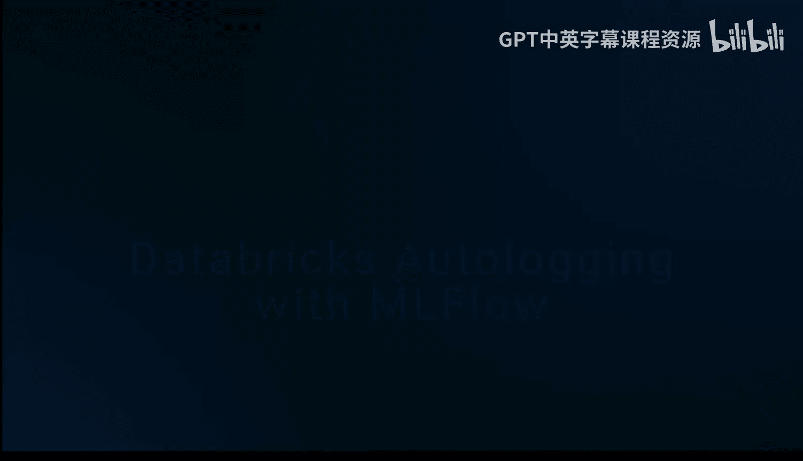
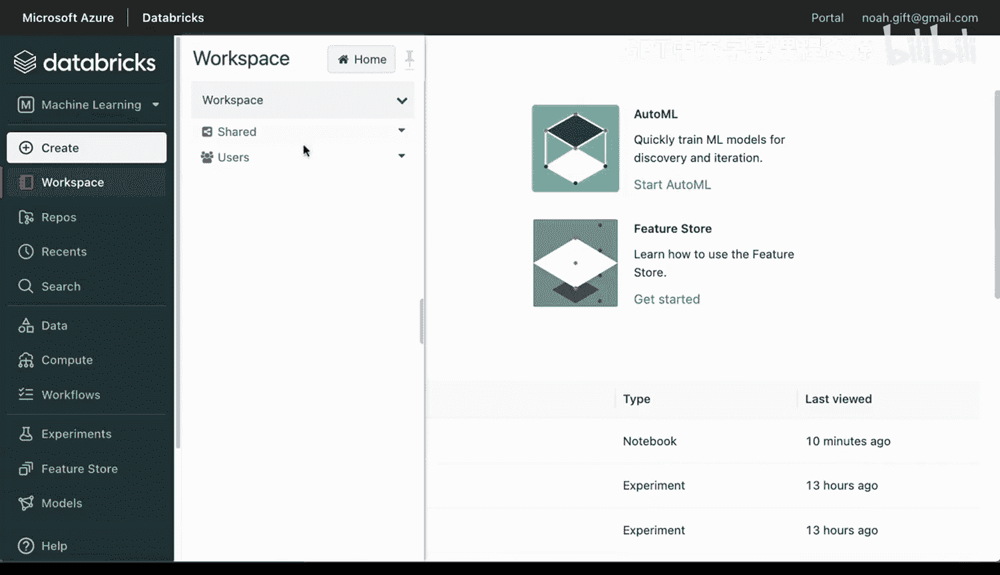
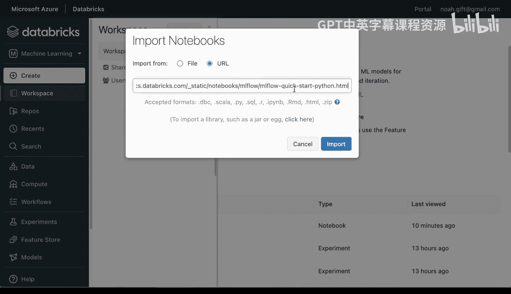
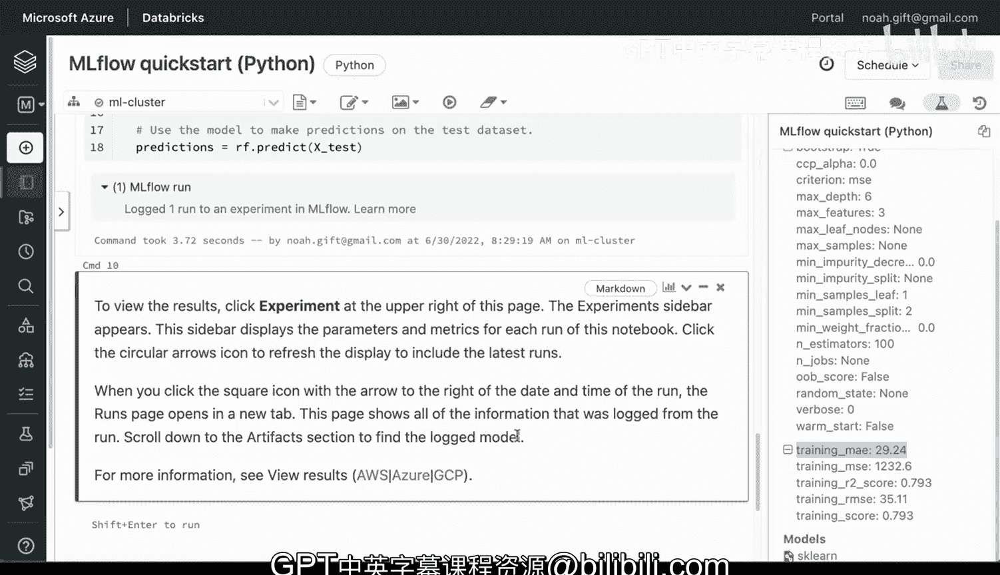

# 杜克大学《应用Python数据工程（3课全）｜Applied Python Data Engineering》中英字幕 p34 34_03_07_Databricks与MLflow的自动日志记录.zh_en -BV1nz421i7KP_p34-

Now， let's look at the official documentation for model tracking。

 and you can see it's part of a comprehensive solution to understand what's happening with your model during the development phase as well as the deployment phase。

 And if we go ahead and take a look at this email flow tracking information。

 you'll see that there's actually several different approaches。 There's the scenario 1。

 which is local host theres scenario2， SQLite local host scenario 3 tracking server on local host 4 is remote with a backend and artifacts5 is a proxy artifact storage access and then 6 is tracking server used exclusively as proxy access host for artifact storage。

 So if we go ahead and take a look at these。First up here you can see that the user has the ML code and it is associated with the MLF client APIs in section2 here。

 there's user ML code plus ML flowlow clientient API。

 you could have a local artifact repo and also a SQL alchemy store。

And scenario3 here is MLFlow on local host with a tracking server。

 and you can see that this tracking server would be more like the experiments tab that you would see inside of Databricks。

And then in scenario4 here， you could have a remote tracking server， and this could be again。

 maybe an Azure data bricks cluster that is monitoring what's happening with the training。

 and you could have maybe a very powerful GPU form in your office or at your personal data center and then that goes to a cloud- based remote tracking server。

And then in scenario 5 here， you've got a tracking server enabled with the proxy artifact storage here。

 and this thing could be saving the data potentially into a bucket like S3。

 and then in this scenario6 here， you could see here that you could have again。

 a remote host with models images configs maybe you're using something like sagemakerr and you're interacting with it locally and then the tracking host could live either in that cloud or another cloud or potentially even in a thirdpart data center。

 So if we go back here and we take a look at how this auto logging plays a role here。

 It really is the key feature here with this auto log function if I go ahead and I copy this link for import and I go over to my Databricks infrastructure right click and say import。

We can actually take a look at what they're talking about。

So let's go ahead and attach this to my cluster and then you can see here that the steps are fairly straightforward。

 you would first import the library and say import MLflow and notice here that this is a very classic example data set and if I scroll down here I can actually import this data and create the training and test data。

 so let's go ahead and first run this and we'll scroll up here and then once that's able to be run I can actually go through here next and make sure that the auto log is working。

Here we go。 and now I'm able to actually train my model and you can see thats logging the experiment right here。

And then if I want to， I can actually click on the experiments tab that shows me that in fact， yes。

 it was able to automatically log all of the attributes of the hyperparameters。

 it was also able to go through here and give me the scoring for my model and even link in and show me a link directly to that model itself。

 so that's really the idea here is that it's a way of logging what's happening with your system in a very passive way。

 and there's little to no effort that's required to use the Mflow logging。

