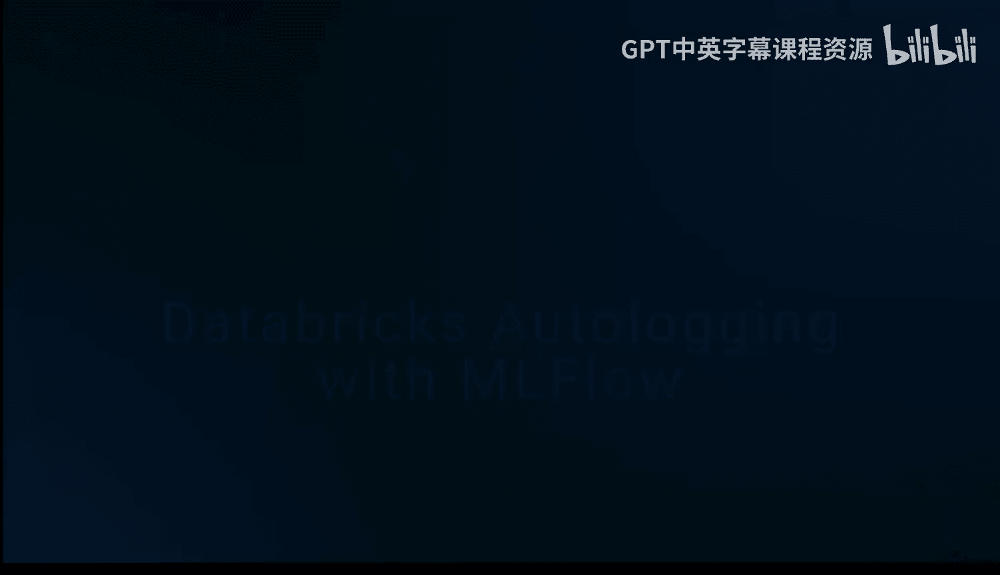
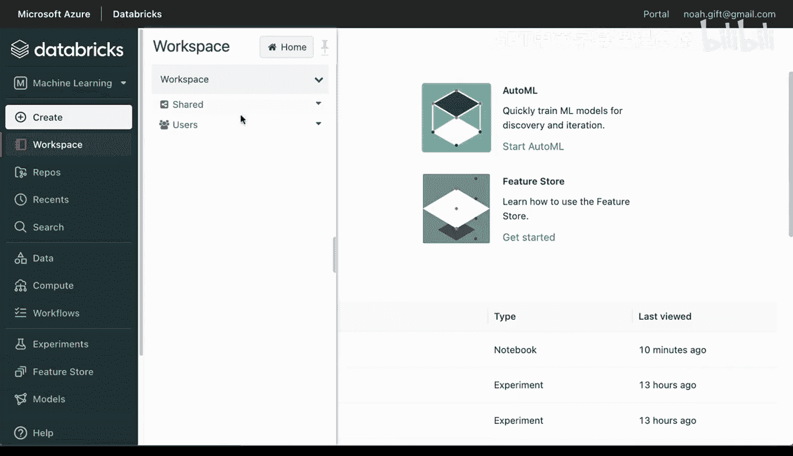
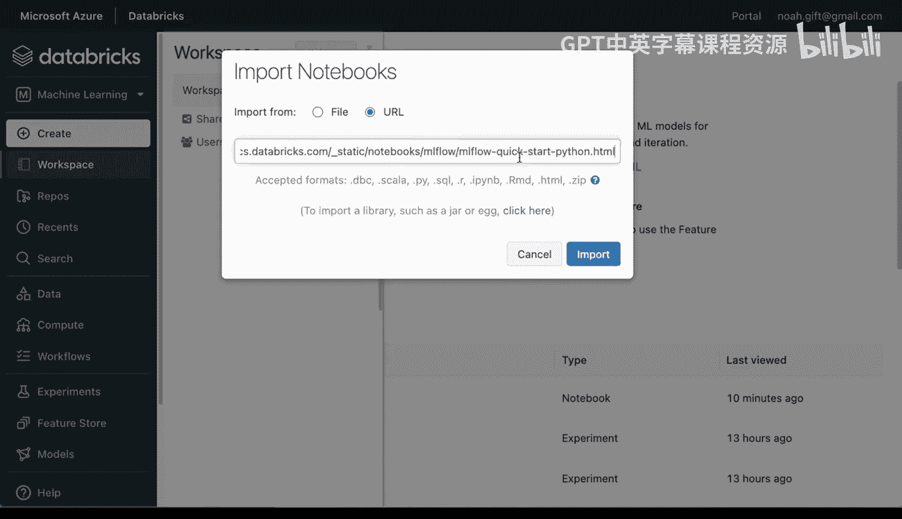
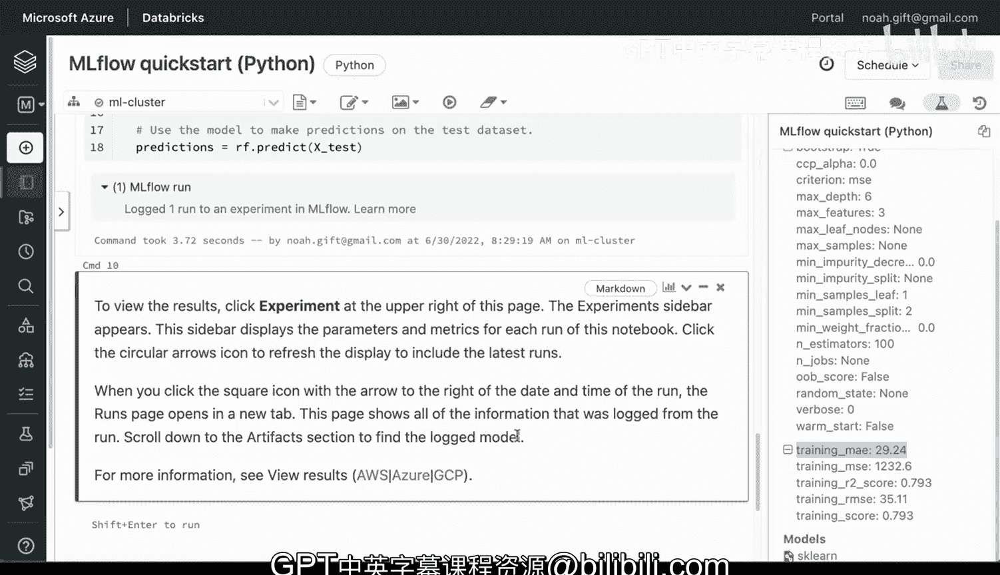

# 应用Python数据工程：3.4：Databricks与MLflow的自动日志记录 📊



在本节课中，我们将要学习MLflow的模型追踪功能，特别是其自动日志记录（Auto Logging）特性。我们将了解MLflow如何帮助我们在模型开发和部署阶段追踪所有相关信息，并演示如何在Databricks环境中轻松启用这一功能。

## 模型追踪官方文档概览

首先，让我们查看模型追踪的官方文档。文档指出，模型追踪是理解模型在开发阶段和部署阶段所发生情况的综合解决方案的一部分。

如果我们进一步查看MLflow追踪信息，会发现实际上有几种不同的部署方法。以下是主要的几种场景：

*   **场景1：本地主机** - 所有组件（代码、API、存储）都在本地运行。
*   **场景2：SQLite本地主机** - 使用SQLite数据库在本地存储追踪信息。
*   **场景3：本地主机上的追踪服务器** - 在本地运行一个追踪服务器，类似于Databricks内部的“实验”标签页。
*   **场景4：带有后端的远程追踪服务器** - 追踪服务器部署在远程（例如云端），而训练可能在本地强大的GPU上进行。
*   **场景5：启用代理工件存储的追踪服务器** - 追踪服务器可以将数据（如模型文件）保存到云存储桶（如AWS S3）中。
*   **场景6：追踪服务器作为工件存储的代理访问主机** - 模型、镜像、配置等存储在远程主机（如SageMaker），而追踪主机可以部署在云端或第三方数据中心。

## 自动日志记录的核心作用

上一节我们介绍了MLflow追踪的各种架构场景。本节中我们来看看自动日志记录（Auto Logging）在其中扮演的关键角色。`mlflow.autolog()` 功能是实现轻松追踪的核心特性。

为了理解其工作原理，我们可以查看官方示例。将示例链接导入到Databricks环境中，并附加到集群后，可以看到步骤相当直接。

以下是启用自动日志记录的基本步骤：

1.  **导入库**：首先需要导入MLflow库。
    ```python
    import mlflow
    ```
2.  **启用自动日志**：调用 `autolog()` 函数来启用自动追踪。
    ```python
    mlflow.autolog()
    ```
3.  **训练模型**：像平常一样运行你的机器学习代码（例如，使用scikit-learn训练一个模型）。MLflow会自动捕获相关信息。

运行示例代码后，系统会使用一个经典数据集创建训练和测试数据。当模型开始训练时，MLflow会自动记录实验过程。





## 在Databricks中查看追踪结果

训练完成后，我们可以点击Databricks界面中的“实验”（Experiments）标签页来查看自动记录的结果。

自动日志记录功能成功捕获了以下所有信息：

*   **超参数**：模型训练所使用的所有超参数值。
*   **模型评分**：评估模型性能的指标（如准确率、均方误差等）。
*   **模型链接**：提供一个直接指向已保存模型本身的链接，方便后续管理和部署。

这种方法的核心理念在于，它以一种非常被动的方式记录系统发生的一切。使用MLflow日志记录几乎不需要额外努力，就能实现全面的实验追踪。

## 课程总结



本节课中我们一起学习了MLflow的模型追踪功能。我们首先概述了MLflow追踪的多种架构场景，从本地部署到复杂的远程云架构。接着，我们深入探讨了 `mlflow.autolog()` 这一核心功能，它能够自动捕获训练过程中的参数、指标和模型，极大地简化了实验管理。最后，我们在Databricks环境中实践了如何启用自动日志并查看追踪结果，验证了其高效性和便捷性。通过自动日志记录，数据工程师和科学家可以更专注于模型本身，而无需为手动记录实验细节费心。