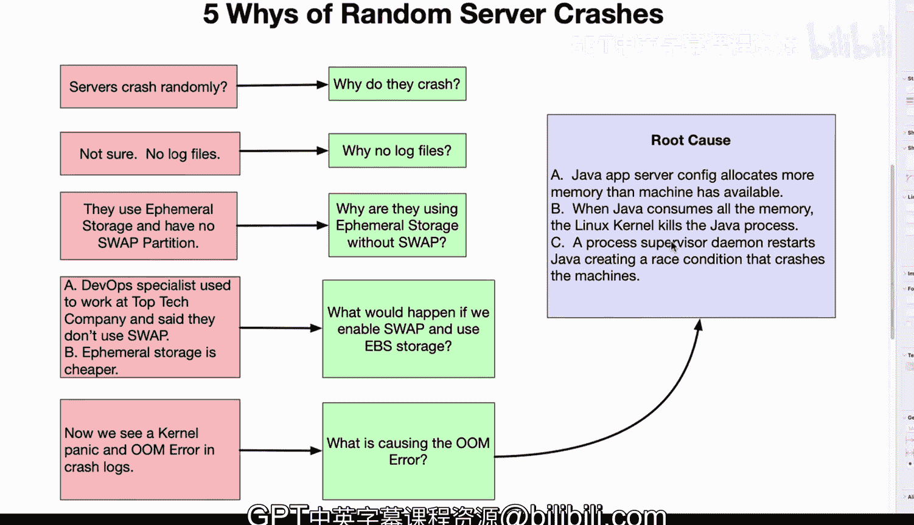

# 应用Python数据工程：3.4.1：数据的Kaizen方法论 🏭

在本节课中，我们将学习Kaizen方法论，这是一种源自制造业的持续改进哲学，并探讨如何将其核心原则——特别是“计划-执行-检查-行动”（PDCA）循环和“五个为什么”（5 Whys）分析法——应用于数据工程和软件开发中，以系统性地解决问题。

---

## PDCA循环：科学方法的实践 🔄

上一节我们介绍了Kaizen的基本理念，本节中我们来看看其核心的实施框架：PDCA循环。PDCA是科学方法在制造业或软件工程领域的具体应用。

PDCA循环包含四个阶段：

1.  **计划**：在此阶段，你需要识别问题。例如，我们需要构建一个查看库存的自动化工具。
2.  **执行**：接下来，尝试将该解决方案付诸实践，构建初始原型。
3.  **检查**：完成初始原型后，需要检查以确保它确实实现了业务目标。例如，围绕库存的自动化工具应能提供准确的库存计数。因此，你需要分析结果。
4.  **行动**：如果方案确实有效，则将其作为生产设施的一个组成部分投入运行。如果无效，则需要回到计划阶段，识别问题所在，然后重复此过程。

因此，PDCA本质上是一个不断改进事物的迭代过程。这是Kaizen方法论的关键组成部分。

---

## 五个为什么分析法：追溯根本原因 🎯

理解了PDCA循环后，我们来看一个更具体的分析工具：“五个为什么”分析法。其核心是不断追问“为什么”，直至找到问题的根本原因。

以下是一个来自我职业生涯的真实且非常严重的场景示例：

我们有一些服务器会随机崩溃。
*   **第一个问题**：它们为什么崩溃？
    *   **答案**：不确定。没有日志文件，因此无法调查崩溃原因。
*   **下一个问题**：为什么没有日志文件？
    *   **答案**：我们发现系统使用的是临时存储（ephemeral storage），这种存储会在重启后消失。并且系统没有交换分区（swap partition），即当机器内存基本耗尽时使用的分区。
*   **下一个问题**：为什么系统会使用没有交换分区的临时存储？
    *   **答案**：DevOps专家曾在一家顶级科技公司工作，他们说那里不使用交换分区。第二个原因是临时存储更便宜。
*   **后续问题**：如果我们启用交换分区并使用EBS存储会怎样？（EBS存储是一种在重启后仍能持久保存的块存储。）
*   **最终的根本原因分析**：我们能够在崩溃日志中显示存在内核恐慌和内存不足错误。这是调试问题的最后一步。
    *   **最终问题**：是什么导致了该错误？现在我们能看到根本原因是：Java应用服务器配置文件分配的内存超过了机器可用内存。这导致应用软件本身消耗了所有内存，并且由于没有交换分区可供写入，内核本身不得不介入。由于Java消耗了所有内存，Linux内核杀死了Java进程。最后，一个用于管理进程并自动重启它们的监控程序（supervisor）引发了竞争条件，导致机器崩溃。

通过追问这五个问题，我们找到了一个非常棘手问题的根本原因。并非所有问题都能通过五个“为什么”解决，但许多问题可以。这真正体现了Kaizen的核心原则：追溯根本原因，持续找出该原因并修复它。

---

## 总结 📝

本节课中我们一起学习了Kaizen方法论在数据工程中的应用。我们首先介绍了**PDCA循环**（计划-执行-检查-行动），这是一个用于持续改进的迭代框架。接着，我们深入探讨了**“五个为什么”分析法**，通过一个真实的服务器崩溃案例，展示了如何通过连续追问来揭示问题的根本原因，而非停留在表面症状。掌握这些系统性的问题解决方法，将帮助你更有效地构建和维护可靠的数据系统。