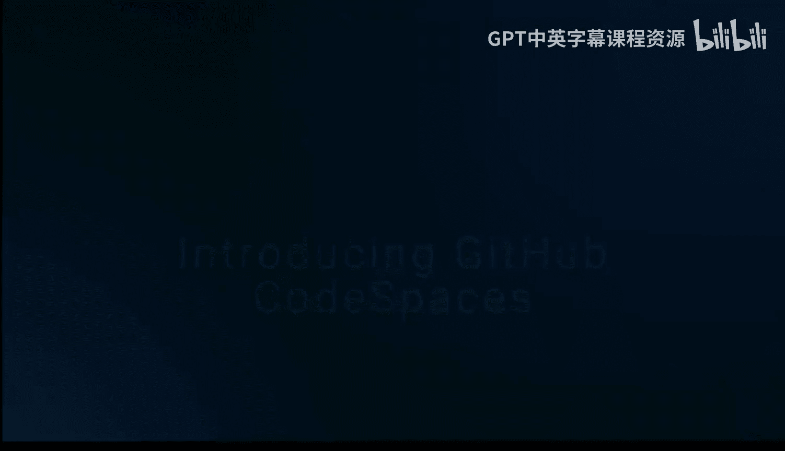
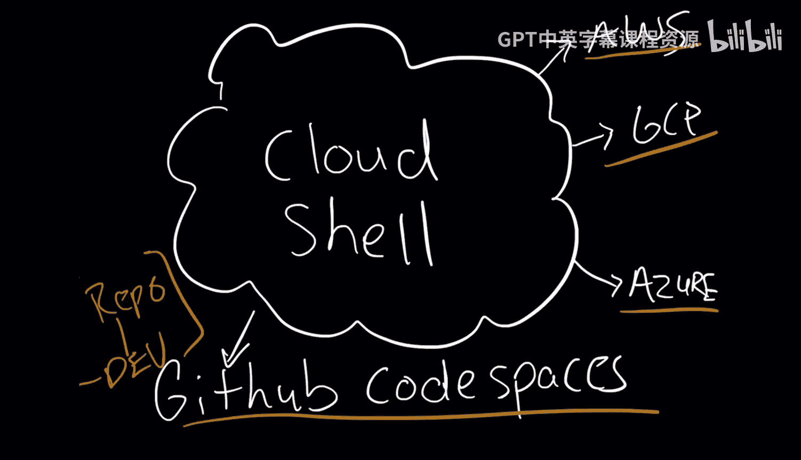
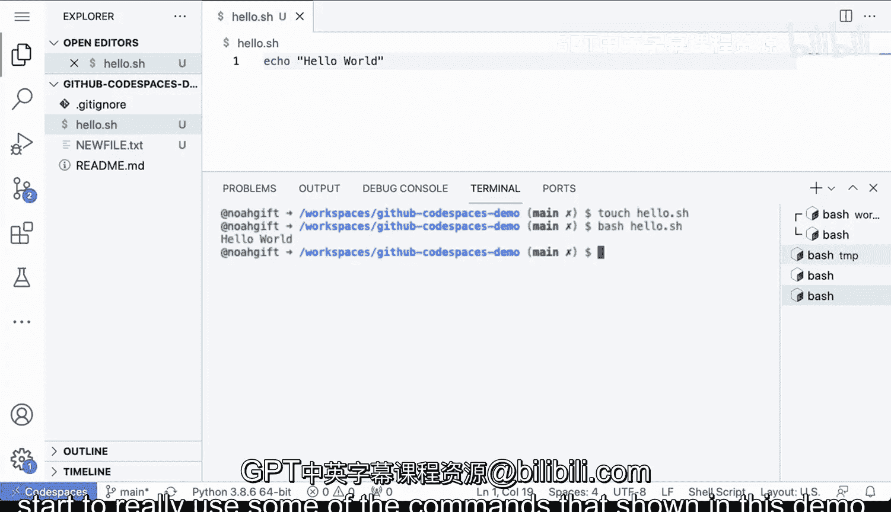

# 杜克大学《应用Python数据工程（3课全）｜Applied Python Data Engineering》中英字幕 p36 36_04_02_GitHub Codespaces简介.zh_en -BV1nz421i7KP_p36-

Let's talk through this Cloud shellll environment。 you have it with GitHub codespaces。

 so directly you can talk to the repo and you can also talk to the development environment and this is a huge advantage of using the cloudbased environment。

 the same with AWS you can talk to their services plus their development environment the same with GCP you can talk their services and their development environment the same with Azure really this is a new paradigm for developing software and we're going to get directly into GitHub codespaces and go through the features that allow you to be very productive。

Here we are in GitHub， I'm going to create a new repository， we'll call this GitHub。Code spaces。

Demo and we'll say this is for a demo。 and then you can see here that I'm going go and add a readme。

 I'm going to add a gi ignorere。 I like to use Python for a lot of my gi ignores and this allows us to ignore garbage files here。

 we'll go ahead and say create repo。 Now once I've done this what's nice about using this Github environment is that I could do software development inside of it。

 And this is really a foundational component of data engineering， software engineering。

 machine learning engineering。 Now notice if I go to code here。 I could clone this locally。

 or I could clone it into a cloud environment。 But what we're gonna to do is we're going select code spaces。

 and notice what it says， it says welcome to cloud editing。 you can edit。

 debug and run your repo without local cloning and setup。

 So this is really the future of software development。 And if you're going to learn bash。

 This is one of the best places you can possibly learn bas to set up a temporary repo like this。

And actually get started with building things inside of this code space and the reason for this。

Is that is really already set up for everything you'd need to do to start writing code and and this is really an ideal scenario for you as a software engineer。

 to really get inside of here and start playing around。

 So let's walk through some of the things you can do with a terminal what you can do with Linux one of the first things that I like to do is type in this command。

 which is we'll type in you name。Dash a and what this says is it gives me the ability to see what is the operating system。

 And here we go 1804 abuuntu it also shows me you know basically when that was actually created and when I was actually able to use this there we go we've got all this information on here。

 the next thing that I like to do is actually run the LS command and this is a way of listing what's inside of my repository and notice if I type in Pwd here we can see I'm in slash workspaces Github codespaces demo ands there's a readme file that's what we saw with LS。

 Now if I want to create a new file I can use the touch command we'll call this new file like this。

And notice what happens is there we go。 We have a new file here that shows up inside this Expr。

 If I click on it， I could go through here and I could edit some things。 I could say。

 you know this is really cool and I can put some things in that file Now how would I read that if I wanted to from the terminal Well。

 there's a command called the cat command if I type in cat and I tab it'll automatically complete and notice it then lets me look into that file and read a little bit of information So this is a very。

 very common workflow for people getting started is you want to know what's your operating system so that would be you name you want to look around So you say Ls。

 this would be like turning the light on in a room and then also you would want to create a new file and that's what the touch command does Now notice this touch command if I run it again nothing happens。

 I can run it over and over again and why does nothing happen because this command is item potent That means it'll always have the same effect no matter how。

Many times you run， if the file doesn't exist， it'll create it， if it does， it won't do anything。

 and this is a lot of the style of Linux is that it gives you these little utilities that lets you do useful things like this。

So what else do we need to know well， if we type in PWD。

 this shows you the full path to where we're located now if I want to type in CD。

 I can go to another location， let's go to the temp directory。

There we go and if I tap in PwD notice it says slash temp What if I want to go to the root of the hard drive。

 I can go here and type in C again PWD it shows me I'm at the root of the hard drive now if I want to go back here to workspaces。

We can see here that oh we've got this workspace it's a little bit hard to read well what I can do inside of GitHub code spaces is if we go to view here。

 we can go to appearance and we could actually look at some different things。

 we could go to the layout， we could look at some different things。

 we could actually go through here and change how I view things that's a very common thing to do another thing you can do as well。

Is you can actually configure your terminal to potentially give you different key bindings or to do maybe customization for a different language notice as well in this cloudbased environment。

 you've got this explorer， I can toggle it off and on I can also search for files this is pretty handy I can debug code I can work with my source control。

 This is a new file obviously that I changed I can also communicate with a plugins here。

 So if I wanted to find something for bash for example here we go this is a bash beauifier right here。

 this is been created a lot and then I could also use other environments。

 I can also go through here and tweak things here， add different command peettes but in a nutshell the main takeaway here is that by using a cloudbased development environment I really can go through here and do anything that I want now a couple of the things to point out is we're inside of this bash workspace right here but what if I want to split the terminal There we go I can actually。

I terminals side by side， this is a very common thing that people do。Now。

 if I want to go through here and open up another terminal， I can also open up another terminal。

 notice these these two are connected， they're conjoined here， but I can also tag here。

One thing to point out that we'll get into a little bit later is that it may be helpful to edit your environment and notice how we have all this fancy stuff here inside of our environment。

 Well what if I want to tweak that a little bit and change things a little bit。

 Well I could actually go into my bash RRC file here and I could actually edit the prompt and that's what people do by editing their bash RRC file。

 Now and this is where you see all that stuff has actually been been set up Now another thing that I can do that's pretty handy if I do go through here is notice it's got some aliases set up let's go ahead and create a new alias and we'll call this new alias and what this will do is this will allow us to change into the temp directory So what I'll do is I'll call this Tmp TP so basically go to the top of the temp directory。

And what I can do here is do the same syntax we can type in CD space temp and this is something I do a lot of my projects is I'll create these aliases that are like shortcuts like a bookmark essentially and then in order to load that back in I can either open up a new shell and let's try that first。

And notice now if I type in aliases， this will crop up。 There we go， temp top。

Or I could go back to one of those other shells and I could source this。

 and this is basically telling your environment to reload what's happening and if I type in again alias。

We can see that that's now loaded in this environment。 Now， if I want to use it。

 I would just type in temp top like that。There you go。

 and notice that it worked inside of my environment。

 So really that's something that I would highly recommend is to use a cloud-based development environment。

 you know something like GitHub codespaces， Eos Cloud shellll but in general。

 this allows you to get your hands dirty with working with bash and you can see you can start to configure the environment and these are throwaway environments。

 you don't have to worry about breaking anything it's all set up for you and a fact list maybe in this with the traditional way that people typically work with development as we can actually go through here。

And make a hollowo world， so let's go ahead and touch a file called a low dot S H。

 and then if I go into here， I can just say echoO。Hello world and then we've got our bash script out of the way。

 So how would I run this， I can just type in bash Ho there we go， hellello world。

 so pretty easy to get started with the codespaces development orments and you can play around with it yourself and and start to really use some of the commands that we've shown in this demo。

