# 杜克大学《应用Python数据工程（3课全）｜Applied Python Data Engineering》中英字幕 p37 37_04_04_在GitHub Codespaces中编译Python.zh_en -BV1nz421i7KP_p37-

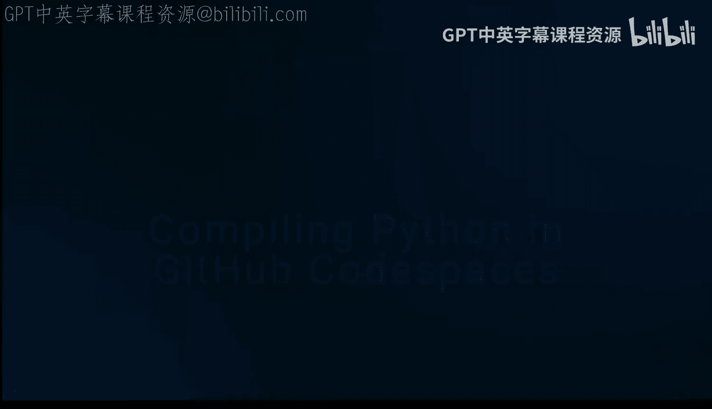

Hi， my name is Noah Gi。 And today， we're going to talk about how to compile Python from scratch。

In a Github codespaces environment， many times you'll be needing a particular version of Python。

 maybe the latest version， like in this case， Python 310。

 and you also need to compile it with a library that enables you to do some kind of development。

 If you don't have these abilities， you can get stuck and then you really can't proceed。

 So we're going go through and from scratch compile Python， use a 16 core box。

 make sure that we're able to fully satur rate it， set up a virtual environment。

 and then test a little bit of code。 Okay， let's go ahead and get started。

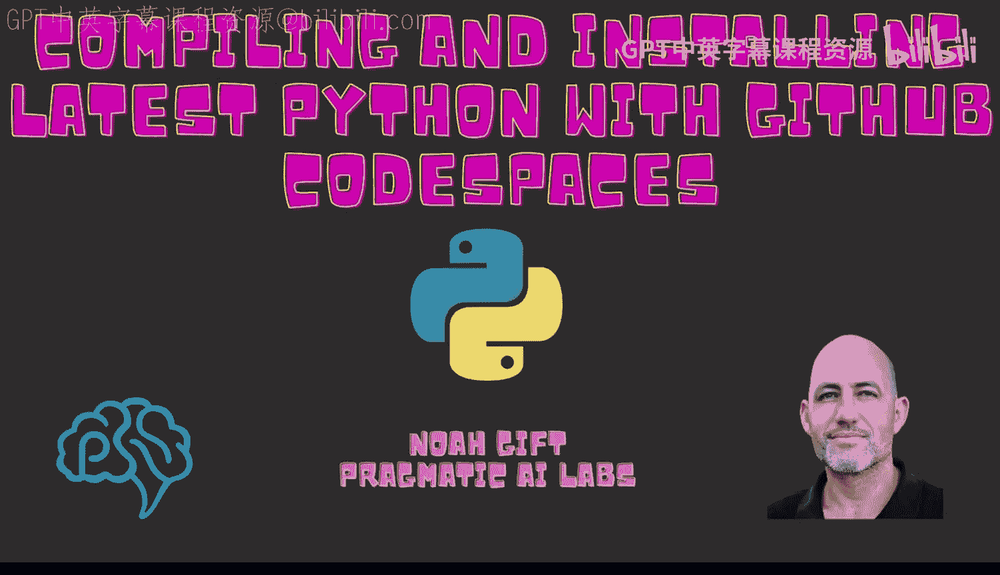

All right， so now we're in Gitthub， and I have an organization that has a setup here enabled for Gitthub codespaces。

 So what I'm going to do is first create a new repo and let's go ahead and call this compile。Python。

And we'll say this is a repo for compiling and installing Python from scratch。Perfect。

 make it a public repo， add a readme file。Before I get ignored。

 we want to use Python because that's the whole point and for a license here， I'll just do C Commons。

All right。So once I've got this set up， this is where the code spaces comes in。 Now if I go here。

 I can see that I've created so many of them， I'm going to have to go through and clean up my code spaces。

 How do you do this， go over here， go to your code spaces， find one you don't care about。

 I'll just go to an old one and we'll go through here and we'll delete it。Now that I've done that。

 I can go back to my codespace location。Inside of my repo and now one's available。 Now。

 what I'm going to do because I'm going to do very computationally heavy work is I'm going to click this button。

 I'm going to say configure and create codespace。 and this will allow me to do advanced options。

 And in this particular scenario notice here for machine type because again。

 I'm going to compile Python code。 I want to select the largest machine I have available。

 And this particular machine I have a 16 core machine。 That's great。

 And let's go ahead and create this codespace。😊，Now once I've got this set up。

 a couple things to point out about codespaces is that you could actually open this up in VS code for desktop。

 which is pretty amazing and also you could interact with it by using your desktop environment and kind of really invoking this as a backend I'm going use the webbased version that's my favorite and I'm going to go ahead and change the theme here real quick I'm going to go to color theme in settings right here I'm going to change it to dark Vi Studio and then I'm going to make it a little bit bigger Okay so。

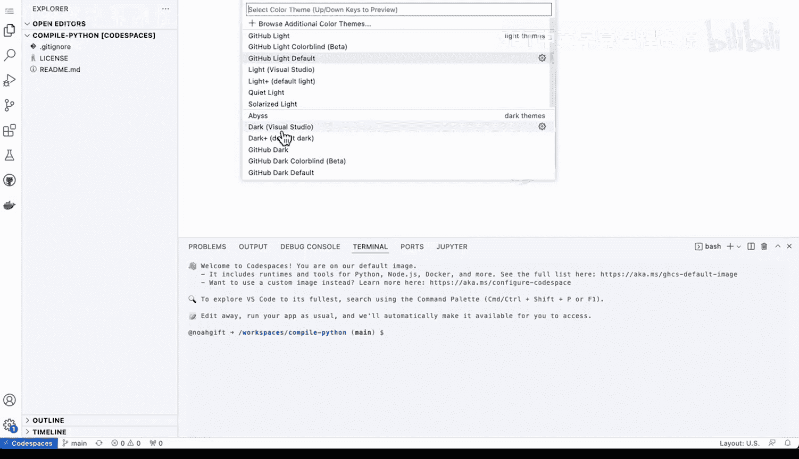

Again， this is a very common problem when you're dealing with things inside of a environment like this or your desktop is that you you in this case。

 let's just see what version of Python we have。 We have Python 104。

 We don't know exactly how it was compiled。 There could be some issues with a package。

 You just can't get to work for some reason because Python was compiled in a certain way。

 So what I'm going to do is I'm going to actually go ahead and recompile Python from scratch。

 So the first thing that I will do is I will actually。

Go aheads and run pseudo appgit update to make sure that I've got everything update inside of my environment here。

 That's always a good idea。 And then I'm going to have to install some libraries that will let me you know essentially compile Python。

 So what I can do is I can actually put these into a step inside of here we can call this compile Python and create virtual andV。

And you'll see here these are the ones I want to install。 I'll do buildEssentials， GB。

 a few other libraries。 Let's go ahead and run this command。Perfect， and I'll go ahead and say yes。

Now， what I could do as well as this thing's installing is notice that I can create new shells。

 let's go ahead and create a new shell like so we have two running。

 and I actually like to run each top。Which allows me to see what's happening with my machine on each of the different cores。

 And you can see like there's not a lot going on right now。

 but I like to keep it running when I'm installing stuff。 So that's great。

 Maybe run update one more time。 Just double check。 We got everything good。 Now。

 the next thing is I want to go and get Python from the Python website。

 So let's go ahead and go to Python。😊。

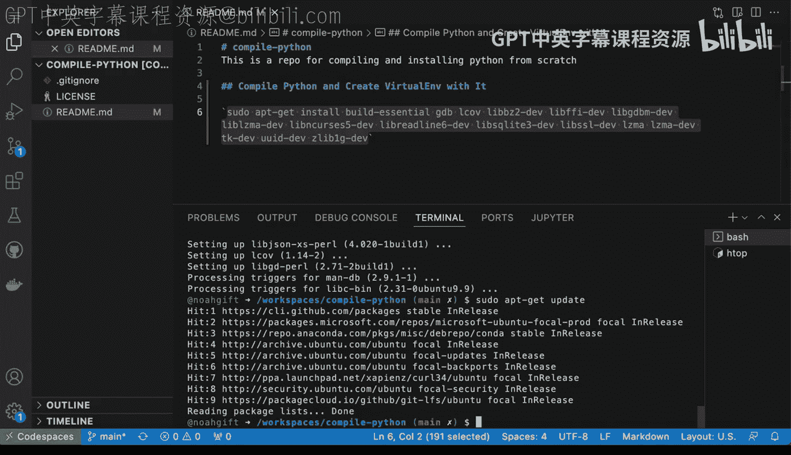

Let's go to Python。org。And go here and we can actually go to downloads。

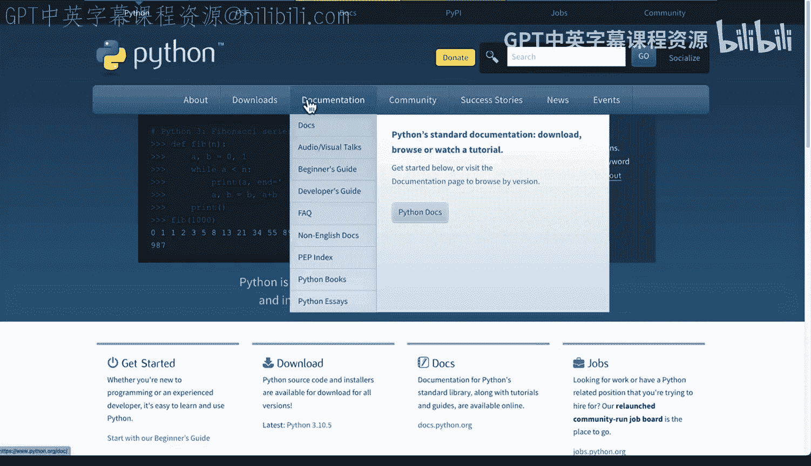

And we want to look at all releases。And we want to find the latest non beta release。

 And we see here that this was released on June 6。 And if I go ahead and I click on it。

It'll show me everything that was updated and also it shows me the different ways that I can interact with it。

 I'm going to compile， so I don't want to get an installer here for OS Tner Windows。

 I want to get this G zipped Tball， so I'm going to go ahead and right click on it and say copy link address。

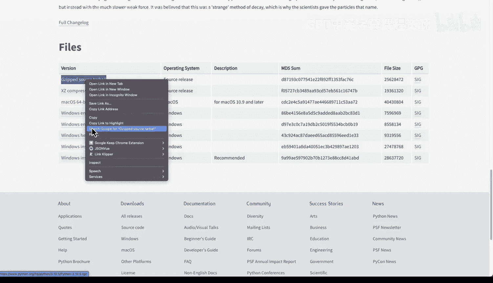

Go back here。 And what we can do is we can do a W gi。 So in this case， I would just say W gi。

And then this path， that's it。 And this will actually download it locally。Here we go。W get perfect。

 Now to uncompress it， you would just type in tar X。Tar Z X， V F。Here and then the word Python。

 that will uncompress it。And in fact， I'll just put this command inside of here。

So that other people can benefit from it。There we go。 and we're we're doing doing well here。

 we have not much more to do。 All I need to do now is actually Cd into this。 actually。

 let's just delete the Python tar file。 We don't need that anymore to save space and then I'm going to change into this directory and I'm going to first need to configure the optimizations for it。

 So this will be the config step。And go ahead and do that。 There should be pretty quick。 Again。

 I can even see how much juice it's taking really， it's only got one core active here not doing a lot of work to do a configure。

Once the configure is done， then what I'll be able to do is actually run the make command。

 which will compile Python from scratch。 There we go。 So it created the make file for us。 and now。

Here's where the magic comes in。 because， again， I have， I have a a very large machine here。 I can。

 I can actually fully saturate it。 So in order to fully saturate all 16 cores。

 I'm going to type in make dash J。And I'm going to put in 16。

 So I want to use all 16 cores to compile。 boom， There we go。

 And now if I take a look at this and we go to each top， look at that。

 every single core is fully saturated。 So thank you。

 Gitthub code spaces for giving me this powerful environment， in fact。For many people。

 this is more powerful than your desktop machine， and we can see this thing。

 it'll go through and crunch and really fully saturate this box while it's actually compiling the code。

 And this is kind of fun know while you're waiting。

 you just go through here and you take a look at all the different things that are happening。

 all the different processes and this is a great learning experience to learn about distributed computing as well。

😊，There we go。 Now it's actually done a great job of doing the compilation。 actually very quick。

 And the final step here is that it goes through and it sequentially runs the test。

 So these tests are not run in a parallel fashion。 And what we'll see is look now it's only using one core And so that's one of the things that that's important to know is that when we first did the compilation step here was very。

 very fast because it's saturated all 16 cores。 But then when we get to something that's sequential。

 we see that actually there's a bottleneck and it's going to take how long it takes。

 So we'll have to go ahead and wait for this。😊，Okay， so we're now again at our final steps here。

 you can see here that it's busily working away。And we've been able to get this thing to finalize the compilation。

 the final step here would be to do make alt install。And this will actually put everything in place。

 and let's go ahead and do this。And in fact， we want to do pseudo。So we say pseudo， make alt。Install。

And this will actually put the Python executable inside of the location where we can use it。

This should take just a second。And now we see that it installed the setup tools。

 which is really important as well。 Now that I've got Python installed here。 This is great。

 I can test it out by just typing Python。 Now， notice the system Python that was already installed is still there。

 So here is where we need to use our Python 3，10。😊，Dot 5。 And how would we do this？ Well。

 an easy way to accomplish this。 And I can even see the out of the director。Is to use user。Local bin。

 Python。Now we see that as Python 3。 105。And to make it even better。

 what we should do is we can actually change a couple things。 First。

 we can actually make Python the default here in our bashar Sea so we can say vim Bsh RRC。

 we can go to the bottom。And we can say。Basically。New Python。And we can say alias。Python equals。

And we can do。That right， so that will be our our new Python。 And if I just source this file。

We can try it out。 If I type in Python。 There we go。 Now we've got the new Python。

 It's always going to be loaded when we come back to this environment。

 The other thing that we can do。Now that I've changed it is I can say Python， dash M， V， E and V。

 so create a virtual environment。And we want this virtual environment to live in this directory。

And it's going to be working with that particular version of Python。

And then I also can do the same thing so I can go back。Here to the bash or Sea， I can come here。

 and I can say， source the virtual environments。And we can say source， Tilde， V， E， And V。

 bin activate。And so again， we can just source this file here。

 and now we see that every shell will be able to have this version of Python and we say which Python。

Here we go。 This version of Python。 we type in Python。 This will actually use Python 310。

 but it'll use the one that's associated with our virtual environment。

 So this is really helpful to then get something cooking and and and really be able to have full control over your development environment。

 a very powerful concept。To go a little bit further what else will we need to do。

 well let's set up the template for a Python project。

 So touch requirements do Txt and also create a make file。 These are two important steps here。

And once you've done that， once you've been able to create these two environments here。

Then what we can do is just fill this out。 And so I typically like to do something like this。

 I'll put it in a make file that has our。Our our kind of basic setup up here install a test， format。

 a Li。 And in all。 Here we go。 I also will do whatever it tells me to do。 So in this case。

 it says install the make file tools。 And also if I go back here for requirements here。

 I can put in whatever package I want to install and I can install it by just doing make install。

 I actually like this Ludwig Autom tool。 So I'm going to go ahead and install that。

 So I'm just going type in make install。And this gives me the ability to upgrade my Python installer PP inside of the virtual environment and also install a very sophisticated tool Ludwig onto my machine。

Now that I've got that installed。I can go through here and also install other things as well。

 and so notice here that there's this extension， one of the things that's kind of cool that you can do is you can actually search for copit。

And this is kind of the new hot thing that's happening with with Github is that it can actually help give you suggestions about what code to write right so we could actually do that as well and install the copilot inside of our project。

 So there's some really cool things that you can do here with Github， including compiling。

 using big core machines installing libraries like Ludwig and then getting this all hooked up so that it's ready to go。

 And maybe the last thing that would be kind of cool to to share is that what we could do is actually open up another terminal。

😊，And check in all this code。 let's go ahead and do that， get status， and we'll say get add。Read me。

 let's go ahead and do that， get add star so we can basically add everything。Al actuallya， we don't。

We want to， we want to not add the Python  one， so we want to remove Python because we。

 we already did that and we probably want to add to get ignore as well。 the the VS code config file。

 we don't need that。So let's go ahead and put that in there。There we go， VS code。

And so we'll say get add， get ignore， and then get add star perfect and then say get status。

There we go。 Here's our changes， commit this， adding skeleton。Perfect， now we've got this。

 We can push it。 And then finally， the other thing we can do is we can actually go now。

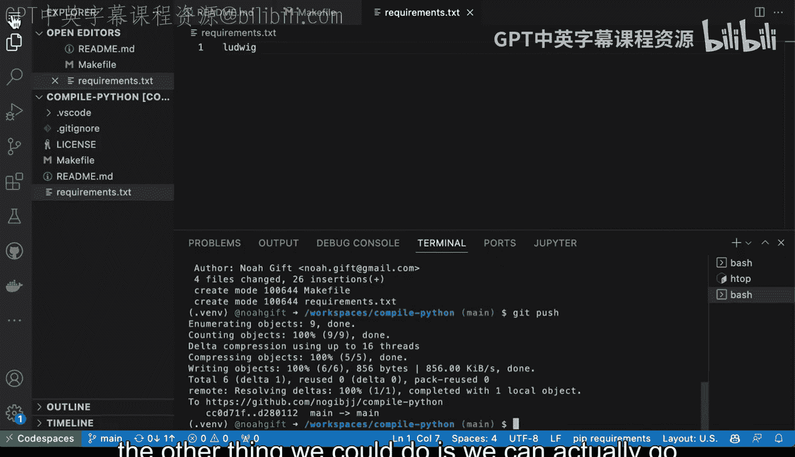

To our project that we set up earlier here。Refresh it。

There we go and actually set up continuous integration as well。

And it's very trivial to set up a continuous integration project here。

 what I'm going to do is I'm going to find a project here that I can just paste in。

 It would be pretty easy。Let's go ahead and do this and with what's neat about this is that。

This will also do whatever thing I want to do。 And in this case。

 I'm going to just do make install for now。 and in fact， I can choose what version of Python。To。

 to test it on， I'm going to say， let's set up。Let's test Python 3，10。

 because that's our environment。 And we'll just say Python 3，10。

And I'll go ahead and say start commit。 And then this will go ahead and commit their code。

And if I go to actions， it should let us see if it works。

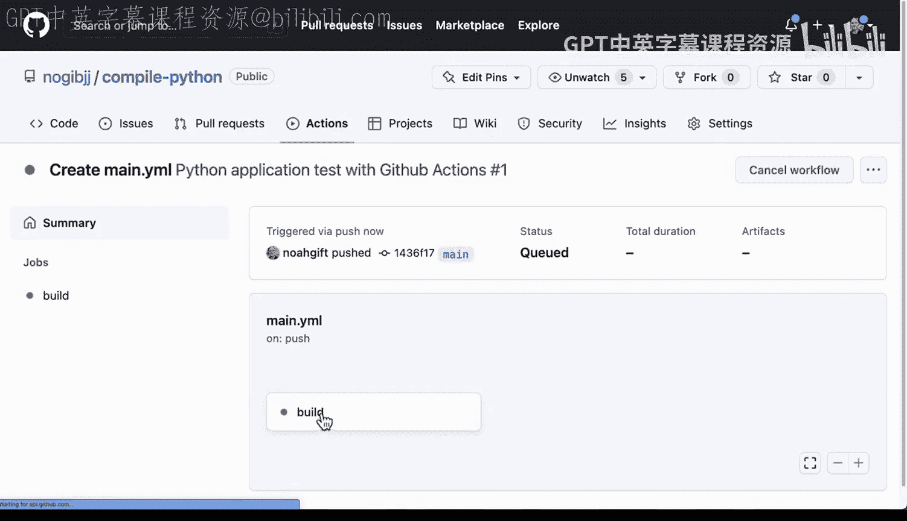

Here we go。All right， waiting for this thing to build。 in in this case， it says，0， only 3，9，13。

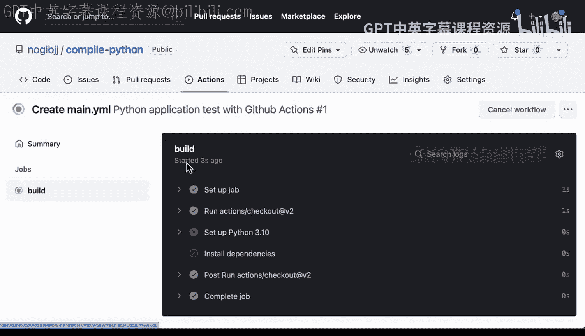

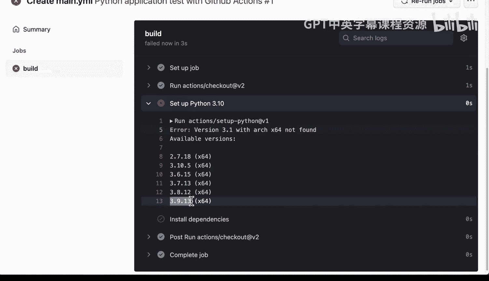

Sure， so that's easy to change。 We'll just go back to our code here and change it。

Gitthub actions has a fixed amount of versions that it can run。 So， so we'll say 3 do 9。t 13， Sure。

 let's test that version。 Let's go ahead and run it again。

 So a very interactive workflow here when you're setting things up with actions。

 a lot of control in order to use different versions， you can even do matrix testing。

 But really the highlights here。 and there we go， it looks like it's able to install it's testing the see that we can get everything working。

 So so basically once you've got the Github code spaces， once you've got Gitthub actions set up here。

 you've really got a full suite of different things you can do。

 including things like Github code pilotlo， which which is pretty cool if we want to just try that out real quick。

 if I go ahead and and I say touch hello do Py how would it work， well， we could actually try it out。

 we can say import leadwig right。

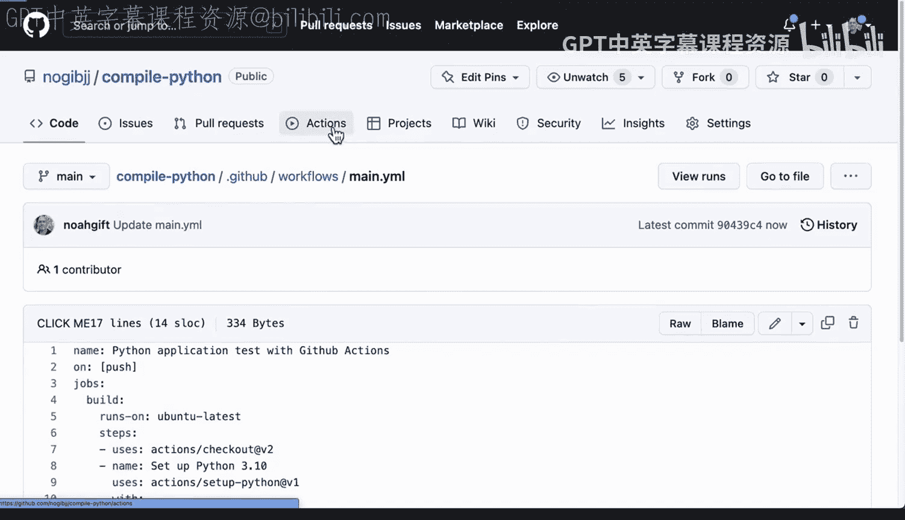

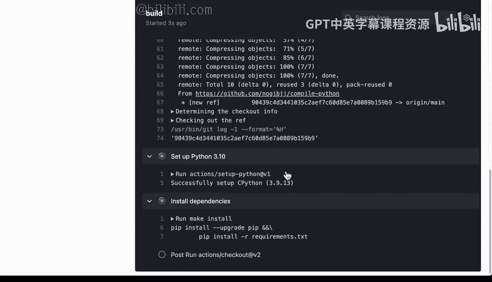

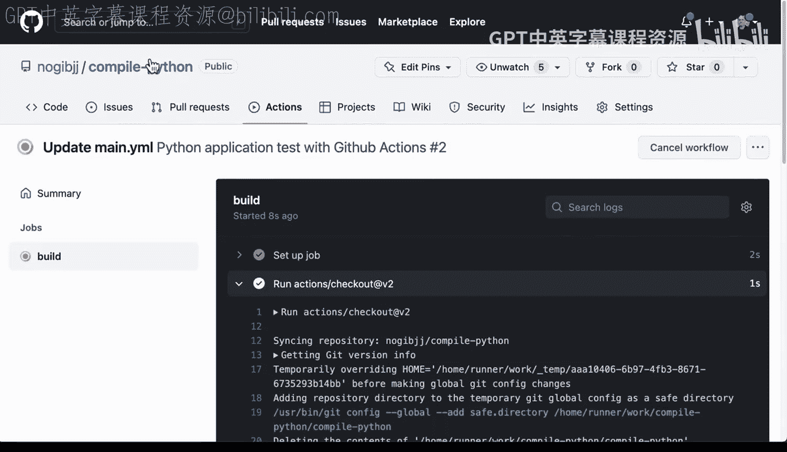

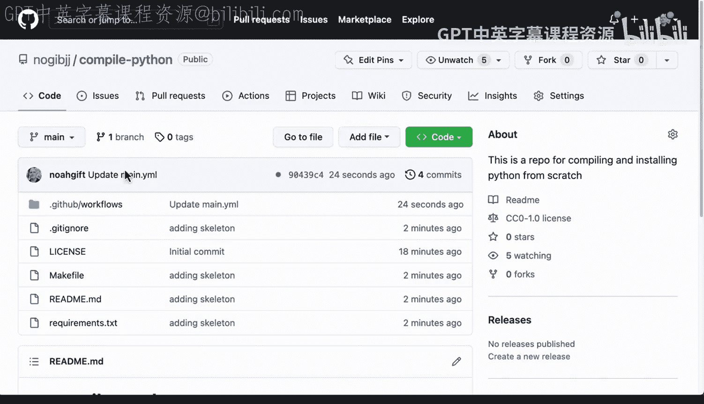

And then you'll notice here that it'll start to give us you know suggestions about。

 you know what it is we would want to write in this case。

 you can see it's given us a suggestion to load a model。

 so we really hit every cutting edge feature that you can use with GitHub。

 which is quite a bit and you're ready to get started on your own project。

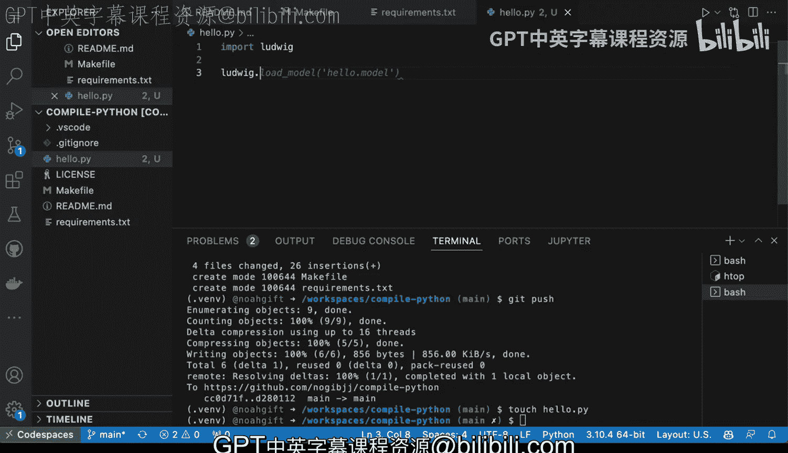