# 应用Python数据工程：第3课：在GitHub Codespaces中编译Python 🐍

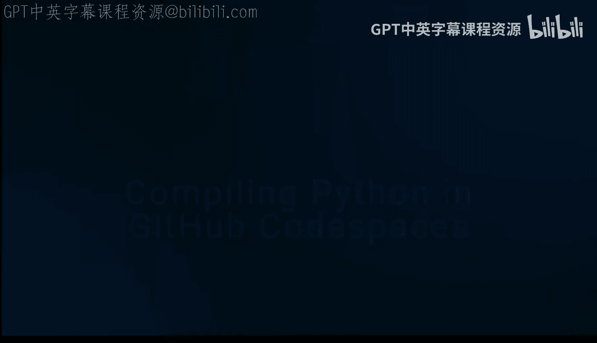

在本教程中，我们将学习如何在GitHub Codespaces环境中从零开始编译特定版本的Python。我们将使用一台16核的机器来加速编译过程，配置虚拟环境，并最终建立一个完整的Python项目工作流。

## 概述

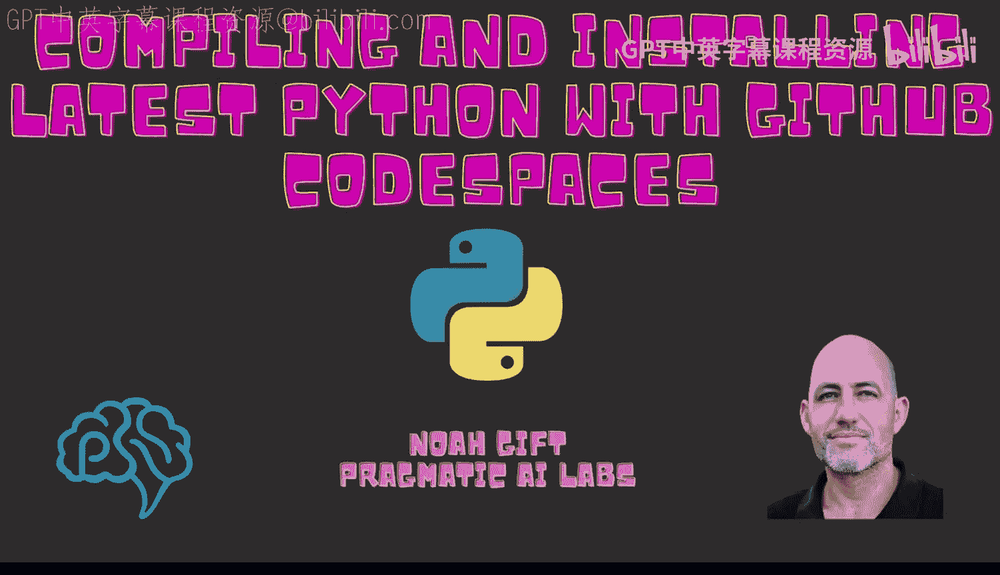

有时，您可能需要特定版本的Python，或者需要以特定方式编译Python以支持某些开发库。如果无法满足这些要求，工作可能会受阻。本节将指导您从源代码编译Python，充分利用计算资源，并设置一个可复用的开发环境。

## 准备工作

首先，我们需要在GitHub上创建一个新的代码仓库并启动一个强大的Codespace实例。

1.  在GitHub上创建一个名为 `compile-python` 的新仓库。
2.  进入该仓库，点击“Code”按钮，然后选择“Codespaces”选项卡。
3.  点击“Configure and create codespace”以进入高级选项。
4.  在“Machine type”中选择可用的最大规格机器（例如16核）。
5.  点击“Create codespace”启动实例。

启动后，您可以在浏览器中使用基于Web的VS Code界面，也可以选择在桌面版VS Code中打开。

## 安装编译依赖

在编译Python之前，需要安装必要的编译工具和库。以下是所需的命令列表。

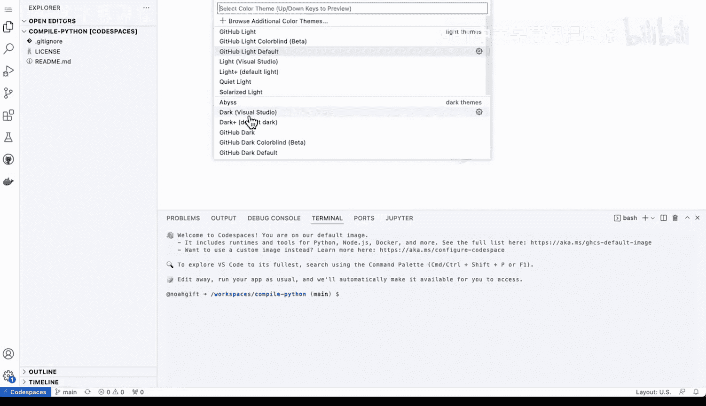

```bash
sudo apt-get update
sudo apt-get install -y build-essential gdb lcov pkg-config \
    libbz2-dev libffi-dev libgdbm-dev libgdbm-compat-dev liblzma-dev \
    libncurses5-dev libreadline6-dev libsqlite3-dev libssl-dev \
    lzma lzma-dev tk-dev uuid-dev zlib1g-dev
```

运行这些命令以确保系统已更新并安装了所有必需的开发包。

## 下载Python源代码

接下来，我们需要从Python官方网站下载所需版本的源代码。

1.  访问 [python.org/downloads](https://www.python.org/downloads)。
2.  找到最新的稳定版（非测试版），例如 Python 3.10.5。
3.  右键点击“Gzipped source tarball”链接，复制其地址。
4.  回到Codespace终端，使用 `wget` 命令下载该文件。

```bash
wget https://www.python.org/ftp/python/3.10.5/Python-3.10.5.tgz
```

下载完成后，解压源代码包。

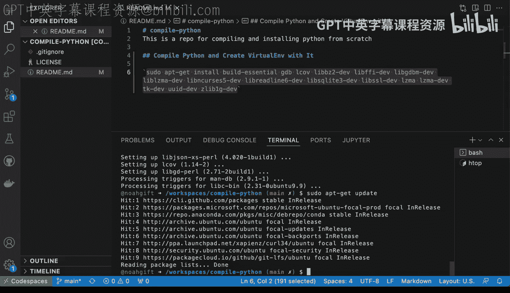

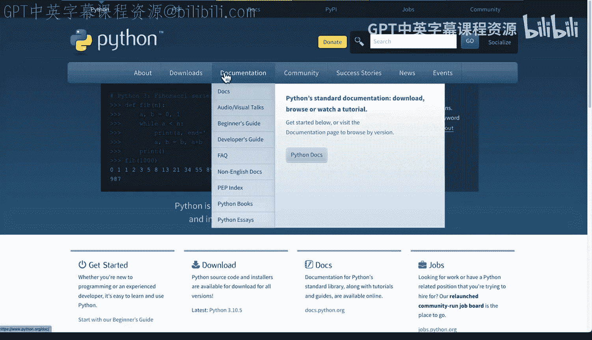

```bash
tar xzvf Python-3.10.5.tgz
```

可以删除压缩包以节省空间，然后进入解压后的目录。

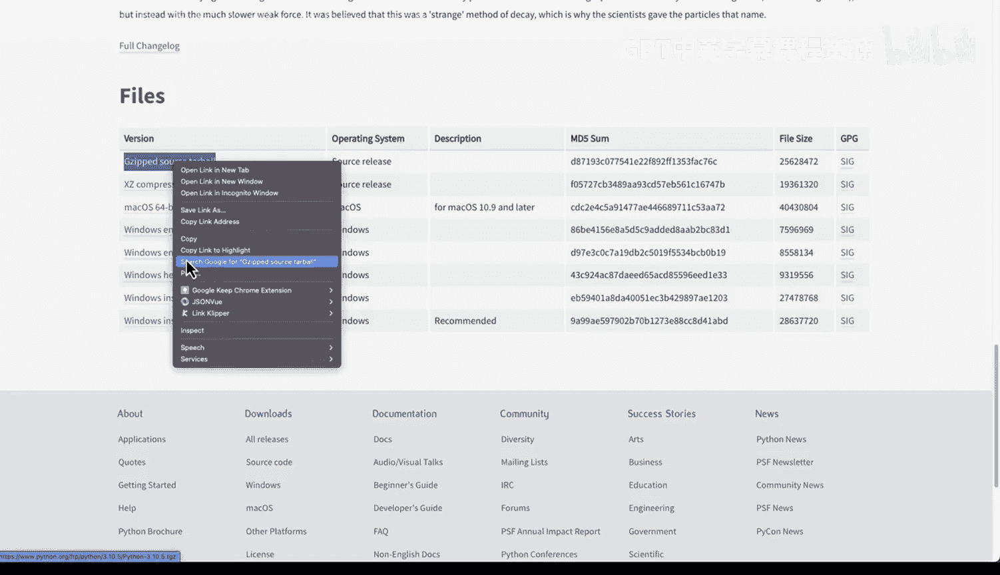

```bash
rm Python-3.10.5.tgz
cd Python-3.10.5
```

## 配置与编译

现在，我们进入核心的编译步骤。首先运行配置脚本，然后使用 `make` 命令进行编译。

运行配置命令，为编译过程生成合适的Makefile。

```bash
./configure --enable-optimizations
```

配置完成后，使用 `make` 命令并指定 `-j` 参数来充分利用所有CPU核心进行并行编译，这将显著加快速度。

```bash
make -j 16
```

此时，您可以使用 `htop` 等工具观察所有CPU核心是否已被充分利用。编译完成后，系统会运行一系列测试，这些测试通常是单线程的，因此会看到CPU使用率下降。

## 安装与设置环境

编译和测试通过后，就可以安装新编译的Python了。

使用以下命令进行安装，这会将Python可执行文件安装到系统目录。

```bash
sudo make altinstall
```

安装完成后，默认的系统Python版本可能仍未改变。为了使用新编译的版本，有几种方法。

**方法一：直接调用**
通过完整路径调用新安装的Python。

```bash
/usr/local/bin/python3.10
```

**方法二：创建别名**
编辑 `~/.bashrc` 文件，为 `python` 命令创建一个别名，指向新版本。

```bash
vim ~/.bashrc
# 在文件末尾添加
alias python=‘/usr/local/bin/python3.10’
```

保存文件后，运行 `source ~/.bashrc` 使更改生效。

**方法三：使用虚拟环境**
这是推荐的做法，可以为项目创建独立的Python环境。

```bash
python3.10 -m venv ~/venv
source ~/venv/bin/activate
```

同样，可以将激活虚拟环境的命令添加到 `~/.bashrc` 中，以便每次打开shell时自动激活。

```bash
echo ‘source ~/venv/bin/activate’ >> ~/.bashrc
source ~/.bashrc
```

## 建立Python项目模板

环境准备好后，我们可以建立一个标准的Python项目结构。

创建项目所需的基础文件。

```bash
touch requirements.txt
touch Makefile
```

以下是一个简单的 `Makefile` 示例，包含安装依赖、测试、代码格式化等常用任务。

```makefile
install:
    pip install --upgrade pip
    pip install -r requirements.txt

test:
    pytest

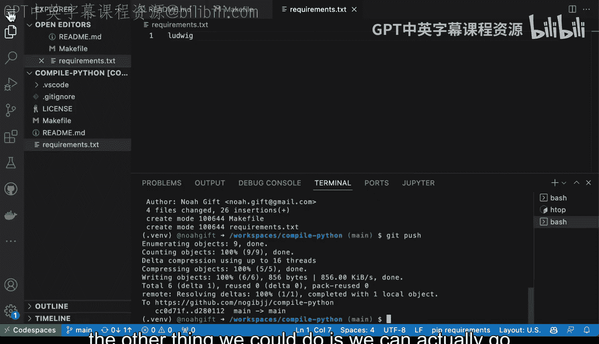

format:
    black .

lint:
    flake8 .

all: install test format lint
```

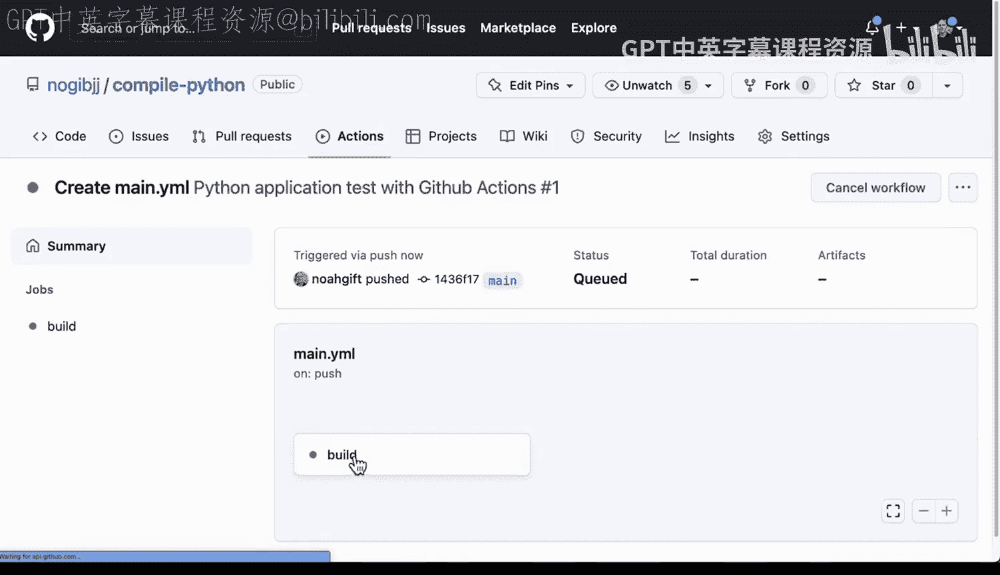

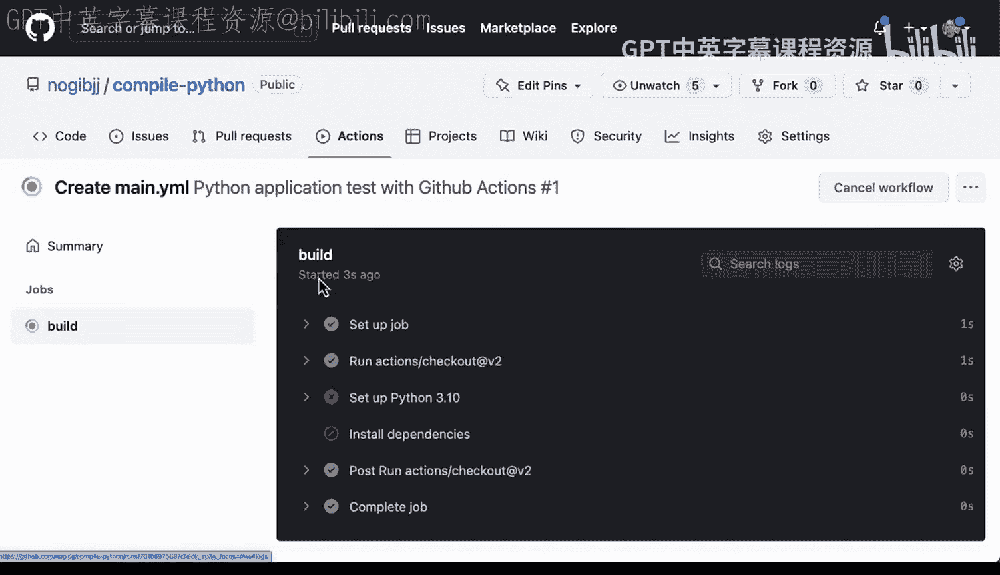

在 `requirements.txt` 中，可以列出项目依赖，例如 `ludwig`。然后运行 `make install` 来安装它们。

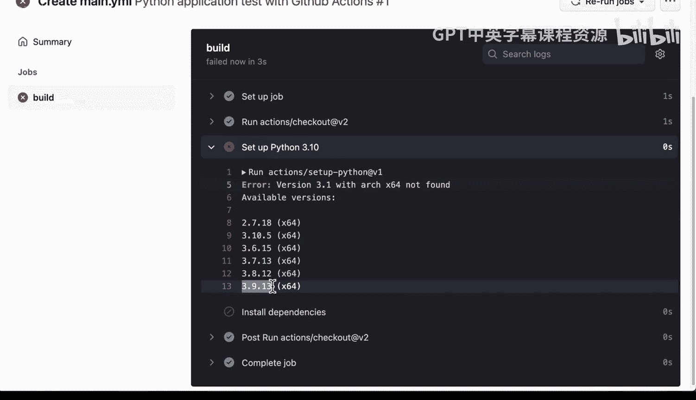

## 集成GitHub工作流

最后，我们可以将代码提交到GitHub，并设置持续集成（CI）来自动化测试。

1.  将必要的文件（如 `Makefile`, `requirements.txt`, `.gitignore`）添加到Git仓库并提交。
2.  在GitHub仓库页面，进入“Actions”选项卡。
3.  创建一个新的workflow，配置它在每次推送时运行 `make install` 等命令。
4.  在workflow配置中，可以指定使用的Python版本矩阵，例如同时测试Python 3.9和3.10。

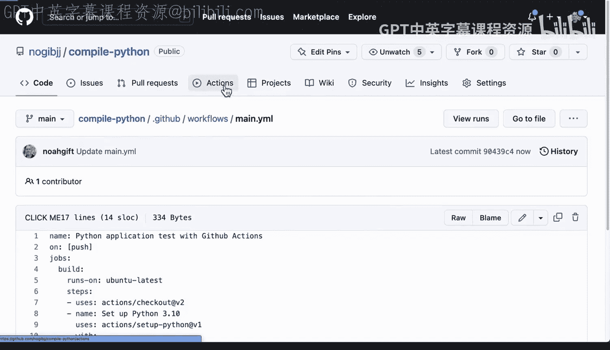

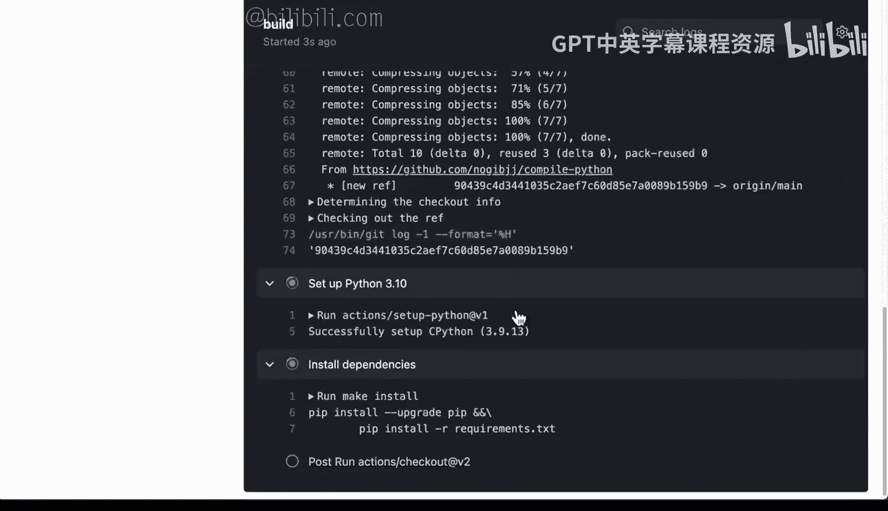

这样，每次代码更新都会自动触发测试，确保项目的兼容性和稳定性。

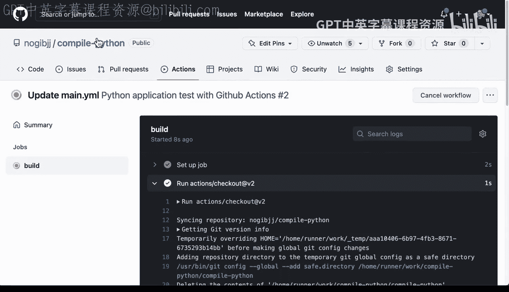

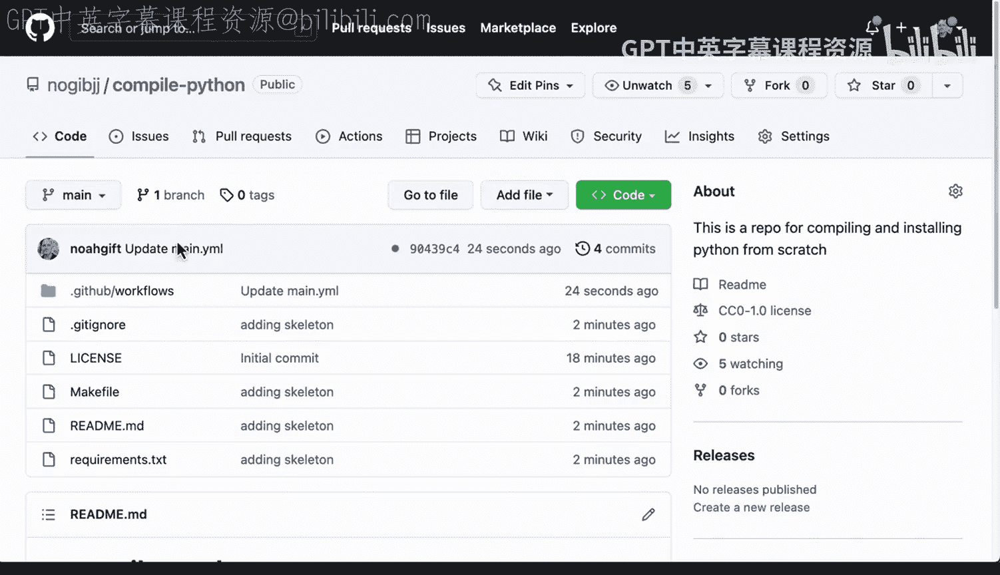

## 总结

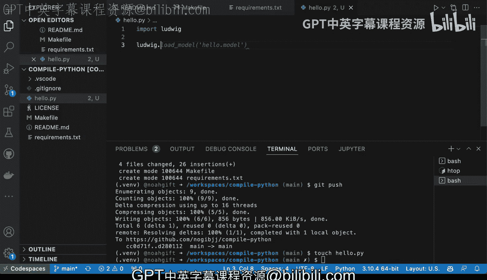

在本节课中，我们一起学习了如何在GitHub Codespaces中从源代码编译Python。我们涵盖了从创建仓库、启动高性能实例、安装依赖、下载并编译Python，到设置虚拟环境、创建项目模板以及配置GitHub Actions持续集成的完整流程。通过利用云端强大的计算资源和GitHub的生态工具，您可以轻松构建和管理一个定制化、可复现的Python开发环境。