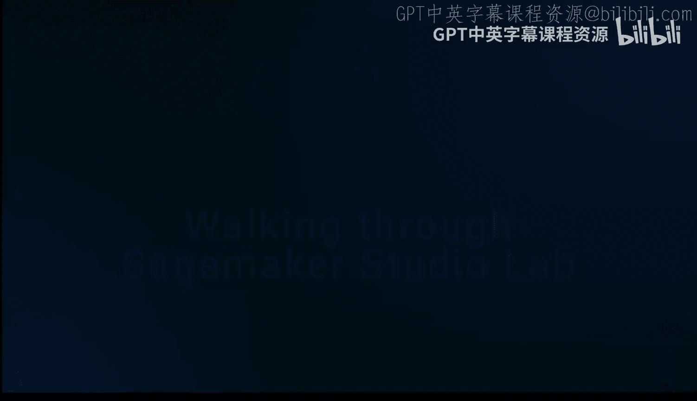
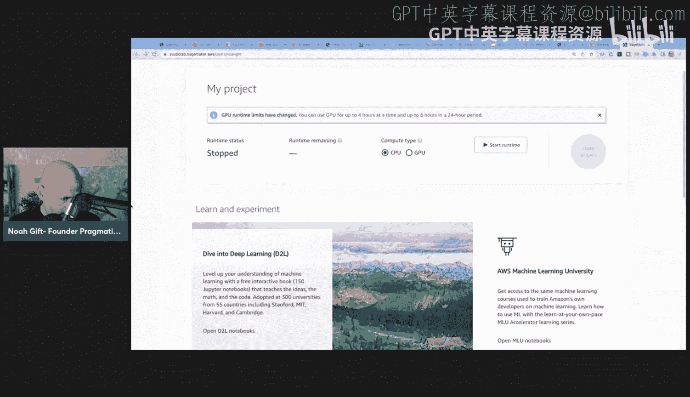
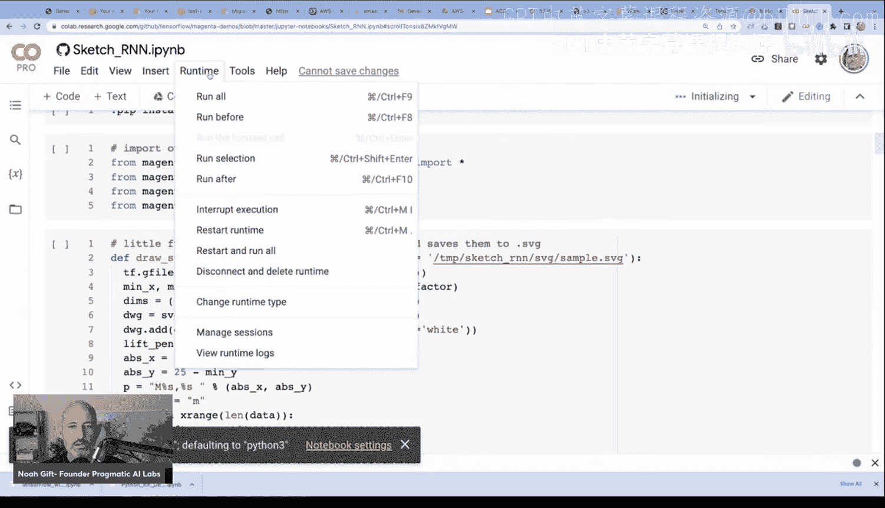
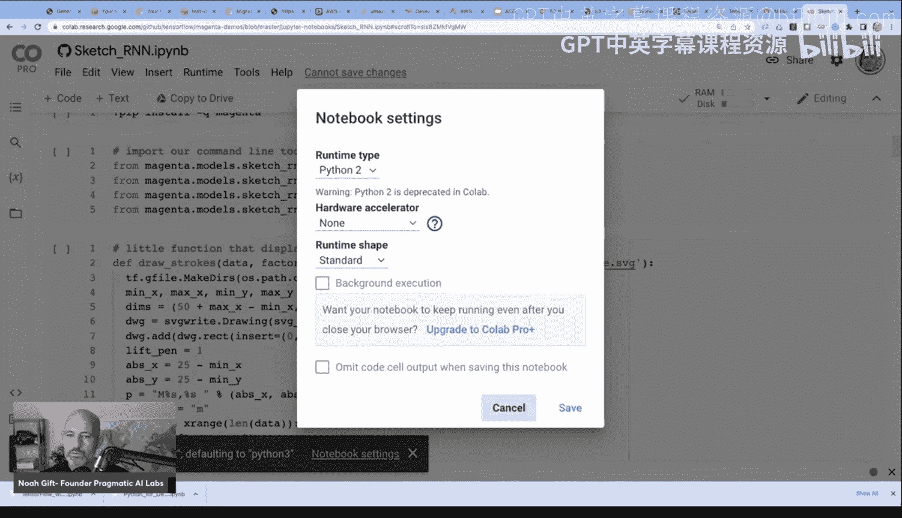
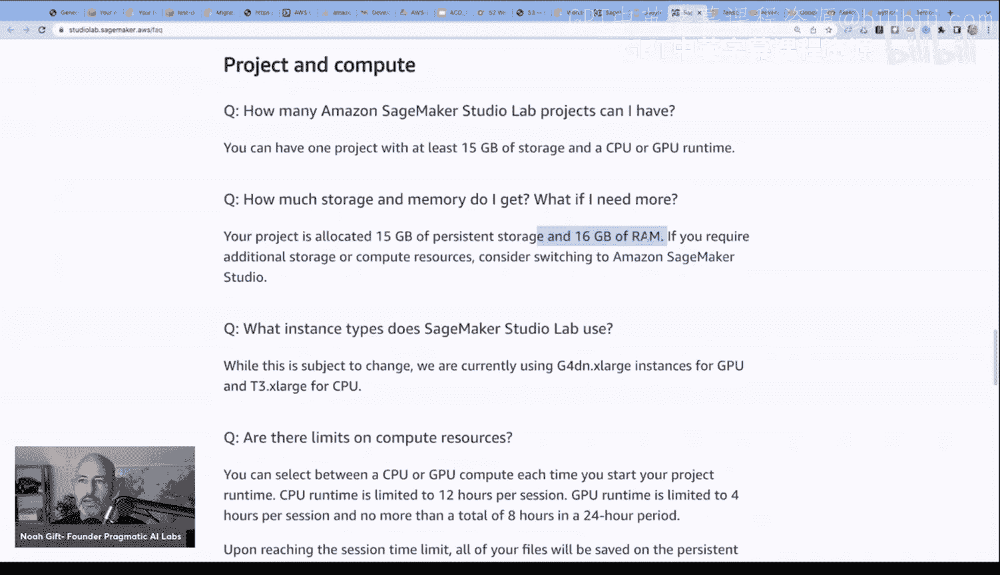
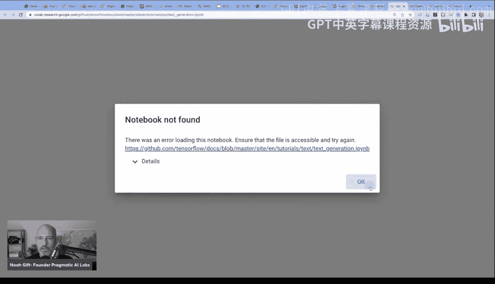
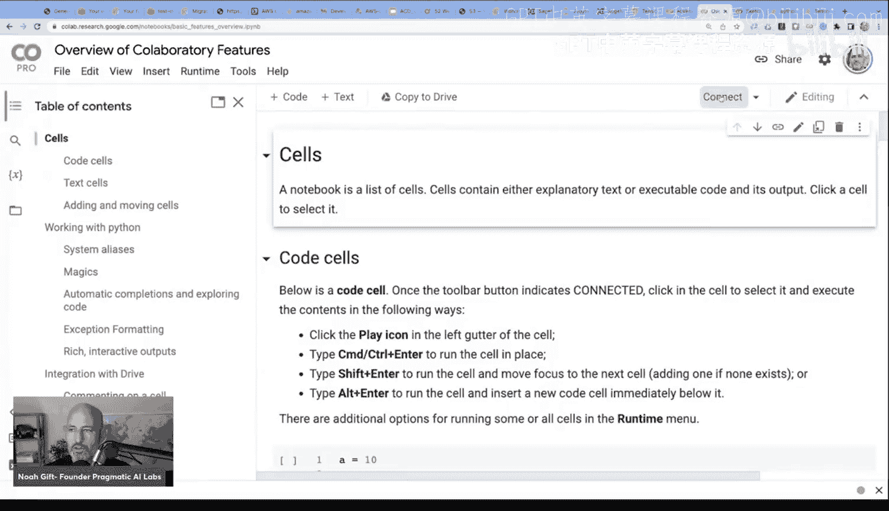
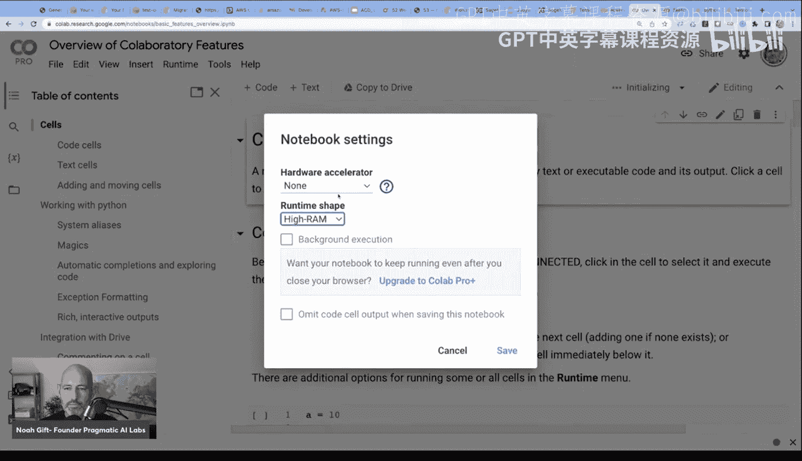
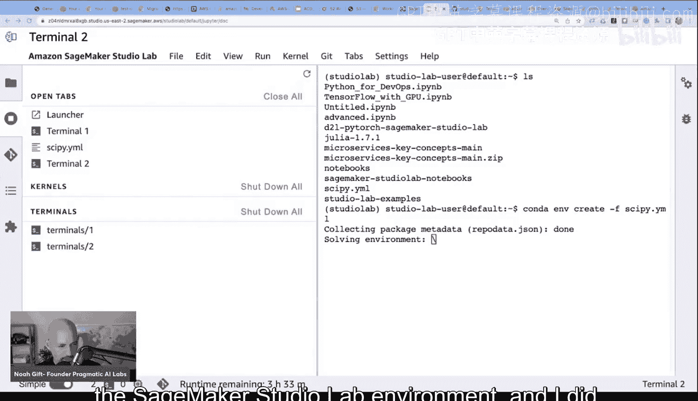

# 杜克大学《应用Python数据工程（3课全）｜Applied Python Data Engineering》中英字幕 p38 38_04_06_SageMaker Studio Lab实践.zh_en -BV1nz421i7KP_p38-

All right， so I'm live with 52 weeks of live coding MLLOs and in particular。

One of the things that I wanted to dive into a bit this week is to really go into SageMaker Studio Lab and actually look at it more from a functionality perspective so less in building something and you know training a model。

 all that kind of stuff， but I actually wanted to look at really the capabilities like what does it do。

 how do I use it fully so that when I'm working on projects in the future I can I can kind of think about you know how I could use something like SageMaker Studio La because it is actually very interesting service so I'm going to share my screen here。

And I'm going to take a look。And if we go。

Here we have SageMake Studio Lab。And。Notice here that this is the default interface， right。

 SageMaker Studio Lab， and there are GPU limits。For me， I'm going to use the GPU limits。

 I'm going to use the GPU right now just because I'm doing a demo and I'm going to go ahead and start this runtime。

Now I think the GPU limits are pretty interesting or just the ability to do GPU because of the fact that I can save the status of my projects so I can train something and then stop and then come back to it again and continue training like that concept。

 I think is a very interesting concept， but again， what I want to do here is just。

Really kind of methodically go through sagemaker studio lab and just look at what it is that that it does。

 right， So kind of in an iterative way。 So we have basically an interface。 And if I type in simple。

It takes away some of the stuff。 Now， I don't know really simple。What that takes away。😔，But。

Interesting， I guess I kind of like simple。 I'm gonna to keep simple on here。 Now let's look at this。

 What does this do， So this is property inspector， no properties to inspect。 This is a bug。

 so this shows us variables， call stack breakpoints Okay and then if we go into this。

 this looks like a like a file menu right， we can go through here and look at what's on disk we can also click this button which this makes a new launcher。

嗯。And if we click on this， this makes a new folder。Which is kind of interesting if I go here。

This goes upload files so I could upload a notebook。 And then if I go to refresh files。

 we can go here。 So this is kind of interesting。 And if I wanted to go up one level right here。

 I could go to up one level。 And so this is everything that I've got on my file system。

 So so this might be a good one to start with is， let's say I want to upload a notebook。

 So what I can do as I'm going to go to the coab。😊。

And I'm going to let's just take actually something I was working on today。

 which is I have a notebook for teaching DevOs， I'm going to go ahead and download this as a IPY N B。

And then I'm going to go back to this Sage Maker Studio La。And I'm going to click this。

 and I'm going to go down to downloads。Where is it on desktop？Where is this thing downloaded。

Let's state at。 There you go， the notebook。And there we go。

 Now let's go ahead and try it out if I click on this notebook。We can see that here we go。I can。

 I can select the the Python notebook。 So not， not bad。 That's kind of neat。

 And I can go through here and trout all my， my code。 It looks like it runs。

Pretty well so just the fact that can I can upload things is pretty neat。

So we know that experiment works。 What about a GPU， I like this idea。

 So if we go back to coabab here。I think they have actually。Most of your subscription here。

Let's look at an example for coabab。Where。They tell us some kind of a GPU based example if they don't have one handy example。

 here we go。I want to do GPU。 Let's look for GPU。No GPPU。 Let's， let's look here。Aqury， snippets。😔。

Collabab examples。Have one if we can't find one。Ill see。Here we go。Observe Tensorflow speed up。

I like this。 Okay， let let's take this one， so I'm going to download this。Again。

 and let's go back to our environments and let's， let's kick the tires。 right。

 Let's kick the tires on SageMaker Studio and let's go to GPU Tensorflow with GPU。 And let's。

 let's see what happens。 So it's going to say you wants me to use。Python。

 let's go ahead and select that。And now I'm very curious。 we'll just work。 And so if we run this。

It says no module named Tensor F。 So what we'll need to do is is put a new cell in here。

Inst a cell below， and we'll just do。It's all countryflow。There you go。But and do that。

So we can see here that's。Tensor F looks pretty good。Looks like a fairly straightforward process。

Okay， I think it's finished and then I'm going to go through and say。

Let's look for a GPU and does it find it。It's doing something。Okay， there we go。

 So it did find the GPU。 and now。This shows a convolutional neural network。

Doing CPU or GPU to compare speeds。 I like this。 So we've got if we find a GPU。

 do it first with a CPU and then do it with a GPU or run one each to warm up Okay， I like this。

Let's go ahead and see what happens。And we see that the CPU took。

About a quarter second and the GPU took 0。03 so 21 x speed up time so。There we go。

 So we know we can use similar notebooks from coabab。 So that is。

 that's actually kind of a cool win here to， to be aware of。 and in fact。😊。

Now it's got me kind of interested。In going。In looking at。More examples from Coabab。

Because I forgot there was a， there was a link here， like coab examples， GPU。

Sed bank or something like this there was a there was some there was some kind of here we go。

Discover machine learning example， seed bank。That this is。A bunch of examples。On the Google cloud。

 and so we want to look at notebook。And we want to look at some。Text generation using our R andN。

 that's kind of a cool one。 Give it a sequence of characters from Shakespeare train a model to predict the next character in the sequence。

Piano transcription。I guess we could look at date， maybe。Publisher。Deep mind， Nope， publisher。

 Google。Okay， how about scope public？😔，Use case。Would do creativity。Music encoder。😔。

Just trying to find a fun notebook here to play around with。

Input type maybe could be one way to filter。 Let's do image。How to you use built in data sets。

 I like that。 That's an interesting idea。 So this one covers using Tensorflow built in data sets。And。

Specify data set， load the data set， metadata， data inspection that's not， I mean。

 that's interesting but。I want to go。And do a use case for。Image generation， here we go。

What about this one？We do。Open and collab。 Let's try this。So this looks like a pretty， pretty oh。

 there's no sections。But。Maenta， we have a list first let's see if we can run it with。

With with regular coab。 And then I'm going to see if I can get the GPU to run here。 So we'll go here。

 change run time。

Oh。😔。

Hardware， GPU。Save。😔，And run all。That didn't work too well。 not that's not working out so。

I think maybe I just go to the beginning again。And let's look at no book。Let's just pick this one。

Open and collab。What does this one do。That's one。 So this is not a great resource so far。

Training and prediction with XG boosts。 Let's try this one。诶。H deployed a notebook。 No。

 I don't want to do that。And。I think we can look at。Imest。Let's go up。There we go。

 here's in thiscollab。No。Tensorflow， Quick start。 Here we go。Load of data sets。

Quick start for experts。What do we got here， This looks pretty good。 Okay。

 I just wanted to get kind of a decent notebook here。For tutorials。😔，Advanced。

Distributed training with caris。U。Let's let's take this notebook， This looks pretty good。

 so let's run it。Let's first make sure it works。 Let's change the runtime to B GPU。And let's。

Connect to it。And let's run it all。All right， so we got this thing working。All the cells are running。

We're using the MS data set。Pretty quick。It goes through， train the model。We've gone through。

 and now we're going to。嗯。Have 98% accuracy on this data set。So epoch one。Epoch 2。

 How many epochs are we going to do5， we're going to do five epochs。

Keeps getting better but more accurate from 98。04 to 98。5。Great， okay， so now that took， I mean。

 we can even do this。 We could say。嗯。Or's time。And we could say time but。

I even think with you time at time， always。I actually know it with Kent you do。嗯。Jupiter。And so。

Is climate。Ch。Yeah， there you go。 This， so I'm going to add。This right here， let's run it again。

And I just want to see how long it takes and then compare the difference between。

The pro version and the free version， right， that would be kind of cool to show。😊。

What the performance differences are between the coab Pro and then SageMaker studio so it took。

CPU time。20 seconds。 so let's go ahead and download。

Let's go back to our s maker studio lab environments， let's go ahead and。嗯。Upload again， a notebook。

And advance， here we go。Let's open it up。Oh， advance， no wrong one。Select。

 we want to go this one advanced。Okay， so I'm going probably need to install Tensorflow again， right。

 so I'll need to go。P store。Unless it's already in the same time。 don know。

 They've already been installed。Okay， it was installed。 All right， so let's go through here。

Let's import TensorF。Next up， let's load the Is data set。Wow， amazing how fast this environment is。

I have， I have the impression that。Saagemakerr Studio La is way faster than coabb pro。

 I don't know yet， though。 I would be curious if it is。Woo。Well， that's not good。That's a， so。

HaF copying。Don't know what that error is Here。 Is it too big， Maybe， maybe it ran out of memory。So。

 so that could be a limitation。 I mean， I can just change the the size here。

 if that is truly the case that it blows up， I'll just make it a little bit smaller。

 So there could be some memory constraints。 So let's just do 1 thousand0。Let's see if that works。嗯。

And let's do。I so。Maybe there are some memory constraints with SageMaker Studio。Lab here。

 which is kind of interesting。IKeep getting this error。And it's failed copying input tensor。

Dtensor is not initialized。Don't know。 Am means。What is it switch K to。Oh， I figured out how oh。

 I see。It depends on the batch size， maybe。 so， so it looks like there could be a memory issue here。

 which is， which is definitely kind of interesting。And。So I couldn't get this one to run。 So we。

 so we did see one limitation now of， of semakerr studio La。 So。

 so that's one thing I want to take a look at。 I want to kick the tires on a few other features not just get stuck only on notebook。

 so。I tested uploading。 What does this do， The launcher。

 this looks at all the different tabs and things like that。 though let's close all， right。

 let's close all these kernels， right， I can shut down all the kernels。There's no terminals。嗯。

But I can open a terminal， so a new terminal right there。So terminal， so if I wanted to do AWS S3 LS。

Unable to。Locate credentials。 so if you do want to use this as your own AWS environment。

 you would have to put in your own credentials， which is you know something to be aware of if I wanted to communicate。

With AWS and maybe I will， maybe I'll do that at some point in the future。

I'll go ahead and close everything。What about this。

 So this is get repository so I could go through and clone a repo。

If I wanted to or I could even open up the file browser。This is tableable of Cons。

This is experimental features， all right？So if I go to file menu， what else do I got here。

 I've got the new things I can open。I can export notebooks as different things here。

 which is pretty interesting ASI Dooc， HTML， Markdown， PDF， I can save the current workspace as well。

So that's in the file menu。 What have we got to under edit menu， edit the cells， I guess。

 from the notebook， activate command palette。You can see the different commands that you can do。

Presentation mode。So if I wanted to use it for presentation， I can do syntax highlighting here。

I can show the log console that's kind of interesting。嗯。Log level。😔。

I don't really see anything going on here， but if I say edit or view。Again。😔，Toggle that off。Run。

Yeah， run。This would be for the cells， kernels Git。 if I wanted to clone a new repo tabs。

 let's look a settings here。Advanced settings， editor。

If I wanted to go in here and dive into all kinds of settings， I could do that。 So， okay， I mean。

 that's， I guess the， the gist of， of。The gist of things here。If I wanted to take a look at。

All the different features of the system and then help as well so。Not bad。

 Let's go down to this menu down here。 What does this do， So we have the。The terminals here， the sum。

Close all。We also have。I'm not sure what this does。Run time。 and this shows。

 run this shows I have another。3 hours and 41 minutes of GPU available to me。So I guess that's it。

 I think that's probably the gist of everything I could look and try to figure out。Inside of here。

What else could I do is there documentation？About。Sagemaker studio Lab。

 There are frequently asked questions。 let's go ahead and take a look。Okay， is it free and free？

ee who is it for It's for aspiring people。 What can I do。

 It's great for experimenting It gives you a minimum of 15 gigabtes of persistent storage。

 CP and GP runtimes and Jupiter Lab So it does run on AWS。

 but you don't need a AWS account That's another thing available Why is it different than SageMakeer Studio。

 it's a subset， basically Studio。Has a bunch of advanced things inside。Kind of upgrade。

 you can move your project when you're ready。 So that's good to know。And。It's in no setup。

 No charge environments。There's a we list。嗯。How many projects can I have。

 You can have one project with at least 15 gigs of storage。 So 15 gigs is not bad。

And I see 16 gigs of Ram。 so that that is less。 So if I go to collabab。

Here， and I just pull this in， for example， and just grab， I don't know like this。

 and I look at connect and I go to runtime。

And I go to Hi Ram。

For example， and I look at collLab Pro。I have 25 gigs Ram。

 so I do get more Ram for the pro version of collabab。

And what kind of instances we're using G4 D and X large instances for GPU。 So let's look that up。

What actually instance is that？So this is。😔，ACost effective versatile GPU。

And they feature NVDdia T4 GPUs。And they feature these are radon pros， M D radon pros。 Oh， no， no。

 they're not。 These are These are Nvi。 So NviDs and。Does it show me？The cost of these things。

 anywhere。😔，So we do have the costs。So these are， I think it was。Before N exhale large on this one。😔。

We're getting a pretty good deal here， right because？

They're letting us run something that costs basically 50 cents an hour。

And so if I can run it4 hours a day， we're getting $2 worth of value， right。

 for free every every 24 hours。 So， so not bad。 that's that's that's a nice service for。

 for AWS to provide for us。And are there limits， so we see the limits， yeah， I can import。

You can actually。Share by Github。😔，It's based on Jupiter Lab， you can install via condor Pip。

How can I install open source packages， you can do that。No， don't use it for production。

 I you can't share。It's， it's actually prohibited。No， if you do cryptocurrency， of course。

And now what I'm curious about。Is with Caes Makeker Studio as well。

Is how do you customize the environment here that would be kind of interesting to to， to know about。

And I don't know if they have， here we go， custom environments。These are autogluon， geospatial R。

 fast APIpi images。So the directory contains a number of example environments you can use as starting point to create new conduct。

Environments for different purposes。And once you've cloned it。You can do it a couple different ways。

 So you would。Clone this and then look at the Conda dot yamel。 So let's take a look at this。

 How do they do this。 So if we go here。We have a yaml。 So I guess the way it works。Is that。

You use Conda forge， Is that how this works， I really don't know enough about Conde forage。

Let's take a look at this sipai Condeforge。 interesting。Let's see if I can create this myself。

 That might be a nice thing to play around with。 And so。If I。Grab this file。

And I go back to seageMaker studio here。Whoops， go here。And maybe just open up a terminal。Like this。

Okay， now I can say touch。And we'll call this， let's see if I can just kind of recreate this。

Sipai yal。So。再白的眼膜。😔，喂。Get in here， oh vim is not available， really。A。是。W the， that's rough。

 So I need to。File。Open from path。Path relative。 Let's see here。PwD。Once your lab user。

 let's see here， file open from path。😔，Sa白的眼。😔，Can you have。Can I look my math。Okay。

So so definitely makes it a little bit difficult， but let's see if I can just edit this open okay。

 there's an editor。嗯。😊，I go over to this， I'll just grab this。😔，Pace stand， perfect。Next。Next file。

Which is。 oh， that's it。 So， so now that I've got that loaded。You just do that， you seed into it。

 and you just say create an environment。Okay， let's try that out。So we have here。😔，嗯。The terminal。

 again， file new terminal。 And so I would just load that。 I guess if I wanted to create my own。

Enviments。What do this con EMV create I really。Don't do condo much。 so I don't。

 I don't really know how this works。The concept makes sense， I guess。

 which is that you put stuff inside of here。 And these are all the libraries that you care about。

 kind of a weird， weird system， though， in a way。And then if I go to。😔，Here。We can go here。

Here there we go。 and we can watch it run。 So I guess this would install a new kernel and I could create my own kernel with my own packages。

 and that would make it easier to do things in in the future so。Definitely interesting。

 I wanted to spend some time。Learning more about。The SageMake studio lab environment， and I did。

And I can now。Go through here and stop my screen so yeah in a nutshell it looks like a decent environment to play around with for free for GPUs which there are not many and especially for students this could be a great resource to use and I think I'll probably call it a day there for now and then dive on to another topic in MLOs next week so see you next week for another episode of 52 weeks of live MLOs coding。

