# 杜克大学《应用Python数据工程（3课全）｜Applied Python Data Engineering》中英字幕 p39 39_04_08_Pytest大师班（可选）.zh_en -BV1nz421i7KP_p39-

Today I'm going to cover what I call the PT masterclass。

 we're gonna to go from zero so building your environment using GitthHub codespaces。

 using AWS Cloud 9 using AWS Cloudhell， building everything out so that we have local test environments then go in and using the continuous integration servers like Gitthub actions and AWS code build and then continuing to build and use fancier functions inside a Pyt like test selection。

 PDB and then using fixtures and once we get all that set up。

 then we move to the next level which is let's actually have a realistic project。

 where we have libraries， we have Cam tools， we have web services and let's actually test those as well and then put it all into really a comprehensive solution So if you really are on your first week of your job and a new startup and you want to go from zero to one and become a Pt guru go ahead and stay attention to this。

Of course that I was able to give to you in about four hours and you'll get everything you would need to be a true expert at testing the Python Okay。

 let's go ahead and get started This is I think going be a pretty good rundown of some of the things I think are important to cover here and I'll just you know go through it like a queue so first we're gonna start off with testing with Py test you know why do we test and we'll go through here and also get into development ornaments we'll also get into CI systems that'll get into some invocation and then。

We'll get into some advanced pie test here so we' got a pretty big schedule here of cool stuff so the first part is you know why do you want to test anything so I'm going to move over to a screen here real quick just sketch out a few things。

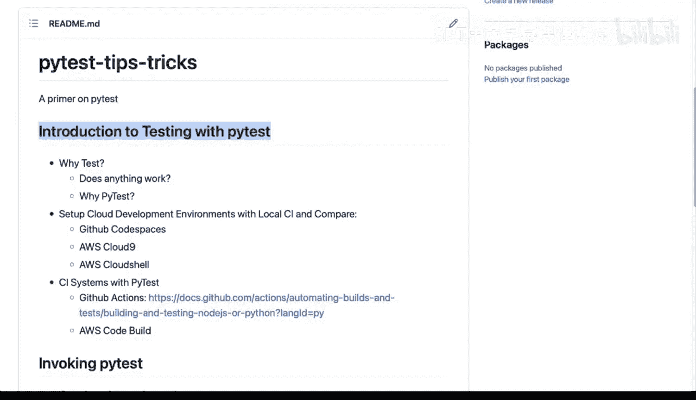

So me get my pad here and I think a big part of the reason for testing is that really it's DevOs。

 I think this is the technique that many people are talking about and one of the core concepts of DevOs is that you have the ability to automatically test your code and so this is this feedback loop where you have you know continuous integration and what is continuous integration the ability to know whether your code works like that's really it in。

In a nutshell and so once you've got that。And you know your code works if this is your development environment。

 then the trick is， can you actually replicate that to let's say the cloud or your production environment。

 so this is the production environment。In order to do that you're going to have to have a couple things。

 so one is that you're going to be able to you're going to need to be able to replicate inside of this production environment。

 so if we say here you would need to have potentially infrastructure as code so you're able to define the cloud- based environment。

That would be similar to your development environment two。

 you're going to need to have some form of testing and so that would be the CI components that you did earlier right so this is the continuous integration and then in terms of the deployment。

 you're going to have to piece all this together and then deploy your code into that environment。

So this would be what I would call continuous delivery。

 so once you've got continuous delivery set up， then you're able to replicate these changes。

To any number of environments， and that's really the power of DevOs。And that's the power of testing。

 Is it that the testing。It a is a mandatory component of continuous delivery like you wouldn't you wouldn't want to replicate。

Bad code to production environment and then cause an outage right So that's really the essence of why we care about testing is you first get it working locally and then you're able to replicate that into a cloud based environment。

 So I think the first place to start here is let's get the local development environment cooking first。

 right so let's let's make sure that we're able to actually get anything working。First。

 so I'm going to go ahead and shift gears here and talk about a couple different development verments。

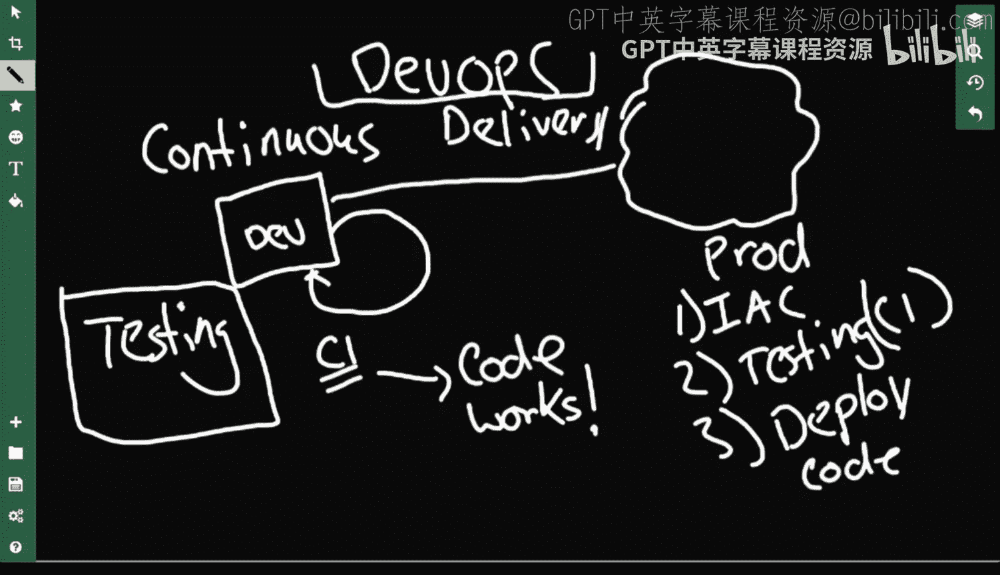

The first one I'm going to start with and we'll just build out this repo throughout the whole next several hours is that。

Most people， I think， start with something like either Github or Gitlab。

 there are obviously other source code environments， but Gitthub is probably the most popular。

 and I think it's a good place to start out with think about your structure for your project and what I like to do is use cloudbased development environments and the reason for this is that it's easy to have all the right tools available for you。

 in my opinion is we're probably at the point now where the majority of developers would be better off developing in a cloudbased development environment。

 So one of them is this is Github codespaces。 So this is a feature of GiHub。

 it's very similar to other cloudbased development environments like AWs cloud9。

 So I'm going go here and I'm going to say。New codespace， right we'll set this up。

And what's great about this is that you could even work with it locally in your VS code desktop if you for some reason really wanted to work locally。

 but I like these because it's letting the cloud itself do all the heavy lifting and I don't have to worry about my environment now it's completely safe for me。

 it's all tricked out， it's got extensions loaded， everything's basically primed and ready to go for me to test my code。

And so the first thing I would do in a new environment like this is create a Python virtual environment。

 and the reason for this is that Python is an interpreted language and Python needs to have the ability to have all the packages in one directory just for reliability so it comes with a tool called virtual in V so if we go through here and we say virtual in V notice that that's this tool right here。

And then if we type in virtual EV help like this， notice that it's going to give me all the different things that you can do in this environment including creating the virtual environment so there's a ton of different things you can do with this virtual environment tool we're going to keep it really simple and we're just going to create a new one so I think a good convention is to do something like this say virtual ENV。

And then do tilda/。v andv and the reason for this is that it's not going to be accidentally pushed into your GitHub repo。

 which is annoying if you put it into an invisible directory inside your home directory that's a great place to kind of keep it out of the way。

So there we go once I've got that there to source it。

 I just go through here and I say tilda do V E and V then activate there we go we're all set if I type in which Python now we can see that I'm referring to this Python so really this is step one for any Python project is in my opinion is Git virtualt get a cloudbased development environment if you're on AWS use cloud9 if you're on GitHub you can use Gitthub codespaces GCP has Cloudhell Azure has a Cloud channelll environment they're all very very similar now once I've got this setup。

One bummer is that if I open up a new terminal here。Look， now the virtual environment's gone， right。

And it's kind of annoying。How can we fix this Well fortunately we can fix it pretty easily because what I can do is edit my Bsh RRC file。

 which is the configuration file for this environment and I think this is a good idea for one of these cloudbased development environments if you're going to use it for a project and it's kind of a one to one a project in an environment why not just make this happen every single time。

That I open up a new shell， so I'm going to go here and type in vim tilda。bashrc。Like this。

 and then I can do a shift G get to the bottom of the file and just add a little note here that says。

 hey， I want to source my virtual environment。There you go， source virtual environment。There we go。

And then I just put in that command and then。If we open up a new terminal now。There we go。

 Now I got it。 So I think that's a neat little trick that will really save you a lot of pain and suffering so we got an environment we're in great shape and we can open up new shells。

 that's great。 So the first thing I like to do is create a scaffolding of a project。😊，And for me。

 the scaffolding of a testing project that the bare bare minimum here would be first a make file。

And the reason I like to do a make file it is going to keep a lot of complex commands inside of here for me。

And this will be something I can refer to over and over in projects and even build up on it like a cookbook and then the next thing that I'm going to create is a requirements file and this will be a place that I can I can refer to a packages that I want to install and then that's really the first two files that I really need and then we can maybe make a test file and then make a application file so let's just call this first file hello。

And then the second file test hello right so this is a pretty pretty standard process most projects I work with。

 I work with something like this Now the first thing to do here。

 these are all empty that's what the touch command does it's item potent so it means like if I run the touch command over and over again it doesn't do anything different if the file was already created so neat little command that just kind of makes empty files for you so I'm going to go to this make file here and I need to put some different components inside of this make file and so in order to do that what I can do is go and look at potentially another project that I set up earlier and just take a take a a look at this so let's see I have one called P test here we go Github actions by test and notice that I've already created a make file in the past let's just maybe look at this and see if we can get some ideas for it okay great I have an installation。

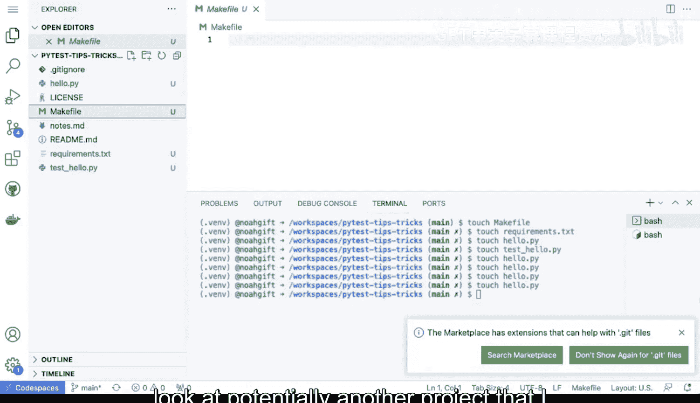

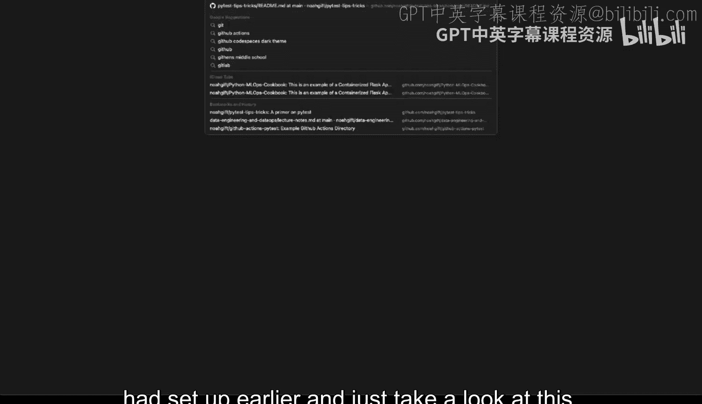

Section， I have a test section， I have a format section。

 I have a L section and then I have something that runs all this at the same time so we can probably just copy this let's go ahead and use this as as our scaffolding so I'm going go back here and I'm going to go to the code space and I'll just paste it in and that's what's nice about having created once a scaffolding can you can pretty much use it over and over again Now let's take a look at this make file and see how it works here。

To start with， you know， one of the things that we'll see is that。

If I type in make and then let's say I do install， notice it autocomps and if I do make space tab。

It'll actually show me all of the different options as well。 So that's another really。

 really cool part of make is that it will actually like give me a almost like a help menu automatically So that's why I think make files are really。

 really cool for Python developers And if you're not using make files it's going to be worth your while to start integrating them into your project just saves you a lot of time So we can probably now look inside of a requirements file say well well we need to install some packages that will help us out。

😊，And to start with， I think one of the packages that we would want to install。

woWould be the testing library obviously right so Py test and so first up we just put in P test and let's just take a look at how that would work remember it's really simple I just always check to make sure there's a not a new version of the Python packaging tool in this case Pip I then go through here and I say you know Pip install dashR requirements。

Let's go through this， make install。Perfect。And now that I've got this thing set up now I've got P test loaded。

 so how would I test this to see if P test is loaded， well， I can just type in P test like this。

And I can just say I think it's just Da help there we go， you can see that in fact it is running。

 I've got P test loaded， it's a very complex tool， it can do a lot of stuff。

 a lot of testing tools are very complex and so I can look at all the different things that I can do with PT now that I've got installed。

Most likely for me when I'm first starting a project。

 I would also get started with a couple other things like I like to use Pi lens。Which for Linting。

 there's also flake8， which is an alternative。There's。

Also the black tool which is a formatting tool and then I also put in Pi test Cove as well。

 which is cover a testing tool that or a coverage tool that shows us the coverage report for our code so like how much of it is actually tested and so that's probably a good start here I think that's probably a good fit and so I can again just leverage the power of the fact that I have this make file and just very simply type in make install again there we go make install。

And what's interesting here is that I think it's nonintuitive that installation is an important component of continuous integration。

 but it is， and so when we later set up the build system for GitHub actions。

 one of the things that we're going to do is we're actually going to also test the installation of packages because that's the real world。

 you want to make sure that your code is actually installable。

So now we got everything pretty much set up， we have you know the ability to run things， you know。

 maybe another tool that we can install that I like to use for just kind of playing around with things is I Python。

I think that would be another one， so let's go ahead and do that and I'll show you why I like to install。

I Python is that when I'm debugging code or I'm playing around with things， it's actually pretty。

 pretty neat to be able to， let's say import my module or whatever and just and just play play around with it from this interactive prompt here So for example。

 if I'm going to test my code I might first play around with the module on writing so let's let's go ahead and write something here so let's go ahead and。

Let's let's type in。More hello。And let's just do something really simple and just say hi， right。

 so I've got a piece of code here。 So now how would I use this inside of the i Python。

 I would just type an i Python。And I would say from hello import。

And look it'll it'll autocomplete here for me， which is really nice and then I can kind of play around with my code even before I write my first test I can say。

 okay what did this do again， let's check this out if I call it， what does it do okay。

 it returns high and I can give even play around with like the test I would potentially write in P test。

PyT works with asserts and so I could go here and I could say assertt。You know。

 high is equal to more hello， right is this is essentially like prototyping my unit test， right。

 It's like， oh， great， this is pretty simple， cool。

 So good tool to have in your toolkit for testing as i Python。 I think very overlooked。 Great。

 So we got we got a test file here。 that's good。 So let's go ahead and write our first test in P test。

 Now， fortunately， Py test is trivial to write a test。 And that's why so many people like it。

 The tool is complex， but to write the test in Py test is just ridiculously simple。

 So remember we have a test hello here。 all we gotta do is say the same thing basically that I did in my i Python terminal。

 In fact， I could just look down at this i Python terminal here。 And essentially。

 it's gonna be all the code I need。 So I'm gonna to say from hello import more hello。😊。

And then now I just need to write an assert。 that's how the test works。

 So I'm going to say deaf test more hello， I like to name the test by the module functioning the module。

 so here we go。We'll say def test more hello， and then I just do the same thing。

 I can literally cut and paste the same thing I did below here and just paste it in。

And we can just go here， assert high is equal to more hello。And let's go ahead and now do a test。

 Now let's again， look at our make file here。Notice how I test， I say Python dash M。

Py test and I and I give it a couple different options here like make it extra verbose that's what those flags do and then I just run this file just like that so if we go through this I can just say make test and the reason I like to do make test here and you can see it past。

Is that it's just simpler right its just less code to type it just gets annoying to type the commands over and over and over again。

 And what you'll find is typically you you'll unless you're doing some kind of you know really tricky thing with P test it's just put it into a test block of your make file and it's going save you a lot of time。

 Now lets let's take a look at what happens if we have a failing test here， So that's successful。

 but lets let's go ahead and make one fail and say test。More hello。Qu。

And then obviously it only returns back high， what if we said， you know， something else like？Bye。

 there we go。And we can go here and we can say more hello。And it'll auto completete here。

 and And if I say make test again， we're going to get a failure here。 There we go。 So very。

 very intuitive to write tests with P test here。 And look。

 it gives us a report here that says 50% of the of the。

the system has passed here and and we have one failure and we can see right here it says， look。

 you said that the function should return by but in fact， it returned high。

 we got a problem Okay so now maybe what I would do next here is go back to my code and say， oh yeah。

 I didn't mean to do that。 I didn't write this this function yet。

 so let's go ahead and write a function that says more。More goodbye or let's try that。And then。

 we'll say， return。Bye， there we go。And then if we go back to the test file here。

 I can just import that file。And we can just do this。More goodbye。And then I could just change this。

To test more goodbye。And。Change this。Like that？Perfect， and now if I run， make test again。

There we go we got two tests that are passed， so really intuitive in a sense in that it gives you this output that says。

 whoops， we got a problem here， you know let's go ahead and fix this。That's good。

 we got the basics of Pt working personally， I think it's also good to get the formatting working and thelinntting working this would be like the the I would call the checklist of best practices so let's double check that thelinntting works so if we look atlynting with Plinnt。

Notice what I do here as I say pi Li and I disable these two other types of warnings which are recommended in configuration I believe。

 and so I only want to see warnings and errors so I've noticed just in my opinion。

 those are the things I care about the most and so I'm gonna to go ahead and link this file so I'm going to say again make L just again because I want to be succinct and what I'm typing here so here we go make L great now what could allow us to test this out and see what would happen with a bad Li an easy one is this if I say var equals one right I create a variable and then。

Inside of here， I create this， I say， var。Is equal to vr like do some kind of， you know， nonsense。

 like it doesn't break the code because watch， if I do make test， the test still pass right。

 so it's still。Synactically。It's yeah， synactically valid， like it still works， it's just doesn't。

Really do anything and it's a bad code technique right like you don't want to reassign a variable to a self and so if I do a make L。

Now this will say hey， look at this， you can't do this。

 you should really be careful that you're assigning the variable to itself。

 it's a warning right the code still works， it's not like an error now it will catch errors as well so that' that's one well let's just put a note here that says。

This is nonsense code that。Generates a warning。So I do believe this is really critical to also catch warnings with a language like Python and even compiled languages I think why not listen to a compiler。

 I think it's a great idea。But now let's make actually bad bad syntax and so if I go here。

 I could also say you knowF is equal to and just leave it blank right like so it's broken code like this code won't execute the other thing is cool if we do a make L。

Is actually， it'll show us that look， there's invalid syntax。 So so it failed right here and says。

 look， your code won't even run。 I could't even get to the warnings because it doesn't even run。

 and it tells us right there。 It says line line 12。

 So that's one of the really powerful things about P test。

Is that it I'm sorry P Ly is that it works very well with Py test it's kind of complementary or flakeate like any of these lins and so it catches an extra layer of things that are just helpful right so you want to know these things especially if you're working on a team project。

Okay， great we got this working let's go ahead and say you know make test again。

 double check that works great， we're gonna say make Li。

 make sure that works awesome and then the only other component really to get to kind of get this initial feedback loop would be to go to this format unless it's double check how this works so inside of this what I like about the formatting tool is it also solves problems with your team like。

You know it can be very annoying when you're working with people in your company that one person wants to do it this way。

 one person wants to do it this way， if you use a formatter like this is like look the formatter says this so let's just keep it simple and let's go ahead and use this so if I say make format。

There we go。 Now we can see it just kind of cleans up the code and makes it a little bit better。

 So I think it's a good idea as well to do that。 And if you want to。

 you can actually put all this together right so you can and you can chain it in the order you'd like it to be So I think this is a pretty good order that I would recommend which is that basically before you check in your code to let's say GiHub why not just do make all right so install your code。

 make sure that you've got all the latest versions now you could also pin the requirements as well which actually will do and then test your code and format your code so。

Let's go ahead and do this， let's say Pip freezeze。

If we type in Pip freezeze and we maybe pipe it to less。

What it'll do is it'll show us all the versions that are currently installed。

We can go ahead and do this so we can we can just swap these out and I'll just do this。

 I don't like to just cut and paste this because what happens is that。

It will maybe put things in there that I don't need。

 so I think it's better to be a little bit more careful about my curation here so I can say pie tests and P test Cove。

 great， let's go ahead and throw those in。Like this， so this will tell this repo。This is it。

 you're using this version of the package that I installed。

 which again is great for testing because I can test a very specific version of my code and then we can go back up here and we can put this version as well。

Awesome。There we go， we have our packages installed as well。

 that's great and now I can do the make all， let's go ahead and do make all let's just double check everything works again。

There we go。 So it's going to install my software。 it's going to Li my software。

 It's going to test my software。 it's going to format。

I think this is a great way to start your project， in my opinion， highly recommend。

 so let's go to the next step here and let's push this code。So I'm going to say git status。

 and I'm going to say git add this。And then I'm going to go ahead and say get commit dash in。

 adding initial layout。Initially layout of Python project。Perfect。There we go。

 and now I'm going to go ahead and push this code。Excellent so now that I've got this initial structure set up here。

 we can now start to look at going to the next level。

 which is well what if I want to use a different environment other than just this environment For example。

 let's say your company uses AWS or GGP or Azure well what do you do Well。

 there's a couple things that I would recommend， one is that if we go back to this drawing here remember that the idea is that your' locally testing in your code works that's great。

 but you also want to have the ability to deploy to other environments。

 and so this is where the build system comes in right here and this would the build system will basically be the gatekeeper that allows you to double checkck that hey everything's actually okay before I use it so。

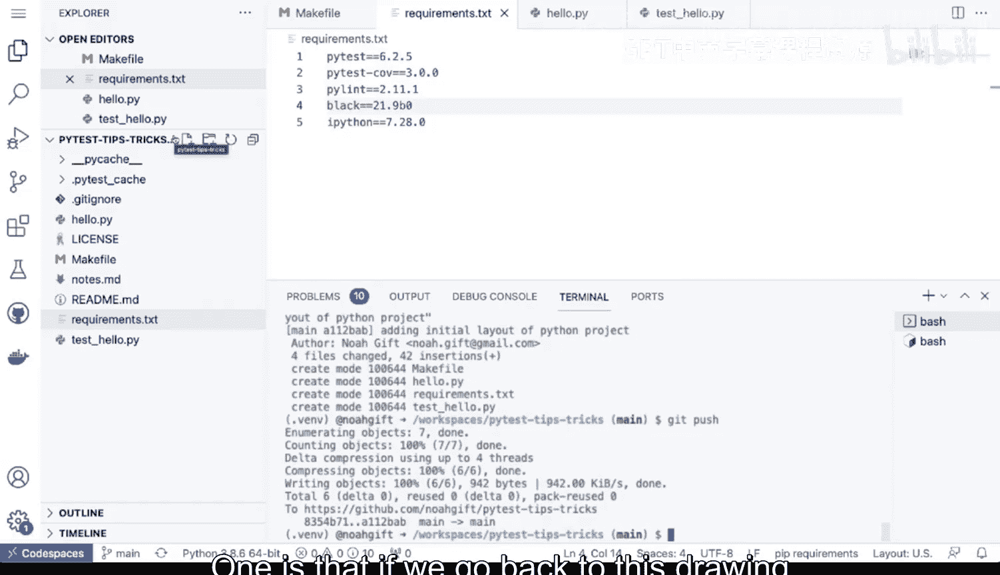

Because we don't have the build system set up yet， let's not get into a cloud environment until we can fix that。

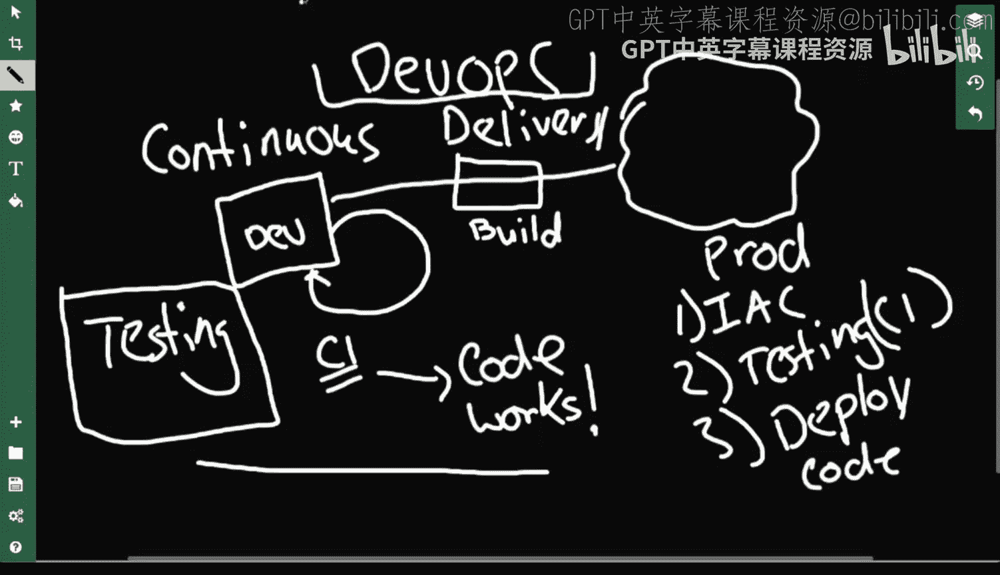

What I'm going to do is I'm going to go over to GitHub。And I'm going to go back to our repo。

 and I'm going to set this up。 so let's go ahead and say。Py test here。Pie test trips。

 tips and tricks。And now I'm going to go to this section where it says actions and this would be the GiHub actions build system and a build system just runs your code and allows you to do testing on it and deployment that's really the essence of it GitHub actions is kind of one of a newer one and you know really shiny because it integrates really well I personally am a huge fan of it I think is' awesome and a few things to point out about GitHub actions here。

Is that these workflows allow you to do things like use Ananaconda you know here's how to do one with a make file which I'm just I'm showing you and then also how to publish a Python package or you wanted to be an open source software developer you could do this you could also deploy your code with other popular services like Azure ACK ECS GkeE。

 all these things are great examples of ways to to use it and additionally there's also like kind of more abstract ones like hey let let's do like you know a labeler or where let's give somebody ingredients so there's a lot of really cool stuff I think a good place to start would be to set up workflow yourself and it just gives you basically a really rough structure here that you could use to to play things play around with things so since I've done this before。

What I'm gonna do。Is I'm going to actually open up a new tab and again just copy an old version that I've got here I think I。

A GiHub actions， example， there we go， I have one that I've done earlier and look at the layout。

 it's dot Gitthub workflows， and then there's a Yaml file。And you can see here a very。

 very simple Python application test with Github actions。 we're going to say on push。

 we're going to run these steps and we can we can actually。

Even say what operating system so in this case it would be a bountu latest we could even specify the versions of Python and then I could just tell it to do the things I just did locally right that's really all it is is' just do the same thing I did but run it in a cloud somewhere and make sure that everything is validated before I move to the next step So let's go ahead and try this This looks exactly like what I want。

Let's go ahead and copy this。And then I will put this into this file。And in fact。

 we can even call this。You know。Maybe testing。呃。CI or something testing continuous integration。

And then we can just go ahead and say start。Okay that's great and what's cool about it once you click the start here。

 it's going to go through and kick off our job， here we go and I can even see it in action so it's going to do all the steps' going to install first。

 then it's going to L， and it's going to test， and then it's going to format our code。

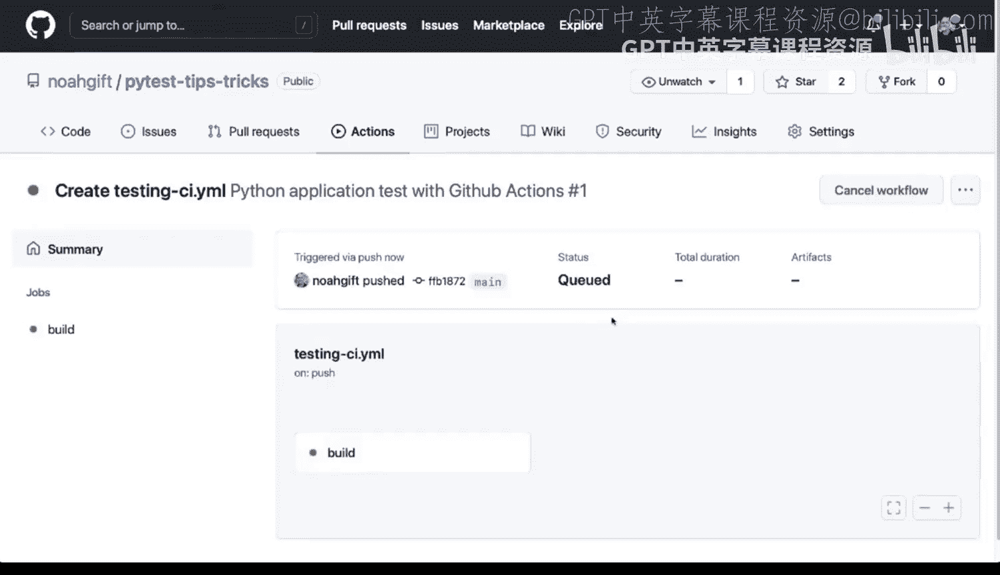

Great， this looks pretty good。So far， so good。Okay， that looks like we're in good shape here。

We've got everything running and it even says each of the steps here。

 which is nice for all of our code and then not a bad idea to click on this little menu here and say createre status badge and just copy this。

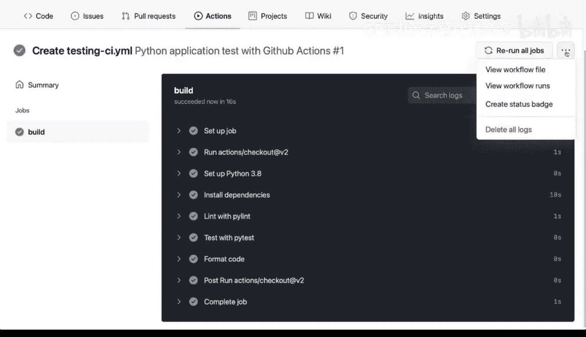

And then we can go back to our project。

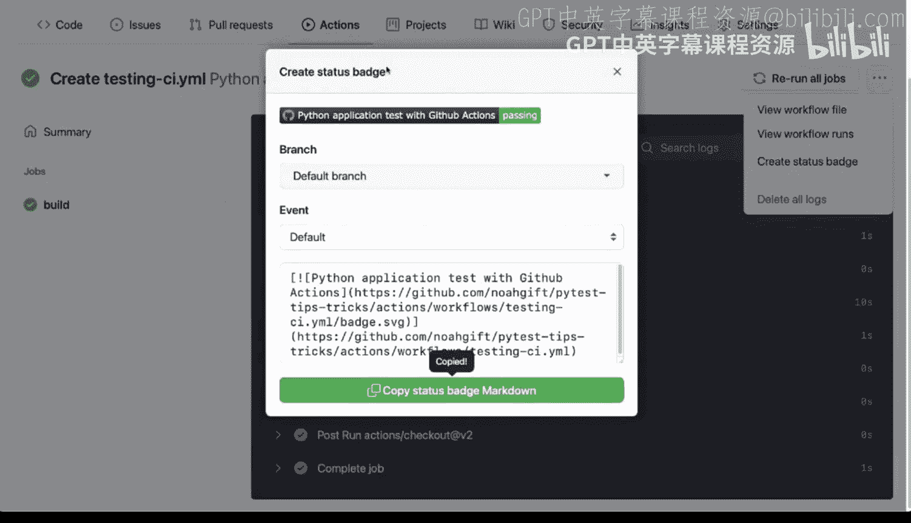

Here， which is this project。

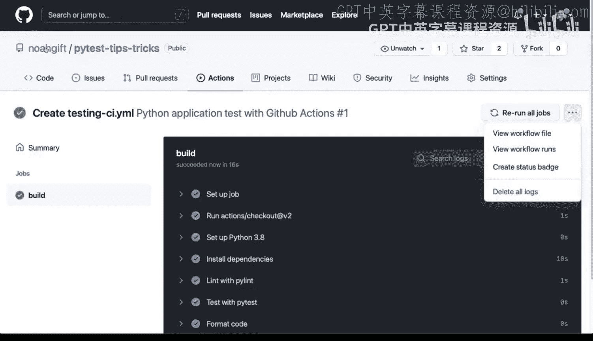

And go to the readme file。And probably put it up here at the top。 we can have our test bad。

 So we're in pretty good shape。 I think the only thing we didn't do。Which we can we can actually。

Easily get to。Is that we didn't， I'm going to say get pull so I can get all the stuff I just did。

There we go。 But we also didn't do。The test coverage flag here， and so in order to do that。

 all we need to do is just make a slight tweak here。And just do。

 I believe we can just look at this up actually， this is how I usually get around things as I just say。

 you know， pie test cove。Where is it， how do you use it in a command？You just say。There we go。

 that's it， that's all I got to do， So I'm going to do something like that， go back to this repo。

 and we're just going to add a little bit of a flag。And we just say。

 do what do I want to cover in this case I just have a file called Hello like a really simple project。

 let's go ahead and do this。Unless you make test again。

And let's see if we can get a coverage or report， make test。There we go。

 so now we have a coverage report， we have 100% test coverage， which is not surprising。

 it's a very simple piece of code， go ahead and say get status， get add， make file。Okay。

 let's commit this adding。Adding coverage report。So we're in great shape here。And again。

 when I push this change and we go back to this repo and we go to actions。It's going to allow us to。

Let's see， did I push that， I think I mean， no I didn't push yeah。

 so we can see it didnt it didn't run yet because you it only runs on push。There we go。

 we can say push， we go back if I refresh。There we go adding coverage report so really really neat that that's the trigger that that gets us to run the next step there we go and I could add as many steps as I want。

 build Docker containers， etca。 Maybe the last thing that I'll do here with with Github actions would be to。

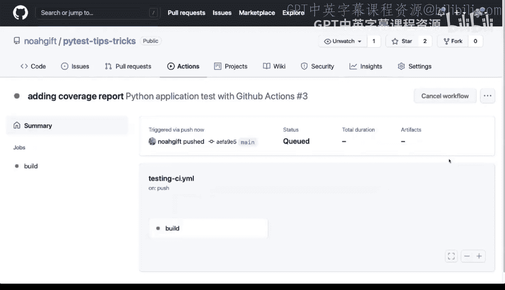

To look at what other little tricks we can do to test our code。

 and I think one of the ones that would be a good one to take a look at here。

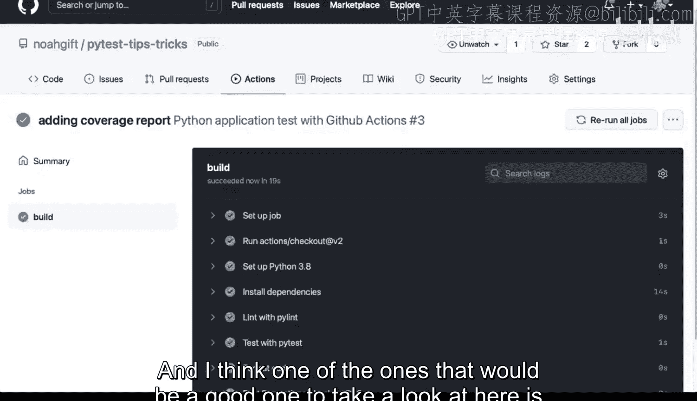

Is that inside of the official documentation for building and testing Python。

 great idea to just kind of go through here and look at all the different things you can do so specify a Python version so in our case。

We basically have。Hard coded python 38 and that may not be what we want notice what you can do。

 you can do this， you can say strategy and you can actually make this a little bit bigger you can actually test。

Several versions of your code， so yeah let's go ahead and just maybe copy their example here looks pretty cool。

And let's just， I think I can just copy this whole thing。And I'm going to go back to my project。

And I'm going to go into the GitHub directory here， go here， and let's just swap it out。

 So'm I'm going to go ahead and just go like this and just delete this one。

AndI'm going to replace this one and I'll just tweak it a little bit。

Maybe maybe take out some of the spaces to make it a little bit easier to read and there we go。

 so it's going to say name， you know， we'll just call this like test。Multiple Python。

Versions like that。And let's try this out， let's try 33，6，37，38 and 39。

 and let's see if there's a problem。 I think there may be a problem with 36 with with one of our libraries but let's test it out this all looks good now for this I'm going keep their name that looks pretty cool but I don't need to do all this stuff see this is again why I like a make file is I can just do this I can just say and let me just double check the way I did this before。

Is if I go back to this。I want to make sure that I'm going to use the right syntax here。There we go。

By test。Just look at this， I'm going to look at one of my older yeah。

 so we want to keep this when we want this thing here， this this thing and then below it。

I will just put a command that says make install。Just like that。

 there we go and then and then I could just basically from here。

Do Lnt and we can say Lnt with pilinnt， right so we can we can。Kd of riff off of their idea。

And then again， I think my style is better， which is that this is just too much stuff。

 I don't want to put all that in there， like let's just keep it simple。And we'll say make li。

And then we can do the next one， which is test with pi test。 That's good。

 but I can just say make tests， which I think still is simpler。

 and then let's just add one more thing， which is make format。 So I'll just add a step here。

 right So so that's what's really cool about。In my opinion。

 using a make fileile is it makes it really easy to kind of play around and riff off of other people's ideas without needing to do a huge heavy lift and then we'll say you know format。

A code。With Python black。And let's see we could get surprised here because one of our libraries may not work right and so that's the entire point of doing a matrix test is let's see we don't know does anything work。

 so let's go ahead and say get status。Okay， let's add this。And let's go ahead and commit。

 So adding matrix test in GiHub actions。Here we go。Let's push this。And now that we push this。

 we can go back to here， click on actions。 and there we go。 pretty exciting。 Look at this。

 There's four jobs now， which is awesome， right， We have a matrix of 3，6，3，7，3，8，3，9。

And we can just pick which one we want to look at。 I mean， let's look at 3，9 first， let's see oh。

 install dependencies。 that's looking good。 Oh， look at this。 we already got a failure here。

 which is pretty cool actually， that we have a failure so we can see。😊。

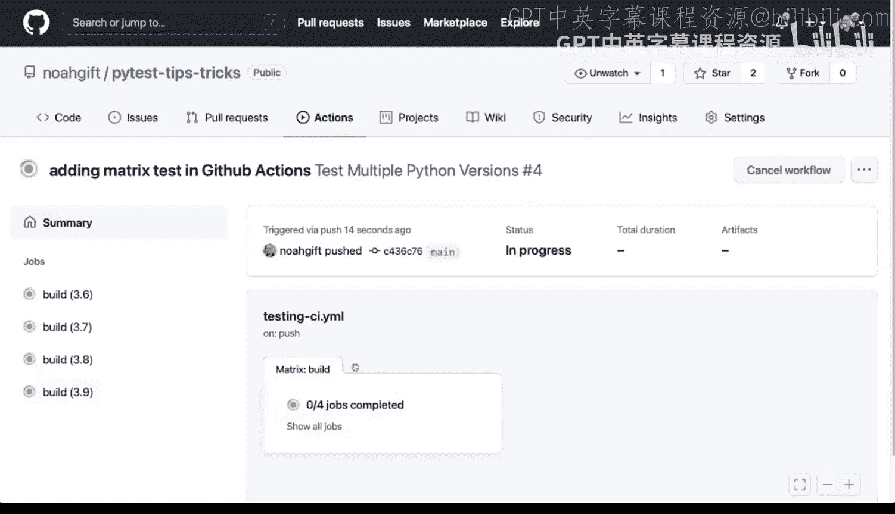

That Python 36 is not our friend， but these other ones。

 what's going on here why is this the operation was canceled， Oh， because this one failed。

 none of the rest went through。 so I believe the issue is that。There's a couple libraries here。

In this case it says， look， it couldn't find that version of i Python。

Yeah we have a couple options one is we just say look our code doesn't support Python 36 so let's just keep tweaking things so let's get that out I mean that's a pretty old version of Python let's just say we don't need it。

 yain't gonna need it。

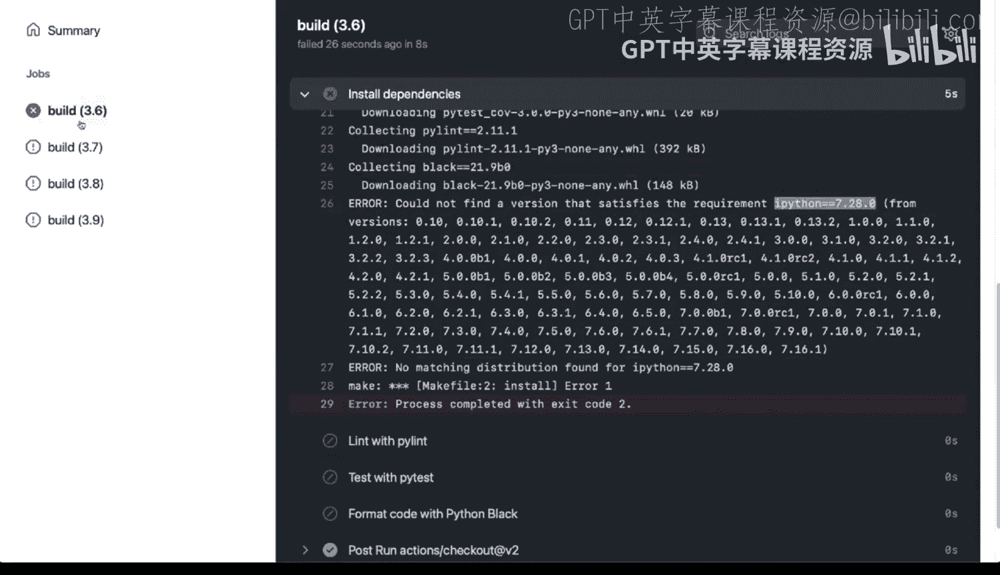

Let's go ahead and。Add it again， so we'll say get add。Commit this and push it。

And now let's go ahead and see if this works。

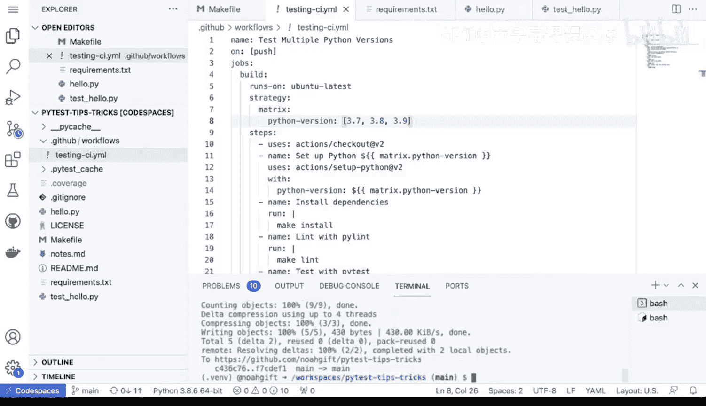

And I can go back to actions。

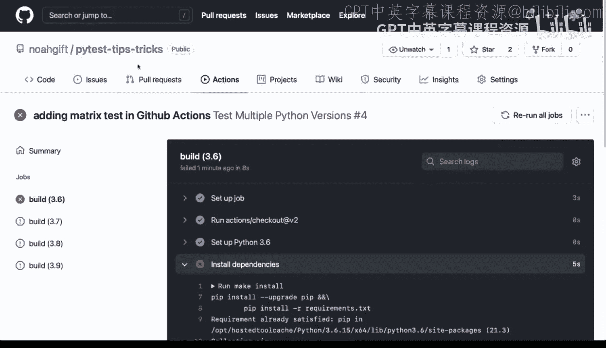

And we see V 2。 Now we don't have 3， right， We have 3，7，3，8，3，9。 So again。

 I think this is a really cool， cool technique here。 That's pretty exciting way to test our code。

 And we can now verify。😊。

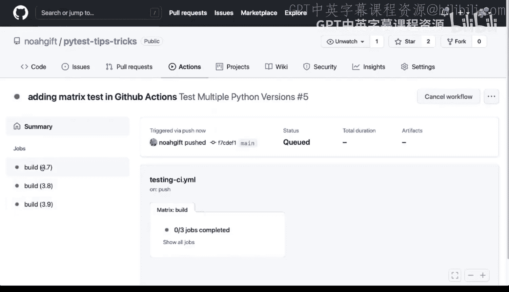

Certain versions of Python with our code so if somebody was looking at my open source project。

 they could look at， let's say 37 and say hey， this is good。

 this is working or they could look at 36 and say there's a problem here We need to to really pay attention there we go。

38 is working which is awesome and we're still working there we go so our code works perfectly on all three of these versions。

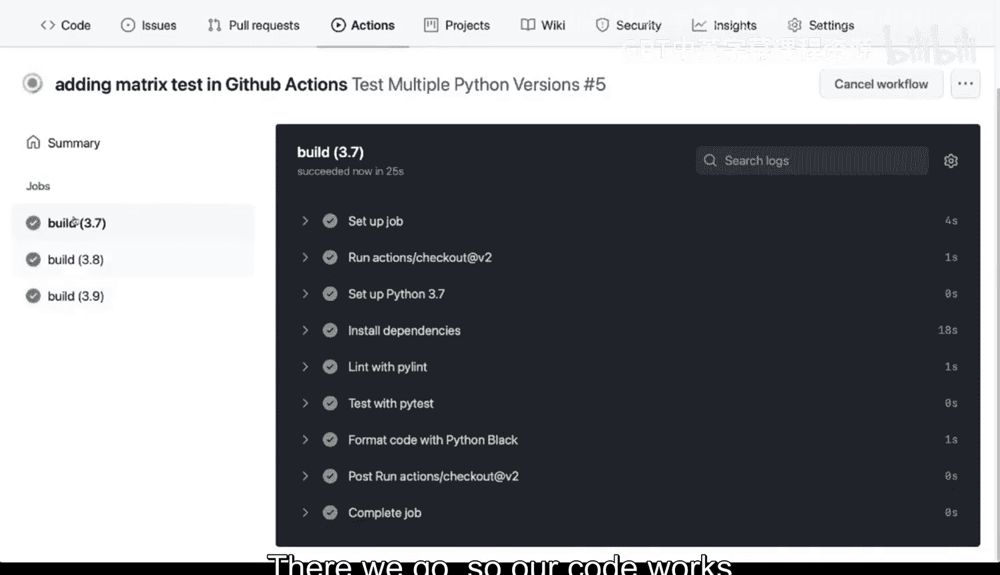

And I think if you look at this。Someone could click on this and they could take a look at what happened if we go to this repo again。

The last place we set up， we had matrix testing， everything's wonderful。

So what I'm going to do next here is I'm also going to take a directory structure and just clean things up a little bit。

In Python， the convention is to actually have a test directory or like a test directory。

 so I'm going to go ahead and make that， so I'm going to go here。And in fact。

 I'm going to change the color of this。Repo， which I think is here， we can say color theme。

 I'm going to say。

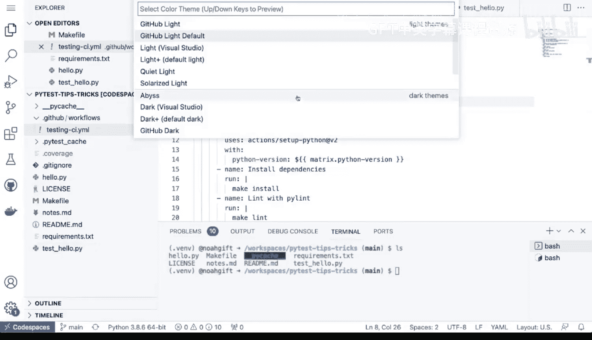

Dark visual studio， there we go。 that's a little bit easier on the eyes so we can see the directory structure。

And then what I'm going to do is also make a directory called tests， so it's going ahead to do that。

There we go。 And then I'm going to say a get， I'm going to do a get MV。 I'm going to move。

The test low。File the test， Ho。Into the test directory like that。

 And then all I got to do is go back to。This and I can just say to the directory。

 just say tests like that， so let's go ahead and give that a whirl。If I say make tests。

There we go it works。 So that's really the idea here is that you would put your tests inside of this test directory and then you could you could have a whole series of tests in fact。

 let's go ahead and keep testing right so what I could do was I can make another。You know。

 maybe test file， for example， if I was another file so I can go ahead and make another one and well we'll go ahead and do。

Touch。Let's see， let's say instead of hello。We'll call this greeting。pyy， so I got another file。

And then instead of this thing， we'll just say death。You know， name。And then we can say。Return。嗯。

My name is。And in fact， we can maybe do a little parameter thing。And we can say。My name。

Make a underscore here。And then， we'll say name。Something like this。

 like something kind of kind of intuitive to test here and in fact what I would first do is I would just type in a Python and just play around with it just to make sure I understand how it works and I could say from greeting。

Import my name。There we go， and I could say。Asert。That's。My name。Is。Bob。Equals my。Name Bob。

There we go。Perfect， so that works。 And then if I， if I put in。Sally。There we go。

 My name is Bob is not my name is Sally right so we got that we got that working so now all I got to do is I could actually now have a second test file here so so let's go ahead and do that let's say touch test。

Test。Greeting。The Py。And then I can go here and I can just assert on that so I can just say from。

Greeting。Import my name， and then I just do another test， I say test my name。

And then I can say assert， and I just again， just be lazy。

 this is why I like doing this and go ahead and throw this in。And say my name is Bob， right。

 my name is Bob， let's go ahead and do this。And now let's go ahead and say make tests。

There we go we' were able to get multiple test files tested now notice the coverage report doesn't pick that up though。

 so all I need to do to change that is I also just add a additional coverage statement。

 so I say D dash Co。Equals。The greeting。Right right so basically a file maps to unless these were in a directory。

 then it would cover everything in the directory， but since these are in the current working directory。

 I would have to explicitly call them， so let's go ahead and do this。

And let's go ahead and say make test。Now now we've got actually coverage report for both right so pretty straightforward to kind of move things around here。

Let's go ahead and go to Git status， get add all these files。

 you can see the visual Studio code black style is what I prefer。

 it definitely has good syntax here in the GitHub code spaces and we'll go ahead and say get commitm。

Adding another test layout。There we go。So we're in a great shape now if I push this。

 let's go also double check。That we're able to see everything working right in our repo。

 which is again one of the cool things about this whole matrix build， we can test， hey。

 I've got a bunch of new code， does it work right， and here we go。

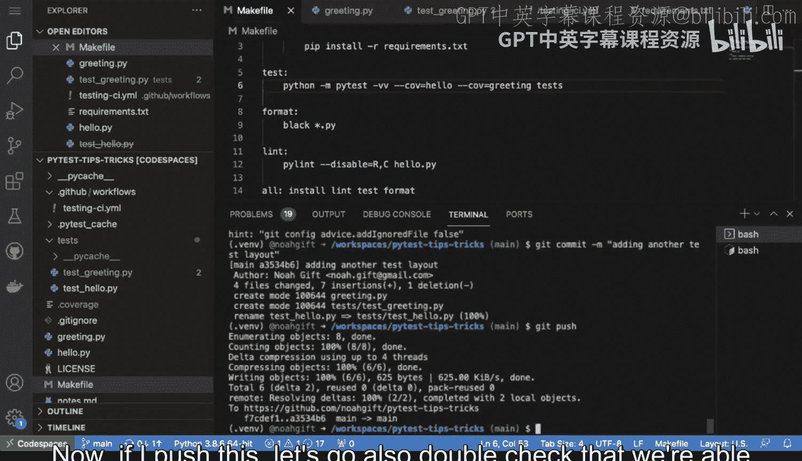

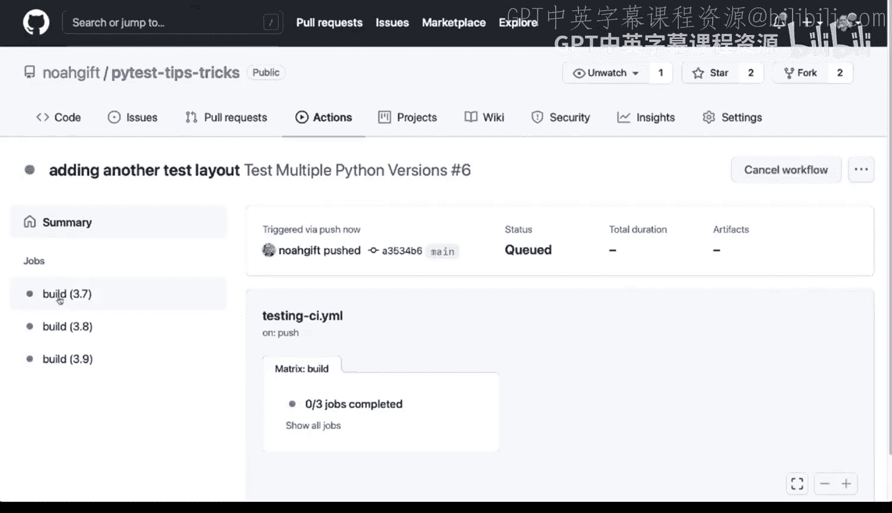

We got this。We got this thing cooking。Perfect， so everything works still and this again is the whole point is that it's one thing to test it locally。

 it's another thing to have this whole matrix that test it and really really awesome so。

I think this is a good。Good step to go to what I wanted to keep moving towards。

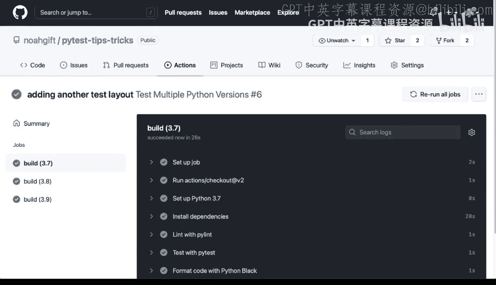

And I'll go back to our repo here is that we basically got this stuff。Set up right here。

Now let's dive a little bit into okay， we want to get a new environment and get all that working like how would we do this。

 so I'm going to start with going to AWS over here。

And what I'm going to do is first show you that they have something called CloudShell and if you're using AWS or using any cloud platform。

 they all have this and they look actually almost identical and what's nice since we've already tested our code。

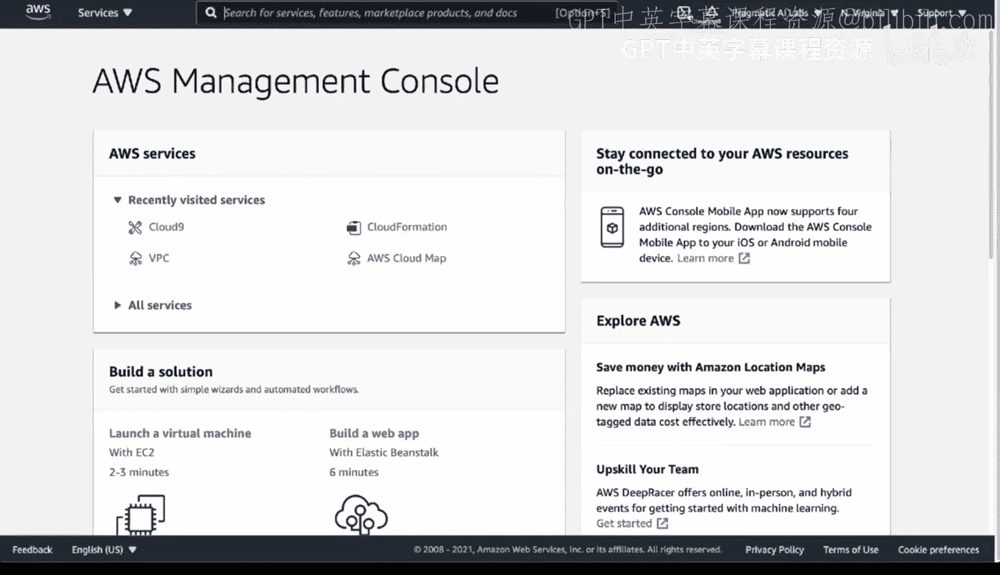

We can easily verify that it works in a new environment。

 which is the entire point of continuous integration， right is we want to make sure that anybody can。

Very simply just pull out my code and just rerun it again and everything works。

s that's that's the essence of continuous integration。 So let's give this a second to wake up。

And then we can we can test that out the thing I like about Cloudhell。

Is that this environment has got all of the tools available for AWS and so you can talk to。

 let's say buckets or talk to maybe some kind of a microservice you've got set up and it's all tied into this particular environment and again for me if I'm developing a project。

 I like to use the one that most closely fits to the environment I'm working on and I think this is really the modern era of developing is these new Cloud shellll based environment so we can notice here that look I had previously had like an environment that I'd used here and so probably probably could use that if I wanted to let's go ahead and just be simple here and do the same thing and just use this environment now one thing to note as well if I say which Python。

It's going to be in this virtual environment I had set up previously。

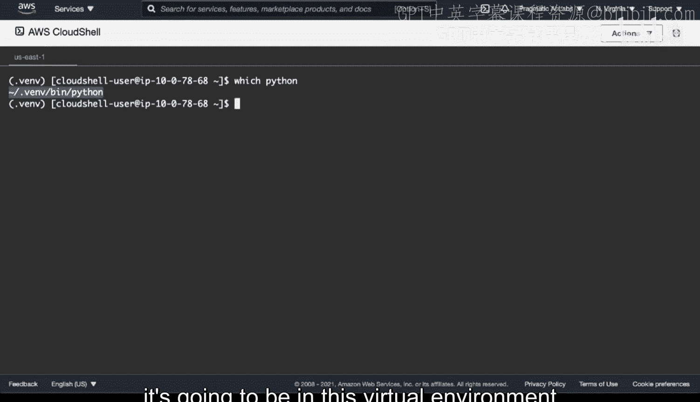

And then I can just clone my repo。Let's go back here and clone this repo。

 so I'm going to click on code。I'm going to say local now， and I'm going to clone via SSH。

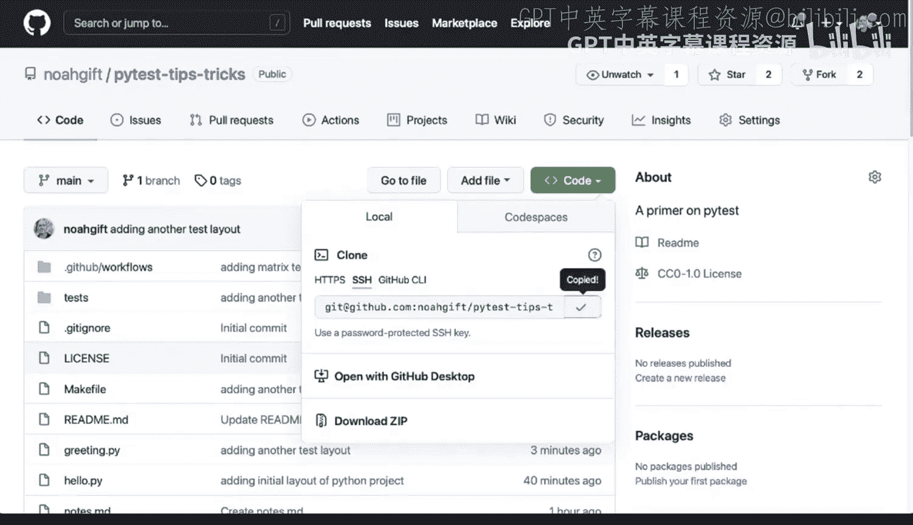

And we go back to this， move this over back back to this。

 and I can just say get clonelogne Now I've already set up the SSH keys for this environment so it'll just work so we can go in here and just see the into P test。

Tips and tricks and the first thing I would do is I would just say make all right。Again。

 if we look at the Vm file here right， we can see that there we go we got everything working。

 let's just do make all let's just double check and if we're lucky everything just works and that's the beautiful thing is of another person on my team。

Needs to get started literally it's their first day there we go right everything works awesome。

 I've got full test coverage， I've got the installation tested so really this is I think the essence of why it's so cool to use something like containers integration is that it makes it trivial to work in a new environment right everything works。

There's another environment on AWS as well called Cloud9， let's go ahead and just test that one out。

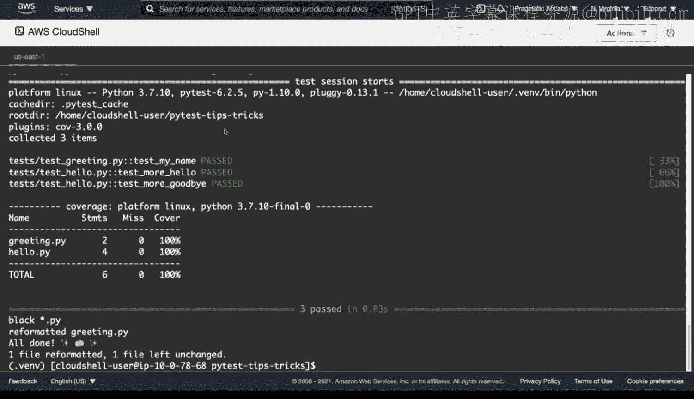

And so I can just even reuse one that I've set up before here just to make things simpler。

 you can create these environments， they're very simple to create I'll just show this real quick。

 you would just go through here and say test E andV like that。

 go to the next step and then you could go and use whatever size image you want。

 leave the defaults you could pick abuntu and it's a great way to also have an AWS more rich environment so I've already had one earlier。

That I've been playing with， I'm going to go ahead and just pick this one up since it'll be a little bit quicker to launch。

 there we go。

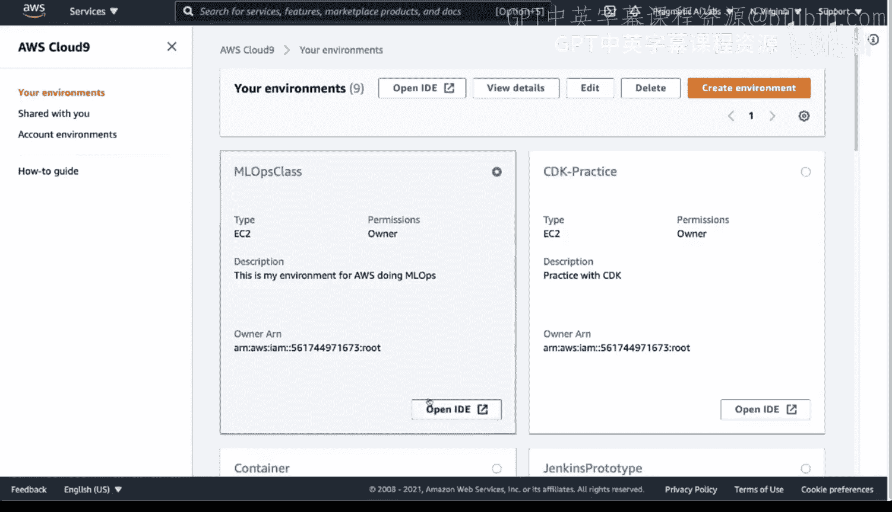

Ands what's cool about this is it's more closely aligned to the GiHub code spaces。

 so GiHub code spaces is is really about。You know， linking directly with GiHub and all their their tools。

 but if I want to do AWS development， I should use the AWS rich environment which has syntax highlighting and all this other stuff。

 So let's go ahead and I'm going to just close some of these windows。

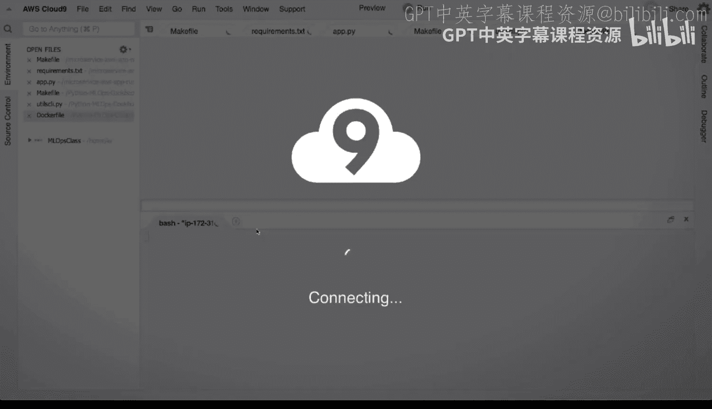

And。And just check out this repo。So I can do the same thing again that I did before just so that we have a clean environment so I can say you know。

 Python 3 dash M V and V。Tilda， the E and V， so previously。

I mentioned this that there's virtual environment， which is one of the ways to do this。

 which is installed on Ubuuntu on Red Hat Linux， which is what Amazon uses or a Red Hat variant。

 you would actually use the Python 3 M V E and V tool， so I'm going to go ahead and do that。

There we go， and now I'm going to do the same trick I did before， let's just be lazy here。

 and let's do this， let's say source Tilda。 V E and V， then activate， let's add this to our bash。

 our C file so that every time we log into this environment， it's all set up for us。

So I'm going to go ahead and do that， I'm going to say Tilda。baashhar C。And then I return。

And I just add a little note that says。You know， adding the virtual environment。There we go。Perfect。

 and now bo， there we go， I can just open up a new terminal like this and it's all ready for me。

 right？And then it's going to be trivial to go back to this again， go to SSH， clone this repo。

And go here。To my tomic， let's close this。Will， keep that open。 Let's go to。This here。

And do a git clone， so we'll do git clone。And then again。

 we have a pretty nice little setup here where I can just seed into that directory， pie test。

 tips and tricks。And then I've got a full IDE and it has actually really good ability to do syntax highlighting。

 you know， let me do any kind of editing I want。And then again， if I just look at the make file here。

 it's pretty easy to just do make call right， let's go ahead and do that and we'll just say make all。

And we can verify that works in this environment as well。Great。

 right so this is really the idea here of continuous integration is just this we've already got two environments set up。

 they work beautifully now everybody on my team can get up to speed day one I've worked in environments where it could take a week to get your laptop set up I've worked in environments before where took a month there was somebody I worked with and they said。

 yeah， I'm still setting things up and they were really motivated too they're trying to get everything set up but if you don't have good testing you're really delaying people start when they're onboarding in your company so。

Now that I've got that set up， what else can we do if we go back to this？

This structure here that I was talking about we've done this， we've set up Github codespaces。

 weve set up Cloud 9 and Cloud Shell right here， but what if I want to and we already did the testing with Github actions but what if I want to try different build system like AWS code build because my company uses AWS let's go ahead and take a look at that So if I go here。

The equivalent to Gitthub actions would be code build。

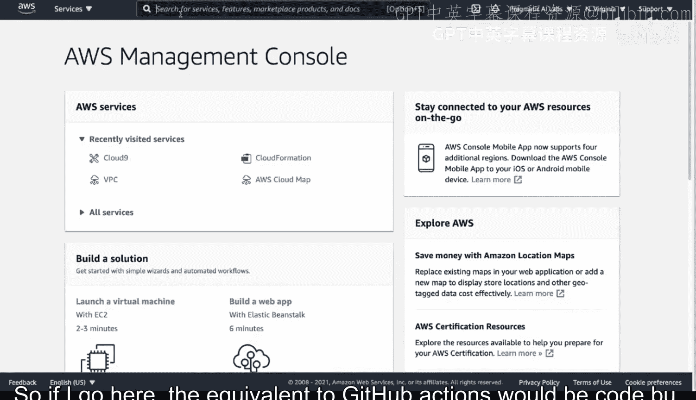

And if I go to code build。

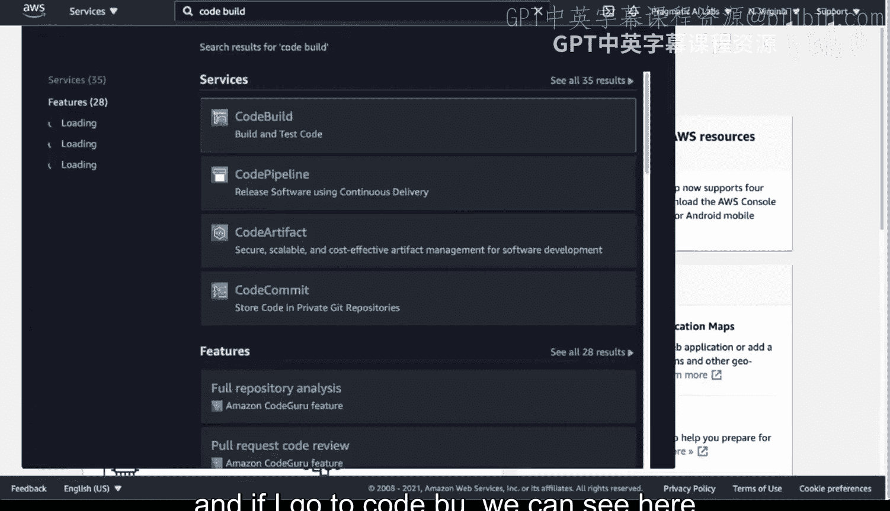

We can see here I'm going to build and test the code。And here's the structure here， right， source。

Artifacts build deploy pipelines I would just go ahead and say create build project and if I go ahead and say create a build project it's got a lot of the same kind of tricks and tips that my Github actions had so I'm going to say you know P test。

系。Let's see。It can do yeah。Tips。And tricks， there we go and just say this is。This is a in AWS。

Build system and we can also do the same things that Github Action does right we can say in order enable build badge I think the big difference with something like AWS here is that it has deep integration with whatever you're doing on AWS so if you're going to build containers for the AWS ecosystem。

 why don't you just use their environment。Now， if we scroll down here。

 you also could do additional configuration。You know， you could tag it， for example。

 and say this is the， I don't know， the tools team or whatever。

And then now we need to get to the first step， which is we need to configure the location of our code Now the different locations here is you could pull from Amazon S 3 could pull from code commitit。

 which is their own get hosted Git solutionution， Github or bid bucket or Gitthub Enterse we're gonna go ahead and select GitHub so then you'd have to authenticate and I'm gonna to say repository in my Gitthub account So I've already connected this if you haven't done it。

 you would have to do an OOuth connection like this。There we go， and then I can just type in P test。

Tips and tricks， perfect， there we go。And then if you wanted to。

 you could even specify like certain versions and this comes at handy you've actually used this before with AWS codeBuild is you can even use Git submodles as well。

 so I don't personally like Git submodles that much but sometimes you use a project that requires it and so you can do this and it'll pull out the submodles also it can actually report the build status as well if you want。

And then this is another one that's probably pretty important to be aware of is that I think a web hook would allow you to rebuild every time the code is pushed to the repo so for me。

 this is really what I would want。And so then I would say single build。

And then you could even trigger the different types so you could say。

 you know I only want this to test for certain things like a pull request was you know merged。

 for example， you could trigger it so maybe you use GitHub actions plus you use this and you have some kind of a sophisticated workflow I think for now we'll just say every event。

And now we get into in a way like。More configuration that's available via Gitthub actions。

 I could say managed image or custom image。In this case， we see managed image here。

And this would be an image that's managed by the AWS code build environment and notice as operating system。

 we can say Amazon Linux 2， and so this Amazon Linux 2 environment allows us to use the exact same operating system that we would deploy our code do so if I was going to build a microservice。

 for example。I would want to test it on the exact same environment。

 so this does give us a little bit of an advantage in some sense to using something like GitHub actions because it's kind of dialed into our environment。

Also for runtime， we could go through here and pick what version of the code build we would want to use。

 I'm going to pick the latest one。And then this would be if I wanted to do something that required pseudo or root privileges。

 you could also do this， for example， if you wanted to build Docker images。

And then do you create a new service role or do you do an existing service role。

 so this service role becomes important for you to you know maybe talk to other parts of AWS so if you needed to。

 let's say put things into S3 or maybe put an artifact into， I don't know。

 maybe like elastic file system or something like that。

 you may have to create a service role that would know you would have to create a service rule that would give you the privileges for that。

And then there's other things as well， you could go through here is like configure the timeouts。

 environmental variables， all kinds of really cool things in fact。If we scroll down here。

 the mountpoint is kind of cool that you can actually add a file system to your system。

 which would be really a cool way to do deploys。And now we get to the part where you have either the option of building giving them a file that's checked into GitHub。

 which is probably the best approach， or you could also insert the build commands here so if we click on insert build commands。

 we could actually switch to this editor and we could essentially do the best of both worlds。

 we could actually。Essentially use this as like a start。

And then I can copy it and then I can check it into my repo。

 which I think is probably a neat little trick to be aware of。

 so I'm going to go through here and just take out all this stuff， which I don't need。

And then here we go， we see phases here。And we have build commands。

 so I'm going to basically I need to put something in whatever section that it lives here。

 so I'm going to go here。And I'm going to comment out， install。

And then this is where I would do my install command， so I would go this， and then I would say。

 you know， make install。Write that。And then for the build。

 maybe this is where I would do my other commands。And so I would。Get rid of this stuff。

And also uncomment the commands， and then I would under the build， I would say potentially make。

Make Lint。And then do another one， which is。This， which is make format。Make format。

And then we could also do。Actually， we would want to do this， we would want to do this。Make format。

Here， make tests。Right so this should be good enough。To get us going。 And then again。

 what I could do， that's kind of a neat little trick is since I use this。This like built in editor。

I actually don't have to actually use it。But I could I could just use it just to build out my build spec。

 yal file and then I can keep copy of it so I'm going to go back to my AWS environment here and I'm going to just create that at the root of the directory I'm going to say touch build spec。

yMl let's double check what they want to call it。Here， so go back to this。Use a build spec to let's。

Go to this double， let's start with that。And I forget if it's Y AML or YMl。

And I'm going to click on this， let's exit it。And I believe， yes， Y M L so great。

So as long as it's right there is called YMl。 we're set， you could actually give it a custom path。

 I think we're I think we're good now because I'm going to。I'm going to push this into the repo。

 this looks good， so I'm going to say git。Add build spec and then get commit。

And we'll say adding EWS code build。Configuration file。There we go。

 and then because of this environment， I haven't set it up for the first time。

I can do that if I want。Let's go ahead and do that just because it's annoying。Go ahead to do this。

And do this so you can just copy these messages if it's the first time setting up get。Perfect。

And then we'll reset this and then I'll push it Okay great so so exit this that looks good and then get push So so once I push this it's pretty much ready to go out I think we're good we don't have to do anything else You could。

哎。you know， enable logs， do all kinds of other things here。

 but let's go ahead and build this out and see if this works if we're lucky。

Whi I'm always skeptical the first time I can figure something and work。

 but we could get lucky here and all of a sudden we have an equivalent thing to get up action so let's go ahead and click on start build。

And then this will allow us to actually tail the log file as well。

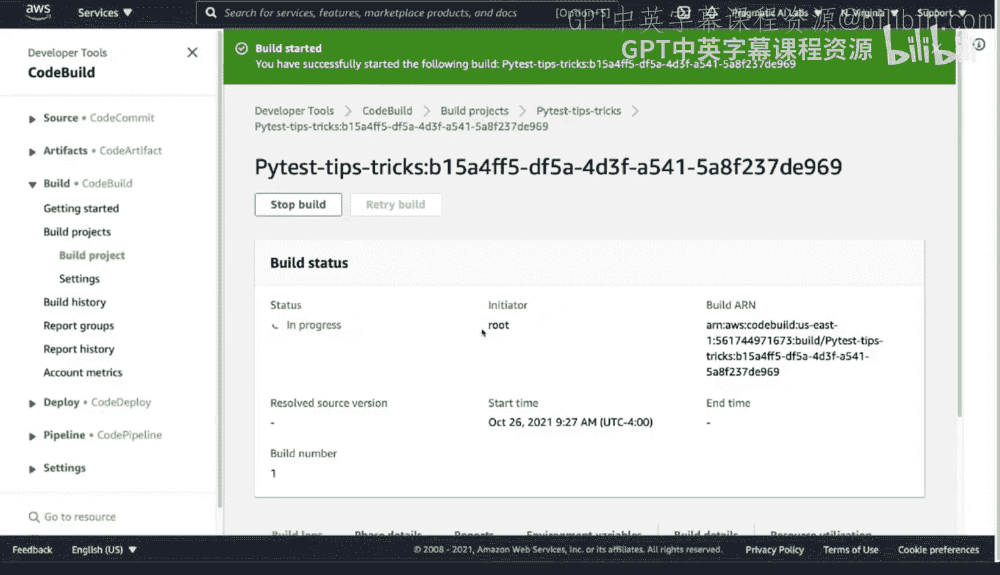

So again， if you're using AWS already and you have deep AWS infrastructure。

I think it could potentially be very advantageous to use the code build because you could natively talk to things like the El file system。

 S3， and it just would be a tighter feedback loop。And so it's good to know this。

 it's good to know both options here， so let's again watch this out。

Oh it says wrong number of container tags expected one well so we got a problem here so we can fix this a couple different ways。

 I think the first one we can do is we could just see if we can find a build spec。

yl file so example build spec。yml。

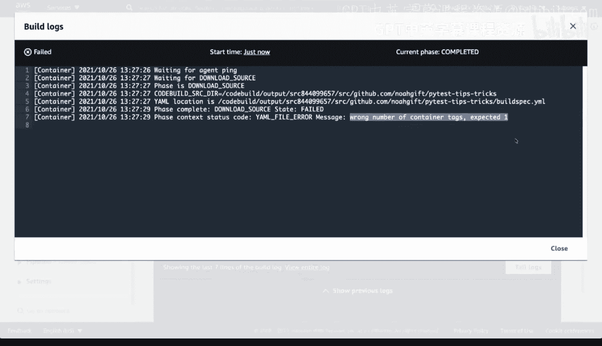

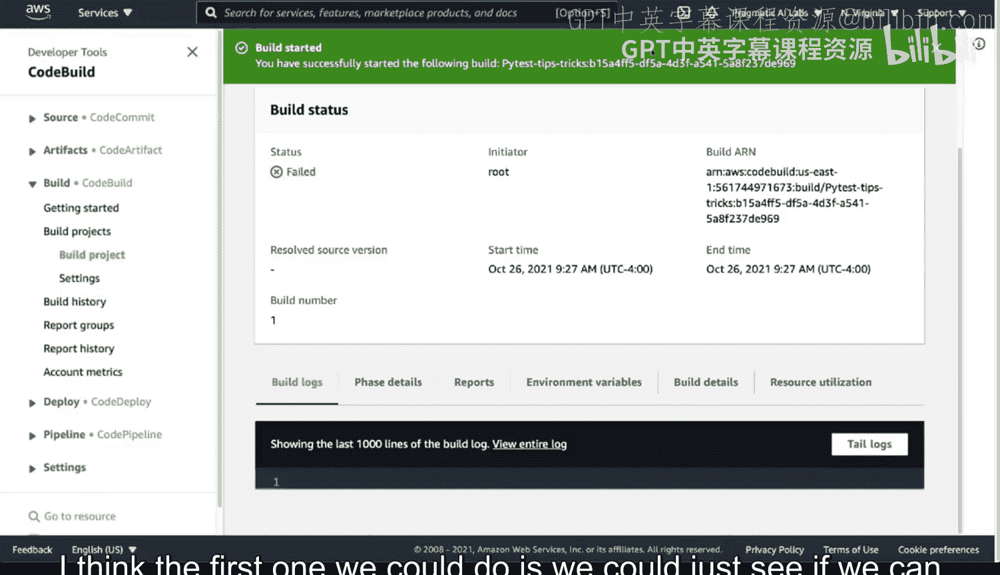

That's one way to do it， we could be lazy and just not use a build spec。

 but let's see if we can get a hello world here。This looks good， like a hello world。So。

Let's see here， this looks like what we would want。Here， I guess I could copy this。

And we could just see。We could see if this would work。Let's see if this works。I mean。

 I guess the other lazy， the lazy， here we go， Bsbeck example， there we go， that's what I want。

This looks pretty good。 Yeah， lets let's copy this one。

 let's copy this build spec Yaml and let's see if we can fix this。

So that's our old you know what it didn't save it， I wonder if that's the problem。

 I think that is the problem， maybe I don't even need to do any of this。Which would be even better。

Let's commit this。And let's push this。That would be a beautiful thing if I don't have to do anything now we can also verify the second part。

 which is every time I do a push its going to retrigg the build。

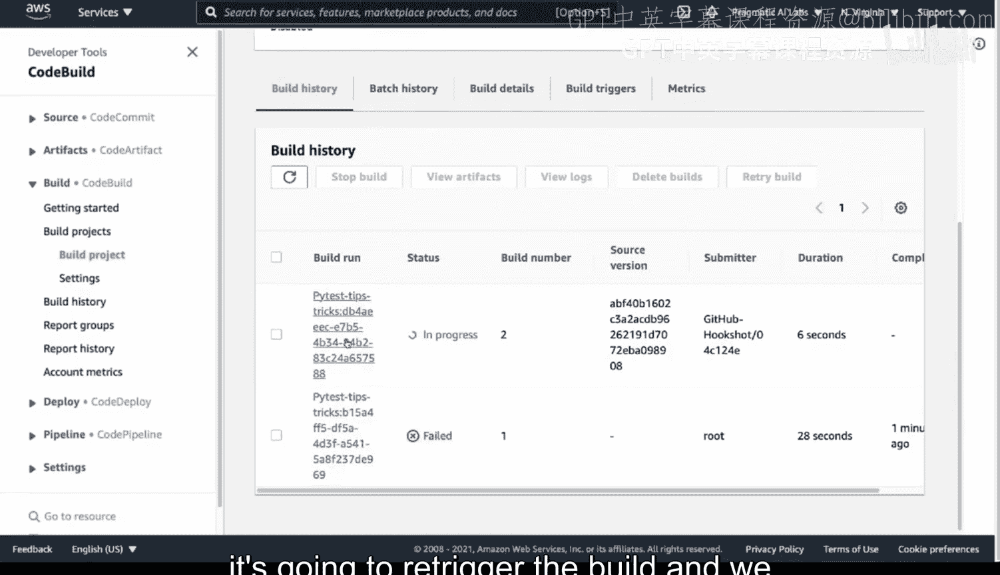

And。We can tail this and just take a look at it。So it's now acting again。

 almost identical to what we had with GitHub actions。The thing that's interesting about codeBuilders。

It has maybe a slightly higher chance of failure because of how powerful it is。

Where GitHub actions is just like ridiculously simple to set up。

 but because of so many different configuration options and different ways you can use it。AhOkay。

 this is looking good， so it does appear I just didn't save the file， which is which is。

An easy way to fix the problem there we go we。The installation， we have the test coverage。

 we have the lintting and we have the formatting， we're all set， beautiful thing， perfect。

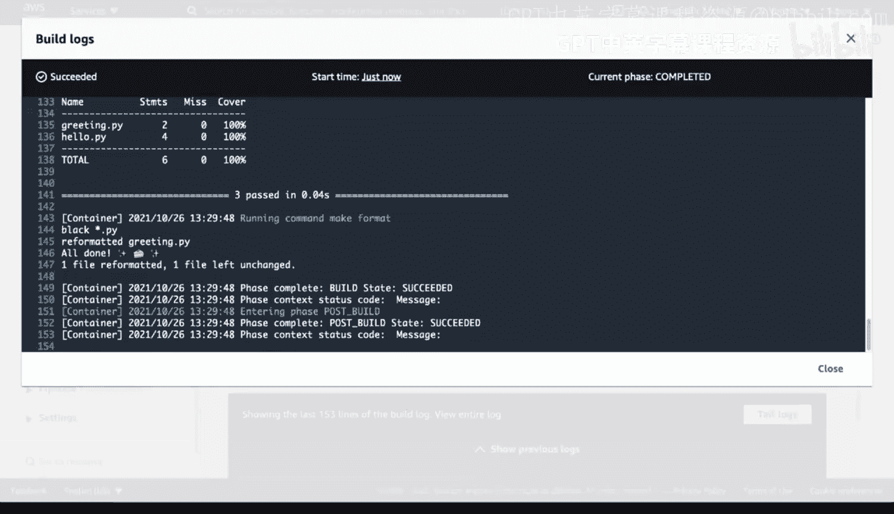

Everything's set up here now we can even do similar things。Like we did before。If we click on this。

 notice this says copybage URL， let's go ahead and copy this and I can go back to my project and go to the readme file。

And we could just also add a second batchge， so we're double tested here， we're like you know。

 I have a merit badge here。And so I'm going to go through here。And I'm going to put this。

Instead of here with。Two of these like that。It'll just kind of copy what we did over here。

Let's call this EWS。Like that。And then we'll put this into。A little。Block of code。All right。

 that looks good， I'm going to save it。And then I'm going to say get status。

 we should just have a couple files here， let's go ahead and get add both。And we'll say get commit。

Adding AWS code build。Bge。Now let's push it。So couple now we can test a couple things， so one。

 if we refresh。There we go。 We got a second badge here， which is pretty cool。

 It says AWS code build passing。 So we're getting very， very similar in many in many sense。

If we go back here to build history， we should have a third one now。There we go。

 we have a third progress。And we can take a look at this and just double check that everything is working by tellinging the log files。

 I'm assuming it will work。

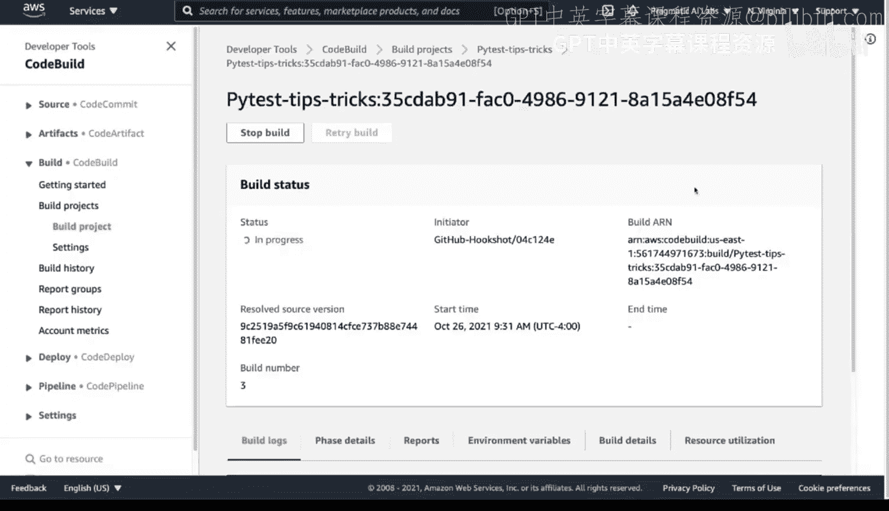

Because we didn't make anything substantially different。There we go。

 so it's installing and treating the phase。So we could do， we could keep doing this。 I mean。

 I think two build systems is enough， but we could go to Google and we could do their Cloud shell。

 and then we could do Google Cloud build。 We could do Azure。 We could do their build system。

 but you know the general。

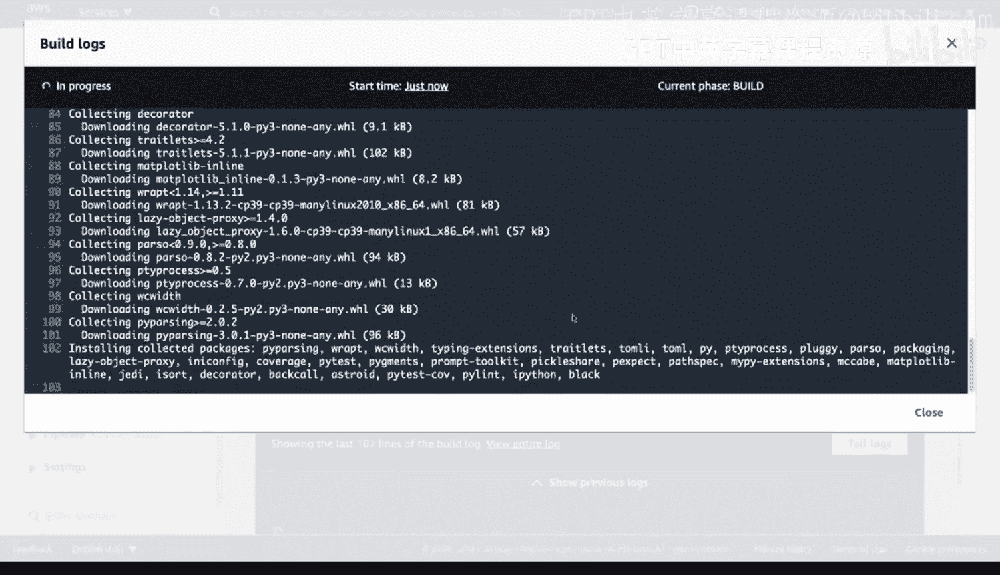

Princiipple is once you've got your structure set up the way we do。

 it's trivial to extend it to other systems and a big part of it。Is again， because of this make file。

 in my opinion， this just simplifies everything because I have a source of truth in every build system I just say make install make test and notice again here that this build spec Yal file is potentially you could it's almost identical to what the Github one looks like very。

 very similar style and again， you know what's happening， this is an installation。

 there a lint there's a test is a format， everything's cooking here so。

The next thing for us to do here。Since we've got really the whole ecosystem set up and in fact。

 I would， let me just whiteboard this really quick。

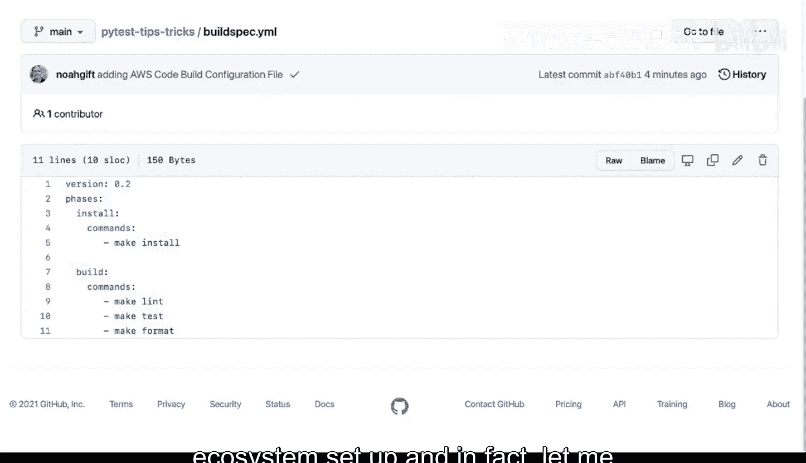

That let's make one more here。And let's just double check。We're on the same page about what we built。

Let's look through this we have first。We have our source repository right here。So this is the source。

And it could be anything like in our case， we used Gitthub actions or GitHub but。It could be。

 you know the AWS code build， I'm sorry AWS code commit， right， it could be AWS's repo。

 it can be anything， it could be Bi bucket， you know， it doesn't matter what it is， the source is。

And then the next step is。Because of we have a unified interface for testing。

 we have this make file that we can actually interface with many different locations。

 so this is really maybe step one is to get your source configured， right？

And then step two would be your environment， like your environment and again， in my opinion。

The environment should be a cloud based environment。

And so we go like this and then one of the ways that you can do this would be to use GitHub codespaces。

Which is amazing。Or you can use the EWS Cloud shell。Which is also， in my opinion， pretty amazing。

AWS Cloud show。Or。You can also go through and do cloud 9。And then you can just keep going， right。

 there there's also other clouds。You can do similar things and once you've got this this kind of one。

 two punch here， then in the center of the universe is the build system and then for the build system we'll do this number three。

You can use anything， it can be GitHub， it can be the AWS code build。呃。And again。

 once we have this code build。We're now at the point where all the next step down the line would be continuous delivery right so this would be going from C to C because of the fact that we have such a great environment that everybody can work on right really that's kind of the goal here so let's now that we've got that structure setup up digging into Py test a little bit more and see if we can do some other things with it and so in particular one of the things that might be an interesting place to move on to next is so we tested regular Python code but what if we wanted to to test a notebook and so。

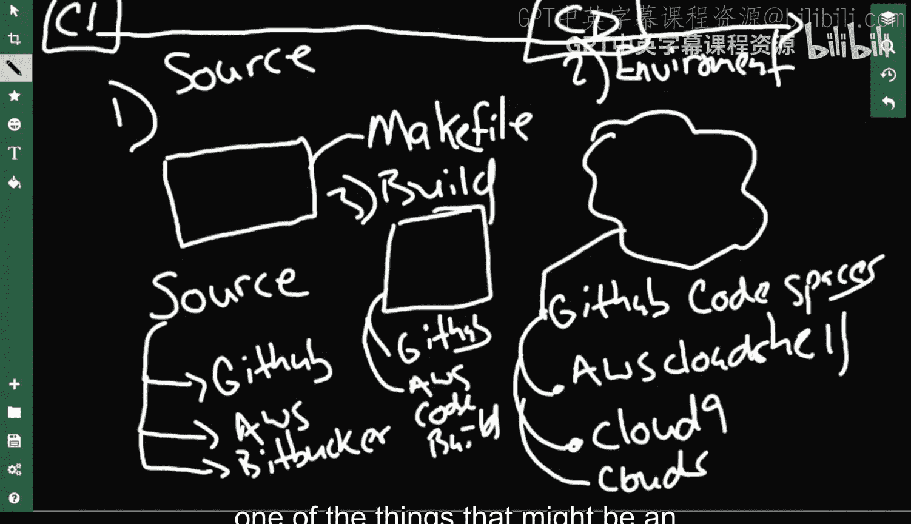

We can actually do this so we can go to。For example。Let's go to this repo here。

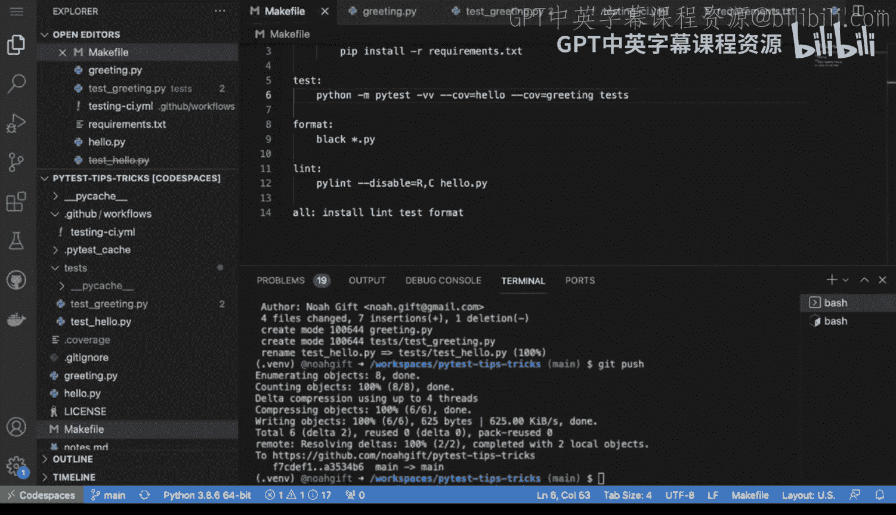

And let's open up a new tab and I'm going to go to something called Coabab。

And so coLab is a hosted Jupyter notebook and I'm going to create a new notebook and let's say that I'm now going to be part of a data science team or data engineering team which is very。

 very common and they use notebooks and I'm a real fan of testing will still you can actually interact with the same workflow and so what we can do is this we can just say。

notebook like this。 And what's cool about these these notebooks is you can do things like thisvari goes one。

 you know， and you can say let's say assert。V。Is equal to one， right， so equal equal。Does this work？

It does all right， so the world's simplest notebook。

Let's go ahead and say file and let's save a copy into GitHub。

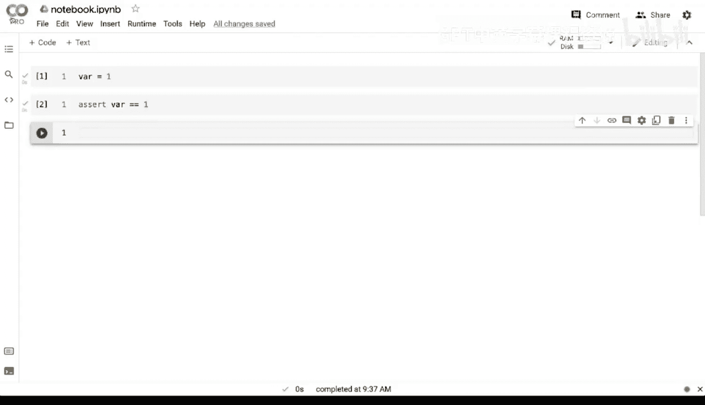

Let's retry this。And so what's cool about this is that I can now。

Push this into my project and then start building a test suite around it。

Let's go ahead and let this thing wake up。 There we go。 We have pie test tips and tricks here。

 Let's go to that。And。Byy tests， tips and tricks， perfect， okay。

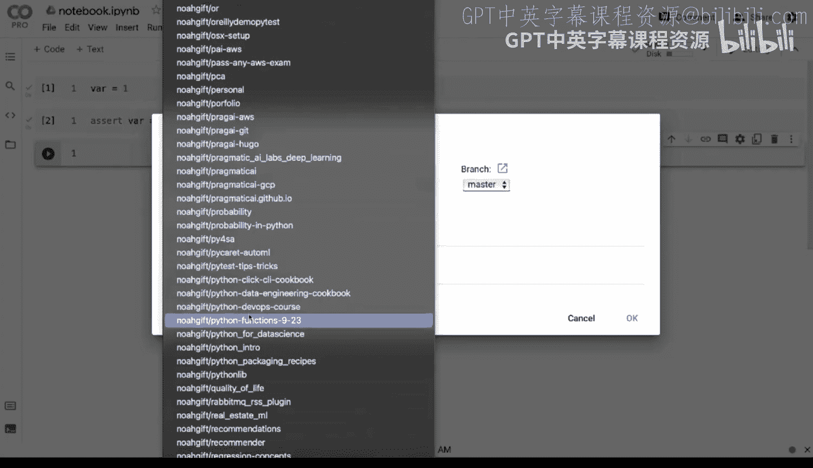

Commit and now this commits this inside of this repo， so if I go back to my project here。

We should have a notebook。 there we go。 Now we have a notebook here。

And what's cool about this notebook is other people can just open it， right， Oh there we go， yes。

 I'm back。 I have a notebook really cool， right， and they can can they can run it again。

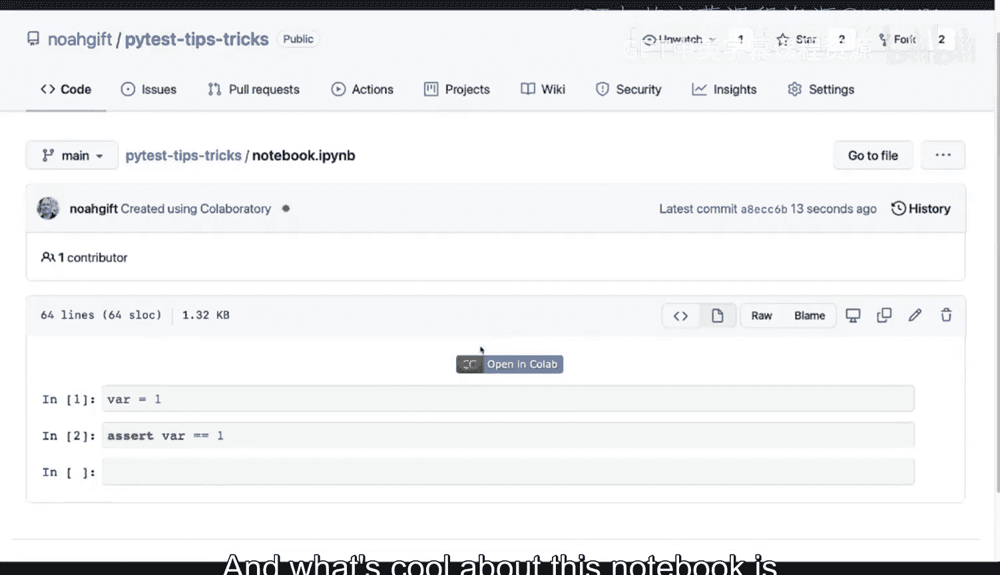

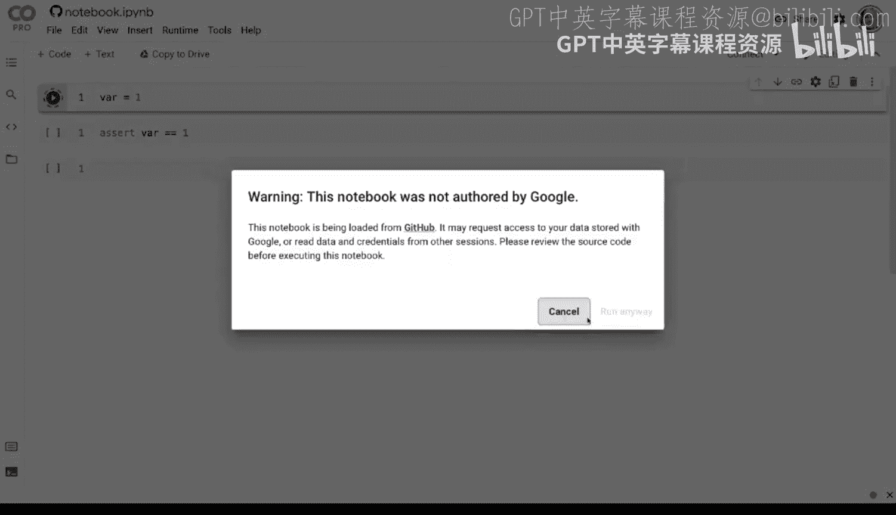

TheyThey can go through this， but a lot of times what's tricky about this。Is that。know。

 how do you test this， like what so fortunately there is a tool that allows us to actually test this。

And it's called in BVal。And I have an example of this tool in another repo I have。

 so I'm going to open up a new repo。Called myripo。And what's neat about this is that。

If we look at the requirements file。This is the name of the package in Bvalal。

 So let's go ahead and do that。 Let's go back to our our project。

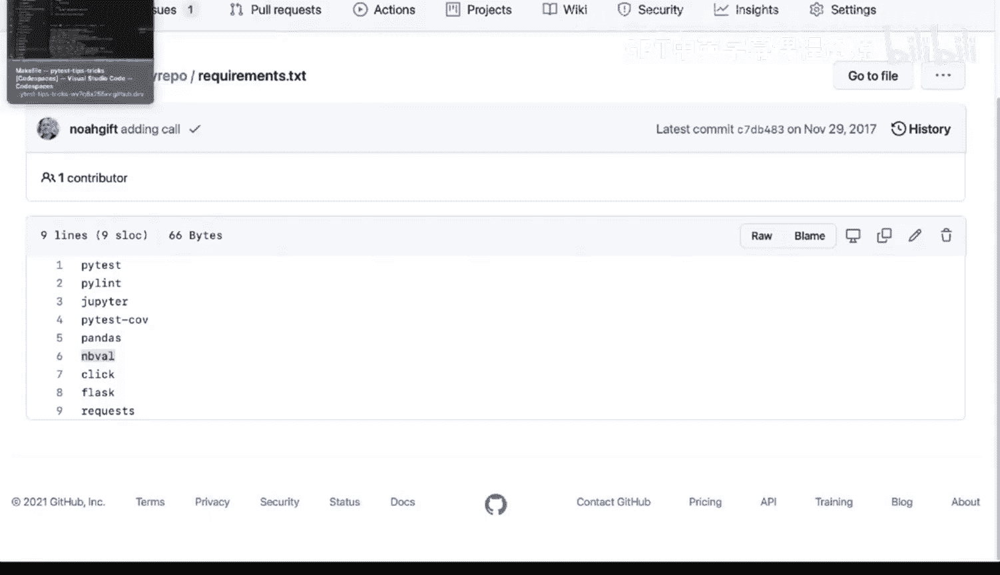

And let's go to our make file here or sorry requirements file。Let's add this。

So we're going to go ahead and add N BVal now I'm going to go ahead and do a get pull because I added some code like that notebook and then I'm going to say a make install because I just added a new library。

Okay케。And then if I want to see the exact version of Mval because we're using the actual pinning of the numbers。

 let's go ahead and do Pip freeze。And in fact， I can just be lazy and pipe that into grip and just say inV。

RightBecause that's the only one I care about。That's a great way to just get the ones you care about。

 there you go Mbival0。9。6。And then I could just test make it all again just make sure everything's good。

 So so now that I got that installed， lets let's keep looking at this this project and reverse engineer it。

 So how do I test it， let's go to the make file All I did was I added a second line here like this。

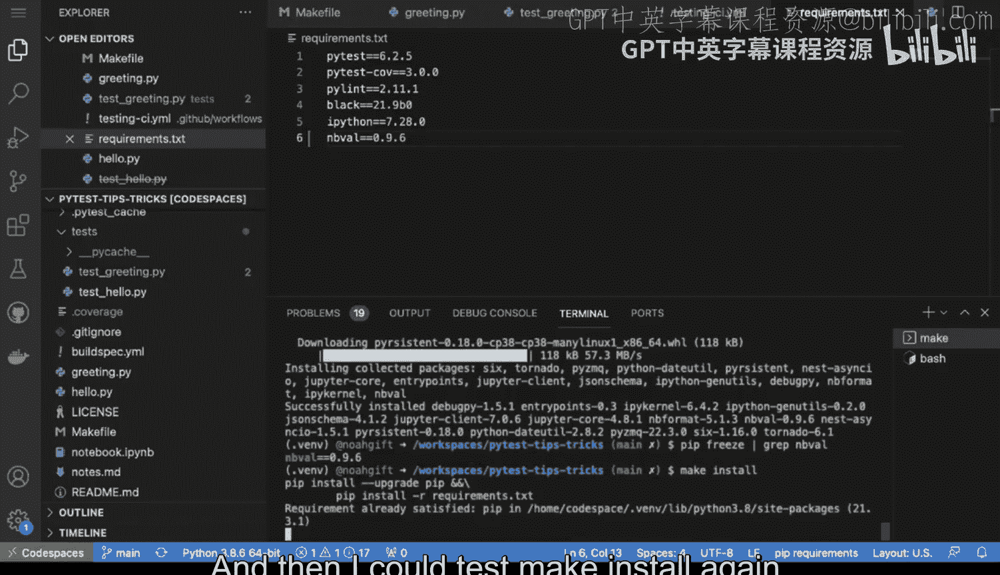

And what I do is I say dash in Bvalal notebook。 Okay， let's try it out。

 So let's just copy this line of code here。

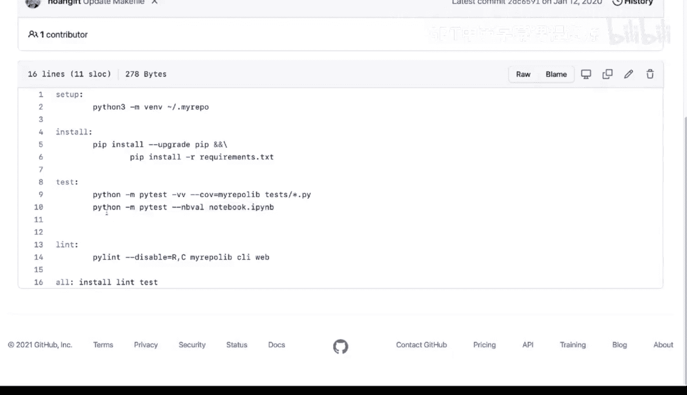

And I guess we could even run it without even putting the make file first just to get a feel for it。

 let's go ahead and paste this。 And what it'll do is it'll execute the notebook。

 there we go it passed。 So what's cool is it is actually executing the cells in the notebook。

 and I believe that this will open in Viual Studio code。 Let's go ahead and try。Let's see。

We welcome to it。 We think of find it faster。 Okay， thank you。 So that's pretty cool。 Look at this。

 I can， I can choose。😊，What version of Python， in fact， I can use。I can actually， I believe。

 for the kernel。It doesn't really matter for for now the the kernel that we use， we can。

 we can potentially use。We could use this one， though。 I believe we could say which Python。

It doesn't necessarily matter。I think I could say， select kernel。And just try that。

But it doesn't matter not the main thing is that there's nothing tricky in here。

 just I'm going to basically run this cell， which is Var1。We know that that works。

So it's going to connect to this kernel here。There we go。

And then I'm going to go to the next one right so we know that this works so what if I what if I change this to a bad line of code so it's like far too right right so now oh right we have an assertion error so now let's run our code right so。

The trick here。Which is this particular。Directory， we don't want。We want to。We want to go here。 Yeah。

 so I'm going to go ahead here。 I'm going to say。Py test and ViV now notice it fails right so it's got the exact same characteristics as a test and we can now treat a notebook like actual code。

 which I think is a very good idea for many organizations that use notebooks like data engineers。

 machine learning engineers and so what I'm going to do is I'm going to go ahead and and。

And make this change， so I'm going to say get status here。

And notice that I changed the notebook right because we changed the cell and I changed the requirements file。

 so it's going to add both get add star。Get commit。Adding the tests for the notebook。

And we'll go ahead and push this。And what's really cool now is I can go back to。

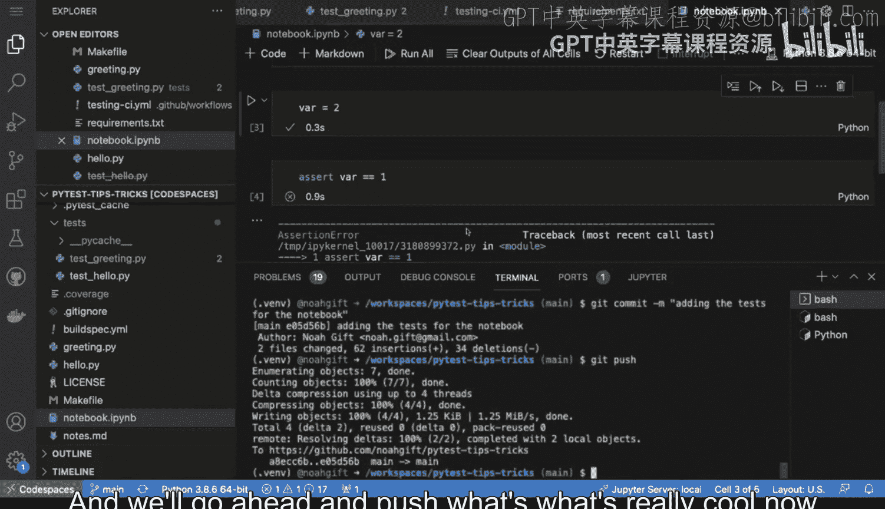

My environments for， for， for GiHub。Click on actions and what we're going to see。Is that。

All three tests should fail because we added new code， which is a broken notebook。

 and we should now see the output in each of these。So let's go ahead and take a look at this。

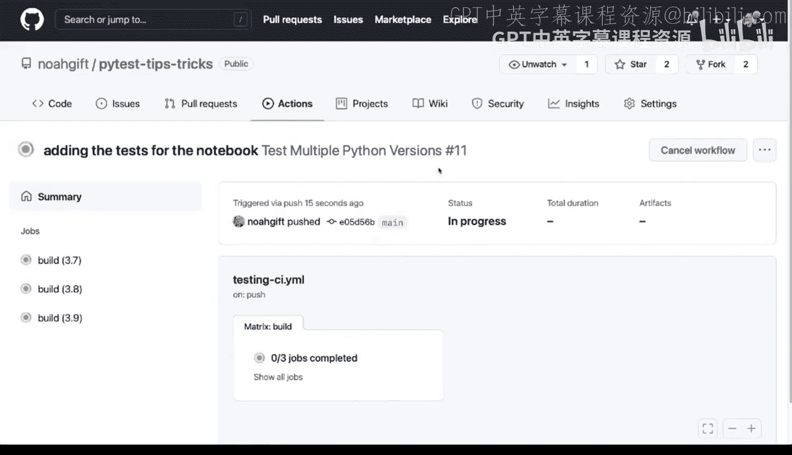

Okay， so it's running this code， installing it dependencies， it's linting。It's testing with P test。嗯。

Now， what's weird is， why did this not fail， because。

This is a great point is this is why you do want to add it to the make file。

 It's really easy like you just added a bunch of code。

 but I didn't link it into my make file so let's fix that。 So let's go back here。

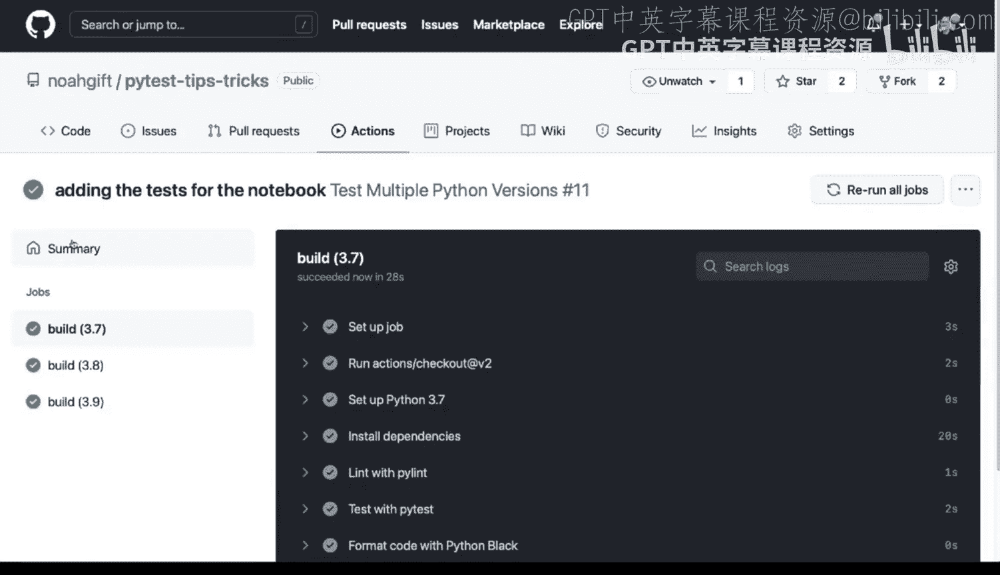

And let's take this command， which we knew was the one that tests our notebook。

 and let's just add that as another step in our test suite。So we want to add a block here like this。

 and so I could even add a documentation here that says tests are Jupyter notebook。Like right。

 just so I can see stuff。There we go， and let's go ahead and。And do do a。A make test。

And we should see it fails perfect。 We'll do a get status， get add the make file。

 and then this should fix the problem of it not failing in production or in our continuous integration。

 adding。Jupiter notebook。Test to。Our bill process。Perfect。Push it。 We go back again， too。Our no book。

And we verify again。

Here we go。

We can go to actions。How did Jupiter。Now， this should definitely fail because now it's testing our broken notebook。

Install dependencies， Great， we have the pin dependencies。We're liing our code。Py test。 Oh。

 we got a failure right， so perfect， right， So this is really the the beauty of being able to test notebooks as well as that many data science projects have there's some options that that are available to to tweak how you test notebooks。

 But but really this is something we should fix。 So all I got to do。😊。

Is we can actually fix it in here， this is a neat little trick to know about is we just have a bad test essentially。

 And so we can actually go。Into our make file。Like this。 or I'm sorry， we can。 we can't fix it。

We couldn't know we could fix it in here， we just go to the notebook and look see how that's wrong。

 we just open up in coab and we rewrite it so we can go here and we can say let's change this to two。

There we go， unless double check it works。

Here we go。Here we go。 perfect。 And now I just go back and I say， save a copy and Github。

 which is pretty cool is that I can actually。😊。

Save this from my external notes provider， my notebook provider。

 and then that will trigger the build。

Which。We could do from here， I could do gett pull。And I could say make all。

 and it'll verify that the code now works。There we go， the notebook is now passing。

 and then likewise， if I go back to。

The Gitthub actions build system。We can see that that works。This one should be passing。

Let's just give it a second。Maybe Python 39 or Python 37， I don't know which one is running first。

Linin。😔，Testing。

Great， it all works perfect。 And then likewise， if I go to code build now。

 remember this one's listening as well， we have， we have another build projects。😊，There we go。

 it's in progress， we click on this thing， we should have had， yeah， see a failure before。

Now this one should be succeeding。And we click on it。

There we go， looks like this one's passing as well， and we're also testing the notebook。

So the next step here we。We really covered this stuff。

 so let's now get into the PDB and actually do some more stuff on invoking things with Python so if you go here。

You know what's the whole point of PDB so so part of it is that if you type in PDB it will actually set a break point and you can play around with your code which which can be pretty cool so the way I typically do it is let's take one of these like a like a。

Like a hello file here。Here we go， hello right here， so if I wanted to hop into this。

 all I need to do is this， this is the magic incantation， you would say import PDB， semicolon PDdb。

 settrace。Just like that， and now all I have to do is do this， I just say Python。And I do more。Sorry。

 hello。And。That won't drop me in until I actually invoke it。 so now I just have to invoke it。

So I say more hello。We have a script here， and in fact， I could do this fancy thing here。

 which is say if。Under the name。Is equal， equal to mean。

What this will do is it'll make it so that only only if I run this as a script that it'll actually call this this function。

 So let's go ahead and do that there you go。 Now it drops me into PDB。

 And so the idea here is that it's easier to debug your code。

 And you can just say like X is equal to1 X right So so you can you can actually debug things then when you want to get out。

 you just go through here and you say you say exit。 Now it doesn't really do。

That much here like this is not really that helpful。

 it gets a little more helpful when it's something like the greeting where in this one notice that I pass in a variable so I would potentially do that we can actually copy the code I did before。

Which is do this。 we can just copy this right here。Go to the greeting。Say if under musical domain。

And they'd say my。My name here like this。And then I could just say。Import。PDB， semimic and PDDb。

 settra like this， and now if I call this thing。You can do Python greeting。Like this。

And it's going to say， oh， more because I renamed it。There we go， my name。

 so if I go ahead and do this。Notice， look it's missing an argument， so I need to pass in Bob here。

I run it again and now again， I'm right in the middle of the function， so if I type in name。

There we go， Bob。 So， and I can even reset it because they name now as you go to Sally。

And now I can do in for next。And then it'll go through and it'll it'll walk me through the code next。

 next， right， so so you can go through here and and play around with with your code and。

And see actually what it does to verify that it's actually working。

 so the idea here is similar with the Python PDB。Integ with with P test now also and I'll show that in a second。

 but I want to show one other thing here， which is that。

There's also something called IPDB， which is pretty neat and so what IPDB does is it allows you to actually have like maybe a little little fancier of a debugging system so you just do this right like IPDB。

 settrace so let's go ahead and add that to our project as well。

 so let's go to requirements and we'll type in IPDB。

And then I'm going to again do make install。Like this。There we go， make install。

We can do the same thing， we can see oh great IPDB， so I can do Pip freeze。And then grip IPDB。

We'll just grab this the depend penency number。Put this in there。And so now。

What I can do that I have IPDB， I can go back to my G file here and let's try out IPDB so important。

IPDB， let's see how different it is。IPDB does settrace like that。Now， let's go ahead and。Run it。

 so we'll just say Pythonging。pyy。There we go， now I have like a fancier like interactive。

 like you know。Let's do something like this。Class， fo。

And then we could do pass or something like this。And then I could say f is equal to fo。

 make an instance of the class and do like ID is equal to one or yeah so like now I could do f dot right and it can autocomple so it gives me like a fancier like interactive shell here to play around stuff so again depending on what it is you're doing this could really be helpful for you to play around with your code I like the IPDB one as well so you know now that I've got this setup here and we know the convention let's look at in terms of Pi test here that we can actually look at the invocations documentation。

And take a look at some of the different things we can do。 so we want to go here and go into。

 you know， the different things you can do with P test。

One of the things that we can do is we can actually do PDB。

 and so I'm going to go ahead and look for that， so PDB。There he goes， so look， we just do this。

So you could say Python comes with a built in Python debugger called PDB Py test。

 and so you can drop into the command line if the test actually fails。

Let's try that， so let's actually make the test fail。 We'll go here。

And so we'll change this to Sally。My name is Sally。And so if we do P test here。

 just do a regular pi test， oh， no module， no， we have to do。The pipe test from。

Let's copy the command that I'm doing， which is this one。

And the reason why is that it just simplifies things to run it like this。

And I'm going to just do this， I'm going to say this P test。

And then I'm going to do the flag that it talked about， which I believe was。

D has PDDb like that PDDb， so we'll go through here we' do and we'll just paste in paste。

There we go， PDB。Aha， so what's cool about this is that now if I have a failed test。

It'll actually allow me to go through here and say， hey。

 my test failed what's happening like why is it failing and I can kind of poke around the code a little bit and notice that I believe that the import would be available for me right so this this my name should be available。

Let's we could even look at name， okay， name is not defined。But what about my name。

 is my name defined， let's see， let's try that。My name。As equal and we'll say。Bob or whatever。Yeah。

 so so basically it's got everything available for me to start testing out my code and go oh。

 this is a problem。 Yeah， it's supposed to do this and you know so basically can I can debug the code by using this interactive prompt so depending on what you're doing this is a really cool option so what we could do to use this because you wouldn't want to put it inside of this test because of the fact that it would hang right like if you have a failed test you don't want your build server to just sit there and like be waiting for you what you could do is you could do this。

You could call this like debug。Debug， right， and so you would just do copy everything。Like this。

And it works said， we'd just be lazy and just do this。We can go here and say。

Python D in this there we go， so we could add a little section here that just puts a comment。呃。

Let's do this comment here and says。You know。Debugger。

Is invoked right so so so this would this would let us know that， hey。

 we need to really dig dig deep here， the test of failing， I want to open up a debugger。

 So let's try that right So if I go through here and I say make debug。There you go。

 though we can see that there is actually a problem。嗯。And so I could fix the test， obviously。

 so't make this work。And then if I go and I say make debug the debugger won't get triggered right so I think that's a pretty pretty slick way to to integrate the debuggging into your code and again。

 all you got to do is just add this to your make file here and now you got you got a little debugger now there's there's other stuff as well that you may want to consider doing。

And I think that this is kind of a cool one， this maxve 3， let's try it out。

 so this one basically says look if if basically，If there's three failures。

 like there's something bad going on， I want to actually exit out。

The other one you can do is say drop the PDB on first failure then in the test session。

 but I think this is probably the one we want right here。Is we want something like this。

 And so I'm going to throw that also in our make file and we can just say like we can call this。

Deep debug or something like this。Or debug debug。Dbug 3， we'll say debug3， we'll say debug 3。

And we'll throw this in， let's just copy this part and replace it。And do this。 There we go。

 So basically drop to PDB for first three fillers。 So we if we， if we try this， if we say make。

Debug three here。This is not going to do anything because there's only there's no failures。

 but let's go ahead and add like just for fun， let's add three tests or four tests。

 so let's go through here。And let's go through here。

Let's add four tests and we can call this one test my name two， test my name three。In testimony in4。

And so now we can actually change our code。Just to make it simpler。Is。

What's the easiest way to do this， Yeah， we can change this all to Sally。

Like that now there there's an easier way to do this using fixtures and which we'll get into in a second。

 but for now let's just keep it simple and let's go to here。Sally。Here we go， Sally。So basically。

If I run this， make debug3， there we go， it failed because there's four failed tests。

RightNow what happens if I only have two failed tests， what happens？Right， here we go。

 we can do this， we can see a Bob。And Bobb。Right。Here we go。And it did， did it， Why did it do， Oh。

 I didn't save it。 There we go。 the old don't don't save a problem。 So let's do it again， Debug 3。

Interesting that that's still invoking here。Not sure why there's because it failed once。

 it failed twice， let's just double check I'm looking at my debug。Debug 3 is not working。嗯。

Make follow nu， there may be a drop to PDDB for the first three failures。

H not sure why it's doing that。What happens if I changes a four。

 maybe maybe it doesn't work the way I expect but。Yeah， I don't know why that's not working。

 so we have our first our first demo failure。We can debug this later。

 I can put a little comment that says not working the way I expect。The way I expect。

 but conceptually， it should work。嗯。So let's get， let's add all the stuff。Commit actually。

 let's clean this up because we don't want all those failed tests right now， let's。

Let's go through here and yeah， these are good。 these are good。These are good。呃。

That might be something to take a look at as the max failil。

 the probably the PDB looks a little bit cleaner though， so get status， get add tests。Commit。

Adding more tests。Great。Now that we've got the PDB working here。

 I think the next thing that we could look at is。How to actually specify the tests as well。

 So if we scroll down here， there's a section that talks about this。

 which which is pretty cool is look， see you can actually run a specific test within a module。

 which I think is really helpful sometimes when I'm working on a really large codeb。

I don't。 It could take five minutes or 20 minutes to run the test suite。

 I just don't have time for that。 I just want to test just one particular function。

 So let's do this right， So how would I do this， I would do this syntax。

Let's again go back here。And we can look at the make file。

And we can just kind of riff on it a little bit and we can say like， we can say like。

One test right there， one test。And we can just add this in because we just need to add this part in there。

Because it needs to be invoked this way and look it says test modpyY test function。

 so in this case it would be test。Let's try both ways， let's say test and let's say test。Greeting。

And then let's look at the test greeting and let's just do test4。 Let's do this。

 Let's see if this works。And lists you test for。Like that。Test my name。 Let's see if we。

 if this works。 So I could， I could even just first do it on the command line。 Let's go through here。

And go through this。And we can say， test my name。Well。

 that was easy right so that's pretty cool right because the use case for this and let me just commit this in。

 the use case for this would be， again， you're working on a huge and I've had to do this before like huge code base with like like a massive test suite and you just don't have time you don't want to sit there and wait for 20 minutes。

 you just you change one line of code first， just you know later， yeah。

 you do want to run all a test， but you just want to do this one test。This is the way to do it。

 adding test for one module only or one function only， which is pretty sweet。There we go。

 Got that working。 Now what about if you want to point it to a particular directory or something like this。

 I mean again， if we look at this， all you have to do is。

Is actually just put in the directory and it'll it'll allow us to test things。

 So this is a good place to to take a look at more information。 I mean。

 one other thing we can do too is test this out， which is the detailed summary report as well。

 So you notice here that it allows us to。To do that so if we go through here。And we go back to this。

Let's run this command， let's just do Pi test。Let's actually run a full pipe test suite here like this。

Let's take this。And we'll go up here。And this。And then we'll do this， we'll say Python dash in Pyte。

But let's add a dash R here。To the end。Expects one argument。

 let's double check we have the right invocation here。

So we want to do PT RA， so let's add this to the beginning。

So we can say pie test。DashRA。I think you can do RAV， yeah like that。There we go。

Allows you to have a slightly trickier report， although I don't see how it's that different。

Maybe because it already does the coverage report， it's not as verbose。

 but it should give you a more comprehensive test example here and collect at the end like a test。

Summer year so there's more there's more invocation options that you can do that can be pretty helpful as well。

 but that's pretty much the gist of the reporting now one other thing I wanted to do was do the setup and do the fixtures so if we go to fixtures here let's take a look at P test fixtures because it would help us with that problem where I had a bunch of different tests and so you know if you look at fixture here。

Where's the example of the fixture， let me just grab it real quick。Py test fixture。

Let's pull this up here。Yeah， so one of the P test fixture examples here that's pretty cool is I'll just throw it here。

Let's do this I this notice the way this thing works is that this， this really can be pretty。

 pretty awesome to to build out these fixtures in your code because of the fact that。

All you have to do is define the fixture like this。

And then put that fixture inside as a parameter to the function。

We can actually we can actually try this out， let's just first run their hello world here。

 let's see if their example works here so I'm going to go back to my project。

 I'm going to add one more file and we'll call this touch test fixtures。

Fix your example or something like this。And then we'll throw this in and this should be pretty easy to verify。

 right， we could just go through here， import P test and so what's happening is there's an object's that a class that's created。

And then we make an instance of that class right here and then we just we assert that is's actually working correctly。

 so let's go ahead and do that let's do here right at the end assert that my fruit is in the basket right so let's go ahead and say make test。

Let's see， I think I'm going to have to add。The easiest way， actually， to do this would be to。

To explicitly call this file。So I'm going to do that。

 I'm going to use that same technique that we used before。Which I believe would just be this。

So if I did something like this， I can just say test。Fixture example。So， test fixture。Test。Test oh。

 I need to move this into the right location。Actually， no， we'll leave it there。

 we'll leave it there for now， we'll just say test。Test fixture。Like this。 there a fixtureer example。

 there we go。 So it passed right， because again， this is this is the the heavy lifting would be would be that we define this。

 So we can we can copy this。 I mean， there's not a lot to it。 I mean， I just， let's just。

 let's just kind of steal their ideas。And let's go back to our code here。And。

Go to test greeding and notice see this is like like basically a perfect example of why we would want to do a fixture in a sense is that what I would do is I would call this one。

Bob。And then what we do is it just returns back， Bob， this is a very simple fixture。Here we go。

 Bob returns back Bob， and then we do another fixture。And then we have one called。Sally。

So here we go。We have Bob and Sally。Okay， and then I just put past this in。

 so I' say test my name is Bob。And in fact。We could even make it even trivial， more trivial。

 as we could do。嗯。That。This might be the better way to do this is is say my name is。My name is Bob。

And then this is a returns。My name is Sally。Right， and this is probably a little more。

Indicative of what why you would build something like this， and we can get rid of。

We can get rid of the rest of these， we'll to need a couple like this。And now that we've got this。

What we want to do is use those fixtures。Here and here。And we're basically going to say。Test。

Test Bob。And what will say test Sally。Bob and Sally， there we go。 And now we got， we say。

We wanted to use the fixture。 So we want to say， basically。Bob， right， because it passed in Bob。

 assert Bob。Is equal to my name Bob， because that's going to return back that value and then assert Sally。

Is。Is going to be my name， Sally。Like that now we could even do this as a fixture as well。

 which it's a little trivial。It's a little silly in a way because it' is just so simple of a fixture。

 but if we go through here and we say make test。We should be able to verify that those fixtures now work。

And。What did we do， we。Name Pites is not defined。嗯。Oh I need to import Pi test。

 that's why so you do have to import the P test module itself right because that's why the decorator is used just like that so we can say import pi test but okay。

 perfect。And there we go， make tests， we're good to go。Perfect。

 so let's let's go ahead and I'm going to remove that。

That test fixtures thing because we don't need that。And then I'm going to commit this in。Get add。Tss。

Get status。 Per。 Get commit adding the test here。For fixtures。addinging tests with fixtures。

 so now we're starting to use some more advanced capabilities of Pi test。

So yeah， this is a good， if you want to look at a bunch of different examples。

 I'll just throw this in our chat here。F free to go through here what I'm going to do is I'm going to just steal some of my own code。

And here we go， here's an example of。You know， a debugging an object right that was that's something you could you could take a look at if you were going to add PDd begin。

 but the one I wanted to show was the，The setup and tear down。Which I believe。

Is this is testello Yeah here we go so take a look at this is that I write a setup function that adds some stuff right here to a function。

And then I have something that goes through and tears it down so we could also see how you could you could basically。

 you know， the setup is a 10。And then I verify that when I subtract it。

 that it will actually assert as nines in the reason we know this。Is that this hello function。

Has a subtract that just subtracts one。 So we can kind of borrow these concepts。

 So let's just go ahead and do that。 Let's let's just。

 I'm going to just copy this piece of code here。

And then I'm going to go to， let's just make a new file， I guess。

 so we'll go through here and we'll just say touch。You know， math do PY or。Math stuff。Let's do。Math。

What's a good word。Sm。S math， there we go。 That's a good word。 Okay， I'll do this。

 That's sometimes the hardest part of doing demos is thinking of the names for things。

 if I scroll down here， we have S math， I'll just put this in here So all it does is subtract the number right like incredibly simple。

 Now I need to create a test file for that。So I'm going to touch the test directory test SM。

So what this is going to do is allow us to。cant。Touch。😔，Oh， because I'm in the directory。That's why。

 And I need to envy this S math。Up one。Its change directory up here and now if I do a touch。

 that should work。So。Let's just do the same thing I was showing in my own code over here earlier。

Is we'll get rid of this tab。Is I just need to write。

A test function that has a setup and tear down here。

 so let's just literally copy this code here and go through here in this case though I'm not going to say from hello。

 I'm going to say from SM。

Import， subtract， that's the only one I care about。Perfect。

And what we're going to do is we're we're going to build a setup function that it basically has this thing has the ability to。

To instantiate it with 10 and I could even print this right so I can see everything that's happening inside this function。

 And then here I'm going to tear it down at the end so basically I can I can subtract it and I can verify that that that setup function is actually working correctly right because this this。

If we go back to the SM here。Let's go grab it。 This one right。

 All does is subtract and X right so that's kind of the the value of doing a setup here is I can just instantiate it with the value I want every single time I run these tests。

 it goes through and it verifies it。 And at the very end， I tear it down。 So let's go ahead and。

Do make tests and let's see if this works。嗯。We see that it did in fact， run that。 Look， there we go。

 test S math right here。 Now， let's make it fail so we know that it can fail as well。

 So if I go through here and I run this。We can see that it would actually go through and fail。Right。

 because in this case， it says。That will it will actually。We could do subtracts。

Which is the one we actually have and then do it。And it says， look， yeah。

 this is the assertion is is incorrect， now I believe as well。That I could also make it more verbose。

 and we could potentially see that print out。 If I go through here。

 let's just add one extra layer of verbosity。 Does it allow me to。To see a little bit more of the。

Of the printout here。There's a way to basically see。

Basically the print statement for the setup and teardown as well， which is。Which is not critical。

 but basically you can see that it's oh it's instantane and it's pulling down。

 So it's just a way of having a shortcut so you don't have to do a bunch of work every time you instantiate a value you go through and you run it again So let's go and make sure it passes great Everything's good to go。

 We got this working Now I also could potentially add the。

TheThis to the coverage right so we can we can test that as well。

 Ds coverage and we'll say here equals S math right so so we're building quite a lot of fancy stuff here。

Now we got most of the key features of Py test are covered。

 so let's move on now to what I would call the next step is flask。

 so if we've ever done a microservice， you know in Python flask is probably。

The way a lot of people start， right， we just go here， the hellello world is trivial。

It's aGreat way to build applications， so what I'm going to do is I'm going to build one out real quick。

So let's close bunch to these Tas at way too many open。And let's just close this， close this。

 close all this stuff， and let's start building a microservice。There we go。

 so first up what I will do。Is。Is build out a flask file。

And also you go to the requirements file and put that in so let's go to requirements and let's add in flask I just did that。

And I'll say make install。And this will go through and install our flask for us。

Do the same thing I've done before， which is Pip freeze。Grep for flask and find that version number。

Pip freezeze。是。Let's try this again。Pip freeze。And I guess it does。Where is flask here， Oh。

 it's it's uppercase flask。Okay， they want to make it complicated。There we go， uppercase flask。

 and then if I go back to the terminal here。What I can do is now create a file called web。

 right this will be our microservice web。pyy。And then it's pretty simple to build out a web application in Flask。

 I would do something like this， let's say from flaskask import。Fask like this and Jsonify。

And what's cool about this is that this visual Studio code editor is not bad in code spaces。

 it does autocomplete， we need to make an app so we'll say equals flask。

And we'll do just a name here like this， this is the way you create a flashask gap and then it's pretty trivial at this point you just create endpoints and so we can we can do this。

 we can say at app。 routes。m here and put the the main route。

 it's always a good idea to put a H world in， even if you're doing something else with it just so that you can get a health check if you deploy it into a cloud environment。

It's easy to mess yourself up by not doing that to Soify。And then we can just do have this， you know。

 basically return something， so we'll just give a Python dictionary。That says， you know。

 hellello world is always a good one， right， hello？World。Or we could say hello， Bob。

We we've been a museum。The Bob example a lot， hellello， Bob。

And then really we can do the if under under name thing now， so if under under name。

And then say equal equal。And then， say。嗯。呃。Equal equal to let's keep all the quotes the same right here。

 so let's do this。And let's keep all the quotes the same， there we go and we'll say。

If under name is mean。Like this。We can go in and do app。run。

Dbug is equal to true and then put a port， let's say 8080。There we go。

Perfect so app do run debug true so how do we run this thing will get again get up codespaces has like an amazing setup here so first let's double check install works great Everything's good we have the right flask version Now we just say Python。

Web。 Py Now what's cool is look it it uses that port 8080 here and look。

 it even lets us actually preview it， so this should return back hello Bob if I click on open browser。

There we go。 We've got Ho Bob， So really awesome workflow here from GitHub codespaces are really killing it in terms of things。

 so we got a very simple hollowo world， but how would we test this Ho world app so we could just do the same thing we did before。

Go to the test directory。Testweb。pyy just like that。Okay， now what we can do is。

Go to that test web file and just start building it out。

 So we need we know we're going to need fixtures。 So we're going to say a Pi test。

 We're going to build off of what we did before。And no， we don't want that。

 and then I'm going to import JN because we're going to use that for testing。

And then I'm going to say from web。Import app。As Flaskg。That looks good。Yeah。

 we can do that from port， we'll do that and then we'll also then go through here and we'll create a couple fixtures。

 so we'll say at Pt dot fixture。Do this and we'll make this app here。And we'll yield a flask gap。

And then the second thing we'll do as we'll say P test。

Dot and notice again how nice that is that I can do auto complete by test。Dot fixture。

And I can say deaf clients。And I can pass that app in。

 right so they basically work off of each other。And then I can return the app dot test client。

Just like this， right， here we go。And then from here， all I need to do。It is go through here。

And and and basically build out my initial test。 So these are the fixtures that get me going so that I can I can instant instantiate flask and then I can now use these in later test。

 So let's just make a real basic one like let's just test the index route， so go through here。

 go app。Go through a clients。Just like this， and then I can say the result is equal to client。

 Git and's let's just invoke that endpoint。So go through here， invoke the end， there we go。

 we've got the first route here and now I just need to do an assert just like we've been doing all day assert here。

And we can just save results。status code should be 200 right so go through here and just say 200 and then also we can say basically assert the expected value and by the way。

 a search required two equals。And we can say expected。

Is equal to and we just put it our Python dictionary， right， which would be hello Bob， right。

 so hello Bob。Hello Bob， that's what we expect and we just say assertt。That this is actually tuverbo。

 In fact， I don't like this。 I'm going to say this。 I'm just going to assert that hello Bob。Is。This。

Hello， bo。Is equal to。Jason。 loads， right because it returns back to Jason payload， remember。

And we say results。Dots get data。And， and we could even。Yeah， we could do get data。

And then say ask texts。Like that。 I think this should work。There we go。

 and let's go ahead and test it out。And we could be lazy again and just only call this one test。

 which might not be a bad idea。 Let's go ahead and do that。 Let's just go。

Let's do this。Let's。I don't know why my coat space I think it went to sleep。

 so I gotta wake it back up again， just give me a second。

That's the one downside of using this thing it's like， hey。Why are you？Why are you going to sleep？

I was actually using you。I don't want you to stop my code space。

Let's see if I can figure out why it's stopping here。And go back to codespace。We want this one。Yeah。

 that's weird， very strange that the code space just bombed out of me。m not sure why it's doing that。

 but we're back。Maybe I just used it so much， it was upset and needed to reboot。

All right， okay， so we're back here and again what I'm going to do is and this is also shows why it's so cool to do the automatic virtual environment。

So I'm going to go through here and copy this。 I'm just going to say Python dash M Py test。DV。

And then pass in the test test web。 just， just test the thing I built。And what happens。There we go。

 we have the test passed， now if I want to tweak this a little bit。And make it fail for a second。

 like hello， Sally。Like this。 we'll notice that。It should fail。 There we go。 full diff。

 It shows that there's a problem here。 So， so pretty， pretty cool， actually。

 I guess what we could do。😊，Is actually built out。A little bit more of of something like because the hello world is cool。

 but let's actually build an actual like。You know， endpoint that does something slightly more interesting。

 So I have a bunch of flask examples， so I'm going to go to what I have and just take a little bit of the code。

 which is called change flask。 Yeah， here we go Change microservice。

 So I'm going just look at this file here。

And I'm going to build a change function， which is this。

And we'll， and we'll paste this in。 So we'll go to。嗯。This。

We'll put a little bit of code instead of here。

There we go So this is just gives me the correct change。And then， I'm going to。Let me go back here。

 I'm going to go and just add this route。 So all this does is ask us。

For a URL and then give us back the change。 So it's kind of a slightly trickier。

P of code here that allows us to build a more sophisticated web service which should be funer to test。

 so let's go through here and let's just pacee this in so it says look app route so I make a route that takes in dollars and cents parameters like this。

And then it's going to call that change function that will give us the correct change。

 So let's go ahead and first test it manually before I even write the code。

And we'll just say Python web。Just like this。 And notice again。

 I can just play around with this and it's going to be on this。

 it's going to be changed dollar cents。 so let's go ahead and try it out。

There we go。 So now I just need to go up to this to my。To my URL up here， change。And I can do 134。

 so it's a little bit hard。for you to see， but there we go， we have this。

 but I can actually show you this in local mode as well because look if I go to here。

I can create a new bash terminal。 We've got the python right here。 We have bash here。

 all I have to do。It's just curlness and because it's on local host， so I just say。

 let's just double check where it's at。So I just curl this， right， I just take this。And I curl it。

And I just first I get the main endpoint， yet， hello Bob， that works and then we do change。Like this。

 And I can put in $10 and。50 cents， there we go， 42 quarters， or I can do $1。34 right here。

5 quarters one nickel for pennies right， So so we've got a kind of a cool little service here to play around with。

 So I'm going to go ahead and stop this。And then what I'm going to do is just tweak this test here。

We can add one more test。In fact， that we could even build a fixture if we wanted to。

 that could be one way to do this。And。But。It's probably actually easier to just write a simple test。

 so we'll say death test change like that。Put it pass in the app， pass in the client。

And now I could just say result again， result as equal to client。get。And do the change again。

 There we go， change。And then I can say assert。Reult the status code right because this is always a good idea。

 you know you want to double check that you're you're returning to the right status code。

 I mean there's some routes that won't be 200 right if you're doing a redirect or something anecdot in this case we want to test the 200。

And then we're going to assert that。The correct change values are set now， if I don't remember。

 it's fine because the output will be given to me。So I'm just going to try something。

 and I'm just going to say like。Amount。You know， I don't know like。

1 do34 or something like this just so that I can can later fix it so we go through here and we say Jason。

呃。So we're going to do this， we're going to say change。We want to call $135。

 let's go ahead and try that out or $1。34。 and we'll say Jason。Dot loads。Here。Good to your results。

Dot。Let's get rid of this。We could just actually just do this。Which is kind of verbose。

And it's not going to work， but we'll test it anyway， here we go， Pi test， just test the web app。Yep。

 it says that's not what it's looking for， it's looking for this， which is。

It's going to look for just the payload of the actual change itself。So we can just do this。

 we can just go through here， swap this out。And now do the test again。There we go。

 we have our tests pass， so we're now testing even a slightly more complex。Web application。

 which is very realistic and real world。And in fact。

 what I don't know is how the test coverage will work。

 but let let's play around with it and let's see if we can get a test coverage now。

 so we'll say test here。Geding。Let's see if it the coverage will show up for the web app。

 We'll say web and let's run the whole suite now so we can do here， we can say。

And before I do that though， let me just capture this pretty cool trick here。

 which is that I can just put a note here that says like this like。If you just want to test Web。

Right which again， sometimes when you're writing code very quickly。

 it's nice to just test a section of your code， which is something that Pi test makes very。

 very easy， So we're going to now go through here and just say make tests。There we go。

 And pretty cool， pretty cool that we can look at our report here。 Look at this。

 We have 96% test coverage for our web app，100% for that math library and we have 75 and 83% respectively for the other ones so we're really cranking here on testing。

 So what else can we do Well， the next thing I would do that I like to do a lot is also build amelan tool And so the the if we go to click。

They have a really cool framework which is built by the Flask people and I have an example here here we go。

 Python click cookbook and so what I'm going to do is I'm just going to test I'm going to steal some of this code from my previous project and see if I can test this out and I'll notice that it's got some of the same logic here right？

Because this Ka tool。Is also using that change function。

 so I'm starting to see a pattern here and so what we could do。

Is we could actually make ourselves a library and get that cooking。 So， you know。

 what I can do is and then all we have to do is build a function like this。 So let's try that out。

 So let's refactor our code。

Which should be in theory， pretty easy。So let's let's do make a directory called MlibB like that。

 and then we'll create a file inside that's an under under a knit under under Py， which will let us。

Import code。And then we'll go through here and we'll inside the Mlib we'll create a file called change that PI there we go。

 So now that I got that， let's first try to get the web app working so I'm going to rip out。

That other code here。Which is in web。And and this is again kind of a messy Anyway。

 It's like lot of code here that's in my microservice。

 I personally like very small microservices that I can look at and it's like 30 lines of code。

 So I'm going to go through here I'm going to go to Mlibib I'm going to go to change I'm going to go here So this says change change probably let's rename this thing。

 let's call MlibB and we'll call this。呃。How about MlibB？Mlib change will change to MlibB M change。

Ichan。All right， and now we' got I change。And then if I go back to this directory。

 which is again in my new library section， this looks good。

 so so what I would probably do first is just。I would。Double check with i Python。 This is again。

 it why I like i Python so much。 and I say from Mlib。Comport。from mlib dot m change。Import change。

 something like that。 And then I would say change。 and then I would put what is it looking for like an amount。

Which is $1。34， right， just something like this。And I think it wants。

What does it want in there it once。A what does it need or it wants like a float， okay？There we go。

 So maybe I could even build a better unit test。 I don't think I even am unit testing this at all。

 so we could later even do that。 But basically， there we go。 We got， I know the thing works， so。

What I could do next here。Is now。Tweak this and say from flask， import flask， and I could say from。

Ilib。And I can import this lever from MlibB dot。Im change， import， change， right？

 And what's awesome about this is now， look at this trivial。 And now we have a really small。😊。

Microservice， which are the kind of microservices I like which it's all in one snippet right I just it's on one screen it's 19 liness of code we're done and I can even remove the space and it'll be 18 liness of code I could even say make format here just just clean everything up。

There we go， fancy。Looks good， now let's be bold and let's do a make test and does our refactor work？

Oh， that's a beautiful thing， isn't testing awesome， I totally refactored my code。

 made it new library and Python and things are still working。

 let's go ahead and do a Gi status let's go ahead and just say git add。Star。Get status。

 we got a lot of files we just added。 let's change these， adding both a library。And a web service。

We we're on fire here。 The only thing left to do is now to build out a command land tool。

 So now that I've refactored that， a command tool is going to be trivial and I already created an empty one right here like CI so I can just copy。

What I did before in my other cookbook library， I just kind of riff off my own code， say a raw。

Take a look and I just need to do this So the first thing。That I'm going to do inside of here。

In fact， I can just code it on the fly。They're probably be easier。

Then just pastcing it and like more intuitive。

Is let's go to here。And let's just build this out。 So first thing is chaang line。

 So I'm going to say。This user bin E and V Python。 and we're going to say import， click。

 and there's going to be a problem here。 look what's going to say。Click is not available。 Well。

 we didn't add it， so in fact， I can even verify this as a problem because the tests are going to fail。

 So if I say make tests boom， it'll blow up。It'll blow up。If I had a test for that。

 which I don't yet， but basically the lint would fail， let's try that， the lint would fail。

 that's what I meant。We need to add the li。 So we need this is good。

 I need to make sure that I'm liting everything。 I think I'm lintting。 So let's go here。 aha。 see。

 look， the Li we need to add。 we need to make it more robust。 In fact， we can do this。We can do star。

And then it's going to be a more robust lint， which should catch my problem。 Aha， there we go。

 That's what I was waiting for。 So this is another thing that you have to be careful of is if you hard code a only one li。

It's not going to be helping you when I wanted to say hey you don't have this library loaded so I'm glad we fix that。

 let's go ahead and push that change real quick， get status。

 get add so you can see as well how I'm just constantly committing so I could be over the course of a few hours in a real company I could commit like 10 times because I'm so confident in my test capabilities。

And so adding changes。That li。The entire code base。There we go。So， I think。In my opinion。

 people should commit quite a bit because that means that they're actually using their continuous integration system to help them debug the code。

So next up， all I got to do is go to the requirementsqui file， add click。There we go。

And then let's go ahead and say make it stall。All right。Install is working。

And now I'm going to do the same thing， I'm going to say Pip freeze。Grp by L， I'm sorry， Gr click。

Perfect， there we go， put this in。Perfect， and now we can build this out。

 So I so I remember I have the library now， so I just need to say from。Mylib dotimchan。

 importm change。That's really the most complicated part and that's why I love a centralized library I can use it a web service and I can use it in a command line tool and so next up I need to just build out some functions so it's always a good idea to do this like if I say if。

Under name。Equal equal to main， I always start with this because this is just the kind of the convention with click。

And then I'm going to say like， I don't know， we'll create a function called make change。Here。

Like that。And。And then I need to just make a function called make change。

 So let's go ahead and say make change。And in order to invoke this thing。

 it's going to need an amount， and we're going to need a decorator on top， a couple decorator。

 So it's going to first is going to be a click command。And again。

 look at autocomplete is awesome inside of here。And then it's going to be click dot option。Go here。

 click thatt option， and now we just would direct the options into the Kameon tool so go here。

And to say， amount。Like that's。And go down。And then we'll say prompt。

Equals amounts right So this is basically saying， hey。

 do you want to what do you want to give into this change function and then I could add a little help menu here as well that says this is this is my change calculation。

今。Culation， there we go， that looks good。And what else do we need to do that looks pretty good。

 We got it all sorted out here。Perfect， and then we can just put even a little help menu because this will show up in the click as well。

 gives correct change， correct change in。Queens。Okay。There we go。

 We'll just say result is equal to change。 We need to convert it to a float if you remember had that problem before anyway。

 so we need to do a float here。And then pretty much we're almost done， we can just say click。

 echo and let's give it some cool styling right so click has the ability to make colored output。

 which I think is pretty cool so we can do an F string here and just say change for amounts right so we'll do that。

And then maybe format this a little cleanly。And then we can say。Here， change for the amount。

 that looks pretty good， and then we'll do foreground as equal to red， let's make that red。And then。

For each of the things that gets print out to the screen， we can just say for correct change。

In the results。Let's go ahead and save for number。In queen。Incorrect change items。

 correct change that items。Let's go ahead and do another click echo， click dot echo。

 and then say click dot style。Style， and then put an F string in here。

 So we'll just do the same thing。 We'll just say coin， right。

 So each of the coin denominations that appears we'll print this out。 We'll do the number right here。

And then we'll do foreground is equal to。And we'll say green， perfect， just like that。Beautiful。

 there we go。 We've got this thing working。 so now how do we test this out we first。

We can just use the command line Now because I did this chaang line there， let's justot it。

 right let's cha X， the CI to make it executable and let's do this help。Oh， we got an error。

 no problem， just put a coal in there。Fix that。And well we could even do make Lint right。

 that's always a good good test even before I run it aha there we go。

 So the Li might even be a better way to debug this thing is let's look at line 15 it says a that's right。

 it should be FG， not FB。foreground。And then see this one， this is a spurious error。

 and so we can actually fix that。Because sometimes Pyint can give false positives。

And so we'll just go through here and we'll say make Li。And does our code links？

I honestly think the Li is one of the best ways to test your code。Before you run it。

 so now we'll do help there we go， now we see correct options。We'll go through here and see amount。

And we'll do $1。34。 There we go Change for $。34，5 quarters， one nickel， for pennies。

 and it's all different color codinging， really really cool So let's go ahead and push this right so we'll go the get status We got two things the requirements changed and the command tool change so let's say get。

Add star。Get commit， adding。Cmeing tool。But there's something we're missing here。

Which is that we do have， if we say make all， it's true， we've got all this。

 we've got the lint protecting us。But we don't have a unit test for this， so that's a real problem。

Right， so we need to build。A unit test for this thing so how do we actually do that Well we can do the same thing we were doing before right with this with this the click stuff so I'm going to go I'm actually going to go back real quick here。

To this library， the click cookbook。And let's see how I did this before as I have a test app。

And all I got to do is import the app right， so pretty pretty trivial， say from app import change。

And then I just go through and I pass this in。 Now I could even add that as a fixture and all that kind of stuff。

 which which we could。 we could do that as well。 But so let's first try this out。

 though let's let's go through here and let's copy this。

And let's go into。Making another file here， so we'll say touch test。Test underscore CLI like that。C。

 I， W PI。Perfect and then。Inside of here， I can just say from app import change just like this。

And this is pretty good because this is testing。This is testing the library itself。

But notice that this is not in there， so it's not going to work， we need to test the lid。

And so let's go ahead and test let's test the Lib first so we can that might be a good place to test this as we say from MlibB。

嗯。Dots。Im change， import change。Right， and then let's go ahead and。

Let's just run our tests and we can potentially see。Let's go up， yeah， make make test like this。

 and this at least gives us a little bit， but we let's add code coverage block for this to see where we're at。

Because we're not fully testing the CLI yet with code coverage。

 and in fact this is getting a little bit lengthy so I can do a wrap around here like this and let's do D dash Cove equals CLI and now let's run again。

 make make tests。And see that we can see that。Coverage， Ci。😔，warning module CLI was never imported。

Now that is weird。 I don't want to know why that's say never imported。嗯。H。

Not sure why I can't import that that module。But。We'll not worry about that。

Right now we can test that out， we can take care of that later。

 but basically what I'm going to do here。Is that。I'm going to want to test out the invocation of click itself。

 And so how could I do that？ Well， well one way to do it is let's see how they actually ask us to test so I can go to Python click test。

Here we go， just look at their documentation。And notice that they have their own test runner。

 right which is pretty cool。 So let's just copy this code and see if we can just tweak in a little bit and actually see if that gives us the ability to actually test our CI so we'll go back to this right。

 so at least the test is working。

Let's go to T CLli， so that's at least working。Because everything passed because tests。Test web。

 test index， Test change。😔，Tests youah， yeah， test change past。 That's good。 But， but let's。

 let's do a little more in here。To to make it a little more realistic， right。

 So we're going to say from click do testsian pour to the runner。We already tested that。

And so let's just copy their syntax here。So we're going to put both of these together。

And then we're going to do a test here。 So we're going to say instead， though。

 we're going to say test。Instead of howello world， we're going to say tests。嗯。CLI change like that。

We make an instance of the runner。Which again， we could probably use a fixture for if we want to get fancy。

 which maybe we will。 And then we say result runner don't invoke。

And then we need to invoke the make change function like this。And then we need to pass in。

What would be passed in， so what would be passed in。Most likely would be this would be $1。

In 34 cents and we say， what's the output？Wo。Well， let's first see if it passes。

Lets before we assert the output。Let's do that。And let's go ahead and say make test。Make change。Now。

 it does seem to be hanging right there， so we we screen we might be screen stuff up。

Because import test runner invoke。

Let's double check we're testing our application right here。 So we have Ho file。So， this one。

Is telling us that it's invoking this。That looks like we're doing something。

 it's hanging on something。

And let's see here， assert exit zero， so it's obviously not working。So oh， I know what the issue is。

 is that you have to pass in exactly what would be passed in。 so what we could do to start with。

Is you start with this let's do test hello。 let's do that。

 That's probably a great way to get the ball rolling， say hello and do this， do dash or do dash help。

 So we'll say test help。Let's just double check。 the help works。And in fact， let's also do our fancy。

Thing where we only test one thing at a time， which might make it a little easier。

 So I'm going to say Python dash M like this。I'm gonna to do this。

And that I'm only going to test the CLI just to make things quicker aha so that does work。

If you the issue is you have to actually call the option itself， and so we could say assert。

 now let's see what actually returns because this won't work， this will fail。There we go。 look look。

 it says gives a correct change。 So we could say result do output is we could say an easier way to test the help would be to do this。

 We could say。That。Uage。In result that output， let's assert that。Right， there we go。Bm。

 that that works， right， So， so now we know how to do some pretty cool testing and we can actually。

Do a more complicated test， which actually invokes the option with the amount in it。

 so if we member the CLI， if we do help here，What is it going to expect。

 It's going to expect the amount。 So we need to pass that in。 So we're going to do one called。

Test amount。Or CI change， that would be a good one we go through here。And we say， make。

Chas that's right， and we say amount。And then， I believe。That's。You would put in。

What it is you're going to pass in the parameter， so itll be again， $1。34。And we can say。

Let's just first let it fail because this won't work。And let's go ahead and do the test。Aha， look。

 so it did work， right， but we're assert the wrong thing。Um， we， we would want to say like。

 we would want to look inside and say， assert that。嗯。5ve。Nicickels or something。Let's try that。

 let's try five nickels。Let's assert that five nickels is in the output。No。

Let's assert five is in the output。 How about that。Let's do kind of a lame test。

There we go right so basically。we can tweak this and make it assert whatever we want。

 but the idea is that you invoke it with the option， pass in the parameter into the function。

 and then you're able to build a more sophisticated test So so pretty slick that you can actually do this Now the thing that would clean this up a little bit because it's a a little clunky is let's go back to the test web and let's copy their idea right。

 notice that they did this like have this like yield thing So let's just copy that just to clean up our chameleon tool because it just it looks a little sloppy。

 let's build this， let's say fixture and let's just say app。But in this case。

 we to we want to yield the runner， I think so let's actually do。We'll actually say。

Runner and we'll say like。My runner， something like this。And then we'll just say yield my runner。

There we go。You， my runner。Perfect， so this is our fixture that gets the kallan tool runner in there。

 And now all I need to do is just pass that into the ones that I use it。

 So we'll go through here and we'll go runner and we go runner。 and just cleans up the code。

 It just makes a little less。Cunkky， right， is in this case。We we don't need this anymore， right。

 we just this is just there's less stuff to write。And it just makes anytime can you can have less code。

 it's going to help you。 Now we do need to import pi test to do that so we'll go here。

 we'll say import by test。And now let's see if our new fancy stuff works。

And we can even go a little further and even add more fixture。And function object has no invoke。

Did we yield this？Deaf runner。Did that work runner， runner， runner？They should。Actually。

 do we even need this like let's do this， Let's just yield。Let's figure this out。

Why our fixtures is not working here。Let's do this。 That looks。 Oh， I need to put the fixture。

Let's double check。 let's look at our test web and double check how they did it。 So they did this。

Yield that。 That looks good。And then yield that。And then pass it in。Client， yeah， this should work。

 this this should work here let's double check。If for some reason， it doesn't work。

I'm redefining the runner from outer scope。And I don't think that's this that matters here because we have the same issue here。

 Yeah yeah， because it's a it's a fixture。 let's go ahead and run it again。 if it's got a problem。

 it's got oh， there we go。 So I don't know why that wasn't working before。

 but now it should work right。 We have this。 So we could even， we could even。

Make another fixture here， which is that we could also clean this up。

 so why don't we just make the change， so let's say。Let's again copy， make another fixture。

And we could call this。Vowels or something like that or yeah， see vowels。OrOr a mount。

 maybe a mount is pretty good。 I don't think I'm using a mount anywhere。Yeah。

 so we'll do a mount and then look， this is just annoying right I don't want this in there and we go here。

嗯。And then we do this。We do get rid of this。呃。We， we， we yield。The amount like that。There we go。

So now this fixture。I can just really easy。I could just say assert and I could just put this amount in there。

Commounts。Aert amount is equal equal to change right， and we can get rid of this obviously。

 we can just delete this and put this in here。There we go。 So now let's do it again。

 so we're basically refactoring our tests even to be delete delete， delete。

 which I think is is awesome because it just makes it。Way， way easier to。

 to debug our code because it's so much smaller。 Sam thing。 like if we wanted to， we could。

 in theory。Let's see what happens if we do this， if we did this amount。

Does this give us what we want。Let's see， a amount。Is equal equal。What happens if we do that？

It's not exactly because I'm formatting the output it's a little bit different here。

 so that won't exactly work the way I expected it to work。But yeah， I mean， nice try。

 nice try to clean it up we could do other things to make other fixtures here for other tests but in a nutshell this is really pretty powerful that we have some great stuff here。

 we say make all， make tests or whatever。Ma test， and。We're good to go。

 we've got a full test suite of a full， pretty complex application actually that we built over the course of four hours。

And including libraries and testing and everything。 so let's go ahead and push this， get status。

 get add here， get commit。Adding。Adding the final chameon tool。Command my tool。Com line tool perfect。

There we go。So now that that's going， let's double check everything before we finish and double check that still pie test。

Is running， which should be。There we go。We have a matrix job that runs Python 37。

B job right here，37，3839， if all of these work。

We're going to be in great shape。

So。😔，Here we go， Liing our code， testing our code， formatting our code。Great， look at all this。

 We have a really complex project here。It's all working， beautiful。

Also， we can click and look at our our。Our code build， right。

 let's say we're working on AWS code build。 let's go back to that。And go to code build。

Double check that's working， but it is， there we go。We have this thing working 56 seconds ago。

 same thing。 we've got all this， we've got reports， all kinds of cool stuff in here。Um， and again。

 what's awesome about all this is that this is a fairly， I would say， realistic。Example of。

You're working at a startup， or you're working at a Fortune 500 company。

 and you wanted to build out a microservice and command tools associated with it。

Probably would look at something like this and we've got every build and whistle that you can think of from a build spec to a test file to everything else。

 so really comprehensive spot for testing all of our code and we're showing people how to test it with multiple versions of Python and code build。

