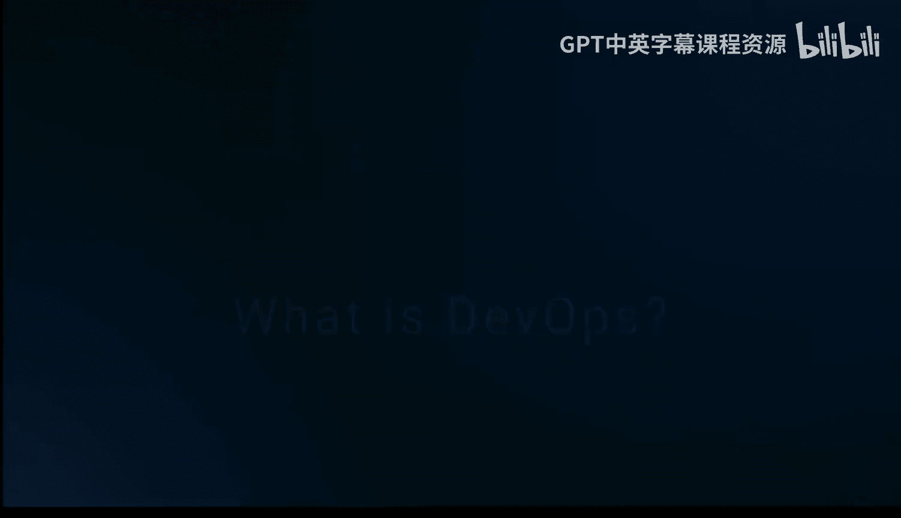
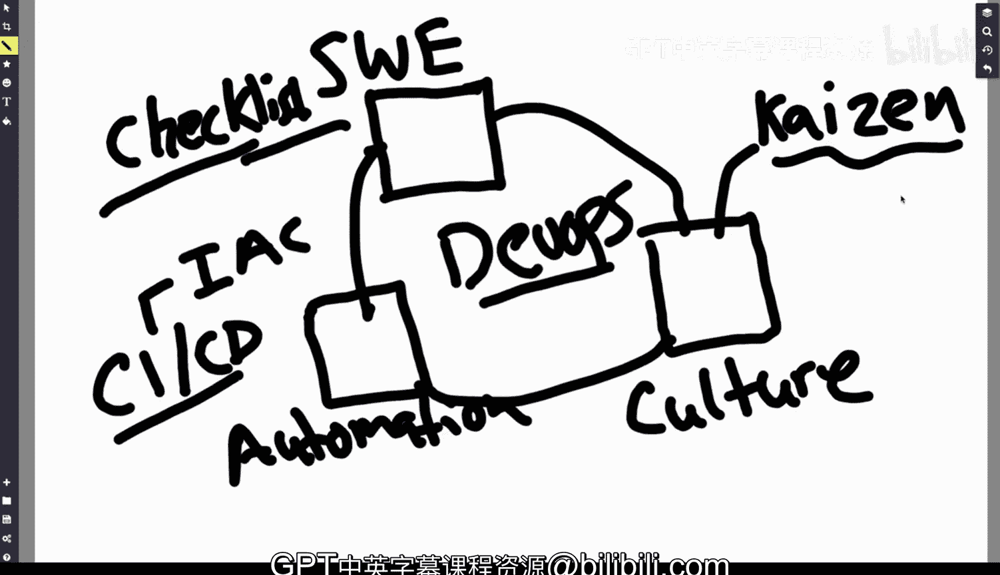

# 杜克大学《应用Python数据工程（3课全）｜Applied Python Data Engineering》中英字幕 p40 40_04_01_什么是DevOps.zh_en -BV1nz421i7KP_p40-

So when someone says， you know， DevOs， what are the main components of DevOs， I think you to really。

Kind of summarize it。We have the software engineering best practices and so if you you kind of put that into a box here。

 we have SWE， right software engineering， these practices， you also have really a cultural。

Kind of a cultural mandate right so your culture of your company embraces the concept of continuous improvement。

 which is referred to as Kaiszen and then also really there are。The end results， right。

 And so if we go through here and we say。what is the end result well you have basically automation and that's really the essence of what I would consider DevOs if we put DevOs in the middle here is that it's this combination of these software engineering best practices。

 the culture of an organization and then automation and it's really a feedback loop and if you don't have one of these。

 you can't have DevOs it's really in my mind pretty simple this is really the feedback loop to consider and so what is software engineering best practices well we'll get into that in just a second。

I would say roughly， you need to have really kind of a checklist of different things that you do when you're building out your project and follow that checklist。

What about automation， well， we just talked about this， this is this concept of CICD。

 being able to continuously deliver your code。And in fact， part of this。

tangently is the concept of infrastructure as code， it plays a role and then in terms of the culture。

 really the culture would be this phrase Kaiszen， which is a term from the Japanese automobile industry。

 which means continuous improvement， continuous improvement， continuous improvement。

