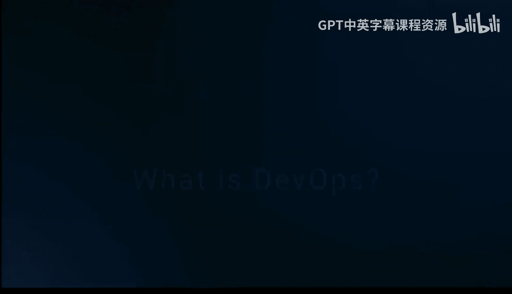
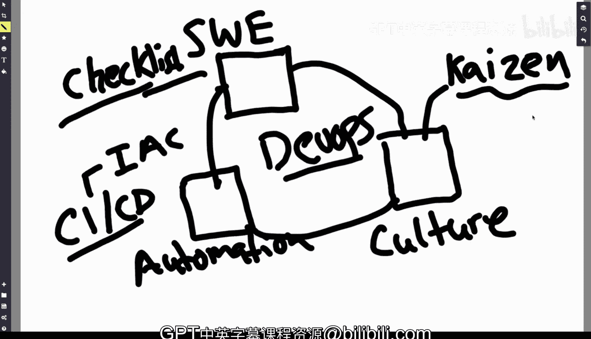

# 应用Python数据工程：1.4：什么是DevOps 🚀

在本节课中，我们将要学习DevOps的核心概念。我们将了解DevOps并非单一的工具或技术，而是一个融合了软件工程最佳实践、组织文化和自动化的综合性理念。

---

当有人提到DevOps时，其核心组成部分可以概括为三个方面。以下是其主要构成：

1.  **软件工程最佳实践**：这指的是在构建项目时需要遵循的一系列标准化流程和检查清单。
2.  **组织文化**：这指的是公司文化中必须包含持续改进的理念，这在日语中被称为“改善”。
3.  **自动化**：这是DevOps的精髓，主要指持续集成与持续交付的概念。

如果我们将DevOps置于中心，它正是这三者的结合体，并且形成了一个反馈循环。缺少其中任何一个要素，都无法实现真正的DevOps。

---

上一节我们概述了DevOps的三大支柱，本节中我们来看看每个支柱的具体含义。

**软件工程最佳实践**指的是在开发软件时，需要遵循一套标准化的方法和检查清单，以确保代码质量和项目可维护性。

**自动化**的核心是**CI/CD**，即持续集成与持续交付。它使得代码能够被自动、频繁地集成和部署。与此紧密相关的还有**基础设施即代码**的概念。

**文化**方面，关键理念是“改善”，这个词源自日本汽车工业，意为“持续改进”。它强调团队应不断寻求优化流程和产品的方法。

---

本节课中我们一起学习了DevOps的基本框架。我们了解到，DevOps是一个集**软件工程最佳实践**、强调**持续改进**的**组织文化**以及以**CI/CD**为核心的**自动化**于一体的综合性方法论。这三者相互关联，形成一个持续的反馈循环，共同推动软件开发与运维的效率和质量提升。