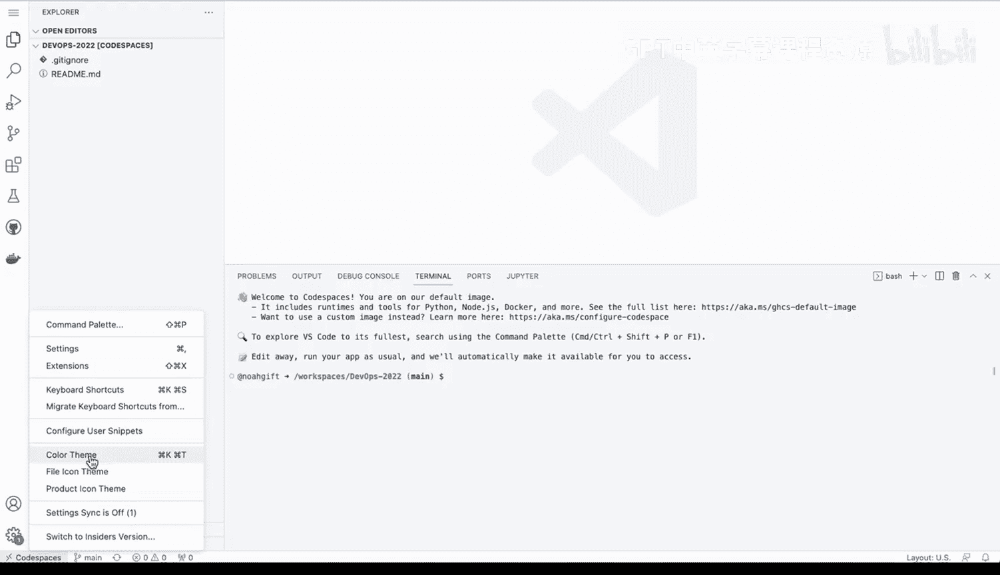
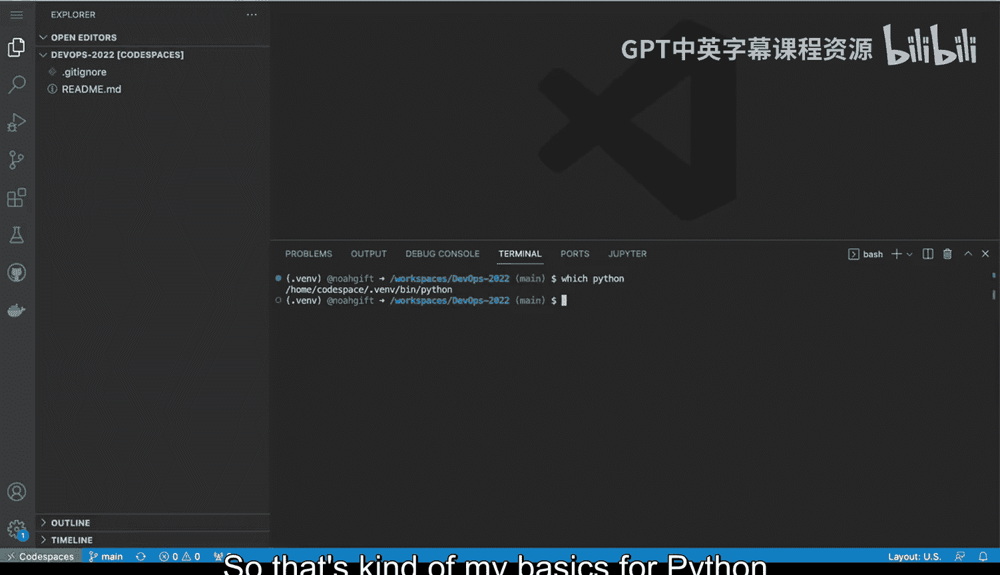
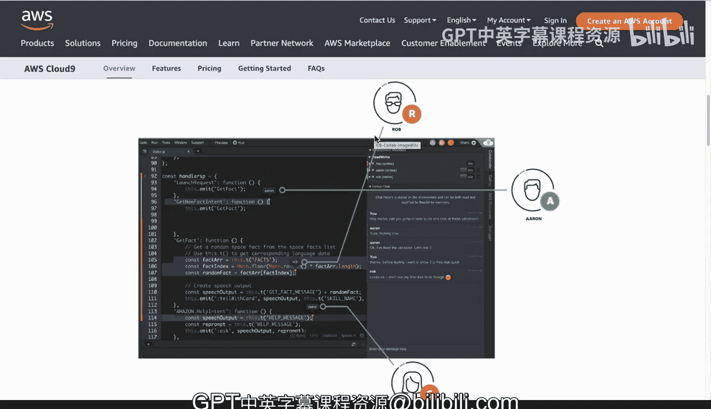

# 杜克大学《应用Python数据工程（3课全）｜Applied Python Data Engineering》中英字幕 p41 41_04_02_DevOps关键概念.zh_en -BV1nz421i7KP_p41-

With with Devops is why are we doing it？And then， also。

What is it right those are two of of the key questions。

 So what I'm going to do is I'm going to dive into some of the books that I've written recently and we'll cover some of the answers to those questions in the book。

 So the first one I'm going to start with is the book Python for DevOs and so Python for DevOs was published 2019 and the authors really have a ton of experience I think maybe combined like 1100 years experience with with Devops and and I think these authors。

 I think give a really good summary and if we go through here and we scroll down you know like what what does DevOs mean to the authors this is a good you know place to explore what it is。

 So one answer here is it's a two way collaboration between the development and the operations。

So this is a really critical thing to bring up is that DevOs really is the ability to synthesize the communication between software engineers and operations for a long time and I've spent a lot of my career like this。

 people did their siloed role like there would be the operations team and there be the development team in really the future is that those two roles have actually merged and I think most organizations realize that there there is really a combined synergy in having one person do both roles。

 no there are exceptions and people do different things but in general， it's completely。

 I think within scope to say that everybody should be able to do DevOs that's a software engineer。

Another thing is right here is the turnaround of ops tasks in minutes to hours， not days to weeks。

 and this is another really critical one that I've seen a lot on my career。

I remember I was working at a company that did the metaverse right this is a big deal now。

 but I worked at a company that was way back in the day doing metaverse things and one of the issues we had was that things would take a week to deploy and I think originally there was probably a good reason for that because theres a C++ game engine and people wanted to be very careful about deploying things that were revenue focused but it ultimately caused big issues with developing new products and so this is also the future is that I would say this is one of the top Kpis for an organization is are you able to deploy your software within minutes not within weeks or within days if you cannot then I would say you're not doing DevOs。

 you need to re-evaluate what you're doing in your organization and if your boss or someone in your company is upset when you say that give them my email and I'm happy to talk to them。

Another answer here is strong involvement from developers。

 otherwise it's the developers versus the operations team。

 so I think this is really a subpoint underneath the  two way collaboration between development and operations is that there needs to be you basically either the same person is doing both roles or a uniformed team combined of the developers and operations there cannot be siloed teams。

Another one that I think is also a little bit subtle in some sense I'll just scroll through as we get through these is that operations people need to actually have programming abilities so I think this is another one that is really easy to kind of dismiss and say oh no the operations people don't need to know a little bit of bash or python what they do and I think this is really one of the issues is that it is important to know bash it is important to know Python and especially as the rules merge it's going to make everybody more productive on the team。

And in terms of another highlight here is developers need operational skills。

Their operational responsibilities don't end with writing the code they but with deploying the system and monitoring it。

 So this is a really key point as well。 And I found this out in my career is that when I was CTtoO of a company with you 100 plus employees。

 I heard this all the time。One of the things I heard was。That's Devop's job。And I have to admit。

 it always kind of raised my blood pressure a little bit when someone said that it' what my response was it's everybody's job to do Devops because DevOs is a behavior。

It's a little bit like saying， you know， you know， physical fitness is the athlete's job or something like。

 no， if you don't walk every day or do some kind of exercise， you're harming your body。

 like it doesn't make sense to say that it's somebody else's job to do an essential component of your job。

And another component here is automation automation automation right this is I think my entire career in Los Angeles。

 the Bay Area， you know New Zealand， Atlanta， wherever I travel over the world when I did jobs basically what I did if I had to summarize it in one letter。

 I'm sorry， one word would be automation， and that's at the heart of automation。

 you have to automate every single thing you do， the infrastructure， the continuous integration。

 the continuous delivery， the monitoring， all of these things。

 the auto scaling have to be automated if you don't have automation throughout your entire ecosystem you're not doing DevOs。

 you're doing something else。And another key component here for DevOs is that it's self-service for developers right so and what this really means is that you have infrastructure as code and continuous delivery setup if you don't have those things set up。

 then it's not going to be self-service for the developer and really you're putting your entire organization in a bad spot。

 if it's not set up in a way that the developers can always do a self-service deploy。

 Now it doesn't mean that it has to automatically go to production。

 a self-service deploy could go to a staging environment。

 and then it could be manually switched over to production。

 but the concept that the code is always deployable really this is the key a key win。Also DevOs has。

 continuous integration， continuous delivery pipelines。You know。

 another one is this concept of bidirectional everything between you know。

 the development and operational team， right， which is kind of what we already talked about。

 you know， constant collaboration， this is also I think a key one here， this constant collaboration。

Is that as you're deploying the software and automating it。

 you have to actually have everybody involved in it or else it's not going to be successful。

 like the Q A team， the development team， the product managers。

 everybody has to be constantly looking at， oh， look， the deploy work。 Oh， it didn't work。

 Here's the bug。 right，' it's a group effort。 You know， if it isn't automated， it's broken。 right。

 Here's another one。 you know， cultural， you know， the hierarchy is。

 is not as important as a process。This is actually an interesting one that many people probably have experienced themselves is that I call this。

 you know， the hippo driven development and what the hippo driven development means is the highest。

Paid person's opinion。 So it could be the CEO。 It could be a big shot of the company。

 They come in and say， I want this feature。 I want this deployed today or whatever。

 That's actually basically like a poison for Devops， because。

You you shouldn't have some person who's powerful just coming in and just blowing up the entire system。

 It doesn't mean that they don't have an important， request and it can go into a queue。

 but it cannot trump the process or else you have chaos。 and this is， unfortunately。

 many people that have no experience of the software industry。 This is what they gravitate to。

 And they you know， like pound the table。 I want this。 I want this。 like sorry， you don't get it。

 I think that's unfortunately what you have to say to those people。The other one is。

 you microservice versus monolithic here， right， is that I think we're seeing this trend of people going towards the microservice approach。

 and especially if you look at what AWS talks about in terms of their definition of DevOs。

 it's a microservice approach。And you know， continuous delivery in deployment system is at the heart and soul。

 right， it really is if you can't deploy software constantly， you don't， you're not doing DevOs。

 I mean， this is really one of the other tooth serums is are you continuously deploying your software if you're not。

 you're not doing DevOs， you're doing something else。

And and then a couple other things here is that there are no superheroes and I think this is another big one that is a toxic brew at an organization is you have these superhero developers who are working till four in the morning and they're doing all these magical things and I have seen this over decades and it never。

 ever works out it never works out Now if it if it's a solo project like a mobile app that one person develops actually could work out well in a team this is just you know a cancer and so this again is is the hierarchy versus you know the process because being a superhero is a form of hierarchy。

 it's a form of power so if you have this as well it really is an issue to address in your organization that's again kind of the what is what is Devops and kind of some of the answers behind it。

The other thing that I'll bring up is if I shift over into practical MLOs。

 one of the things that I'll talk about here。Is in terms of MLopse， is that。

You see MLops as well heavily。Involved in machine learning operations so machine learning operations is one of the hottest things right now。

 I'm sure everybody is talking about MLOs MLO MLOs everybody's talking about MLOs and one of the surprising things I think especially to people in the academic world which I have a footin I teach data science at Duke。

 I teach data science at other universities as well as MLOs is that that world data science has almost no experience with DevOs if you said to somebody that is creating models know at a university like a professor there they don't know what DevOs is。

 I mean maybe one in 100 know what DevOs is and so this also shows that even if you're not maybe directly doing MLOs that's that you're an extremely valuable resource because you know DevOs and here's why at the root of ML engineering is DevOs and if you don't have。

Os， you cannot do MLOs and I'm also if someone disagrees with me you can get my email。

 I'm happy to talk to Abo about this because it's nonseecwi to say that you can do MLOs without DevOs because if you can't continuously deploy your software。

 how could you possibly continuously deploy a machine learning model doesn't even make sense you're missing all of the subcomponents。

 So that's another really critical thing to consider when you're dealing with with DevOs。

And then one other thing I'll mention here， I'm going to shift into。Into。The the next book， which is。

Developing on AWS and so which is going to come out pretty soon a little bit of it it's not already on O'reilly。

 but in this book as well， I talk about kind of the root of Devops like what is its origin and its origin really is from the Japanese automobile industry and the culture of Japan where there's this concept of the plan do check check act lifecycle and this is at the heart and soul of really all continuous improvement systems and it's the scientific method but translate it into more of a engineering focus and so the way this works is you plan something so you could say I'm going to develop a web service and so you've identified the problem。

 we want to build a web service that talks to the database and retrieves back the highest payinged customers on organization as an example you then do it。

Test out the solution So you build a microservice。 you have maybe continuous integration or you have to have continuous integration。

 continuous delivery。 You kind of check that out， make sure that it deploys successfully in a staging environment。

 You analyze it。 Hey， it looks good。 All the metrics are there。 Our monitorings there。 Okay。

 let's go go ahead and deploy into production。Once it's deployed and you implement it。

 then you take a look at it again。 And if there's a bug or there's some new feature you need to add。

 you do the same lifecycl again。 So this is really the heart and soul of Devops is this concept of plan do act lifecycl。

Now， the other one that is a very important component of DevOs that a lot of people don't really talk about。

 but is really critical skill to learn is this concept of fiveYs and fiveYs also is heavily influenced by as part of the Kaiszen culture of continuous improvement and here's actually a real worldord example of something that happened in my career I was working at a big data company it was head of engineering and I was pretty new to organization。

 so I didn't know all of the different things that had occurred and we had these random server crashes and they were really severe because they were causing significant downtime and customers were upset that servers were crashing and they couldn't get their log data。

And so this is really the process that we use to debug it。 So first was we posed a question， right。

 five different questions， why are the servers crashing？RightAnd so the next answer is I don't know。

 there's no log files on the server。 so then the natural thing to go through is to say， well， why。

 why don't we have log files on our servers， that seems pretty important。

 well those servers use ephemeral storage and they have no swap partition so ephemeral storage on AWS means that if they reboot it's gone。

And in addition， the machines were configured to not have swap。

 swap is a partition that enables you to page out memory to disk if the machine is consuming too much memory And then the answer that was well why are they or the next question is why are they using ephemerral storage without swap。

 that seems risky Well， the answer was there was a DevO specialist who didn't work there anymore that used to work at a top company and they said don't use swap because the top companies don't use swap and then they also said that ephemeral storage is cheaper。

 So we're going to use that。 So then the next question is okay， well。

 what happens if we just enable the swap partition and then we do EBS storage。

 which is block storage and then。What about that， Okay， now we see something right now it took。

 it took four layers down to， to， to go ahead and see what it is。 It's a kernel panic。

 and it's an out of memory error in the crash logs。 okay， well， let's ask the fifth question。

What's causing the out of memory error。 Here we go。 The root cause was there's a Java application。

 which was the search engine that had over allocation of memory。

 So the server was allocated more memory than the machine actually had。

What happens then is that when the Linux kernel realizes that a process is out of control。

 it'll just kill it。 So in some sense， this works out okay in some scenarios is that you Java servers accidentally misconfigured。

 the Linux kernel knows that it's consuming too much memory just kills it and restarts。

 So it's not optimal， but it's probably a reasonable you know machine for a while under that approach。

 but because。We also had a supervisor process monitoring the process that also restarted it automatically。

 There's a race condition。 And they just one the Linux kernel stopped it。

 And then the supervisor started it。 And they just went to a race until finally the machine crashed。

 And because we didn't have any way of storing the crash logs。 We have no idea what was happening。

 So， so this technique is maybe one of the most valuable techniques for troubleshooting that you could use。

 and it is really a part of Deops。And in terms of DevOpss best practices here。

 I would say the core of a DevOs best practices is you have to have continuous integration when you're building something right so you need to have a build system。

 you need to have your test code， you need to merge your code。

 it needs to be automatically triggered on the build， you have development environment。

 it goes through， puts us it into the repo and then you can pull it into any other development environment。

 so that this means that everybody in the team always has good code。

 if you don't have something like this， then every person on the team could have different versions of the code and the code could be in different states some code is working。

 some code is not working， the build server ensures that the code is always working。

And then if we go down here and we talk a little bit about well continuous delivery。

 this takes it to the next step， the idea here is that you're working in a local environment。

 you go ahead and you push your code to infrastructure with infrastructure as code so like code that defines let's say。

 storage devices， networking devices， web servers， you push all that into a single repo that triggers the build that code merges back and then from there the build system will actually create and manage the infrastructure itself。

 so the build system not only does a test of the code。

 but it also uses the infrastructure as code to actually deploy that to another environment and this continuous delivery workflow is Kaiszen right which is continuous improvement。

 continuous improvement and so this is really the heart and soul of what Devops is and you see the artifact is that you're able to automatically deploy your code。

But。And if we scroll down here， a few things to talk about in terms of infrastructure as code is that。

In terms of。The process。The first time you deploy it could provision the infrastructure， right。

 it could provision， let's say， a load balancer with three different web servers associated with it and networking and talking to a database。

 but the second time it will make a change if there's no change to be made and this is called item potent So it means that every time you do a deployment。

 It always keeps things in the same state either it creates things either keeps things the same or it mutates it if you make a small change to production。

 And so you don't ever have to worry about running the infrastructure changes because they're always going to keep things in the same state。

 And this is a really critical component of continuous delivery and it's made possible by infrastructure as code the other advantage of using infrastructure as code is that you can clean up your assets so you can completely go through and and and。

up an experiment or a staing environment。 And so this is really， again。

 at the heart and soul of what infrastructure as code is。

And then the other thing to mention about DevOs that's critical is that it is a monitoring and logging is something that you must do。

 and I think of it as data science for software systems so you're able to take all of the metrics。

 the logging the application logs， the machine logs， the metrics。

 the CPU memory disko and you put this into a dashboard and so you actually do data science。

 It really is data science right we've been doing data science on systems for quite some time。

 many people in operations going to realize it， there wasn't some fancy term for it。

 but we are actually taking log， we're looking at statistical analysis， for example。

 if there's an event that occurs that's you more than three standard deviations away from the median like a response time。

 there's something weird going on and I've seen this before like a servers misconfigured so you can。

UseTradition statistics to actually look at what's happening and fix it。

The other thing that also comes up with DevOs is that it's a behavior。

 and so this is I think a really important component to really talk about here is that that DevOs is not just a job title and there's some debate whether it should be a job title or not。

 I say it should not be a job title I think it's just something that you're supposed to do as a software engineer is that it's basically implicit to a well-run software engineering process and so you have a ticket。

 the ticket is identifying either feature a bug and you're then going to convert a request from a human into source code once that source code gets created。

Then there's a pull request where other humans take a look at it。

 they put some comments about what's happening。 They merge this into GitHub or whatever source control management system you have。

 you then trigger the build， it goes through， it builds the code out。

 and then there's an optional maybe human involved There's a resource manager。

 it then goes into a production system， there's an operational dashboard。

And that operational dashboard also tells other humans and machines what the status of the production system is。

Those messages could go to， let's say， a chat server that gets deployed and there's a versioned artifacts that you can take a look at。

 So really it's a constant communication process' when you're dealing with DevOs。

And a couple other things we' we'll mention here is that。From a security standpoint。

 that's another thing that DevOs is helping you with is that when you do have automation。

 it gives you the ability to be secure。 If you don't have automation。

 security really isn't possible either or it's very difficult because in the case of modern systems。

 there's so many different moving pieces， the only possible way to constantly maintain security is to have automation。

 and so here's a good example of security here where we have AWS security group firewall rules they're blocking inbound ports。

 the data is encrypted at rest， there's encrypted in transit to S3。

 the automation system is deploying all this stuff。

 you have cloud trail or some other whatever cloud on monitoring system。

 you have twofactor authentication， you have the security policies in this case for AWS using。

The principle of least privilege。 So the entire thing requires automation。

 And I think this is another thing that companies that are taking a lot of chances in terms of security are not aware of is that if you don't have DevOs or automation。

 security is almost impossible because if you change something that's let's say you accidentally or intentionally make everything secure once。

 how are you sure that in a week， someone doesn't change something and now it's insecure。

 and' that's really the heart and soul of why Devops and security are tightly coupled。

And if we go down here and we talk a little bit more about you some of the things that like our use cases for Devops and like real world scenarios。

 I think one of the classic continuous delivery examples that I like to show people is a static website and so this is a good example。

 a Hugo is a static website technology that I use， and is pretty straightforward to set it up。

 you have source code， you demo it on a local server， maybe AWS Cloud 9。

 one of my favorite development of Ars， you push it to Github， it triggers a build。

 and then your built server， goes through and it makes infrastructure changes， it builds the site。

 it syncs the data to S3， S3， then pushes a copy to the CDdN， which is Cloudfront。

 you have a at Ro 53， which handles the DNS， and you have a global scale website like Wall Street Journal。

 New York Times scale website， just with this kind of。

Process and that's really the power of both cloud computing and also DevOs and another flavor I think to be aware of here is this concept of flavored containerized flavored DevOs and I think this is really the future for right now until some other thing comes up in the next couple years。

 but it does seem like if you're not using containers you're really missing out on a lot of things and the reason why is that it makes things itempotent and reproducible in deployment and so with a container you've got the runtime associated with your project as well as the source code itself and it also makes the deployment very。

 very easy So in this case this is AWS you have the build system infrastructures code。

 the source code， the Docker file， all the stuff is in Github so you can look at everything is pushed to a container registry in this case。

 Amazon E。And then cloud environments will auto deploy。

 So really this simplifies dramatically the process of doing deployment。And then finally。

 I think a few you know critical thinking discussions are you know what's your definition of DevOs and how can you use it to enhance your organization so those are some of the things to think about。

And then finally， a couple of the things I'll talk about in the enterprise Iov's book is that。

 you know， closely related to this。Is this idea of not reinventing the wheel and I think that's another key component of DevOs And here's an example of that is that especially in the MLov space you see this。

 but you also see this in regular software engineering is that there'll be a brilliant engineer who builds like a custom solution and it maybe even doesn't use DevOs or something like that。

 they are so smart that they get paid 10 times their salary and they get hired by a trillion dollar company。

And then guess what happens three months later， even though the system is really good。

 it breaks because no one knows how to fix it because that person left。

And what happens is it gets replaced by a proprietary system。 Now。

 the organization has to retrain people on the new system and a new system delivers superior results。

 So really， this is another component of remember the no superhero theorem that we talked about earlier is that you don't want to do superhero solutions with with Devops。

So those are some of the key ideas in terms of the theory behind DevOs and if we go back here and we look at this right。

 we answered the why successfully and we answered the what successfully and I'll just sketch out here you know some of the things that I think are a good best practice again you have at the heart and soul is the build system this is really you know what we care about is the build system is。

Where everything that is good really occurs and the build system will communicate with production right So this talks to the production of ourment。

And it also talks to your your source control， right， and in this case。

The source control and that's kind of the most essential form of describing in terms of the minimalist DevOs components and capabilities and there's features below these there's subcomponents of this。

 but at its heart and soul， you've got the environment。

 you've got the build system you have the source code。

 those are really the things to care about and I think one thing to really bring up here is that as I mentioned before。

 containers I think are becoming a huge part of the story。

And one of the things that is really important is to use environments that make it easy to build containers。

 and in particular， I would say that what we're seeing is this concept of a cloud based dev。

 So we'll call this cloud dev environment。Here we go。And， and this， I think is the future as well。

 If you want to get a shortcut on， you know， the the top new technologies that are happening is is。

Why develop on your laptop or some workstation when you can develop in the identical environment that the code is being deployed into。

 And so a good example of this is cloud 9 right， or another example of this is Github code spaces。

 These are two really good tools that we're seeing people use to supercharge their ability to to build out code。

 And so this will be a good segue to just show you very quickly。

 both of those tools and and show you some of the bills and whistles of those。 So to start with。

We'll do the easy one， which is Github code spaces。 and I'm going to go over to。My accounts here。

 and I'm going to create a new repo real quick， and we'll just call this。We'll call this Devops。

2022 and we'll say。This is a repo。For Devops。And I typically just put readme file， you know。

 getting ignored for Python， those are kind of the essentials。

And we'll create that repo and once once you have a repo， I mean you don't have to do it this way。

 but typically I create a repo， you can then go over to code here and you can actually create a code space inside of your environment if I want to do a custom one right I could look at machines that are even up to 32 core GPUs。

 but I'm just going to go ahead and create a code space here。

And I'll show you some of the reasons why this is so important。Okay。

 so when you start out with in this code space， it's got really everything you need to build containers to do microservice development。

All these features are available， code highlighting and。It's most likely。

Either the same or close to the same environment that you're going to actually work with in terms of a production environment。

 So this is a huge win， and it allows everybody in your team as well。

 right if we if we know that Devops is a team based you know strategy。

It allows everybody to be on the same space。 So if I type in， for example， Python， right。

 I know everybody on my team has Python you know， 3。10。4 likewise， if I want to install Docker。 Well。

 guess what we already have Docker。Installed right on my machine， right， or Docker image。Image Ls。

Right we know that Dockers already on my machine。 Everything's all set up for me。

 including syntax highlighting， code highlighting， preview for web browser。

 So if I you know build a web service inside of here and I wanted to do a preview。

 it also can do preview right inside。 So really， really powerful environment。

 one tip I'll say here is that。Typically， what I do is。I always edit my bashar C。

 and I create a virtual environment。 So this is probably the big takeaway。

 create a virtual environment， Tilda dot V， E and V like that。And then go ahead and。

Go to your Bsh RRC， which is your Bsh shellll config file。And go through here and。

Put at the very bottom。This this Python virtual verment。

And this just solves a lot of problems that come up。In in the real world with Python。

Activate because you don't have to worry anymore that your environment is is basically bulletproofed from weird things。

 right， And now we know that we're using that virtual environment。

 And if I type in which Python right， So that's kind of my my basics for Python。 Now。

 let's talk about the other one， AWS right is a similar one。

mimic the， the， the production environment。

