# 杜克大学《应用Python数据工程（3课全）｜Applied Python Data Engineering》中英字幕 p42 42_04_04_持续集成概述.zh_en -BV1nz421i7KP_p42-

One of the core concepts of DevOs is that you have the ability to automatically test your code。

 And so this is this feedback loop where you have， you know。

 continuous integration and what is continuous integration is the ability to know whether your code works like that's really it in。

In a nutshell and so once you've got that。And you know your code works if this is your development environment。

 then the trick is， can you actually replicate that to let's say the cloud or your production environment。

 so this is the production environment。In order to do that。

 you're going to have to have a couple things， so one is that you're going to be able to you're going to need to be able to replicate inside of this production environment。

 so if we say here you would need to have potentially infrastructure as code。

 so you're able to define the cloud based environment。

That would be similar to your development environment two。

 you're going to need to have some form of testing and so that would be the CI components that you did earlier so this is the continuous integration and then in terms of the deployment。

 you're going to have to piece all this together and then deploy your code into that environment。

So this would be what I would call continuous delivery。

 so once you've got continuous delivery set up， then you're able to replicate these changes。

To any number of environments， and that's really the power of DevOs。And that's the power of testing。

 I it that the testing。It is is a mandatory component of continuous delivery like you wouldn't you wouldn't want to replicate bad code to production environment and then cause an outage right so that's really the essence of why we care about testing is you first get it working locally and then able to replicate that into a cloud-based environment。

 So I think the first place to start here is let's get the local development environment cooking first right so let let's make sure that we're able to actually get anything working。

First， so I'm going to go ahead and shift gears here and talk about a couple different development environments。

 Most people， I think， start with something like either Github or Gitlab。

 there are obviously other source code environments but Github is probably the most popular and I think it's a good place to start out with think about your structure for your project。

 and what I like to do is use cloudbased development environments。

 And the reason for this is that it's easy to have all the right tools available for you。

 in my opinion is we're probably at the point now where the majority of developers would be better off developing in a cloudbased development environment。

 So one of them is this is Github codespaces。 So this is a feature of Github。

 it's very similar to other cloudbased development environmentments like AWs cloud 9。

 So I'm going to go here and I'm gonna say。

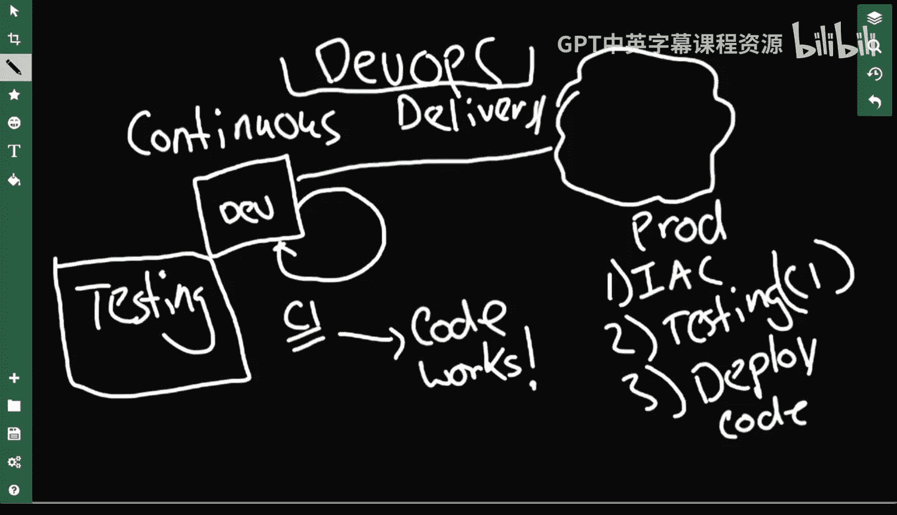

New codespace， right we'll set this up。And what's great about this is that you could even work with it locally in your VS code desktop if you for some reason really wanted to work locally。

 but I like these because it's letting the cloud itself do all the heavy lifting and I don't have to worry about my environment now it's completely safe for me。

 it's all tricked out， it's got extensions loaded， everything's basically primed and ready to go。

 for me to test my code。

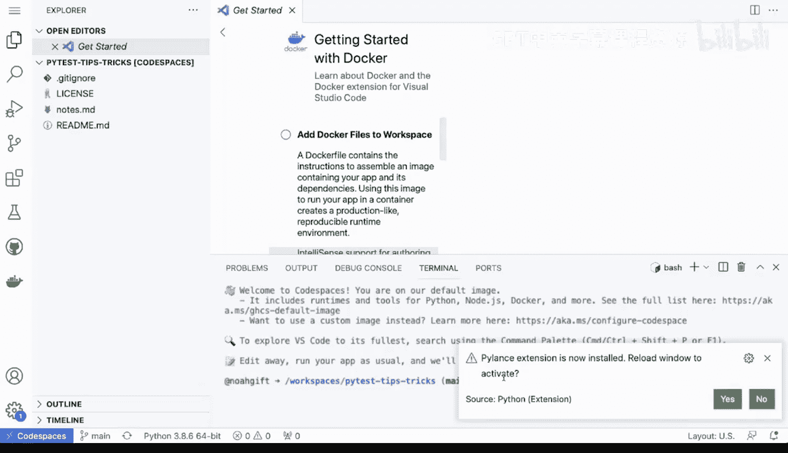

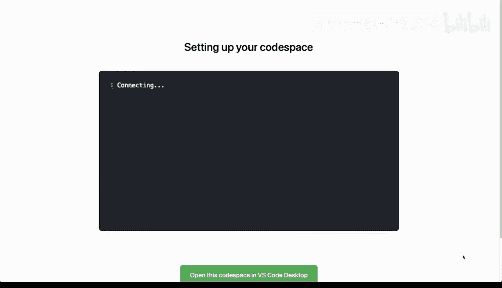

And so the first thing I would do in a new environment like this is create a Python virtual environment。

 and the reason for this is that Python is an interpreted language and Python needs to have the ability to have all the packages in one directory just for reliability so it comes with a tool called virtual in V so if we go through here and we say virtual in V notice that that's this tool right here。

And then if we type in virtual EV help like this， notice that it's going to give me all the different things that you can do in this environment including creating the virtual environment so there's a ton of different things you can do with this virtual environment tool we're going to keep it really simple and we're just going to create a new one so I think a good convention is to do something like this say a virtual ENV。

And then do tilda/。v andv and the reason for this is that it's not going to be accidentally pushed into your GitHub repo。

 which it is annoying if you put it into an invisible directory inside your home directory that's a great place to kind of keep it out of the way。

So there we go once I've got that there to source it。

 I just go through here and I say tilda do V E and V then activate there we go we're all set if I type in which Python now we can see that I'm referring to this Python so really this is step one for any Python project is in my opinion is Git get a cloudbased development environment if you're on AWS use cloud9 if you're on GitHub you can use Gitthub codespaces GCP has Cloudhell Azure has a Cloud channel environment they're all very very similar now once I've got this setup。

One bummer is that if I open up a new terminal here。Look， now the virtual environment's gone， right。

And it's kind of annoying。How can we fix this Well fortunately we can fix it pretty easily because what I can do is edit my Bsh RRC file。

 which is the configuration file for this environment and I think this is a good idea for one of these cloudbased development environments if you're going to use it for a project and it's kind of a one to one a project in an environment why not just make this happen every single time。

That I open up a new shell， so I'm going to go here and type in vimtilda。bashrc。Like this。

 and then I can do a shift G get to the bottom of the file and just add a little note here that says。

 hey， I want to source my virtual environment。There you go， source virtual environment。There we go。

And then I just put in that command and then。If we open up a new terminal now。

There we go now I got it so I think that's a neat little trick that will really save you a lot of pain and suffering so we got an environment we're in great shape and we can open up new shells that's great so the first thing I like to do is create a scaffolding of a project。

And for me， the scaffolding of a testing project that the bare bare minimum here would be first a make file。

And the reason I like to do a make file is that is going to keep a lot of complex commands inside of here for me。

And this will be something I can refer to over and over in projects and even build up on it like a cookbook and then the next thing that I'm going to create is a requirements file and this will be a place that I can I can refer to a packages that I want to install and then that's really the first two files that I really need and then we can maybe make a test file and then make application file so let's just call this first file hello。

And then the second file test hello right so this is a pretty pretty standard process most projects I work with。

 I work with something like this Now the first thing to do here。

 these are all empty that's what the touch command does it's item potent so it means like if I run the touch command over and over again it doesn't do anything different if the file was already created sos neat little command that just kind of makes makes empty files for you so I'm going to go to this make file here and I need to put some different components inside of this make file and so in order to do that what I can do is go and look at potentially another project that I had set up earlier and just take a take a a look at this so let's see I have one called P test here we go Giub actions by test and notice that I've already created a make file in the past let's just maybe look at this and see if we can get some ideas for it okay great I have an installation。

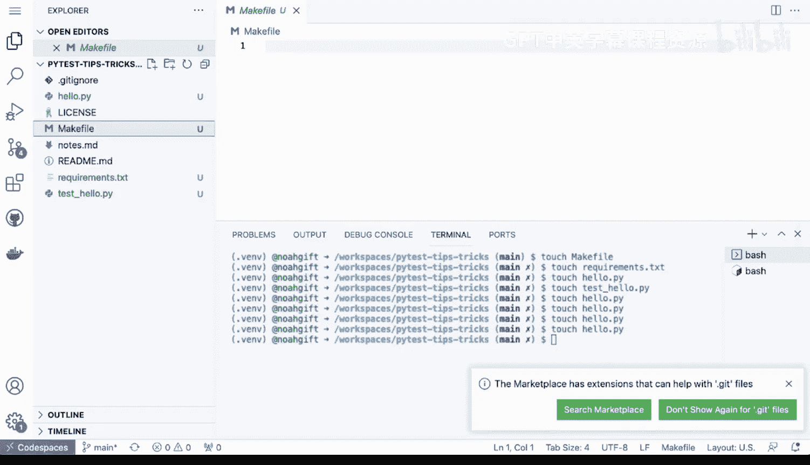

Section， I have a test section， I have a format section。

 I have a L section and then I have something that runs all this at the same time so we can probably just copy this let's go ahead and use this as as our scaffolding so I'm going to go back here and I'm going to go to the code space and I'll just paste it in and that's what's nice about having created once a scaffolding can you can pretty much use it over and over again Now let's take a look at this make file and see how it works here。

To start with， you know， one of the things that we'll see is that。

If I type in make and then let's say I do install， notice it autocomps and if I do make space tab。

It'll actually show me all of the different options as well。 So that's another really。

 really cool part of make is that it will actually like give me a almost like a help menu automatically。

 So that's why I think make files are really really cool for Python developers。

 And if you're not using make files it's going to be worth your while to start integrating them into a project just saves you a lot of time。

 So so we can probably now look inside of a requirements file say well well we need to install some packages that will help us out。

😊，And to start with， I think one of the packages that we would want to install。

Would be the testing library obviously right so Py test and so first up we just put in P test and let's just take a look at how that would work。

 remember it's really simple I just always check to make sure there's a not a new version of the Python packaging tool in this case Pip I then go through here and I say you know Pip install R requirements。

Let's go through this， make install。Perfect。And now that I've got this thing set up。

 now I've got P test loaded， so how would I test this to see if P test is loaded， well。

 I can just type in P test like this。And I can just say I think it's just De's help there we go。

 you can see that in fact it is running， I've got P test loaded， it's a very complex tool。

 it can do a lot of stuff， a lot of testing tools are very complex and so I can look at all the different things that I could do with PT now that I've got installed。

Most likely for me when I'm first starting a project。

 I would also you know get started with a couple other things like I like to use Pi lens。

Which for Linting， there's also flake8， which is an alternative。There's。

Also the black tool which is a formatting tool and then I also put in Pi test Co as well。

 which is cover a testing tool that or a coverage tool that shows us the coverage report for our code so like how much of it is actually tested and so that's probably a good start here I think that's probably a good fit and so I can again just leverage the power of the fact that I have this make file and just very simply type in make install again there we go make install。

And what's interesting here is that I think it's nonintuitive that installation is an important component of continuous integration。

 but it is， and so when we later set up the build system for GitHub actions。

 one of the things that we're going to do is we're actually going to also test the installation of packages because that's the real world。

 you want to make sure that your code is actually installable。

So now we got everything pretty much set up， we have you know the ability to run things， you know。

 maybe another tool that we can install that I like to use for just kind of playing around with things is I Python。

I think that would be another one， so let's go ahead and do that and I'll show you why I like to install。

I Python is that when I'm debugging code or I'm playing around with things it's actually pretty pretty neat to be able to let's say import my module or whatever and and just play play around with it from this interactive prompt here so for example if I'm going to test my code I might first play around with the module on writing it so let's let's go ahead and write something here so let's go ahead and。

Let's， let's type in。More， hello。And let's just do something really simple and just say hi， right。

 so I've got a piece of code here。 So now how would I use this inside of the i Python。

 I would just type an i Python。And I would say from hello import。

And look'll it'll autocomplete here for me， which is really nice and then I can kind of play around with my code even before I write my first test I can say okay what did this do again let's check this out if I call it。

 what does it do okay， it returns high and I can give even play around with like the test I would potentially write in P test。

PyT works with asserts and so I could go here and I could say assert。You know。

 high is equal to more hello， right this is essentially like prototyping my unit test， right。

 It's like， oh， great， this is pretty simple， cool。

 So good good tool to have in your toolkit for testing as i Python I think very overlooked。 great。

 So we got we got a test file here， that's good。 So let's go ahead and write our first test in P test。

 Now， fortunately， P test is trivial to write a test。 and that's why so many people like it。

 The tool is complex， but to write the test in Py test is just ridiculously simple。

 So remember we have a test hello here。 all we gotta do is say the same thing basically that I did in my i Python terminal。

 In fact， I could just look down at this i Python terminal here。

 and essentially it's gonna be all the code I need。 So I'm going to say from hello import more hello。

😊，And then now I just need to write an assert。 that's how the test works。

 So I'm going to say deaf test more hello， I like to name the test by the the module functioning the module。

 so here we go。We'll say def test more hello， and then I just do the same thing I can literally cut and paste the same thing I did below here and just paste it in。

And we can just go here， assert high is equal to more hello。And let's go ahead and now do a test。

 Now let's again， look at our make file here。Notice how I test， I say Python dash M。

Py test and I and I give it a couple different options here like make it extra verbose that's what those flags do and then I just run this file just like that so if we go through this I can just say make test and the reason I like to do make test here and you can see it past。

Is that it's just simpler right just less code to type it just gets annoying to type the commands over and over and over again And what you'll find is typically you'll unless you're doing some kind of you know really tricky thing with P test its just put it into a test block of your make file and it's going to save you a lot of time Now let's let's take a look at what happens if we have a failing test here so that's successful but let let's go ahead and make one fail and say test。

More hello。Qu。And then obviously it only returns back high， what if we said， you know。

 something else like？Bye， there we go。え？We can go here and we can say more hello。

And it'll auto completete here。 and And if I say make test again， we're going to get a failure here。

 There we go。 So very， very intuitive to to write tests with P test here。 And look。

 it gives us a report here that says 50% of the of the。

the system has passed here and and we have one failure and we can see right here it says， look。

 you said that the function should return by but in fact it returned high。

 we got a problem okay so now maybe what I would do next here is go back to my code and say oh yeah。

 I didn't mean to do that I didn't write this this function yet。

 so let's go ahead and write a function that says more。MoreMore goodbye or let's try that。And then。

 we'll say， return。Bye， there we go。And then if we go back to the test file here。

 I can just import that file。And we can just do this。More goodbye。And then I could just change this。

To test more goodbye。And。Change this。Like that。Perfect， and now if I run make test again。There we go。

 we got two tests that are passed， so really intuitive in a sense in that it gives you this output that says whoops。

 we got a problem here， you know let's go ahead and fix this。

That's good we got the basics of Pt working personally。

 I think it's also good to get the formatting working and thelinntting working this would be like the the I would call the checklist of best practices。

 so let's double check that thelinnting works so if we look atlynnting with Pylint。

Notice what I do here as I say pi Li and I disable these two other types of warnings which are recommended in configuration I believe。

 and so I only want to see warnings and errors so I've noticed just in my opinion those are the things I care about the most and so I'm gonna to go ahead and link this file so I'm going to say again make L just again because I want to be succinct in what I'm typing here so here we go make L great now what could allow us to test this out and see what would happen with a bad Li an easy one is this if I say var equals one right I create a variable and then。

Inside of here， I create this， I say var。Is equal to vr like do some kind of， you know， nonsense。

 like it doesn't break the code because watch， if I do make test， the test still pass， right。

 So it's still。Synactically。It's yeah， synactically valid， like it still works， it's just doesn't。

Really do anything and it's a bad code technique right like you don't want to reassign a variable to a and so if I do make links。

Now this will say hey， look at this， you can't do this。

 you should really be careful that you're assigning the variable to itself。

 it's a warning right the code still works it's not like an error now it will catch errors as well so that' that's one we's just put a note here that says。

This is nonsense code that。Generates a warning。So I do believe this is really critical to also catch warnings with a language like Python and even compiled languages I think why not listen to a compiler。

 I think it's a great idea。But now let's make actually bad bad syntax and so if I go here I could also say you knowF is equal to and just leave it blank right like so it's broken code like this code won't execute the other thing is cool if we do a makelin。

Is actually， it'll show us that look there's invalid syntax。 so it failed right here and says， look。

 your code won't even run。 I couldn't even get to the warnings because it doesn't even run。

 and it tells us right there。 it says line line 12。

 So that's one of the really powerful things about P test。

Is that it I'm sorry P Ly is that it works very well with Pyte it's kind of complementary or flakeate like any of these lins and so it catches an extra layer of things that are just helpful right you want to know these things especially if you're working on a team project。

Okay， great we got this working let's go ahead and say you know make test again。

 double check that works great， we're gonna say make Li。

 make sure that works awesome and then the only other component really to get to kind of get this initial feedback loop would be to go to this format unless you's double check how this works so inside of this what I like about the formatting tool is it also solves problems with your team like。

You know it can be very annoying when you're working with people in your company that one person wants to do it this way。

 one person wants to do it this way， if you use a formatter like this it like look the formatter says this so let's just keep it simple and let's go ahead and use this so if I say make format。

There we go。 Now we can see it just kind of cleans up the code and makes it a little bit better。

 So I think it's a good idea as well to do that。 And if you want to you can actually put all this together right so you can and you can chain it in the order you'd like it to be so I think this is a pretty good order that I would recommend which is that basically before you check in your code to let's say GiHub why not just do make all right so install your code。

 make sure that you've got all the latest versions now you could also pin the requirements as well which actually will do and then test your code and format your code so。

Let's go ahead and do this， let's say Pip freeze。If we type in Pip freezeze and we maybe pipe it to less。

What it'll do is it'll show us all the versions that are currently installed。

We we can go ahead and do this so we can we can just swap these out and I'll just do this。

 I don't like to just cut and paste this because what happens is that。

It will maybe put things in there that I don't need so I think it's better to be a little bit more careful about my curation here so I can say P tests and P test Co great。

 let's go ahead and throw those in。Like this， so this will tell this repo。

This is it you're using this version of the package that I installed。

 which again is great for testing because I can test a very specific version of my code and then we can go back up here and we can put this version as well。

Awesome。There we go， we have our packages installed as well， that's great。

 and now I can do the make all let's go ahead and do make all let's just double check everything works again。

There we go。 So it's going to install my software。 it's going to Li my software。

 it's going to test my software。 it's going to format。

I think this is a great way to start your project， in my opinion， highly recommend it。

 so let's go to the next step here and let's push this code。So I'm going to say git status。

 and I'm going to say git add this。And then I'm going to go ahead and say get commit dash in。

 adding initial layout。Iitnitiallyial layout of Python project。Perfect。There we go。

 and now I'm going to go ahead and push this code。Excellent。

 so now that I've got this initial structure set up here。

 we can now start to look at going to the next level。

 which is well what if I want to use a different environment other than just this environment For example。

 let's say your company uses AWS or GGP or Azure well what do you do well there's a couple things that I would recommend one is that if we go back to this drawing here。

 remember that the idea is that your locally testing in your code works that's great。

 but you also want to have the ability to deploy to other environments and so this is where the build system comes in right here and this would the build system will basically be the gatekeeper that allows you to double check that hey everything's actually okay before I use it so。

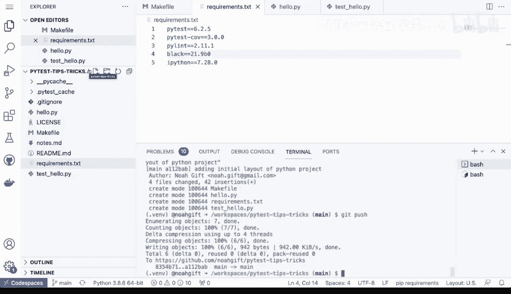

Because we don't have the build system set up yet， let's not get into a cloud environment until we can fix that。

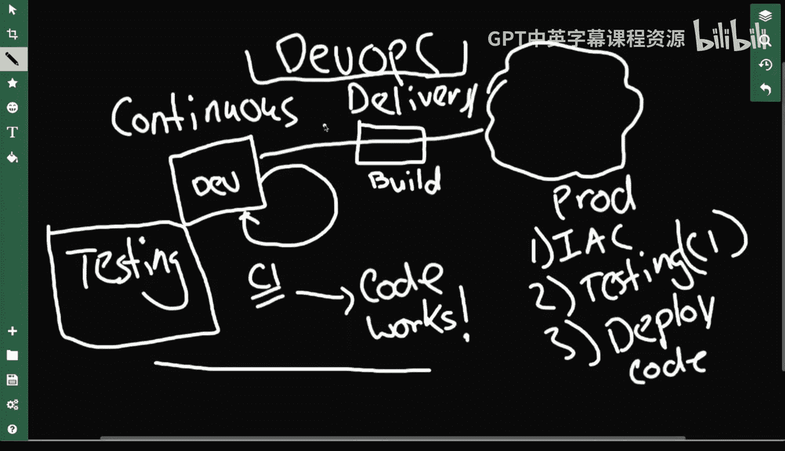

What I'm going to do is I'm going to go over to GitHub。And I'm going to go back to our repo。

 and I'm going to set this up。 So let's go ahead and say。Py test here。Pie test trips。

 tips and tricks。And now I'm going to go to this section where it says actions and this would be the GiHub actions build system and a build system just runs your code and allows you to do testing on it and deployment that's really the essence of it GitHub actions is kind of one of a newer one and you know really shiny because it integrates really well I personally am a huge fan of it I think is' awesome and a few things to point out about GitHub actions here。

Is that these workflows allow you to do things like use Ananaconda you know here's how to do one with a make file which I'm just I'm showing you and then also how to publish a Python package so you wanted to be an open source software developer you could do this you could also deploy your code with other popular services like you know Azure ACK ECS。

 GkeE， all these things are great examples of ways to to use it and additionally there's there's also like kind of more abstract ones like hey let let's do like a labeler or or let' let's give somebody ingredients So there's a lot of really cool stuff。

 I think a good place to start would be to set up workflow yourself and it just gives you basically a really rough structure here that you could use to to play things play around with things So since I've done this before。

What I'm gonna do。I I'm going to actually open up a new tab and again just copy an old version that I've got here I think I have。

A GiHub actions example there we go， I have one that I've done earlier and look at the layout。

 it's dot Github workflows， and then there's a Yaml file。And you can see here a very。

 very simple Python application test with GiHub actions， we're going to say on push。

 we're going to run these steps and we can we can actually。

Even say what operating system So in this case it would be a bountu latest we could even specify the versions of Python and then I can just tell it to do the things I just did locally right that's really all it is is just do the same thing I did but run it in a cloud somewhere and make sure that everything is validated before I move to the next step so let's go ahead and try this This looks exactly like what I want。

Let's go ahead and copy this。And then I will put this into this file。And in fact。

 we can even call this。You know。Maybe testing。呃。CI or something testing continuous integration。

And then we can just go ahead and say start。Okay that's great and what's cool about it once you click the start here。

 it's going to go through and kick off our job， here we go， and I can even see it in action。

 so it's going to do all the steps it's going to install first， then it's going to lens。

 then it's going to test， and then it's going to format our code。

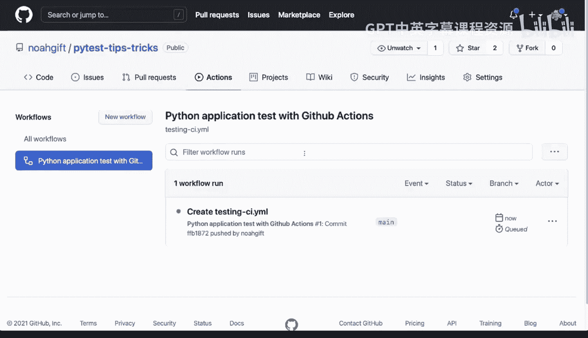

Great， this looks pretty good。So far， so good。Okay， that looks like we're in good shape here。

We've got everything running and it even says each of the steps here。

 which is nice for all of our code and then not a bad idea to click on this little menu here and say createre status badge and just copy this。

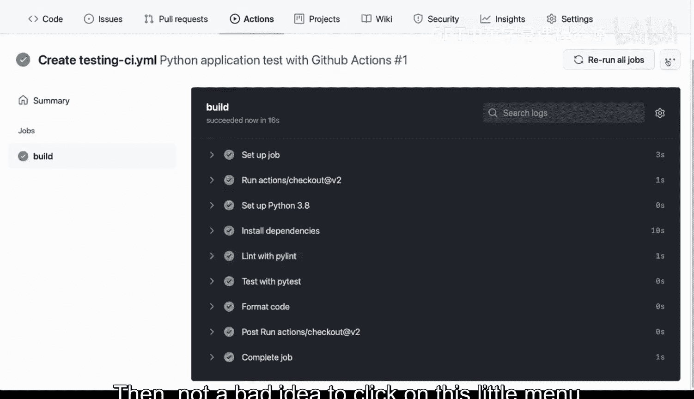

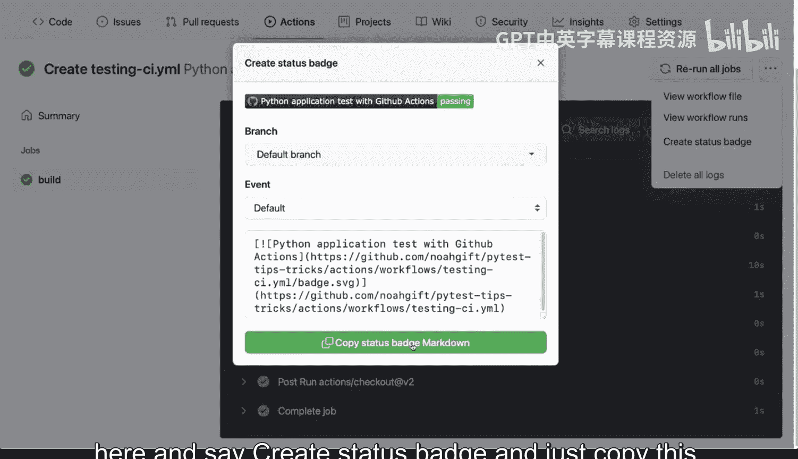

And then we can go back to our project。

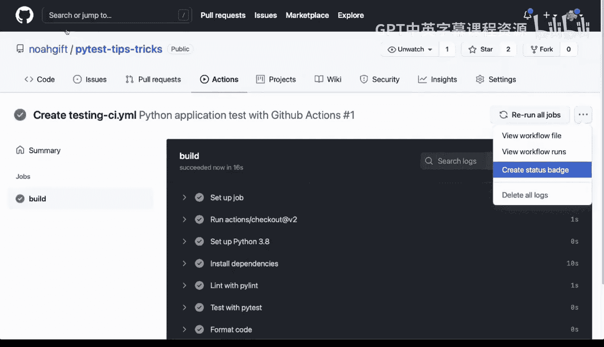

Here， which is this project。And go to the readme file。

And probably put it up here at the top we can have our test bad。 So we're in pretty good shape。

 I think the only thing we didn't do。Which， we can we can actually。Easily get to。Is that we didn'。

 I'm going to say get pull so I can get all the stuff I just did。There we go。 But we also didn't do。

The test coverage flag here， and so in order to do that。

 all we need to do is just make a slight tweak here。And just do。

 I believe we can just look at this up actually， this is how I usually get around things as I just say。

 you know， pie test cove。Where is it， how do you use it in a command？You just say。There we go。

 That's it。 That's all I got to do。 So I'm going to do something like that， go back to this repo。

 and we're just going to add a little bit of a flag。And we just say。

 do what do I want to cover in this case I just have a file called Ho like a really simple project。

 let's go ahead and do this。Un lets you make test again。

And let's see if we can get a coverage report， make test。There we go。

 so now we have a coverage report， we have 100% test coverage， which is not surprising。

 it's a very simple piece of code， go out and say get status， get add， make file。Okay。

 let's commit this， adding adding coverage report。

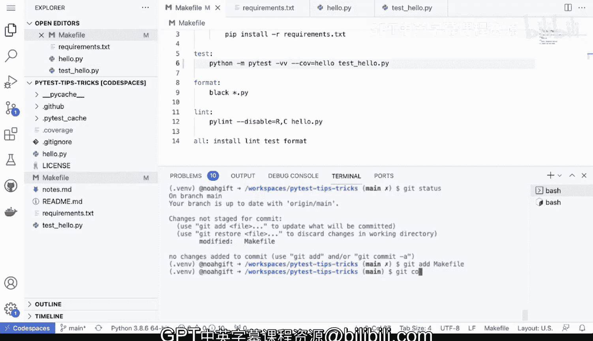