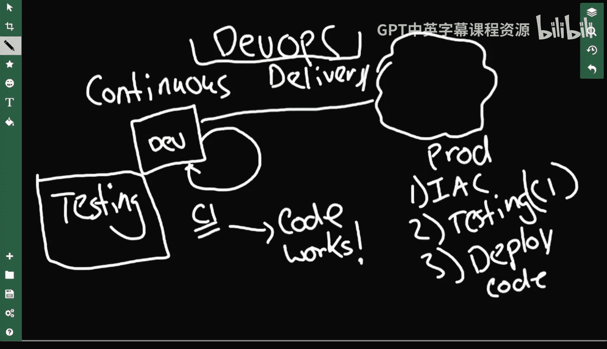
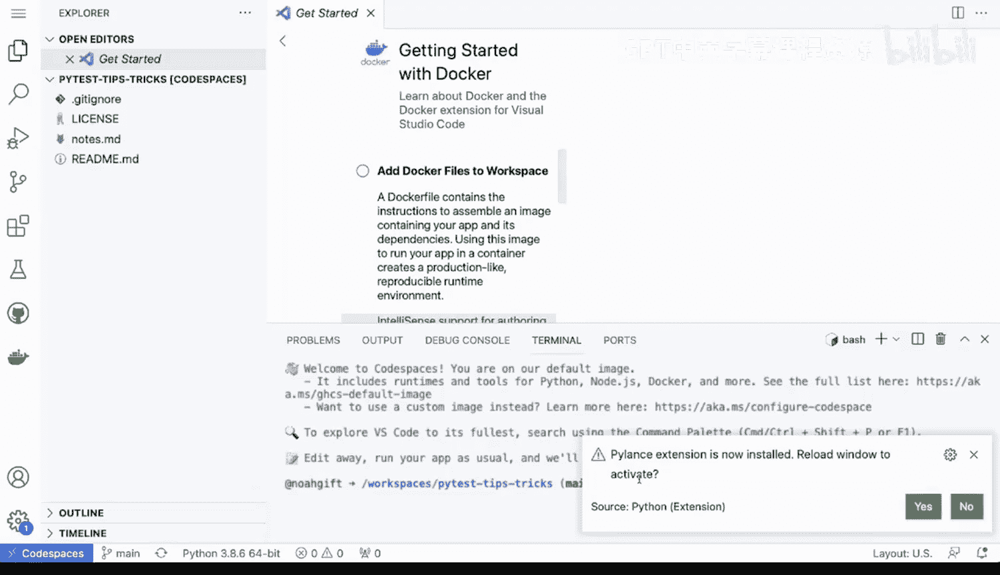
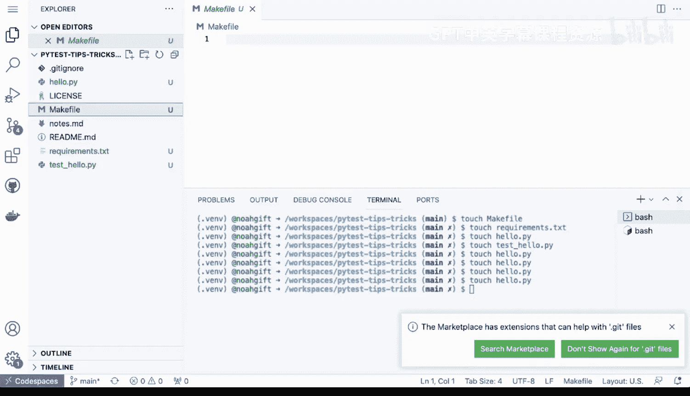
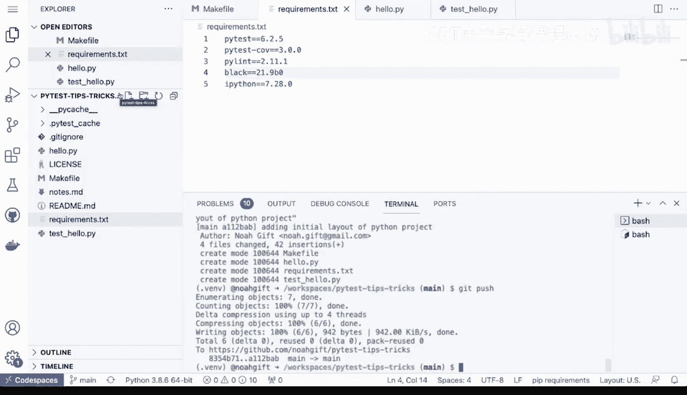
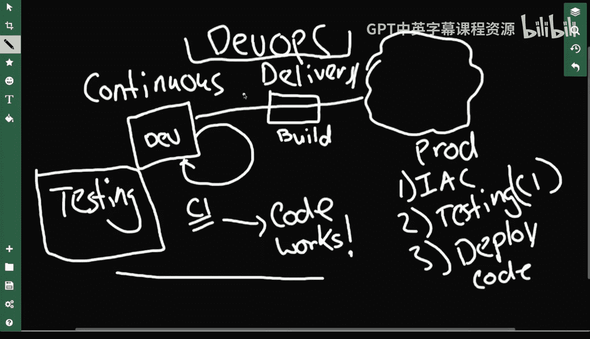
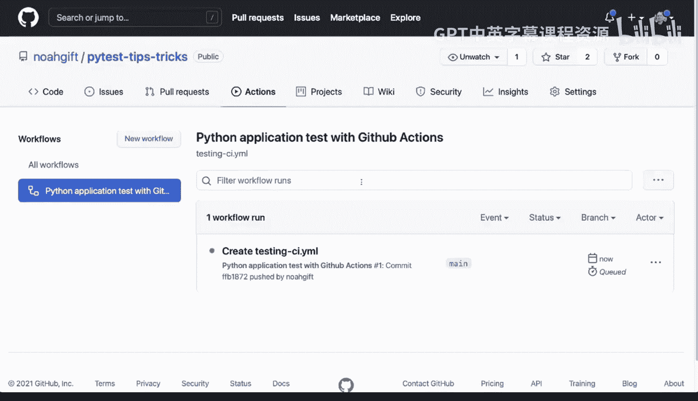
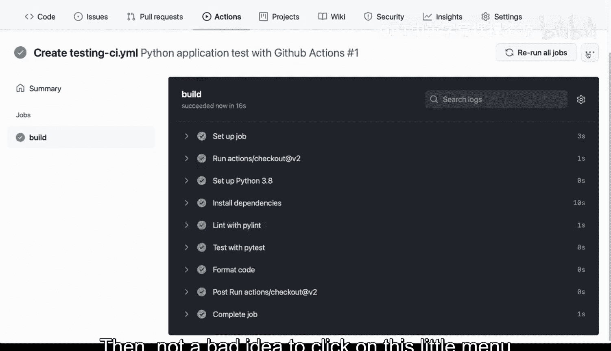
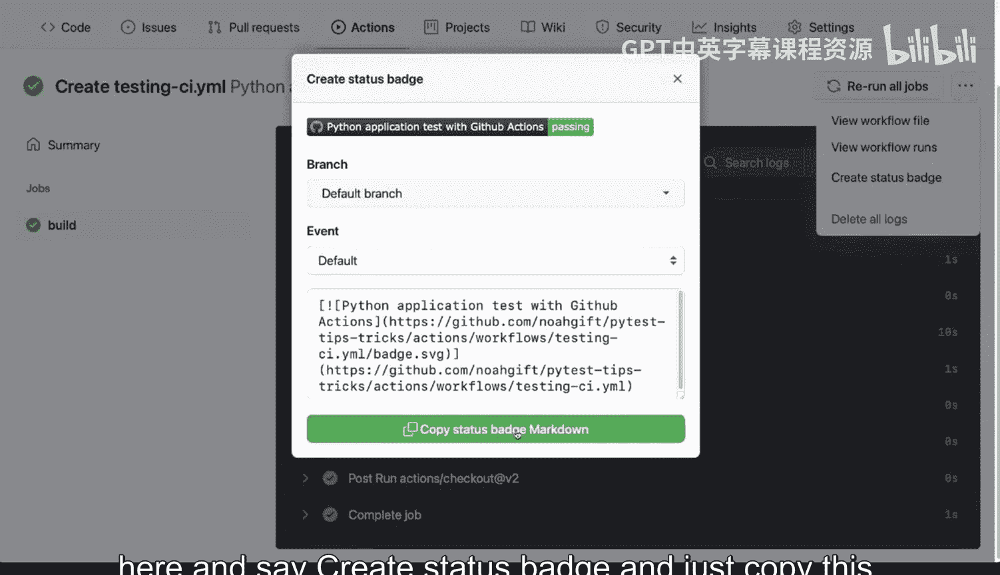
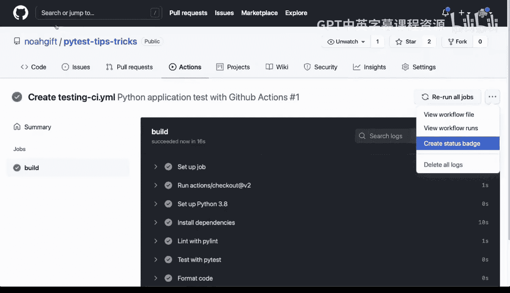
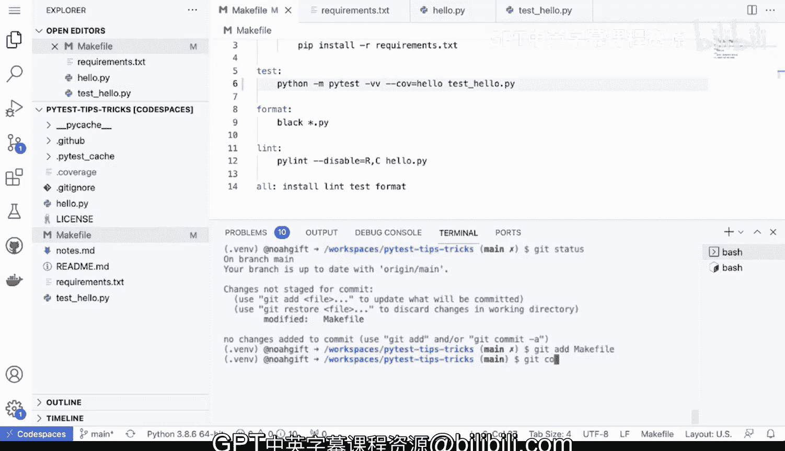

# 应用Python数据工程：3.4：持续集成概述

在本节课中，我们将学习DevOps的核心概念之一——持续集成。我们将从搭建本地开发环境开始，逐步创建一个包含测试、代码检查和格式化的Python项目脚手架，并最终将其与GitHub Actions集成，实现自动化的构建和测试流程。

---

DevOps的核心概念之一是能够自动测试你的代码。这就是一个反馈循环，即持续集成。持续集成的本质是能够知道你的代码是否正常工作。一旦你确认代码在开发环境中正常工作，下一步的关键就是能否将其复制到云端或生产环境中。这就是生产环境。

为了实现这一点，你需要具备几个条件。首先，你需要能够在生产环境中进行复制。这意味着你可能需要“基础设施即代码”，以便定义与开发环境相似的云环境。其次，你需要某种形式的测试，这就是之前提到的持续集成组件。最后，在部署方面，你需要将所有部分整合起来，并将代码部署到该环境中。这可以被称为持续交付。

一旦建立了持续交付，你就能够将这些更改复制到任意数量的环境中。这就是DevOps和测试的强大之处。测试是持续交付的强制性组成部分，因为你不会希望将错误的代码复制到生产环境并导致服务中断。这就是我们关心测试的本质原因：首先让代码在本地工作，然后能够将其复制到基于云的环境中。

我认为第一步是首先让本地开发环境运行起来。我们需要确保能够实际运行任何东西。

## 搭建本地开发环境

大多数人可能从Github或Gitlab等平台开始。虽然还有其他源代码环境，但Github可能是最流行的，我认为它是一个很好的起点，可以用来思考项目的结构。我喜欢使用基于云的开发环境，因为这样可以轻松获得所有合适的工具。在我看来，现在大多数开发者最好在基于云的开发环境中进行开发。

其中之一是Github Codespaces。这是Github的一个功能，与AWS Cloud9等其他基于云的开发环境非常相似。我将在这里创建一个新的Codespace。这样做的好处是，如果你出于某种原因真的想在本地工作，你甚至可以在本地的VS Code桌面版中使用它。但我喜欢这些环境，因为它让云本身承担所有繁重的工作，我不必担心我的环境。现在它对我来说是完全安全的，它已经配置好，加载了扩展，一切基本上都已准备就绪，可以测试我的代码了。

### 创建Python虚拟环境

在这样一个新环境中，我要做的第一件事是创建一个Python虚拟环境。原因是Python是一种解释型语言，为了可靠性，Python需要能够将所有包放在一个目录中。它自带一个名为`virtualenv`的工具。如果我们输入`virtualenv`，会看到这个工具就在这里。然后，如果我们输入`virtualenv --help`，它会显示在这个环境中可以做的所有不同事情，包括创建虚拟环境。这个虚拟环境工具有很多功能，但我们会保持简单，只创建一个新的。一个好的惯例是这样做：`virtualenv ~/.venv`。这样做的原因是它不会被意外地推送到你的GitHub仓库中。如果把它放在主目录下的一个隐藏目录中，这是一个很好的地方，可以避免干扰。

创建完成后，要激活它，只需输入`source ~/.venv/bin/activate`。现在，如果我输入`which python`，可以看到我引用的是这个Python。所以，对于任何Python项目来说，第一步就是获取一个基于云的开发环境。如果你在AWS上，使用Cloud9；如果你在GitHub上，可以使用GitHub Codespaces；GCP有Cloud Shell；Azure有Cloud Channel环境。它们都非常相似。

现在我已经完成了这个设置。一个令人沮丧的问题是，如果我在这里打开一个新的终端，虚拟环境就消失了。这有点烦人。我们如何解决这个问题？幸运的是，我们可以很容易地解决，因为我可以编辑我的`.bashrc`文件，这是这个环境的配置文件。我认为，如果你打算在一个项目中使用这种基于云的开发环境，并且环境和项目是一对一的关系，那么每次打开新shell时都自动激活虚拟环境是个好主意。

所以，我将在这里输入`vim ~/.bashrc`。然后我可以按`Shift+G`跳到文件底部，并在这里添加一个小注释，说明我想激活我的虚拟环境。然后我只需输入那个命令。现在，如果我们打开一个新的终端，虚拟环境就自动激活了。我认为这是一个很巧妙的小技巧，可以为你省去很多麻烦。现在我们有了一个环境，状态良好，可以打开新的shell，这很好。

### 创建项目脚手架

我喜欢做的第一件事是创建一个项目的脚手架。对我来说，一个测试项目最基本的脚手架首先是一个`Makefile`。我喜欢使用`Makefile`的原因是，它可以将许多复杂的命令保存在这里。这将是我在项目中可以反复引用的东西，甚至可以像食谱一样不断积累。接下来我要创建的是一个`requirements.txt`文件，这是一个我可以引用想要安装的包的地方。这确实是我真正需要的前两个文件。然后我们也许可以创建一个测试文件和一个应用程序文件。让我们称第一个文件为`hello.py`，第二个文件为`test_hello.py`。这是一个非常标准的过程，我参与的大多数项目都使用类似的结构。

现在要做的第一件事是，这些文件都是空的，`touch`命令的作用就是创建空文件，它是幂等的，意味着如果我反复运行`touch`命令，如果文件已经存在，它不会做任何不同的事情。这是一个简洁的小命令，可以为你创建空文件。我将转到这个`Makefile`，需要在里面放入一些不同的组件。为了做到这一点，我可以去看看我之前设置的另一个项目，并参考一下。让我看看，我有一个叫做`pytest`的项目。我过去已经创建了一个`Makefile`。让我们看看它，看看是否能得到一些启发。很好，我有一个安装部分，一个测试部分，一个格式化部分，一个代码检查部分，然后还有一个同时运行所有这些的部分。我们可能可以直接复制这个。让我们用它作为我们的脚手架。我将回到代码空间，直接粘贴进去。这就是创建一次脚手架的好处，你几乎可以一遍又一遍地使用它。

现在让我们看看这个`Makefile`是如何工作的。首先，我们会看到，如果我输入`make`，然后输入`install`，它会自动补全。如果我输入`make`加空格加`Tab`，它实际上会显示所有不同的选项。这是`make`另一个非常酷的部分，它会自动给我一个几乎像帮助菜单的东西。这就是为什么我认为`Makefile`对Python开发者来说非常酷。如果你没有使用`Makefile`，开始将它们集成到项目中是值得的，可以节省你很多时间。

### 安装依赖包

现在我们可以看看`requirements.txt`文件，我们需要安装一些能帮助我们工作的包。首先，我认为我们要安装的一个包显然是测试库`pytest`。首先，我们只需放入`pytest`，让我们看看它是如何工作的。记住，这很简单，我总是先检查确保Python打包工具`pip`没有新版本。然后我输入`pip install -r requirements.txt`。让我们运行这个，`make install`。完美。现在我已经设置好了，我已经加载了`pytest`。我如何测试`pytest`是否加载了呢？我可以直接输入`pytest`。我想它只是`--help`。你可以看到它确实在运行，我已经加载了`pytest`。它是一个非常复杂的工具，可以做很多事情。很多测试工具都非常复杂，我可以查看所有可以用`pytest`做的事情。

对于我刚开始一个项目时，我可能还会开始使用其他一些东西。比如我喜欢用`pylint`进行代码检查，还有`flake8`作为替代品。还有格式化工具`black`，以及覆盖率工具`pytest-cov`，它显示我们代码的覆盖率报告，比如实际测试了多少代码。这可能是一个很好的开始，我认为这很合适。我可以再次利用`Makefile`的力量，只需简单地再次输入`make install`。好了，`make install`。

这里有趣的是，安装是持续集成的一个重要组成部分，这可能并不直观，但确实如此。所以，当我们稍后为GitHub Actions设置构建系统时，我们要做的一件事就是实际测试包的安装，因为这是现实世界的情况。你想确保你的代码实际上是可以安装的。

现在我们已经差不多设置好了一切。我们有了运行东西的能力。也许另一个我喜欢用来调试或尝试东西的工具是`ipython`。我认为这会是另一个。让我们安装它，我会告诉你为什么我喜欢安装`ipython`。当我在调试代码或尝试东西时，能够从交互式提示符导入我的模块或其他东西，这实际上非常方便。例如，如果我要测试我的代码，我可能会先在使用模块之前用它来尝试一下。让我们在这里写点东西。让我们输入`more hello`，然后做一些非常简单的事情，比如说`hi`。现在我有一段代码在这里。那么我如何在`ipython`中使用这个呢？我只需输入`ipython`。然后我会说`from hello import`。看，它会为我自动补全，这很好。然后我甚至可以在编写第一个测试之前尝试我的代码。我可以说，好吧，这个函数是做什么的？让我们检查一下，如果我调用它，它会做什么？好的，它返回`hi`。我甚至可以尝试我可能在`pytest`中编写的测试。`pytest`使用`assert`语句，所以我可以在这里输入`assert hi == more_hello()`。这本质上就像是在原型化我的单元测试。哦，太好了，这很简单，很酷。所以，`ipython`是一个很好的工具，我认为它被严重低估了。很好。

### 编写第一个测试

现在我们有了一个测试文件，这很好。让我们继续在`pytest`中编写我们的第一个测试。幸运的是，用`pytest`编写测试非常简单，这就是为什么这么多人喜欢它。这个工具很复杂，但在`pytest`中编写测试却简单得离谱。记住，我们有一个`test_hello.py`文件。我们需要做的就是基本上做和我在`ipython`终端中做的同样的事情。事实上，我可以直接看下面的`ipython`终端，本质上那就是我需要的所有代码。所以我会说`from hello import more_hello`。

现在，我只需要写一个`assert`语句。这就是测试的工作原理。所以我会写`def test_more_hello()`，我喜欢用模块函数来命名测试。然后我只需做同样的事情，我几乎可以剪切并粘贴下面做的同样的事情，然后粘贴进去。我们可以在这里输入`assert hi == more_hello()`。现在让我们运行一个测试。再次看看我们的`Makefile`。注意我是如何测试的：我说`python -m pytest`，并给它几个不同的选项，比如让它更详细，这就是那些标志的作用。然后我就这样运行这个文件。所以如果我们运行这个，我只需输入`make test`。我喜欢在这里做`make test`的原因，你可以看到它通过了，是因为它更简单，只需输入更少的代码，一遍又一遍地输入命令很烦人。你会发现，除非你在`pytest`中做一些非常棘手的事情，否则通常只需将其放入`Makefile`的测试块中，这将为你节省大量时间。

现在让我们看看如果有一个失败的测试会发生什么。那是成功的，但让我们故意制造一个失败。说`test_more_hello_qu`。然后显然它只返回`hi`。如果我们说别的呢？比如`bye`。我们可以在这里输入`more_hello`，它会自动补全。如果我再运行`make test`，我们会在这里得到一个失败。看，它给了我们一个报告，说系统有50%通过了，我们有一个失败。我们可以看到这里说，看，你说函数应该返回`bye`，但实际上它返回了`hi`，我们有问题了。好吧，现在也许我接下来要做的是回到我的代码，说，哦，是的，我还没写这个函数。所以让我们继续写一个说`more_goodbye`的函数。然后，我们会说`return bye`。然后如果我们回到测试文件，我可以直接导入那个文件。我们可以这样做`more_goodbye`。然后我可以把这个改成`test_more_goodbye`。像这样改变。完美，现在如果我再次运行`make test`。好了，我们有两个测试通过了。所以非常直观，它给你这个输出，说，哎呀，我们这里有问题，让我们去修复它。

### 代码检查与格式化

很好，我们已经掌握了`pytest`的基础知识。我个人认为，让格式化和代码检查工作起来也很好。我会称之为最佳实践清单。所以让我们再次检查代码检查是否工作。如果我们用`pylint`进行代码检查，注意我在这里做的是说`pylint`，我禁用了另外两种类型的警告，我相信这在配置中是推荐的。所以我只想看到警告和错误。我注意到，在我看来，这些是我最关心的事情。所以我要继续检查这个文件。我会再次输入`make lint`，因为我想让我输入的内容简洁。好了，`make lint`。现在，什么能让我们测试这个，看看坏的代码检查会发生什么？一个简单的方法是，如果我说`var = 1`，我创建了一个变量，然后在里面，我创建这个，我说`var = var`，做一些无意义的事情。看，如果我做`make test`，测试仍然通过。所以它在语法上仍然是有效的，它仍然有效，只是没有真正做任何事情，这是一种糟糕的编码技巧。你不想将一个变量重新赋值给它自己。所以如果我做`make lint`，现在它会说，嘿，看这个，你不能这样做，你应该小心你正在将变量赋值给它自己。这是一个警告，代码仍然有效，这不是一个错误。它也会捕获错误。所以这是一个会产生警告的无意义代码。我真的相信这对于像Python这样的语言，甚至编译语言来说，捕获警告也非常关键。为什么不听编译器的呢？我认为这是个好主意。

但现在让我们制造真正糟糕的语法。如果我在这里，我也可以说`f =`，然后留空。像这样，这是损坏的代码，这段代码不会执行。另一件很酷的事情是，如果我们做`make lint`，它实际上会显示无效的语法。所以它在这里失败了，说，看，你的代码甚至无法运行。我甚至无法得到警告，因为它甚至无法运行。它就在那里告诉我们。它说第12行。这是`pylint`真正强大的地方之一，它与`pytest`配合得很好，是互补的，或者像`flake8`这样的任何代码检查工具。所以它捕获了额外一层的东西，这些只是有帮助的，你想知道这些事情，尤其是在团队项目中工作。

好的，很好，这个工作了。让我们继续，再次运行`make test`，确保它工作良好。我们会说`make lint`，确保它工作得很好。然后，要获得这种初始反馈循环，唯一剩下的部分就是去格式化，让我们再次检查这是如何工作的。在这个格式化工具中，我喜欢的是它还能解决团队中的问题。当你在公司里与同事一起工作时，一个人想这样做，另一个人想那样做，这可能会非常烦人。如果你使用像这样的格式化工具，它会说，看，格式化工具说这样，所以让我们保持简单，继续使用它。所以如果我说`make format`，好了。现在我们可以看到它只是清理了代码，让它变得更好一点。所以我认为这样做也是个好主意。如果你愿意，你实际上可以把所有这些放在一起，你可以按照你喜欢的顺序链接它们。所以我认为这是一个相当好的顺序，我推荐这个顺序，基本上是在你将代码签入到GitHub之前，为什么不直接做`make all`呢？所以安装你的代码，确保你拥有所有最新版本，你也可以固定`requirements.txt`中的版本，我们实际上会这样做，然后测试你的代码并格式化你的代码。

让我们继续这样做，让我们说`pip freeze`。如果我们输入`pip freeze`，也许通过管道传给`less`，它会显示当前安装的所有版本。我们可以继续这样做，我们可以直接替换它们，我就这样做。我不喜欢直接剪切和粘贴，因为这样可能会把我不需要的东西放进去。所以我认为在这里稍微小心一点我的管理会更好。所以我会说`pytest`和`pytest-cov`。很好，让我们把它们放进去。像这样，这会告诉这个仓库，你正在使用我安装的这个版本的包。这对于测试来说又很好，因为我可以测试我的代码的一个非常特定的版本。然后我们可以回到这里，我们也可以把这个版本放进去。太棒了。好了，我们的包也安装好了，这很好。现在我可以做`make all`了。让我们继续做`make all`，让我们再次检查一切是否正常。好了。所以它会安装我的软件，检查我的软件，测试我的软件，格式化。我认为这是开始你的项目的一个很好的方式，我个人高度推荐它。

### 集成GitHub Actions

所以让我们进入下一步，让我们推送这个代码。我会说`git status`，然后说`git add .`。然后我会说`git commit -m "adding initial layout of Python project"`。完美。好了，现在我要继续推送这个代码。很好。

现在我已经在这里设置好了这个初始结构，我们可以开始看下一个层次了。那就是，如果我想使用除了这个环境之外的其他环境怎么办？例如，假设你的公司使用AWS、GCP或Azure，那么你该怎么做？有几件事我推荐。一是如果我们回到这个图，记住这个想法是你在本地测试，你的代码工作正常，这很好。但你也希望有能力部署到其他环境。所以这就是构建系统发挥作用的地方。构建系统基本上将是守门人，允许你在使用之前再次检查一切是否正常。

因为我们还没有设置构建系统，在我们解决这个问题之前，先不要进入云环境。我要做的是转到GitHub。我要回到我们的仓库，然后设置这个。所以让我们继续，说`pytest tips and tricks`。现在我要转到这个叫做“Actions”的部分，这将是GitHub Actions构建系统。构建系统只是运行你的代码，并允许你对其进行测试和部署，这确实是它的本质。GitHub Actions是较新的一个，而且因为它集成得很好，所以非常出色。我个人是它的忠实粉丝，我认为它很棒。关于GitHub Actions，有几点需要指出。这些工作流允许你做诸如使用Anaconda、使用`Makefile`（我刚刚展示给你看）以及发布Python包等事情。所以，如果你想成为一个开源软件开发人员，你可以这样做。你也可以使用其他流行的服务部署你的代码，比如Azure ACR、ECS、GKE等。这些都是使用它的好例子。此外，还有一些更抽象的例子，比如标签器或给某人分配任务。有很多很酷的东西。我认为一个好的起点是自己设置工作流，它基本上给你一个非常粗略的结构，你可以用来尝试东西。

既然我以前做过这个，我要做的是，实际上打开一个新标签页，再次复制一个我以前的版本。我想我有一个GitHub Actions的例子。我有一个之前做过的，看看布局。它是`.github/workflows`，然后有一个YAML文件。你可以在这里看到一个非常简单的使用GitHub Actions测试Python应用程序的例子。我们会说在推送时运行这些步骤。我们甚至可以指定操作系统。在这种情况下，它将是Ubuntu最新版。我们甚至可以指定Python版本。然后我可以告诉它做我刚刚在本地做的同样的事情。这真的就是全部，只是做同样的事情，但在云端的某个地方运行它，并确保在进入下一步之前一切都经过验证。所以让我们继续尝试这个。这看起来正是我想要的。让我们复制这个。然后我会把这个放到这个文件里。事实上，我们甚至可以称这个为`testing_ci.yml`或类似的东西。然后我们可以直接点击开始。这很酷，一旦你点击这里的开始，它就会开始运行我们的任务。我可以看到它在运行。所以它会执行所有步骤，它会先安装，然后检查，然后测试，然后格式化我们的代码。

很好，这看起来很不错。到目前为止，一切顺利。看起来我们状态良好。我们让所有东西都运行起来了，它甚至在这里显示了每个步骤，这对我们所有的代码都很好。然后，点击这个小菜单，说“创建状态徽章”，然后复制它，这不是一个坏主意。然后我们可以回到我们的项目，也就是这个项目。然后转到`README.md`文件。可能把它放在顶部，我们可以有我们的测试徽章。所以我们状态很好。我认为我们唯一没做的是，我要说`git pull`，这样我就能得到我刚才做的所有东西。但我们也没有做测试覆盖率标志。为了做到这一点，我们只需要在这里稍微调整一下。我相信我们可以查一下，实际上，我通常就是这样解决问题的。我只是说，`pytest-cov`。它在哪里，如何在命令中使用它？你只需说`--cov`。就是这样。这就是我需要做的全部。所以我要做类似的事情，回到这个仓库，我们只是添加一个小标志。我们只是说，在这种情况下我想覆盖什么？我只有一个非常简单的项目，叫做`hello.py`。让我们继续这样做。让我们再次运行`make test`，看看是否能得到覆盖率报告，`make test`。好了，现在我们有了覆盖率报告，我们有100%的测试覆盖率，这并不奇怪，因为这是一段非常简单的代码。然后说`git status`，`git add Makefile`。好的，让我们提交这个，添加覆盖率报告。

---

在本节课中，我们一起学习了持续集成的基本概念和实践。我们从搭建一个基于云的Python开发环境开始，创建了包含虚拟环境、`Makefile`、依赖管理和测试的项目脚手架。我们实践了使用`pytest`编写和运行测试，利用`pylint`进行代码检查，以及用`black`格式化代码。最后，我们将这个本地工作流与GitHub Actions集成，实现了代码推送后自动运行的构建和测试流程。这套流程确保了代码质量，并为后续的持续交付打下了坚实基础。