# 杜克大学《应用Python数据工程（3课全）｜Applied Python Data Engineering》中英字幕 p44 44_04_06_构建持续部署的容器化FastAPI微服务.zh_en -BV1nz421i7KP_p44-

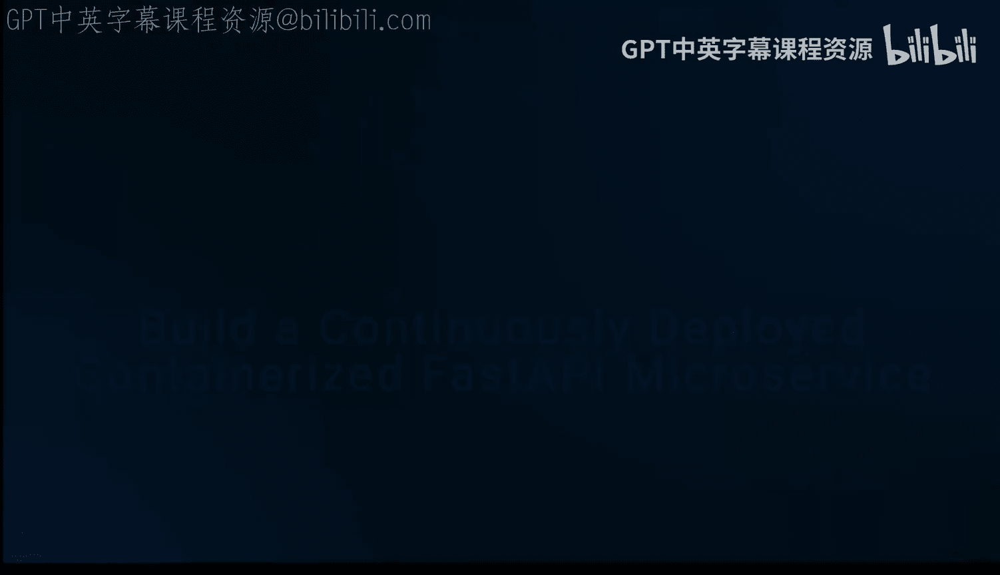

And in order for us to put this。Into production， operationalize it。What we would do。😔。

As we would need to build out a few other things， one。

 we would need to build a Docker file to containerize it。And two。

 we would need to build a web app as well。In this case， I'm going to use fast。APpiI for that。

And then once we have those components。We can push this into the cloud。

And AWS has a nice development environments called Cloud 9， I'll go ahead and use that。

And in addition， I can use a service called apprunner。

Which is a nice service that works with containers on the AWS ecosystem。 So really。

 this is the logic of building a pre existingist piece of code。 In this case， we have an NLP library。

And we're going to take that and turn it into a web service。Alright， so to start with。

 I'm going to go over to AWS。And。😔，Inside of EWS here。We've got cloud 9。And cloud 9 is。

 is pretty cool， because。It allows us to build out。

Things inside of the environment that eventually will， willll be running。

 So the operating systems the same， you know， the context is the same。 The roles， things like that。

 So I'm going to go ahead and put this N LP。Web。Service。Vast API。

And we'll put it a little description here。 This is for building out a containerized。Con raised。

And continuously。While I'm having spelling issues today， I continue。I'm， I'm。Early the morning。

There you go， continuously perfect。呃。Continuously。Deployed。Fast API。There you go。😔。

And I'm going to make it kind of a beefy machine， because。

I will do a C5 x large because I wanted to build containers。I'm going to use Amazon Linux。

 go ahead and see next step。

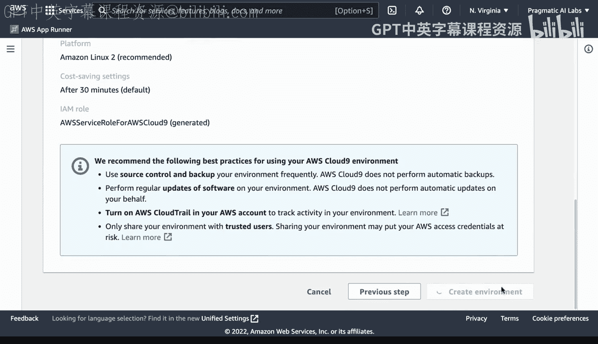

The only real。Integration step necessary to to work with things as I need to create SSH keys。

And send those to Google。To a Github， which is gonna be pretty easy。

So I'll let that run for a second。 I mean I guess I can even tee up。GitHub。

 I'm going to need to go to here。

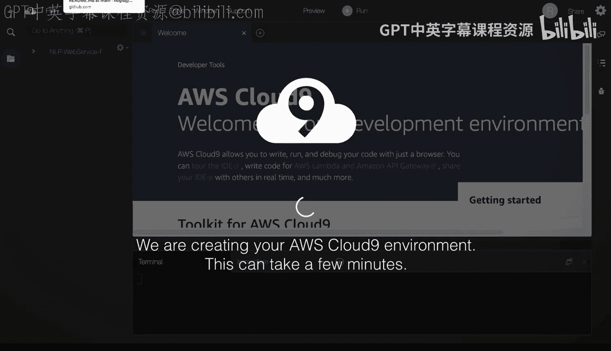

And go to settings， SS and GPG keys， new key。 So I'll kind of get this ready。

 and we'll call this cloud 9。Nl P。

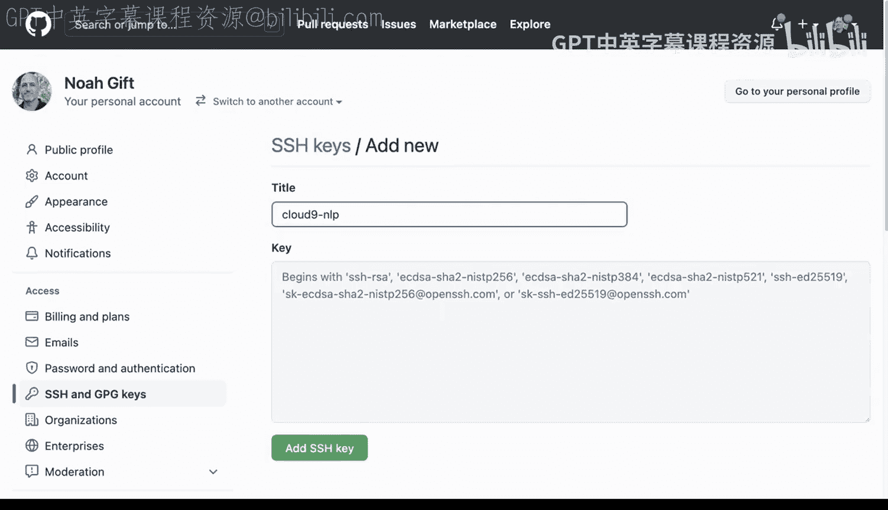

And then once this thing wakes up。There you go。 Now I can just close that， get this thing going。

 and I'm going to immediately type in S S H keygen dash T RA。 So this will build out。S SH keys。

 and then I can。嗯。Put those into Giub。 And this just allows me to connect to my。

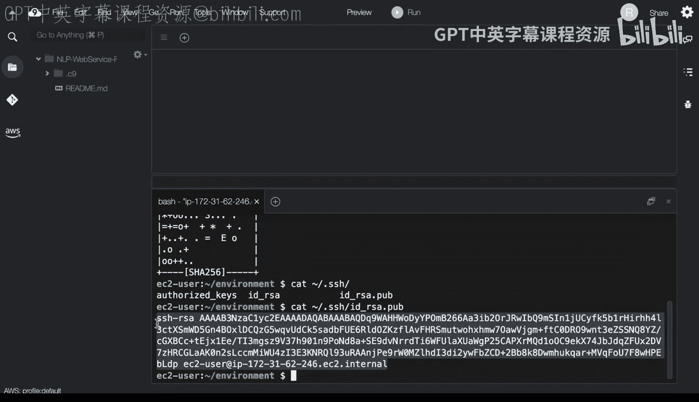

Reippo。There you go， Add the key。Okay。😔，I gotta do this real quick。GitHub。There you go。

So those addedd。And now I just need to go to my。Project。Here and find the repo， Good repo。

And find local SSH， grab that。And then we can put it in here。

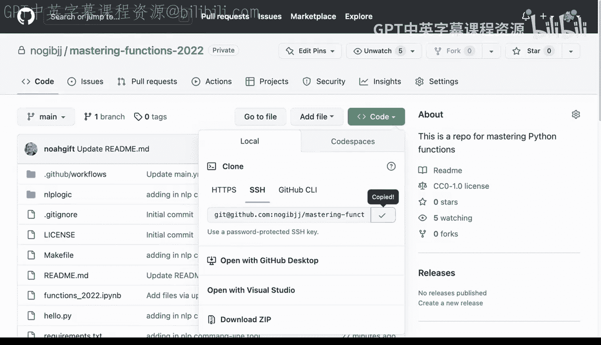

So now I can just say get clone。Cown it inside。Do the same thing I did in the other place。

 make a Python virtual environment。 So we'll call this Python。And。V， E and V， tilde dot V and V。

It's slightly different in vocation， depending on the operating system。 This is based on Cto S。

 So they use Python M D V E and V。 I'll do the same thing， though。 I'll just add it to my bash R C。

 just make things efficient。There we go。And' say source。V E and V。Ben。😔，Activate。Okay， got that。

I can do the same little trick， right， I can just say。New terminal。There we go。 It's。

 now we've got that running。And if I see the into mastering。functions， we've got all of our code。

 And so we can move pretty quickly here that the things that I would do immediately would be to。

 to make install。In fact。If we look at this， there's an all。 Look， I can do all that。

 so I can even add a little step here that says test。And then format。So if I going and make all。

It'll just do everything。 It'll just。Do an installation。

Kind of and then just kick the tires on this thing a little bit。

 Make sure that there aren't any surprises。 Always a good idea when you're moving to a new environment。

To run all the things that we did earlier that made it reliable。

So this is the advantage of testing and liine and continuous integration as it's less work。

 not more work。 There we go。 Awesome。 We' got everything cooking here。

 It did a little bit of reformatting。😊，Which is nice。 I guess I could。

Just handle this right now real quick is just say get add star， get status。 Let's add that change。

The changes get committed。Adding changes。We can be sloppy on this commit。 We don't care about that。

 Okay， now all I need to do is create a docker file。Like that。

And we also need to create a web service。 And so what I can do is kind of go through my Github here and find like fast API。

 I'm sure I got something laying around that's kind of similar。

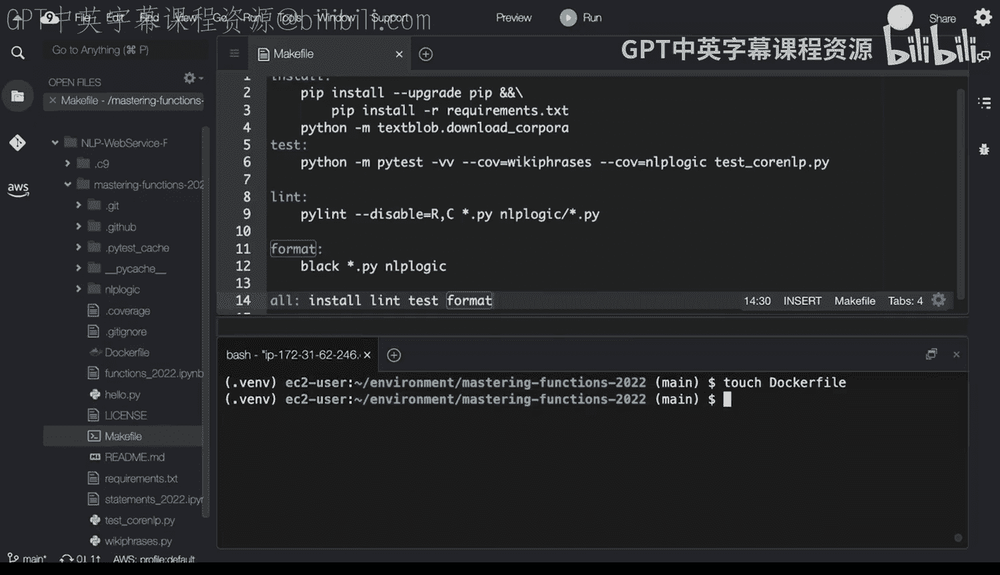

Here we go。 from Pyth。 That looks good。 Let's， let's use that。

Always a good idea to have templates of code laying around。

Because a lot of it of， of coding is boilerplate。 So in this case， I'm going to use。

A base image here doesn't have to be Lambda。 but it in this case。

 the Lambda is kind of a slim down version of Amazon Linux。 that's good enough。

I don't know if actually， there's a Python 3。

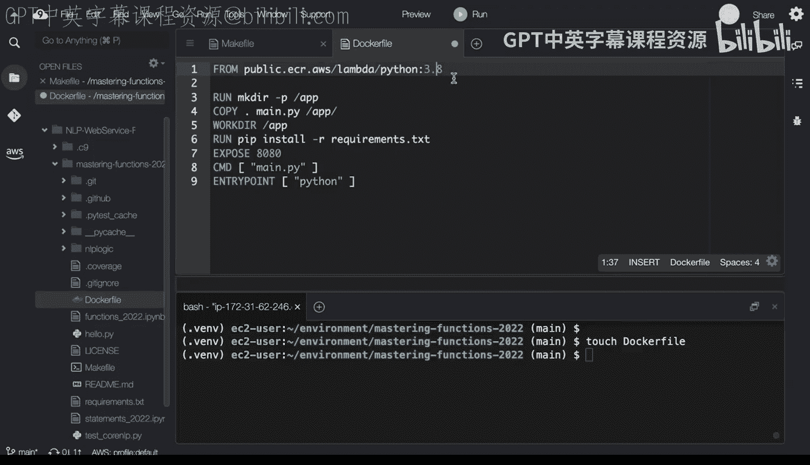

9 available。 We could look real quick。 Let's， let's find this。Is that。Linux。Let's see is， I there。

Fters。Let's find lambmbda。Lamb de Python。Verified。H sort by。Popularity。Here we go。

 This is the one we care about。Python 39， so we'll use Python 39。

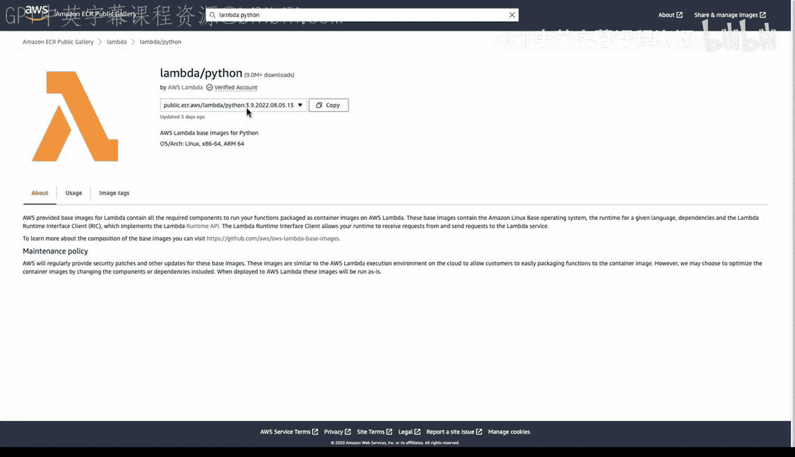

Always nice to see little changes like that， so Python 39。Wo， whoops， Python 3，9。

 So we're going to make an app directory。 We're going make a file called main copied in there。

 We're going install of our code。 and then it's gonna to run like this。 So kind of an easy。

 easy process to， to get this containerized。So I'll go ahead and create that file called main WPY。

And then I again， can just look at my other project here， steal some code。

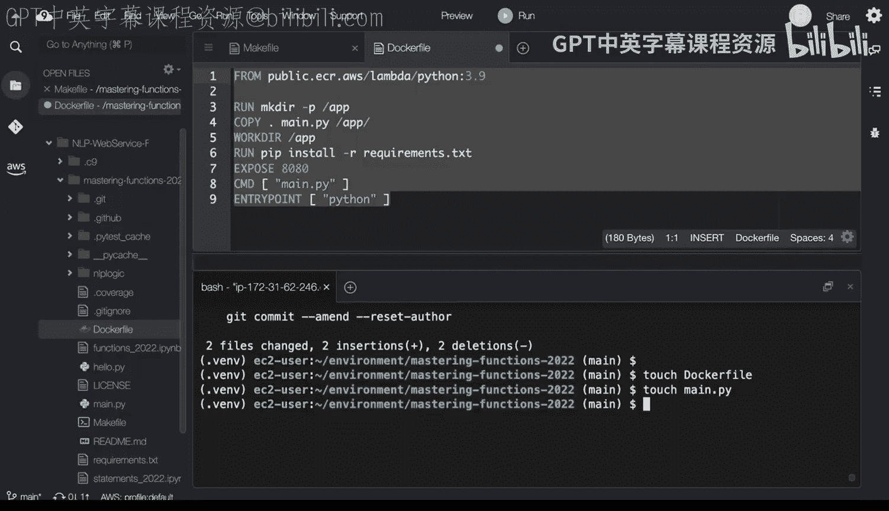

Not that one。 This one， still some code here。I probably have a main。 There we go。 There's a main。

This looks pretty good。And let's。

Work with this template。Okay。So， from here。One of we gotts is we have fast API。

 UCn is the framework that serves it out。And for this， we'll just say hello NLP。

And then we need to build some logic and we also need to import things in the right way。

 So how do we know what to import？ Well， this is where the command line tool comes in handy。

Because we already built a nice little kmean tool， it tells us what to import。

We just need to do that。 so let's go ahead and do that。Right。And now we just need to change this。

Into。嗯。What is going to actually pass in。 In this case， it's only going to need to pass in。A string。

 And we'll call this。A。Well， it we'll call this。Wiki phrases。And we'll call this name。Like that。

 and we'll call this。Wiki phrase。😔，And then we'll call this name。😔。

And I believe we can just do STR for stir。And well say。嗯。Generates。Phrases。LLP。Noown。

Phrases from Wikipedia。Name。😔，And now we， we don't have to do much again， because。

Of the fact that we've already done a lot of the work。 And so we can say。Phrases like that。

Or noun phrases like this。 So it's going to return this payload。And then。We， again。

 can go to our logic here。Look at the library， see how it works。

We just need that we need a little piece of code。So。We do that。 We say gift phrases name。Looks good。

 So total， total。U。Let's make a little more readable and say， phrases。Even noun phrases。And I guess。

 if we wanted to。B。😔，I forgot with fast API logging。

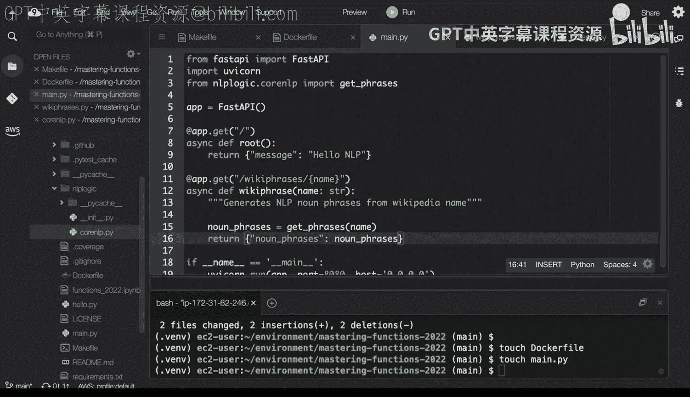

Fast API。Log。Logging in， what， how do they want you to do that。That's。

I want something the simplest as possible。And what have they got here？Okay， blah， blah， blah， blah。

 blah， debugger。嗯。Hm。Let's see if they have logging in in here somewhere。 Let's look for log。Meュ。😔。

Printnce about print。嗯。Prince， let's just do a print for now。 If we need it， we can do fancyr stuff。

 but we can add a little print statement here that says like， you know。

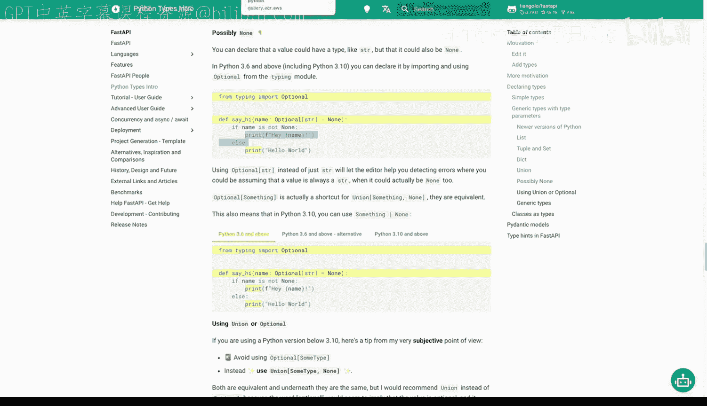

嗯。Past in。Yes and this just gives us some debugging for when the endpoint is actually called。

 So that looks good。 I think we got everything cooking。 Let's also update the make file。

And let's add。Another one， which is Dajesh。Cve equals。Man。And then we'll also links。😔，Okay。

 that length will get caught。 So let's just， let's just do a make a。Make lint here。😔。

Although we need to add as well， the requirements。We need to add。

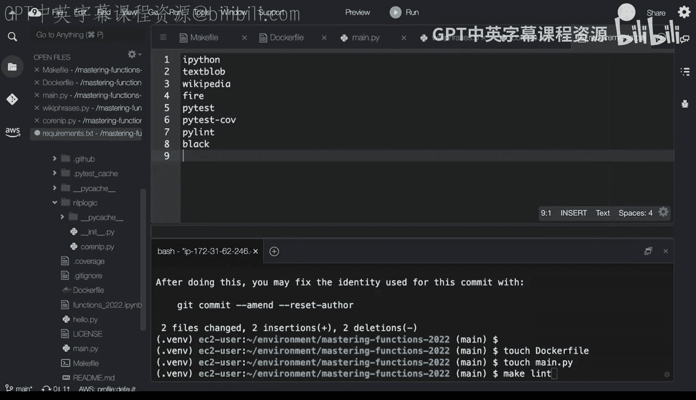

Fast APII。 and in fact， let's look at how I imported it before。I had。

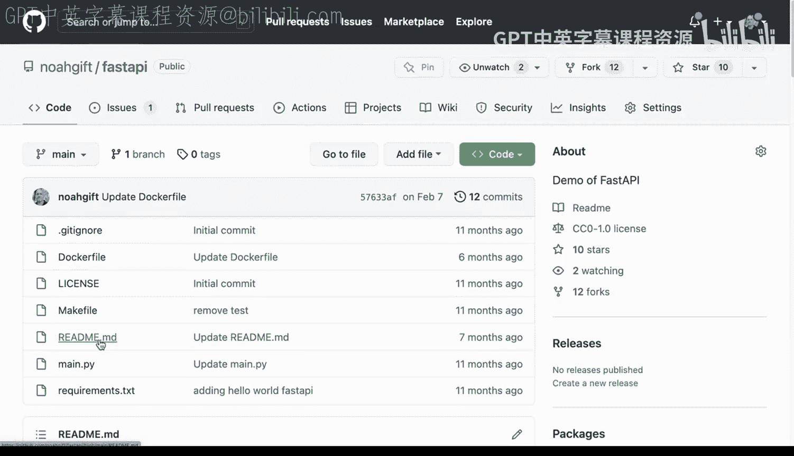

Require， here we go youve aorn。Ubicorn， there we go。 So we got this Ubicorn standard， all this stuff。

 So let's do， I mean， I guess， just make all。That's probably the easiest way to do this。Okay。

Looking good， right， so in theory。This could work by doing Python， main up P Y。Whoa。

 looks like it' it's cooking。Now， in the other thing that you can do in cloud 9 is has it has like a preview。

And， I forget。The preview URL。😔，There's a way to do it。Here， where you can。Where you can see it。

 but let's see if this works。U。Preview on any application。 Oh， I guess it works。

 So we got this thing cooking here。And then。If I wanted to。Well， that's actually a pleasant surprise。

 And if I want to test it out， if I'd go to the end， we know that。We can close that。

We can close that。Close this。We can close a Docker file that there's a， there's。

 there's a root default that says hello NLP。 And we also have the Wikipedia phrases name。

 So we just need to put in。Wikipedia。And then， the name， again。Now。

 this is something I didn't think about。But we may want to have a single。Username Wikipedia。

 So let's， let's go to Wikipedia real quick。

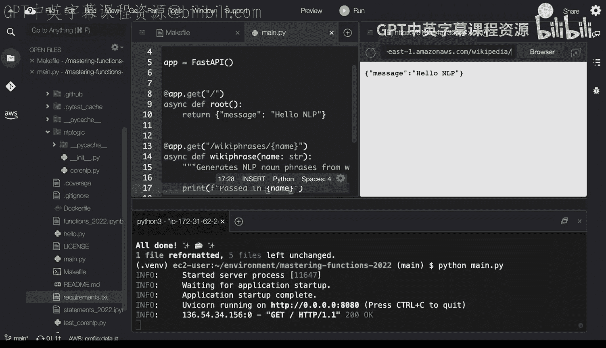

And let's go here。<|OTHER|>And let's just go to Wikipedia。Unless just find like a， I du'n know。

 like Lakers or something， something really simple。

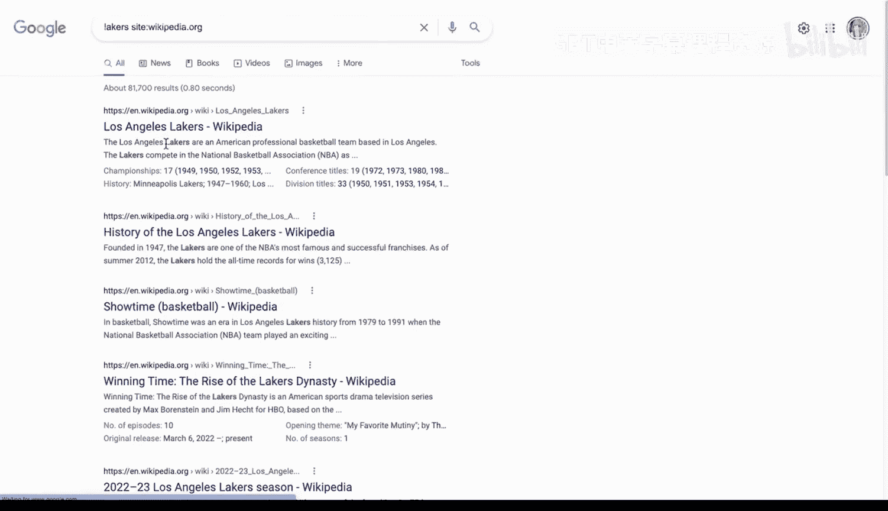

So it looks like I'll I would have to put in an underscore when I put it in。 I mean。

 we can make this fancier in the future， but。Just wanted to double check how they handle it。

 So L A Lakers well， didn't find it。Okay， well， let's see。Oh， because。I need to do。

Wiki phrases first， wiki phrases。There you go。 Well， that was ridiculously easy。

 almost too easy to get that working inside of fast API now。

One other really slick feature of fast API that I'll just show real quick。Is that it also has。

The the the swagger， which is， in a sense， kind of a killer feature， I think it's docs。 Yeah。

 here we go， docs。And what's nice about this is that I can just click on my my endpoint。And look。

 we have the documentation， and it's pretty much ready to go for someone。

 and we can click on try it out， and we can do the same thing。 L A Lakers execute。There we go。

 We got this thing。U。Cooking。😔，And server response。 There we go。 Look at this。

 We have a full functioning Web Web service endpoint。 So we've made an incredible amount of progress。

 Let's go ahead and。😊。

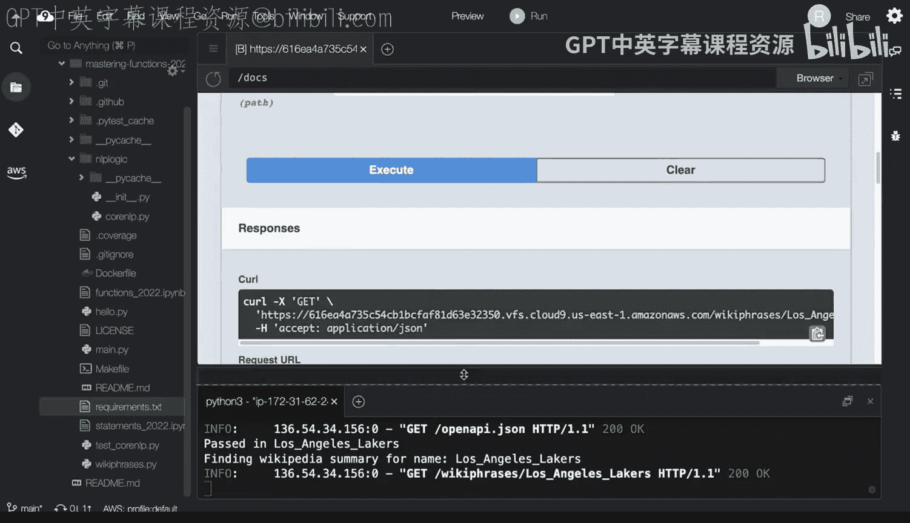

Let's commit this。😔，So we'll add all this stuff in。

Now the part to deploy it to AWS is actually not too bad。

 So what I'm going to do is I'm going to let's did I push that or I didn't push， let's say get push。

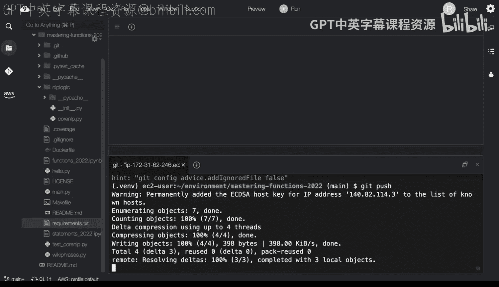

Okay， so to deploy the AWs， what do we do， Well， I can just go to the console again。

And I'm going to go over to something called ECR。

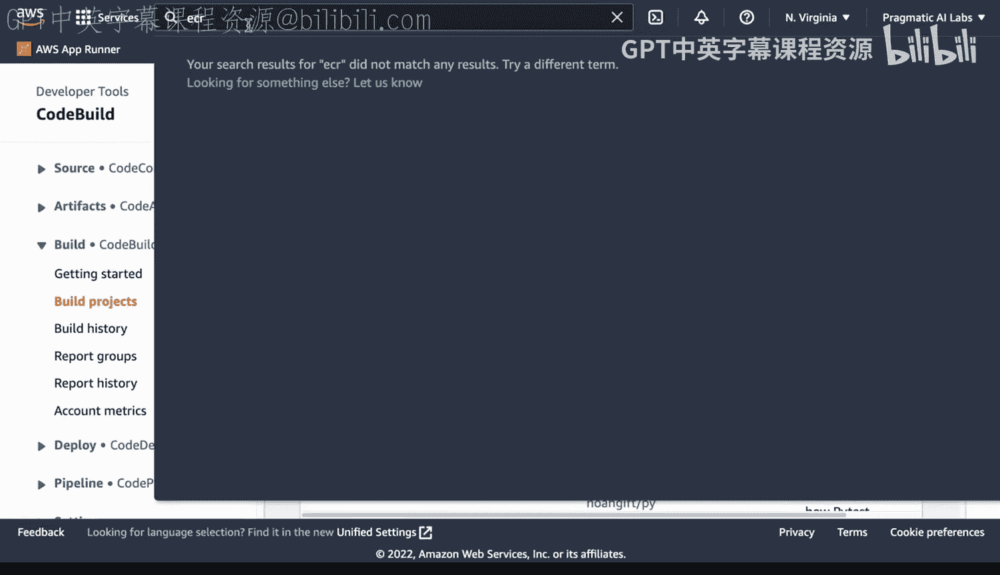

And let's go ahead and do that。嗯。Let's find。View all services。😔，And we can go for。ECcr。😔。

Let's find it。Con。Service。Container， here we go。 elastic container registry。

So the way this will work is that I will。Push a container。Into this repo。

 which will then trigger a build with AWS apprunner。 So to do that first。

 I create a repo and we'll call this N LP， Wikipedia。Fast API。And go ahead and create this repo。

Now to push it。Not too bad。I would just go to。😔，NLP Wikipedia right here。

 and I look at the view push commands。 and I just need to paste these in to cloud 9 because I already have a role that gives me the ability to use things。

 I can do that。 So I'm going to go ahead and copy and we'll go through and。

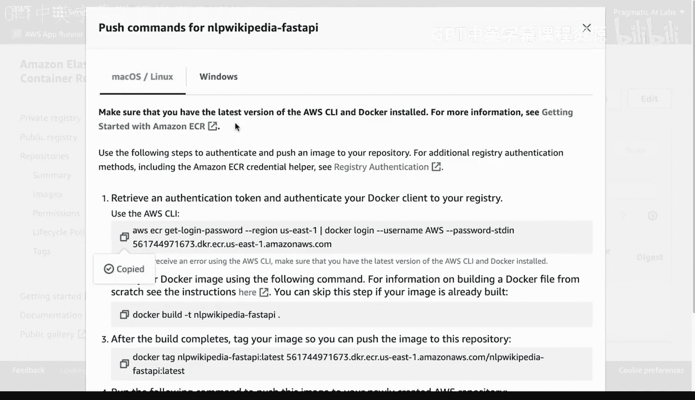

Do this。Let's get this login。This will authenticate me perfect。 Next step is build the Docker image。

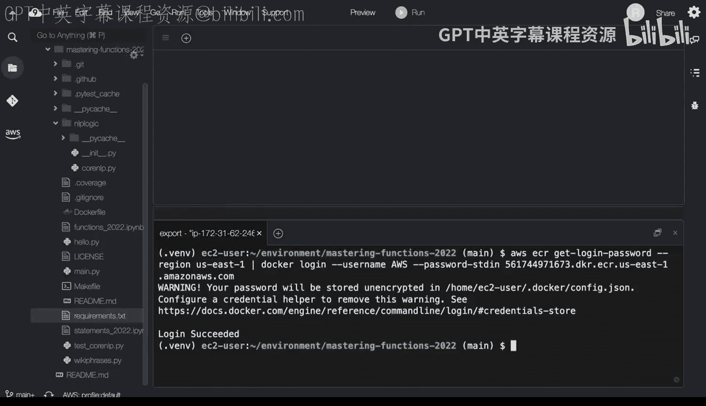

We can go ahead and do that。

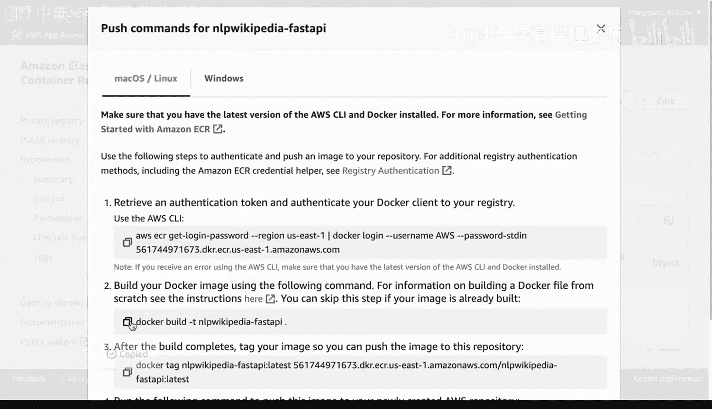

This is why I wanted a powerful machine so that it would。Wouldn't take as long。

And so this is just going to build the local container so that once I've built it。

 I can push it into the ER。 So it's installing the software。Looking good。Okay， it built it。

 There's our tag。

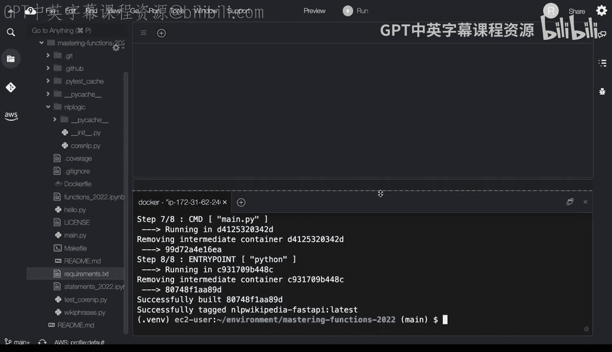

Then， I'm going to。

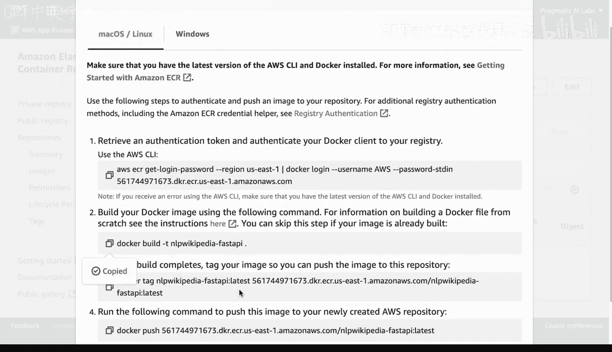

Tag it。Or there， there's our。We， we can。 We can tag it again， actually。

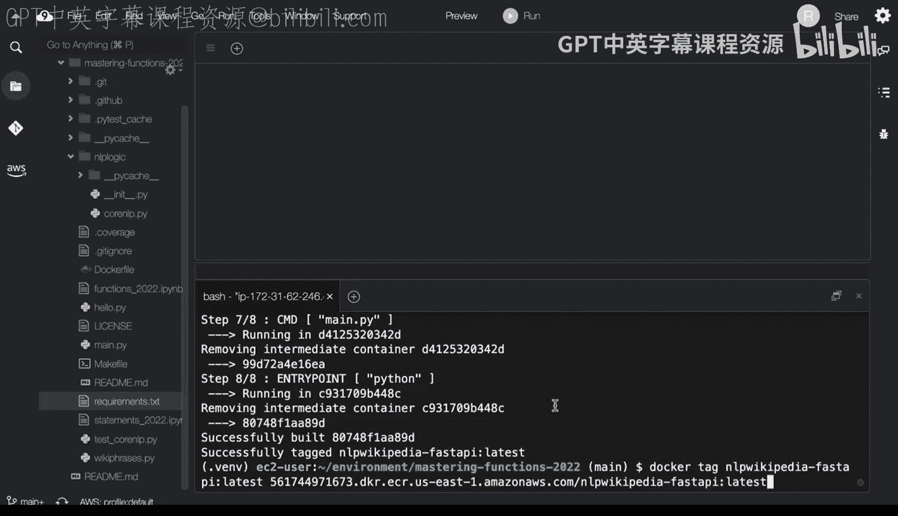

嗯。And then we want to push this。

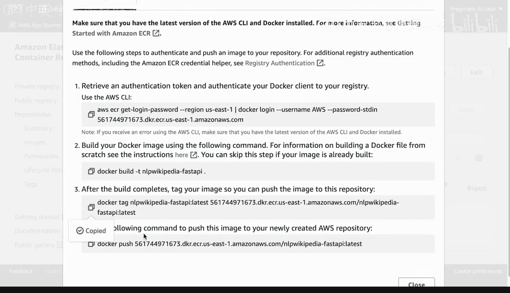

So again， this is where a bigger image is nice。 So it it's moving pretty quick。And。There we go。

And as this is pushing。I'm going double check。

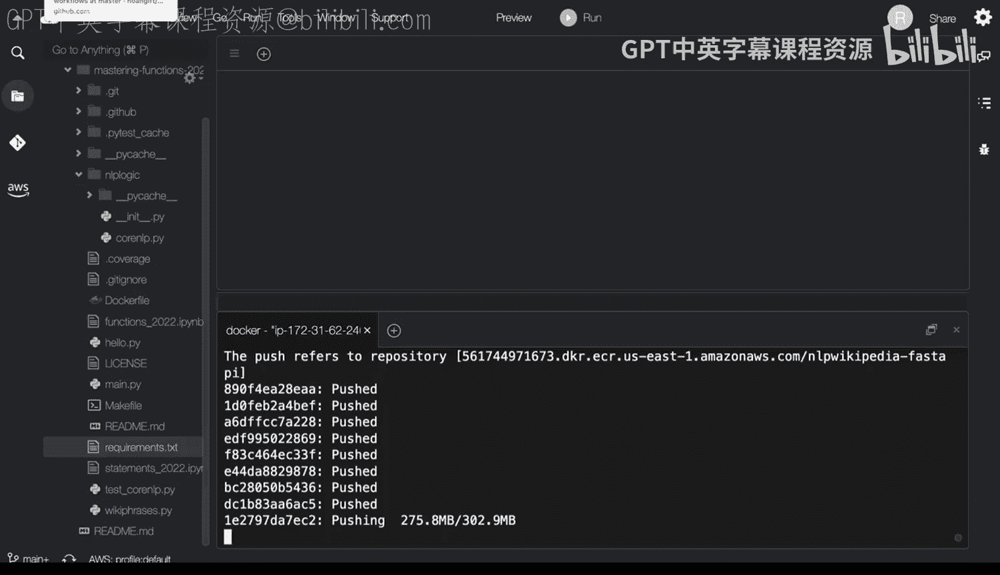

That。This repo， going to make this public。Real quick。And。Let's make this repo。Po request。😔，よし。

There we go。😔，Public。Type this。There we go。Allright， this thing is now public and。ECR。😔。

Is been pushed。 So if I refresh， we got an image。Now comes the fun part。

 So the really cool thing about AWS is they've really done some amazing work here。😊。

Is that we can go over to apprunner， which is right here。

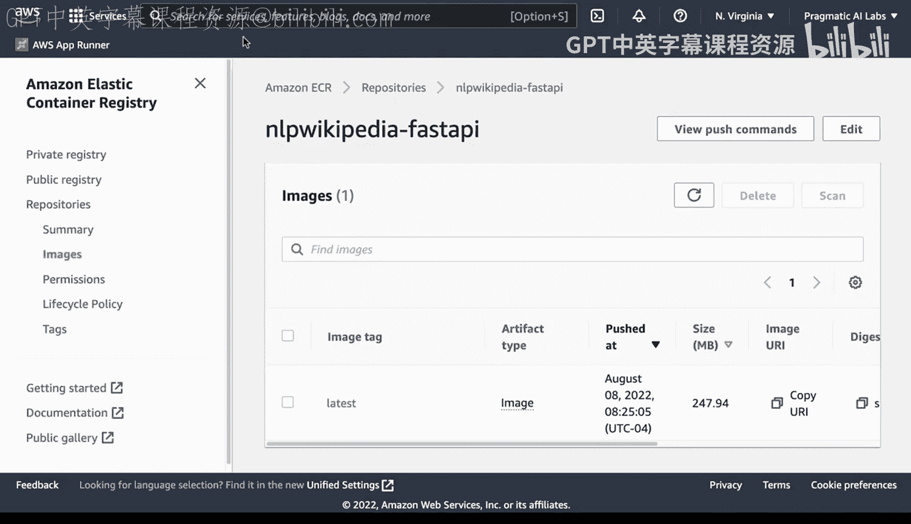

And all we need to do is just point to that image。So。😔。

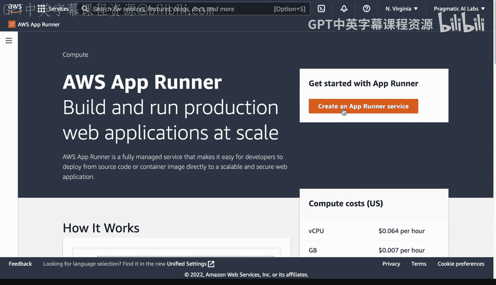

Aint a a srunner。We can say， look， listen to a container registry。And I want to use Amazon ER。

 and I can go here and just browse for it。And we can just find the one I just created。Which is NLP。

 Wikipedia fastt APII。And then for deployment， there's a couple different options。

1 is manual 2 is automatic。 The automatic is pretty slick because it means that if I wanted to push a new container every time I made a change to the application。

 like， for example。I， I added a new。Web service endpoint。The build system， if I hooked up。

 let's say AWs code build， which is similar to Github actions。

 it would go through and automatically push the change。 So this is definitely， I would say。

 in most cases， probably what people want because I'm doing a demo。

 I'm going to leave it here for manual。And then， in this case。You know。

 you would create a new rule if you didn't create one already。And we'll call this service name NLP。

Wikipedia。Fast API。And then you can configure whatever requirements are available for your application。

 This needs to map what is exposed in the container。This 8080。

 and then there's additional things that you could do like start commands， etc cea。A。In this case。

 because there's a container， I don't need to do anything， you could even configure。

 you know custom auto scaling。 in this case， it'll go up to 100 concurrent requests。

 which for a demo is fine。And you could do health checks， security networking。Observability tools。

 Let's try that。And then。We can go to next。And all we need to do now。Is do a crate into de Bo。

So this will take a few minutes to deploy this service。

What's what is amazing about the I apprunner as well is that it gives you a full HPS URL。

 So in this case， look， we see this is going to be available for us。

 It even shows us the link to the source。And also you can see here some of the capabilities so we have logs for the system。

 including the event log， deployment log logs， logs so we can see like the create service application logs。

 so like if I was adding more interpretationational logging that would show up here the activity which show us where we're at。

 the metrics which show us things like requests， HtP 200s， HtP， 400s， HtP 500 right these are errors。

And then we also can go to observability， right， because I turned it on。

 We can look at the service map， and it will show us like。You know。

 stuff that's that's associated with this application。Also， configuration。

 It shows us all of the information。 So really， it's a kind of a one stop shop for building a。

Ind to end， production quality， web service。And it's containerized as well。

 which makes it really useful to actually hook things up to because my container is going to be able to run exactly the same way as this is running locally。

 so。Maybe that's one thing to， to demo real quick is that。

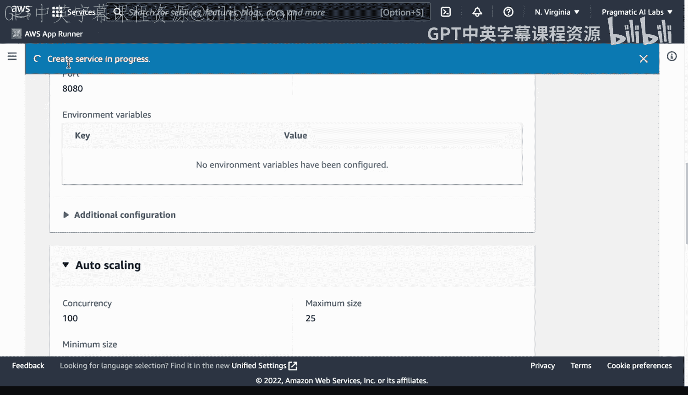

While this is finishing， if I go here。We can also just do the same thing locally。

 because if I type in Docker image Ls， you'll see that。 in fact。

 this is that Docker container that I built。And so。What I can do。

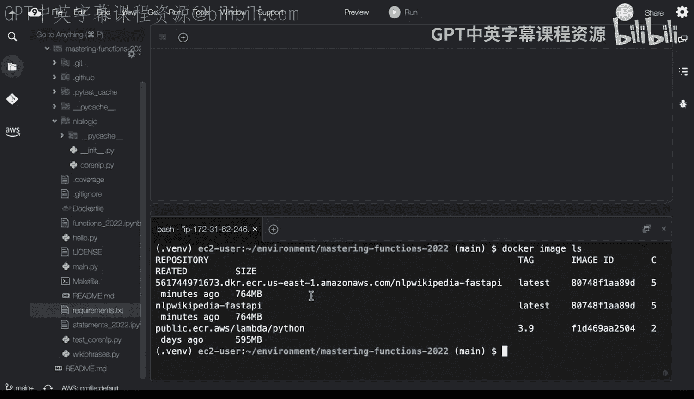

Is I think I have the commands handy here。Is we would want to run something like that。

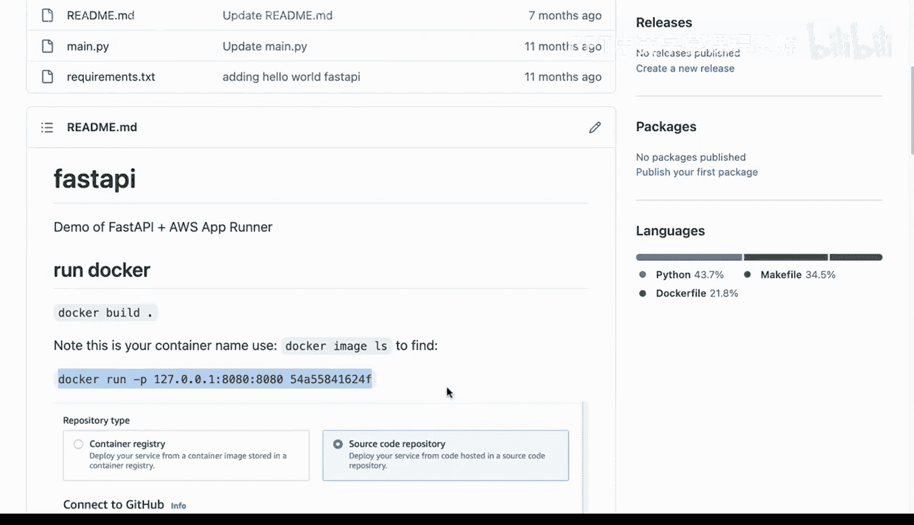

Right is we would just do a Docker run command。So let's go ahead and try that。 So the image I。

 so let's paste this in。And then， the image I D。Would be。This。So let's go ahead and run it。

There we go。 And you can see it's， it's。Able to do exactly what the application server will do in the future。

 and again， our friend preview。If we go through here， it should just work。 Yep， it just works。

 There we go。 Hello N LP， and we could do all the same things that we would。Be used to doing before。

 Go to docs， right， We can go ahead and take a look at that。 So， so containers are， I think。

 are definitely。The future for web services in particular， it doesn't make sense not to use them。

 whether you use Kubernetes or not， that might be a more of an open question。

 but in terms of containers， there's just a lot to like about it because it puts the runtime alongside the code。

 which now allows you to have a more robust deployment story。And this is definitely the case here。

 and we can see her Docker run right with the with the image Id。

The other thing to be aware of is that we could even。Do Dockerlin， add some additional steps here。

 Let's just double check that we've got everything checked in。 So we have a few changes。

And so we'll go ahead and commit these changes， say adding。Docker file。Like this。

 we'll go ahead and push this。Okay， so we got those changes pushed。

And there is actually a tool called Docker Ltz。

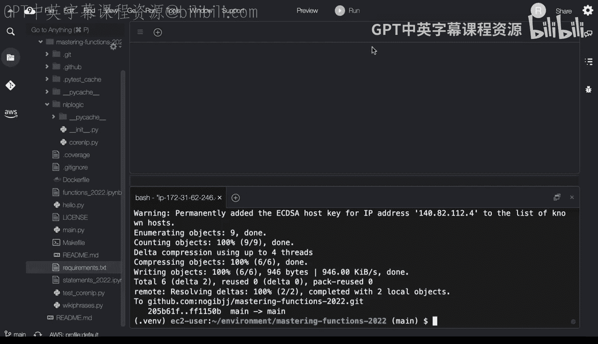

Which is kind of handy that we may want to just take a look at real quick。Is Do。 Ltz。Yeah。

It's called Hadowlin and so this is a neat little tool。Because。It will allow you to。

Just do this command。 Like you can just run docker run。So basically， you can use Docker。

With a lint tool to test a docker。 So， so it's a little bit meta。Here。

 and let's go ahead and and refresh here。 And so if we do this， it's going to pull the image。

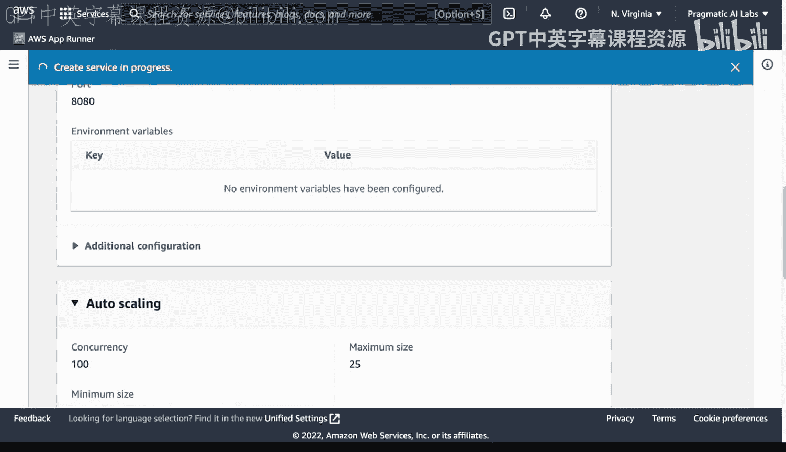

And。Warning， avoid use of cash director use Pip install。 no cash。

 So there's a warning that maybe we care about。Inside of here。 So it says what used no cache stir。

Okay， sure， let's try that。 Let's go to。Docker file。And let's change that。Ppen store。No castor。

All right。There we go， so it did give us some helpful information。And。😔，In theory。

 that might work in GitHub， I haven't tried it， but it might be worth considering and I'll just put this into the make file。

And do this as like a kind of a nice to have， maybe。For running a Docker Lint。

 we'll go ahead and say get status。Get add Docker file。Also， we want to save the make file。

add big file。Adding optional Li。For Docker。Okay。Now， if we go back to apprunner。

 our services available exciting。 So how do we use it， just click on on the button。 There we go。

 We see it's actually running， which is pretty awesome。😊。

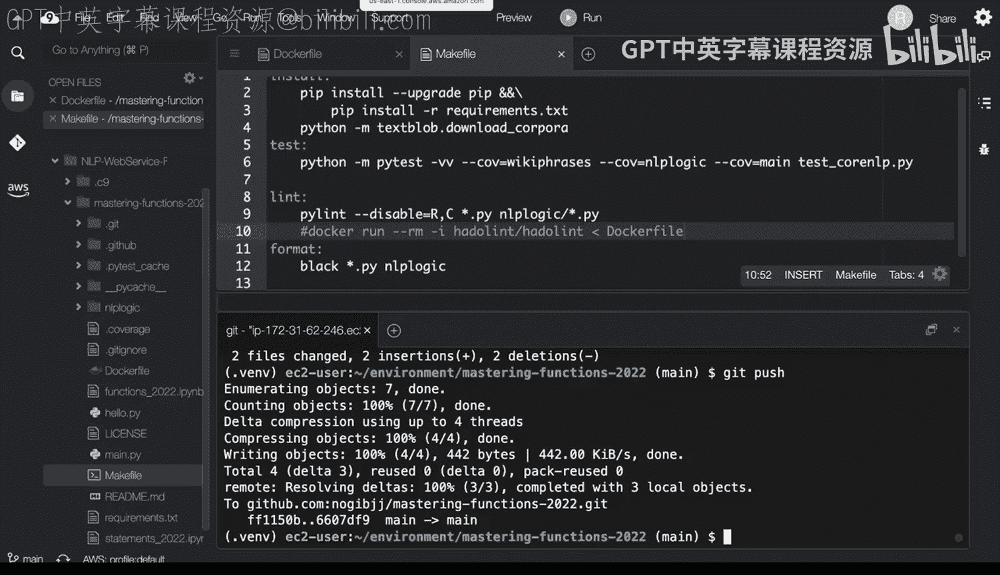

And in fact， I can go through here and just do docs。There we go。

 And now I can actually play around with my production web service。 I just go to Wikipedia phrases。

 try it out like if I was going to build an open API for people， you know。

 this would be a way to do it。 Let's try golden State Warors。

Why keep misspelling that and go execute。It didn't like that。Let's do Los Angeles Lakers。

 Los Angeles。Lrs。Yeah。What happened here， So internal server error。Nam string。Yeah。

 h not sure why that's not working。

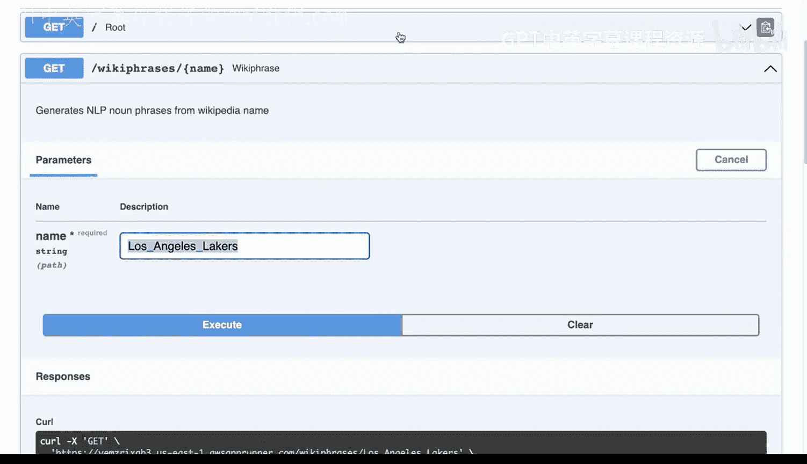

But let's double check on our， on our other side。 So let'， let's go back。

 Let's run our docker container here。This is always a nice way to test things out is like。Wait。

 does it work here， So let's go to preview。Preview in any application。Let's。Go to。😔，Docks。

Let's drill through here。And let's try。😔，Try it out。Let's go to。Los Angeles。😔，Lrs。What do we get。Oh。

 here we identified an issue， which is， in fact。A problem， which is awesome。

 We figured out a bug here so。What we need to do is we're missing this。And so pretty easy to fix。

Let's well， actually that's good。吃么喽。😔，To fix this。F new。Where is my terminal here。😔，Run。

But the bummer of the terminal is kind of hard to find。😔，Wow， it's like completely hidden here。

Where is this terminal。Window new terminal， there we go。 Wow， that's that's。

 that's brutal to find that。 And let's just say PS SS EF， I think Docker's running。

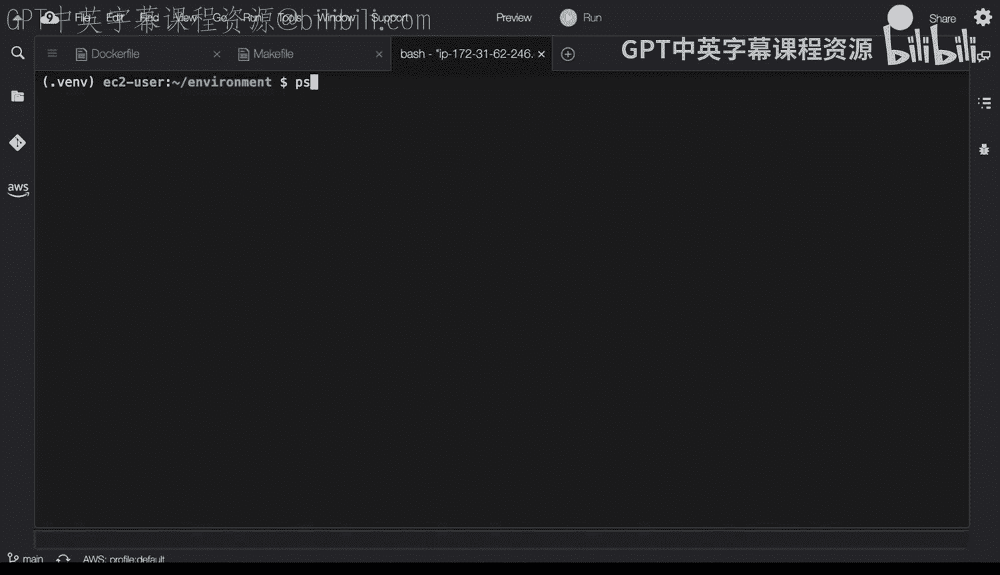

Yes， we need to kill it。Let's kill this。Yes。嗯。There you go。 Let's kill all these。

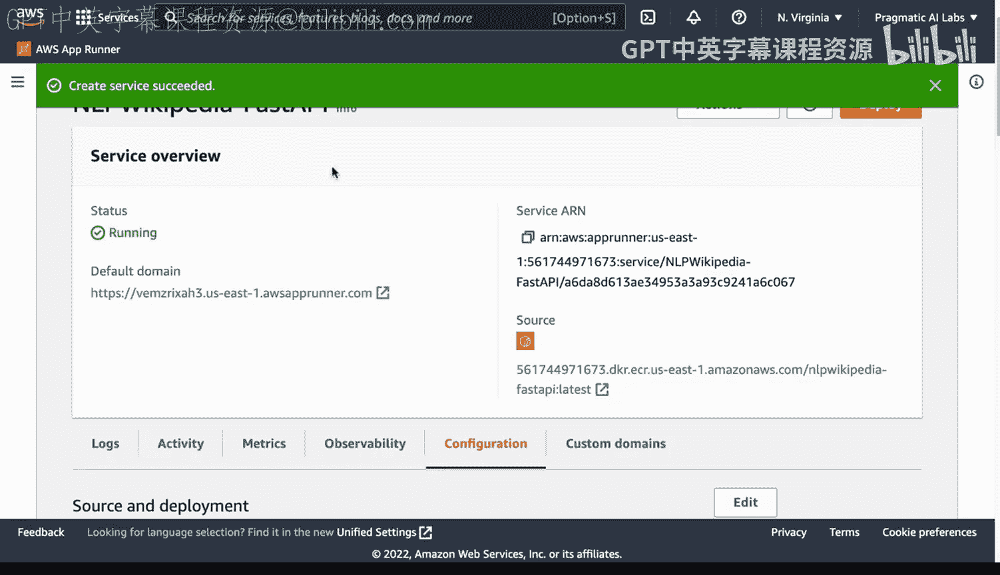

Kill this。Looks like they're gone。 Okay， so， so I， I see what the issue is， is that。We need to。

We need to actually tweak the Docker file。A little bit。And so what we could do is。We can say run。

And just run that command in here。And I think it was this command。 that was。It was。

 if I remember correctly。If I say Docker， run again。We can find it。And if we go to preview。Now。

 the window。This window。Wenwei。😔，Which is annoying。😔，Which， certainly。

Makes it a little bit more difficult to debug， but I think it was this。 Here we go。 I don't need。

 I don't need that right now。 so we can we can stop this。 So all I need to do is in the Docker file。

 put in this command。Like that。And then now that we've got that changed， I should。

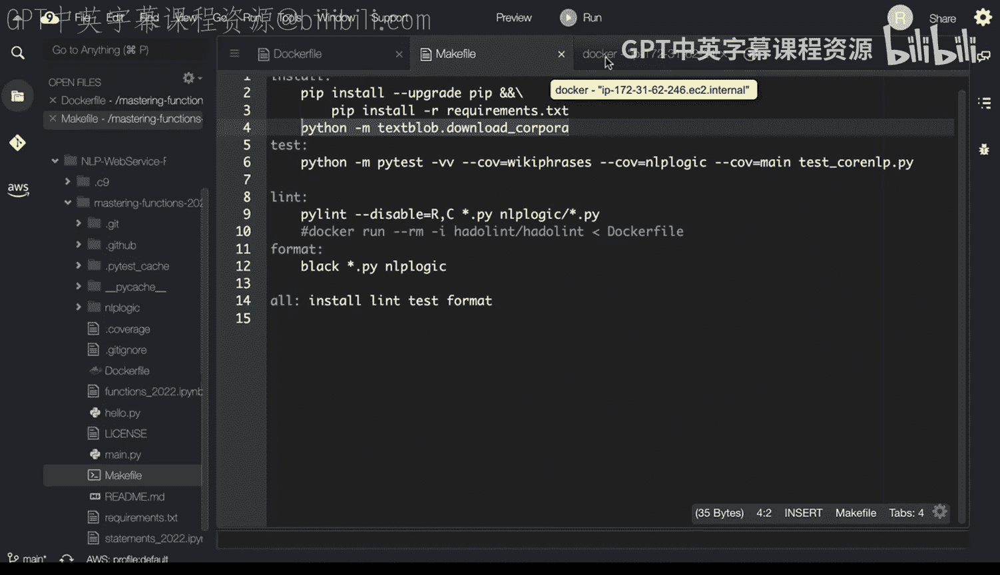

Be able to go back to my AWS ER repo。And let's just look at the commands again to rebuild the container。

Which would be here。😔，And let's look at the push commands。 So let's build it again。

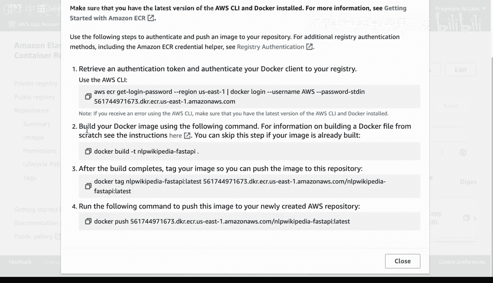

In this case， and this is actually a perfect example of why a build server。Could be handous。Oh。

 we need a CDdN2， this repo。Okay， I'll build it again。

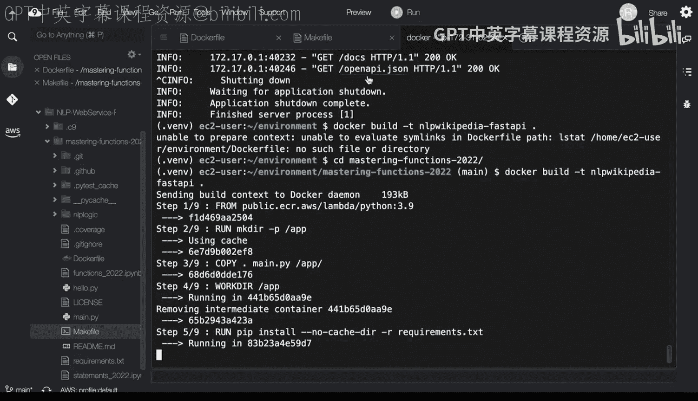

This timeless double check that that works。Looks good。There we go。

 So now we see it's loading that corpusence out of there。Let's tag it， just like it says。

And then let's push， and then we can do the final command。

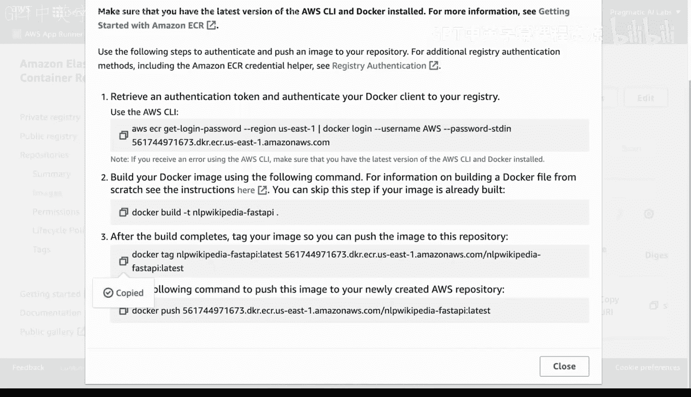

Okay， so now that it's pushed or once it pushes。Because we didn't set up the auto to deploy it。

 which in hindsight actually would have been kind of cool。 We need to just manually trigger it。

 So if we go back to here， we just need to go here and just say deploy again。

 And what it'll do is just grab the latest container， which is the one we just updated。

 So let's again， just take a few minutes to update。

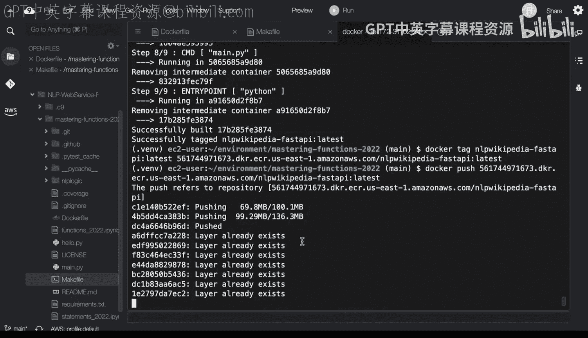

So while that's updating。I will。Put this。Here。Okay， so this will take a few minutes to update。

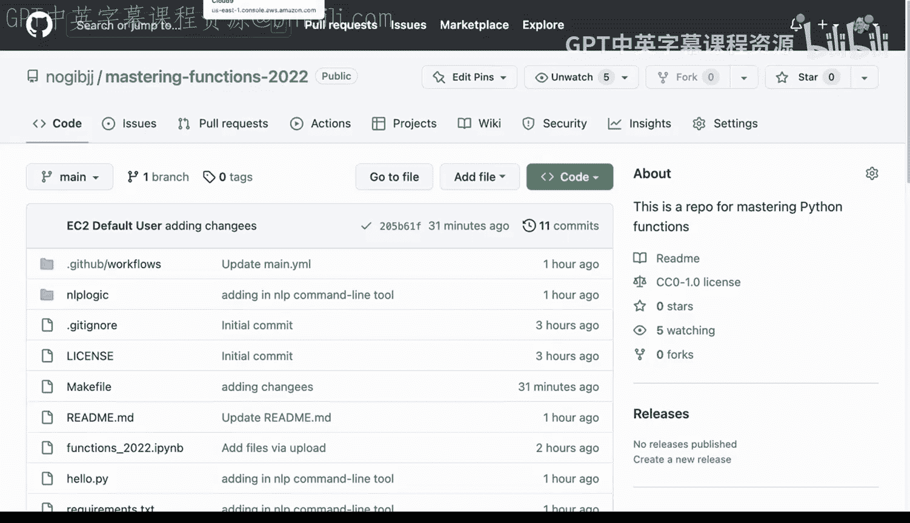

What I could do， though， is why it's so annoying that。That this thing went。I mean。

 I guess that's okay， I can still see things。But the， the other window is kind of annoying that it。

like， I must have closed。Something that I needed。Oh， maybe that's what I want。 There we go。

 That's what I wanted。 Great。 Okay， so it's， so it the view console。 I must have。

 I don't know how that got unselected， but I should be able to test this， right， because if I do。

Docker while's doing the ploy。Image L S。I should be able to do the latest one I just made。

 which is this one。And lets， let's go ahead and do uparrows。There we go。

 So let's take let's run it locally。Let's go to preview。Preview any application。And now。

 this would be。The moment of truth。Is。If I say gis， and I put in。Try it out。

 and I do L A Lakers loss。Angeus。Lrs。Does it work。

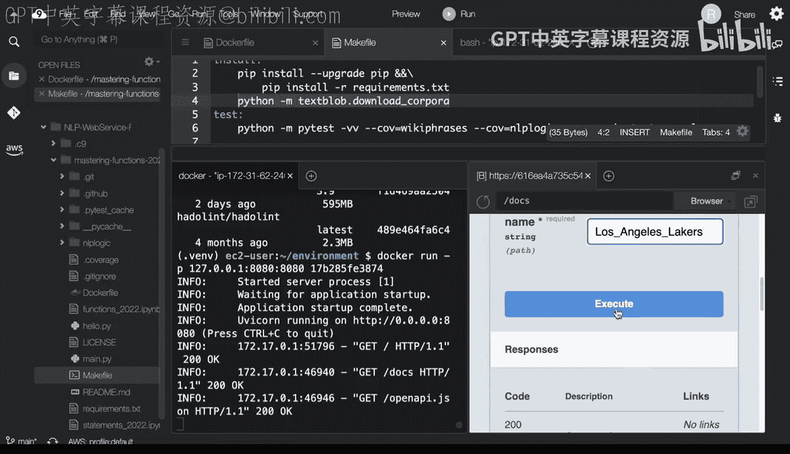

It's doing something。There we go。 So that was it。 That was， that was a bug。

 It's actually better to do a demo where there's a bug and you fix it， to be honest。

 So that was the issue。 We pushed the change。And in fact， we have some nice print statements here。

 too， right， Like I put the print in。 So that is actually helpful to add to add those。

 And so when this thing finally does a deploy。Here there we go start deployment process。

 We should have that fixed。 So let's go ahead and give it a second。

Let's actually look at this observability I've never played with it before and see what that does while we're waiting。

And so。No node selected。Hm。Set up demo a。Services。Yeah， I guess I don't see。Anything yet。So I don't。

 yeah， maybe I just don't know how this works。And then under logs， we can， we can also look at logs。

 We should have seen the errors like， so this was when it went through a deployed。

 We see the create service。 now the application logs。Aha see， look， we even see。 it says， hey。

 what are you doing， We didn， We didn't do the N N L T N L T K。 and we need to。

 we needed to do the the。The import。 And that was the issue。

 And we were able to see that everything was working。 It just didn't have the right corpus loaded。

 So that is really， really nice about apprunner。 So this would take just a second。

And we can even look at the。The the activity here。And it's in progress。

And I think you can see this from the deployments。

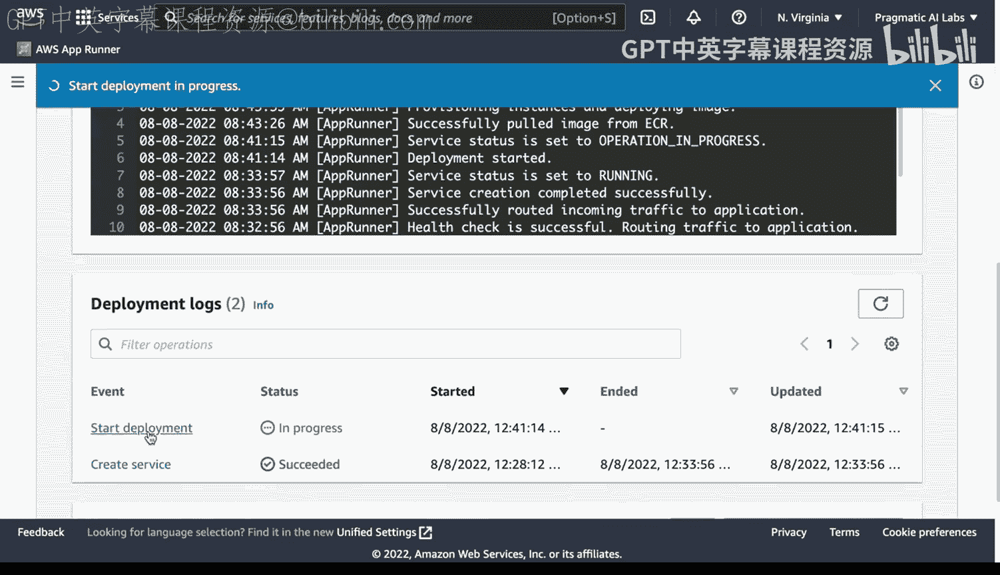

Logs， there we go。 starting to pull your image。 So it's pulling the image。

 and we can even look in Cloudwach。

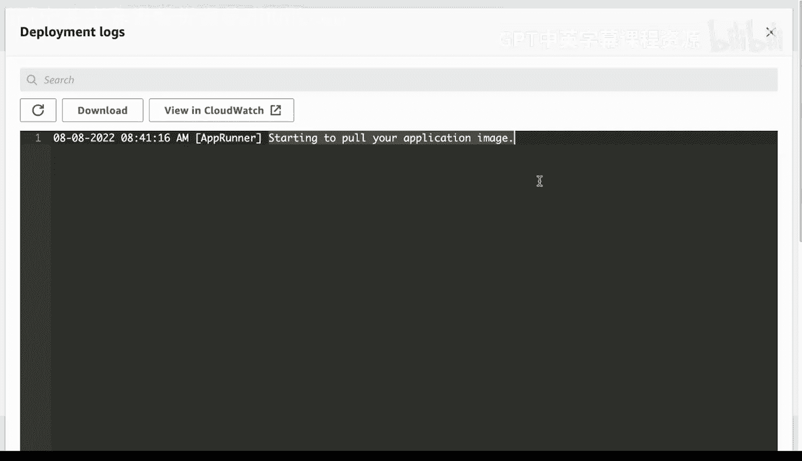

Even watch。This thing build。And you can just retry and just kind of watch it depending on how。

Auto retri。 we， we want to do auto retry。 so we， we can even sit here and just watch it。

Completely as its's building， building things out。So we got a couple different views inside of here。

Still pulling the image。So yeah， I would say one thing about the apprunner service is the deployment isn't necessarily like super quick。

 it does take a little bit of time to deploy things。

I guess another thing we can point out is that custom domains here。

You could even link in a custom domain， which is pretty neat。So again。

 you can build a microservice that has pretty much every professional aspect to it that you would need to just in this one service。

So we'll give this thing a little bit more time。

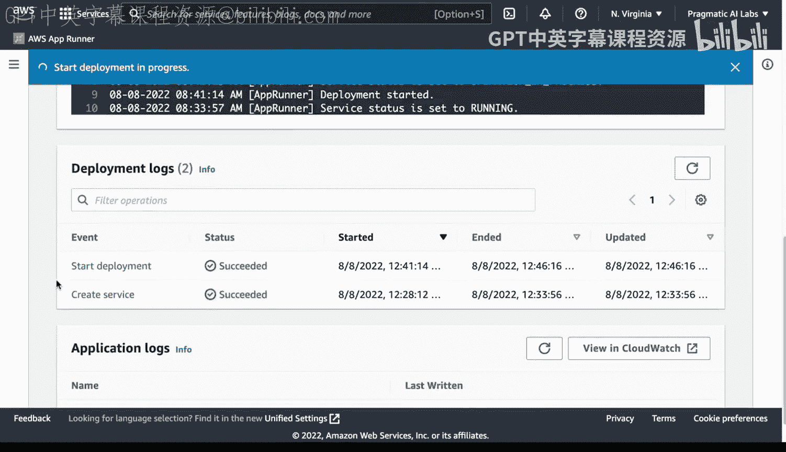

Oh， there you go。 Start deployment play it。It's pullingine finished。 Oh， that's good。

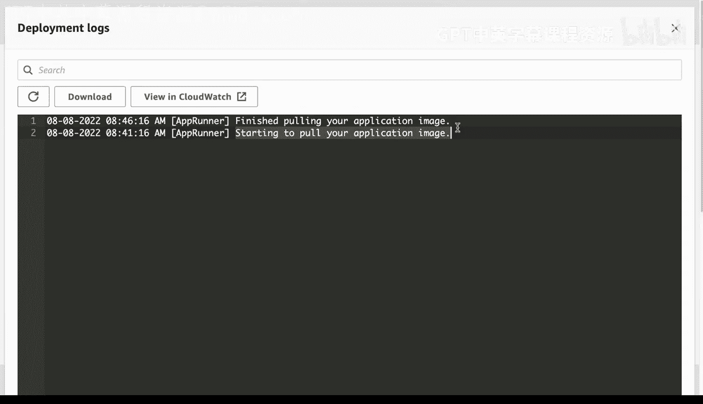

So。It should be getting closer。We can look at the logs。Okay， finish pulling the image。There we go。

 It succeeded now we can test out our application。Exciting。Let's go to Docs。

Let's go ahead and try this out。Los Angeles Lakers。

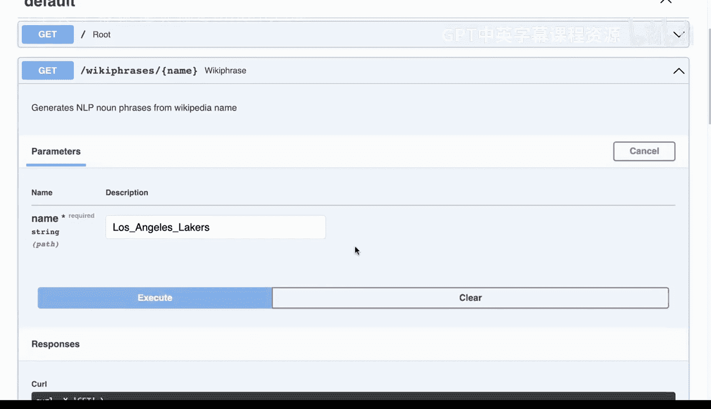

There we go， full working production system。